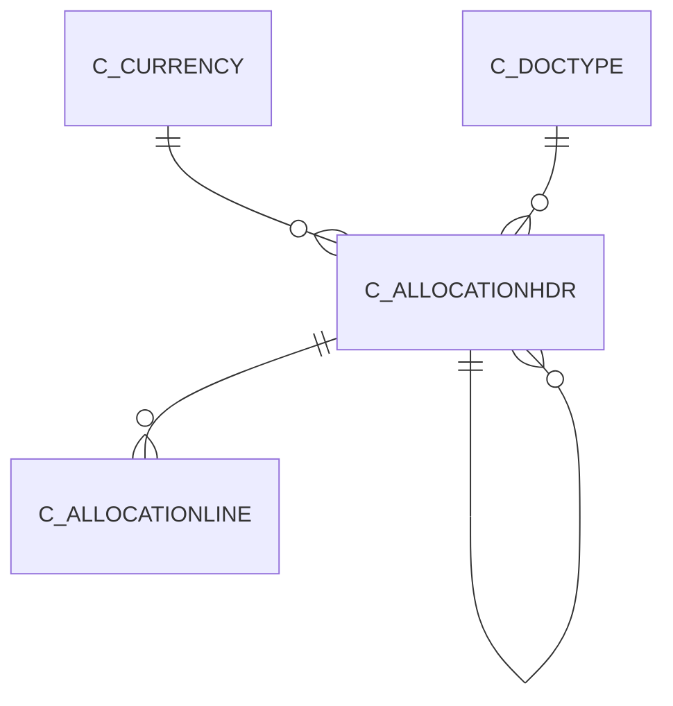

# C_ALLOCATIONHDR

Area [C](../../data-model/c/index.md) · class **business** (proposed) · read from database `idempiere-db` (owner `ADEMPIERE`) · 2 row(s) when profiled

Application model: `org.compiere.model.X_C_AllocationHdr`, access level 1 - Org.

## Columns

| column | type | key | not null | business name | references (code) | nulls | distinct |
|---|---|---|---|---|---|---|---|
| `C_ALLOCATIONHDR_ID` | NUMBER(10,0) | PK | yes | Allocation |  | 0 | 2 |
| `AD_CLIENT_ID` | NUMBER(10,0) |  | yes | Tenant |  | 0 | 1 |
| `AD_ORG_ID` | NUMBER(10,0) |  | yes | Organization |  | 0 | 1 |
| `ISACTIVE` | CHAR(1) |  | yes | Active |  | 0 | 1 |
| `CREATED` | DATE |  | yes | Created |  | 0 | 2 |
| `CREATEDBY` | NUMBER(10,0) |  | yes | Created By |  | 0 | 1 |
| `UPDATED` | DATE |  | yes | Updated |  | 0 | 2 |
| `UPDATEDBY` | NUMBER(10,0) |  | yes | Updated By |  | 0 | 1 |
| `DOCUMENTNO` | VARCHAR2(30 CHAR) |  | yes | Document No |  | 0 | 2 |
| `DESCRIPTION` | VARCHAR2(255 CHAR) |  |  | Description |  | 2 | 0 |
| `DATETRX` | DATE |  | yes | Transaction Date |  | 0 | 1 |
| `DATEACCT` | DATE |  | yes | Account Date |  | 0 | 1 |
| `C_CURRENCY_ID` | NUMBER(10,0) |  | yes | Currency | [C_CURRENCY](../../data-model/c/c_currency.md) | 0 | 1 |
| `APPROVALAMT` | NUMBER |  | yes | Approval Amount |  | 0 | 2 |
| `ISMANUAL` | CHAR(1) |  | yes | Manual |  | 0 | 1 |
| `DOCSTATUS` | CHAR(2) |  | yes | Document Status |  | 0 | 1 |
| `DOCACTION` | CHAR(2) |  | yes | Document Action |  | 0 | 1 |
| `ISAPPROVED` | CHAR(1) |  | yes | Approved |  | 0 | 1 |
| `PROCESSING` | CHAR(1) |  |  | Process Now |  | 0 | 1 |
| `PROCESSED` | CHAR(1) |  | yes | Processed |  | 0 | 1 |
| `POSTED` | CHAR(1) |  | yes | Posted |  | 0 | 1 |
| `PROCESSEDON` | NUMBER |  |  | Processed On |  | 0 | 2 |
| `C_ALLOCATIONHDR_UU` | VARCHAR2(36 CHAR) |  |  | C_AllocationHdr_UU |  | 0 | 2 |
| `REVERSAL_ID` | NUMBER(10,0) |  |  | Reversal ID | [C_ALLOCATIONHDR](../../data-model/c/c_allocationhdr.md) | 2 | 0 |
| `C_DOCTYPE_ID` | NUMBER(10,0) |  |  | Document Type | [C_DOCTYPE](../../data-model/c/c_doctype.md) | 0 | 1 |

*references (code)* is the table the application model's code says a column points to; *Foreign keys* below are the constraints the database declares. Counts come from the profile; no value is ever shown.

## Check constraints

| name | expression |
|---|---|
| `SYS_C0022801` | `IsManual in ('Y','N')` |
| `SYS_C0022802` | `Processed in ('Y','N')` |
| `SYS_C0022803` | `IsActive in ('Y','N')` |
| `SYS_C0022804` | `IsApproved in ('Y','N')` |

## Foreign keys

**References**

| table | columns | on delete |
|---|---|---|
| [C_ALLOCATIONHDR](../../data-model/c/c_allocationhdr.md) | C_ALLOCATIONHDR.REVERSAL_ID → C_ALLOCATIONHDR.C_ALLOCATIONHDR_ID | NO ACTION |
| [C_CURRENCY](../../data-model/c/c_currency.md) | C_ALLOCATIONHDR.C_CURRENCY_ID → C_CURRENCY.C_CURRENCY_ID | NO ACTION |
| [C_DOCTYPE](../../data-model/c/c_doctype.md) | C_ALLOCATIONHDR.C_DOCTYPE_ID → C_DOCTYPE.C_DOCTYPE_ID | NO ACTION |

**Referenced by**

| table | columns | on delete |
|---|---|---|
| [C_ALLOCATIONHDR](../../data-model/c/c_allocationhdr.md) | C_ALLOCATIONHDR.REVERSAL_ID → C_ALLOCATIONHDR.C_ALLOCATIONHDR_ID | NO ACTION |
| [C_ALLOCATIONLINE](../../data-model/c/c_allocationline.md) | C_ALLOCATIONLINE.C_ALLOCATIONHDR_ID → C_ALLOCATIONHDR.C_ALLOCATIONHDR_ID | NO ACTION |

## Write behaviour

- updates: **raw_sql_skips_updated**
- deletes: **deleted_by_app**
- change log: **recorded**
- evidence: 3 citation(s)

## Read by

| kind | name |
|---|---|
| Procedure | [InvoiceopenToDate](../../logic/invoiceopentodate.md) |
| Procedure | [InvoicepaidToDate](../../logic/invoicepaidtodate.md) |
| Procedure | [invoiceOpen](../../logic/invoiceopen.md) |
| Procedure | [invoicePaid](../../logic/invoicepaid.md) |
| Procedure | [invoiceopen](../../logic/invoiceopen.md) |
| Procedure | [paymentAllocated](../../logic/paymentallocated.md) |
| Procedure | [paymentAvailable](../../logic/paymentavailable.md) |
| View | `RV_ALLOCATION` |
| View | `RV_UNPOSTED` |
| View | `RV_UNPROCESSED` |
| View | `rv_allocation` |
| View | `rv_unposted` |
| View | `rv_unprocessed` |

## Schema history

25 change(s); the latest:

| applied | release | operation | column | tickets |
|---|---|---|---|---|
| 2023-04-09T15:47 | iD11 | `add_constraint` |  | IDEMPIERE-5567 |
| 2023-04-09T15:47 | iD11 | `add_constraint` |  | IDEMPIERE-5567 |
| 2021-12-05T16:45 | i8.2z | `drop_constraint` |  | IDEMPIERE-5075 |
| 2021-12-05T16:45 | i8.2z | `add_constraint` |  | IDEMPIERE-5075 |
| 2020-08-04T01:00 | i7.1z | `add_column` | tmp_col_1_tmp | IDEMPIERE-3862 |
| 2020-08-04T01:00 | i7.1z | `add_column` | tmp_col_3_tmp | IDEMPIERE-3862 |
| 2020-08-04T01:00 | i7.1z | `modify_column` | DOCUMENTNO | IDEMPIERE-3862 |
| 2020-08-04T01:00 | i7.1z | `drop_column` | tmp_col_1_tmp | IDEMPIERE-3862 |
| 2020-08-04T01:00 | i7.1z | `modify_column` | DESCRIPTION | IDEMPIERE-3862 |
| 2020-08-04T01:00 | i7.1z | `modify_column` | C_ALLOCATIONHDR_UU | IDEMPIERE-3862 |
| 2020-08-04T01:00 | i7.1z | `modify_column` | DOCUMENTNO | IDEMPIERE-3862 |
| 2020-08-04T01:00 | i7.1z | `drop_column` | tmp_col_3_tmp | IDEMPIERE-3862 |
| 2020-08-04T01:00 | i7.1z | `modify_column` | DOCUMENTNO | IDEMPIERE-3862 |
| 2020-08-04T01:00 | i7.1z | `drop_column` | tmp_col_2_tmp | IDEMPIERE-3862 |
| 2020-08-04T01:00 | i7.1z | `add_column` | tmp_col_2_tmp | IDEMPIERE-3862 |

## Notes

<!-- ekos:manual id="table.c_allocationhdr.notes" -->
_Business notes about this table._
<!-- /ekos:manual -->
