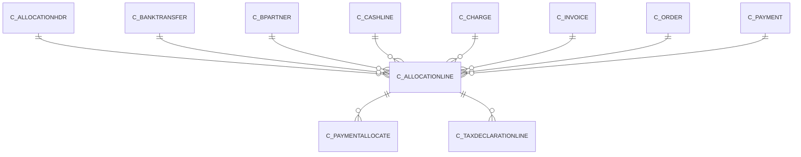

# C_ALLOCATIONLINE

The total of Amount+DiscountAmt+WriteOffAmt is the receivables/payables

Area [C](../../data-model/c/index.md) · class **business** (proposed) · read from database `idempiere-db` (owner `ADEMPIERE`) · 2 row(s) when profiled

Application model: `org.compiere.model.X_C_AllocationLine`, access level 1 - Org.

## Columns

| column | type | key | not null | business name | references (code) | nulls | distinct |
|---|---|---|---|---|---|---|---|
| `C_ALLOCATIONLINE_ID` | NUMBER(10,0) | PK | yes | Allocation Line |  | 0 | 2 |
| `AD_CLIENT_ID` | NUMBER(10,0) |  | yes | Tenant |  | 0 | 1 |
| `AD_ORG_ID` | NUMBER(10,0) |  | yes | Organization |  | 0 | 1 |
| `ISACTIVE` | CHAR(1) |  | yes | Active |  | 0 | 1 |
| `CREATED` | DATE |  | yes | Created |  | 0 | 2 |
| `CREATEDBY` | NUMBER(10,0) |  | yes | Created By |  | 0 | 1 |
| `UPDATED` | DATE |  | yes | Updated |  | 0 | 2 |
| `UPDATEDBY` | NUMBER(10,0) |  | yes | Updated By |  | 0 | 1 |
| `ALLOCATIONNO` | NUMBER(10,0) |  |  |  |  | 0 | 2 |
| `DATETRX` | DATE |  |  | Transaction Date |  | 0 | 1 |
| `ISMANUAL` | CHAR(1) |  |  | Manual |  | 0 | 1 |
| `C_INVOICE_ID` | NUMBER(10,0) |  |  | Invoice | [C_INVOICE](../../data-model/c/c_invoice.md) | 0 | 2 |
| `C_BPARTNER_ID` | NUMBER(10,0) |  |  | Business Partner | [C_BPARTNER](../../data-model/c/c_bpartner.md) | 0 | 1 |
| `C_ORDER_ID` | NUMBER(10,0) |  |  | Order | [C_ORDER](../../data-model/c/c_order.md) | 2 | 0 |
| `C_PAYMENT_ID` | NUMBER(10,0) |  |  | Payment | [C_PAYMENT](../../data-model/c/c_payment.md) | 1 | 1 |
| `C_CASHLINE_ID` | NUMBER(10,0) |  |  | Cash Journal Line | [C_CASHLINE](../../data-model/c/c_cashline.md) | 1 | 1 |
| `AMOUNT` | NUMBER |  | yes | Amount |  | 0 | 2 |
| `DISCOUNTAMT` | NUMBER |  | yes | Discount Amount |  | 0 | 2 |
| `WRITEOFFAMT` | NUMBER |  | yes | Write-off Amount |  | 0 | 2 |
| `OVERUNDERAMT` | NUMBER |  |  | Over/Under Payment |  | 0 | 1 |
| `C_ALLOCATIONHDR_ID` | NUMBER(10,0) |  | yes | Allocation | [C_ALLOCATIONHDR](../../data-model/c/c_allocationhdr.md) | 0 | 2 |
| `C_ALLOCATIONLINE_UU` | VARCHAR2(36 CHAR) |  |  | C_AllocationLine_UU |  | 0 | 2 |
| `C_CHARGE_ID` | NUMBER(10,0) |  |  | Charge | [C_CHARGE](../../data-model/c/c_charge.md) | 2 | 0 |
| `C_BANKTRANSFER_ID` | NUMBER(10,0) |  |  | Bank Transfer | [C_BANKTRANSFER](../../data-model/c/c_banktransfer.md) | 2 | 0 |

*references (code)* is the table the application model's code says a column points to; *Foreign keys* below are the constraints the database declares. Counts come from the profile; no value is ever shown.

## Check constraints

| name | expression |
|---|---|
| `SYS_C0020391` | `IsActive in ('Y','N')` |
| `SYS_C0020392` | `IsManual in ('Y','N')` |

## Foreign keys

**References**

| table | columns | on delete |
|---|---|---|
| [C_ALLOCATIONHDR](../../data-model/c/c_allocationhdr.md) | C_ALLOCATIONLINE.C_ALLOCATIONHDR_ID → C_ALLOCATIONHDR.C_ALLOCATIONHDR_ID | NO ACTION |
| [C_BANKTRANSFER](../../data-model/c/c_banktransfer.md) | C_ALLOCATIONLINE.C_BANKTRANSFER_ID → C_BANKTRANSFER.C_BANKTRANSFER_ID | NO ACTION |
| [C_BPARTNER](../../data-model/c/c_bpartner.md) | C_ALLOCATIONLINE.C_BPARTNER_ID → C_BPARTNER.C_BPARTNER_ID | NO ACTION |
| [C_CASHLINE](../../data-model/c/c_cashline.md) | C_ALLOCATIONLINE.C_CASHLINE_ID → C_CASHLINE.C_CASHLINE_ID | NO ACTION |
| [C_CHARGE](../../data-model/c/c_charge.md) | C_ALLOCATIONLINE.C_CHARGE_ID → C_CHARGE.C_CHARGE_ID | NO ACTION |
| [C_INVOICE](../../data-model/c/c_invoice.md) | C_ALLOCATIONLINE.C_INVOICE_ID → C_INVOICE.C_INVOICE_ID | NO ACTION |
| [C_ORDER](../../data-model/c/c_order.md) | C_ALLOCATIONLINE.C_ORDER_ID → C_ORDER.C_ORDER_ID | NO ACTION |
| [C_PAYMENT](../../data-model/c/c_payment.md) | C_ALLOCATIONLINE.C_PAYMENT_ID → C_PAYMENT.C_PAYMENT_ID | NO ACTION |

**Referenced by**

| table | columns | on delete |
|---|---|---|
| [C_PAYMENTALLOCATE](../../data-model/c/c_paymentallocate.md) | C_PAYMENTALLOCATE.C_ALLOCATIONLINE_ID → C_ALLOCATIONLINE.C_ALLOCATIONLINE_ID | SET NULL |
| [C_TAXDECLARATIONLINE](../../data-model/c/c_taxdeclarationline.md) | C_TAXDECLARATIONLINE.C_ALLOCATIONLINE_ID → C_ALLOCATIONLINE.C_ALLOCATIONLINE_ID | NO ACTION |

## Write behaviour

- updates: **po_only**
- deletes: **deleted_by_app**
- change log: **recorded**
- evidence: 2 citation(s)

## Read by

| kind | name |
|---|---|
| Procedure | [InvoiceopenToDate](../../logic/invoiceopentodate.md) |
| Procedure | [InvoicepaidToDate](../../logic/invoicepaidtodate.md) |
| Procedure | [invoiceOpen](../../logic/invoiceopen.md) |
| Procedure | [invoicePaid](../../logic/invoicepaid.md) |
| Procedure | [invoiceopen](../../logic/invoiceopen.md) |
| Procedure | [paymentAllocated](../../logic/paymentallocated.md) |
| Procedure | [paymentAvailable](../../logic/paymentavailable.md) |
| View | `RV_ALLOCATION` |
| View | `rv_allocation` |

## Schema history

23 change(s); the latest:

| applied | release | operation | column | tickets |
|---|---|---|---|---|
| 2023-04-09T15:47 | iD11 | `add_constraint` |  | IDEMPIERE-5567 |
| 2023-04-09T15:47 | iD11 | `add_constraint` |  | IDEMPIERE-5567 |
| 2022-04-05T03:00 | iD10 | `add_column` | C_BankTransfer_ID | IDEMPIERE-5088 |
| 2022-04-05T03:00 | iD10 | `add_column` | C_BankTransfer_ID | IDEMPIERE-5088 |
| 2022-04-05T03:00 | iD10 | `add_constraint` |  | IDEMPIERE-5088 |
| 2022-04-05T03:00 | iD10 | `add_constraint` |  | IDEMPIERE-5088 |
| 2021-12-05T16:45 | i8.2z | `drop_constraint` |  | IDEMPIERE-5075 |
| 2021-12-05T16:45 | i8.2z | `add_constraint` |  | IDEMPIERE-5075 |
| 2021-12-05T16:45 | i8.2z | `add_constraint` |  | IDEMPIERE-5075 |
| 2021-12-05T16:45 | i8.2z | `drop_constraint` |  | IDEMPIERE-5075 |
| 2021-12-05T16:45 | i8.2z | `add_constraint` |  | IDEMPIERE-5075 |
| 2021-12-05T16:45 | i8.2z | `add_constraint` |  | IDEMPIERE-5075 |
| 2021-12-05T16:45 | i8.2z | `drop_constraint` |  | IDEMPIERE-5075 |
| 2021-12-05T16:45 | i8.2z | `add_constraint` |  | IDEMPIERE-5075 |
| 2021-12-05T16:45 | i8.2z | `drop_constraint` |  | IDEMPIERE-5075 |

## Notes

<!-- ekos:manual id="table.c_allocationline.notes" -->
_Business notes about this table._
<!-- /ekos:manual -->
