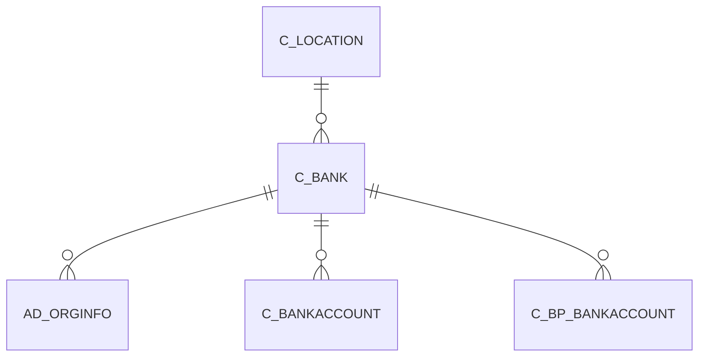

# C_BANK

Area [C](../../data-model/c/index.md) · class **business** (proposed) · read from database `idempiere-db` (owner `ADEMPIERE`) · 2 row(s) when profiled

Application model: `org.compiere.model.X_C_Bank`, access level 3 - Client - Org.

## Columns

| column | type | key | not null | business name | references (code) | nulls | distinct |
|---|---|---|---|---|---|---|---|
| `C_BANK_ID` | NUMBER(10,0) | PK | yes | Bank |  | 0 | 2 |
| `AD_CLIENT_ID` | NUMBER(10,0) |  | yes | Tenant |  | 0 | 1 |
| `AD_ORG_ID` | NUMBER(10,0) |  | yes | Organization |  | 0 | 1 |
| `ISACTIVE` | CHAR(1) |  | yes | Active |  | 0 | 1 |
| `CREATED` | DATE |  | yes | Created |  | 0 | 2 |
| `CREATEDBY` | NUMBER(10,0) |  | yes | Created By |  | 0 | 1 |
| `UPDATED` | DATE |  | yes | Updated |  | 0 | 2 |
| `UPDATEDBY` | NUMBER(10,0) |  | yes | Updated By |  | 0 | 2 |
| `NAME` | VARCHAR2(60 CHAR) |  | yes | Name |  | 0 | 2 |
| `ROUTINGNO` | VARCHAR2(20 CHAR) |  | yes | Routing No |  | 0 | 2 |
| `C_LOCATION_ID` | NUMBER(10,0) |  |  | Address | [C_LOCATION](../../data-model/c/c_location.md) | 2 | 0 |
| `SWIFTCODE` | VARCHAR2(20 CHAR) |  |  | Swift code |  | 1 | 1 |
| `ISOWNBANK` | CHAR(1) |  | yes | Own Bank |  | 0 | 1 |
| `DESCRIPTION` | VARCHAR2(255 CHAR) |  |  | Description |  | 2 | 0 |
| `C_BANK_UU` | VARCHAR2(36 CHAR) |  |  | C_Bank_UU |  | 0 | 2 |

*references (code)* is the table the application model's code says a column points to; *Foreign keys* below are the constraints the database declares. Counts come from the profile; no value is ever shown.

## Check constraints

| name | expression |
|---|---|
| `SYS_C0021904` | `IsOwnBank in ('Y','N')` |
| `SYS_C0021905` | `IsActive in ('Y','N')` |

## Foreign keys

**References**

| table | columns | on delete |
|---|---|---|
| [C_LOCATION](../../data-model/c/c_location.md) | C_BANK.C_LOCATION_ID → C_LOCATION.C_LOCATION_ID | NO ACTION |

**Referenced by**

| table | columns | on delete |
|---|---|---|
| [AD_ORGINFO](../../data-model/ad/ad_orginfo.md) | AD_ORGINFO.TRANSFERBANK_ID → C_BANK.C_BANK_ID | NO ACTION |
| [C_BANKACCOUNT](../../data-model/c/c_bankaccount.md) | C_BANKACCOUNT.C_BANK_ID → C_BANK.C_BANK_ID | CASCADE |
| [C_BP_BANKACCOUNT](../../data-model/c/c_bp_bankaccount.md) | C_BP_BANKACCOUNT.C_BANK_ID → C_BANK.C_BANK_ID | SET NULL |

## Write behaviour

- updates: **po_only**
- deletes: **deleted_by_users**
- change log: **recorded**
- evidence: 1 citation(s)

## Schema history

23 change(s); the latest:

| applied | release | operation | column | tickets |
|---|---|---|---|---|
| 2023-04-09T15:47 | iD11 | `add_constraint` |  | IDEMPIERE-5567 |
| 2023-04-09T15:47 | iD11 | `add_constraint` |  | IDEMPIERE-5567 |
| 2021-12-05T16:45 | i8.2z | `drop_constraint` |  | IDEMPIERE-5075 |
| 2021-12-05T16:45 | i8.2z | `add_constraint` |  | IDEMPIERE-5075 |
| 2020-08-04T01:00 | i7.1z | `drop_column` | tmp_col_2_tmp | IDEMPIERE-3862 |
| 2020-08-04T01:00 | i7.1z | `add_column` | tmp_col_3_tmp | IDEMPIERE-3862 |
| 2020-08-04T01:00 | i7.1z | `add_column` | tmp_col_5_tmp | IDEMPIERE-3862 |
| 2020-08-04T01:00 | i7.1z | `add_column` | tmp_col_2_tmp | IDEMPIERE-3862 |
| 2020-08-04T01:00 | i7.1z | `modify_column` | ROUTINGNO | IDEMPIERE-3862 |
| 2020-08-04T01:00 | i7.1z | `modify_column` | ROUTINGNO | IDEMPIERE-3862 |
| 2020-08-04T01:00 | i7.1z | `modify_column` | ROUTINGNO | IDEMPIERE-3862 |
| 2020-08-04T01:00 | i7.1z | `modify_column` | NAME | IDEMPIERE-3862 |
| 2020-08-04T01:00 | i7.1z | `drop_column` | tmp_col_1_tmp | IDEMPIERE-3862 |
| 2020-08-04T01:00 | i7.1z | `drop_column` | tmp_col_3_tmp | IDEMPIERE-3862 |
| 2020-08-04T01:00 | i7.1z | `modify_column` | SWIFTCODE | IDEMPIERE-3862 |

## Notes

<!-- ekos:manual id="table.c_bank.notes" -->
_Business notes about this table._
<!-- /ekos:manual -->
