# C_BANKACCOUNT

Own Bank Account

Area [C](../../data-model/c/index.md) · class **business** (proposed) · read from database `idempiere-db` (owner `ADEMPIERE`) · 3 row(s) when profiled

Application model: `org.compiere.model.X_C_BankAccount`, access level 3 - Client - Org.

## Columns

| column | type | key | not null | business name | references (code) | nulls | distinct |
|---|---|---|---|---|---|---|---|
| `C_BANKACCOUNT_ID` | NUMBER(10,0) | PK | yes | Bank Account |  | 0 | 3 |
| `AD_CLIENT_ID` | NUMBER(10,0) |  | yes | Tenant |  | 0 | 1 |
| `AD_ORG_ID` | NUMBER(10,0) |  | yes | Organization |  | 0 | 2 |
| `ISACTIVE` | CHAR(1) |  | yes | Active |  | 0 | 1 |
| `CREATED` | DATE |  | yes | Created |  | 0 | 3 |
| `CREATEDBY` | NUMBER(10,0) |  | yes | Created By |  | 0 | 1 |
| `UPDATED` | DATE |  | yes | Updated |  | 0 | 3 |
| `UPDATEDBY` | NUMBER(10,0) |  | yes | Updated By |  | 0 | 1 |
| `C_BANK_ID` | NUMBER(10,0) |  | yes | Bank | [C_BANK](../../data-model/c/c_bank.md) | 0 | 2 |
| `C_CURRENCY_ID` | NUMBER(10,0) |  | yes | Currency | [C_CURRENCY](../../data-model/c/c_currency.md) | 0 | 1 |
| `BANKACCOUNTTYPE` | CHAR(1) |  | yes | Bank Account Type |  | 0 | 2 |
| `ACCOUNTNO` | VARCHAR2(20 CHAR) |  | yes | Account No |  | 0 | 3 |
| `CURRENTBALANCE` | NUMBER |  | yes | Current balance |  | 0 | 2 |
| `CREDITLIMIT` | NUMBER |  | yes | Credit limit |  | 0 | 1 |
| `ISDEFAULT` | CHAR(1) |  | yes | Default |  | 0 | 2 |
| `IBAN` | VARCHAR2(40 CHAR) |  |  | IBAN |  | 3 | 0 |
| `DESCRIPTION` | VARCHAR2(255 CHAR) |  |  | Description |  | 1 | 2 |
| `BBAN` | VARCHAR2(40 CHAR) |  |  | BBAN |  | 3 | 0 |
| `PAYMENTEXPORTCLASS` | VARCHAR2(60 CHAR) |  |  | Payment Export Class |  | 3 | 0 |
| `C_BANKACCOUNT_UU` | VARCHAR2(36 CHAR) |  |  | C_BankAccount_UU |  | 0 | 3 |
| `NAME` | VARCHAR2(60 CHAR) |  | yes | Name |  | 0 | 3 |
| `VALUE` | VARCHAR2(40 CHAR) |  | yes | Search Key |  | 0 | 3 |

*references (code)* is the table the application model's code says a column points to; *Foreign keys* below are the constraints the database declares. Counts come from the profile; no value is ever shown.

## Check constraints

| name | expression |
|---|---|
| `SYS_C0020729` | `IsActive in ('Y','N')` |

## Foreign keys

**References**

| table | columns | on delete |
|---|---|---|
| [C_BANK](../../data-model/c/c_bank.md) | C_BANKACCOUNT.C_BANK_ID → C_BANK.C_BANK_ID | CASCADE |
| [C_CURRENCY](../../data-model/c/c_currency.md) | C_BANKACCOUNT.C_CURRENCY_ID → C_CURRENCY.C_CURRENCY_ID | NO ACTION |

**Referenced by**

| table | columns | on delete |
|---|---|---|
| [C_BANKACCOUNTDOC](../../data-model/c/c_bankaccountdoc.md) | C_BANKACCOUNTDOC.C_BANKACCOUNT_ID → C_BANKACCOUNT.C_BANKACCOUNT_ID | CASCADE |
| [C_BANKACCOUNT_ACCT](../../data-model/c/c_bankaccount_acct.md) | C_BANKACCOUNT_ACCT.C_BANKACCOUNT_ID → C_BANKACCOUNT.C_BANKACCOUNT_ID | CASCADE |
| [C_BANKACCOUNT_PROCESSOR](../../data-model/c/c_bankaccount_processor.md) | C_BANKACCOUNT_PROCESSOR.C_BANKACCOUNT_ID → C_BANKACCOUNT.C_BANKACCOUNT_ID | NO ACTION |
| [C_BANKSTATEMENT](../../data-model/c/c_bankstatement.md) | C_BANKSTATEMENT.C_BANKACCOUNT_ID → C_BANKACCOUNT.C_BANKACCOUNT_ID | NO ACTION |
| [C_BANKSTATEMENTLOADER](../../data-model/c/c_bankstatementloader.md) | C_BANKSTATEMENTLOADER.C_BANKACCOUNT_ID → C_BANKACCOUNT.C_BANKACCOUNT_ID | NO ACTION |
| [C_BANKTRANSFER](../../data-model/c/c_banktransfer.md) | C_BANKTRANSFER.FROM_C_BANKACCOUNT_ID → C_BANKACCOUNT.C_BANKACCOUNT_ID | NO ACTION |
| [C_CASHLINE](../../data-model/c/c_cashline.md) | C_CASHLINE.C_BANKACCOUNT_ID → C_BANKACCOUNT.C_BANKACCOUNT_ID | NO ACTION |
| [C_DEPOSITBATCH](../../data-model/c/c_depositbatch.md) | C_DEPOSITBATCH.C_BANKACCOUNT_ID → C_BANKACCOUNT.C_BANKACCOUNT_ID | NO ACTION |
| [C_ELEMENTVALUE](../../data-model/c/c_elementvalue.md) | C_ELEMENTVALUE.C_BANKACCOUNT_ID → C_BANKACCOUNT.C_BANKACCOUNT_ID | NO ACTION |
| [C_PAYMENT](../../data-model/c/c_payment.md) | C_PAYMENT.C_BANKACCOUNT_ID → C_BANKACCOUNT.C_BANKACCOUNT_ID | NO ACTION |
| [C_PAYMENTPROCESSOR](../../data-model/c/c_paymentprocessor.md) | C_PAYMENTPROCESSOR.C_BANKACCOUNT_ID → C_BANKACCOUNT.C_BANKACCOUNT_ID | NO ACTION |
| [C_PAYMENTTRANSACTION](../../data-model/c/c_paymenttransaction.md) | C_PAYMENTTRANSACTION.C_BANKACCOUNT_ID → C_BANKACCOUNT.C_BANKACCOUNT_ID | NO ACTION |
| [C_PAYSELECTION](../../data-model/c/c_payselection.md) | C_PAYSELECTION.C_BANKACCOUNT_ID → C_BANKACCOUNT.C_BANKACCOUNT_ID | NO ACTION |
| [C_POS](../../data-model/c/c_pos.md) | C_POS.C_BANKACCOUNT_ID → C_BANKACCOUNT.C_BANKACCOUNT_ID | NO ACTION |
| `I_BANKSTATEMENT` | I_BANKSTATEMENT.C_BANKACCOUNT_ID → C_BANKACCOUNT.C_BANKACCOUNT_ID | SET NULL |
| `I_PAYMENT` | I_PAYMENT.C_BANKACCOUNT_ID → C_BANKACCOUNT.C_BANKACCOUNT_ID | SET NULL |
| [U_POSTERMINAL](../../data-model/u/u_posterminal.md) | U_POSTERMINAL.CARD_BANKACCOUNT_ID → C_BANKACCOUNT.C_BANKACCOUNT_ID | NO ACTION |

```mermaid
erDiagram
  C_BANK ||--o{ C_BANKACCOUNT : ""
  C_BANKACCOUNT ||--o{ C_BANKACCOUNTDOC : ""
  C_BANKACCOUNT ||--o{ C_BANKACCOUNT_ACCT : ""
  C_BANKACCOUNT ||--o{ C_BANKACCOUNT_PROCESSOR : ""
  C_BANKACCOUNT ||--o{ C_BANKSTATEMENT : ""
  C_BANKACCOUNT ||--o{ C_BANKSTATEMENTLOADER : ""
  C_BANKACCOUNT ||--o{ C_BANKTRANSFER : ""
  C_BANKACCOUNT ||--o{ C_CASHLINE : ""
  C_BANKACCOUNT ||--o{ C_DEPOSITBATCH : ""
  C_BANKACCOUNT ||--o{ C_ELEMENTVALUE : ""
  C_BANKACCOUNT ||--o{ C_PAYMENT : ""
  C_BANKACCOUNT ||--o{ C_PAYMENTPROCESSOR : ""
  C_BANKACCOUNT ||--o{ C_PAYMENTTRANSACTION : ""
  C_BANKACCOUNT ||--o{ C_PAYSELECTION : ""
  C_BANKACCOUNT ||--o{ C_POS : ""
  C_BANKACCOUNT ||--o{ I_BANKSTATEMENT : ""
  C_BANKACCOUNT ||--o{ I_PAYMENT : ""
  C_BANKACCOUNT ||--o{ U_POSTERMINAL : ""
  C_CURRENCY ||--o{ C_BANKACCOUNT : ""
```

## Write behaviour

- updates: **po_only**
- deletes: **deleted_by_users, deleted_by_cascade**
- change log: **recorded**
- evidence: 2 citation(s)

## Read by

| kind | name |
|---|---|
| Procedure | [C_AcctSchema_Default_Copy](../../logic/c_acctschema_default_copy.md) |
| View | `C_PAYSELECTION_CHECK_V` |
| View | `C_PAYSELECTION_CHECK_VT` |
| View | `c_payselection_check_v` |
| View | `c_payselection_check_vt` |

## Schema history

36 change(s); the latest:

| applied | release | operation | column | tickets |
|---|---|---|---|---|
| 2023-04-09T15:47 | iD11 | `add_constraint` |  | IDEMPIERE-5567 |
| 2023-04-09T15:47 | iD11 | `add_constraint` |  | IDEMPIERE-5567 |
| 2021-12-05T16:45 | i8.2z | `add_constraint` |  | IDEMPIERE-5075 |
| 2021-12-05T16:45 | i8.2z | `add_constraint` |  | IDEMPIERE-5075 |
| 2021-12-05T16:45 | i8.2z | `drop_constraint` |  | IDEMPIERE-5075 |
| 2021-12-05T16:45 | i8.2z | `drop_constraint` |  | IDEMPIERE-5075 |
| 2020-08-04T01:00 | i7.1z | `drop_column` | tmp_col_1_tmp | IDEMPIERE-3862 |
| 2020-08-04T01:00 | i7.1z | `modify_column` | BBAN | IDEMPIERE-3862 |
| 2020-08-04T01:00 | i7.1z | `drop_column` | tmp_col_5_tmp | IDEMPIERE-3862 |
| 2020-08-04T01:00 | i7.1z | `modify_column` | IBAN | IDEMPIERE-3862 |
| 2020-08-04T01:00 | i7.1z | `add_column` | tmp_col_7_tmp | IDEMPIERE-3862 |
| 2020-08-04T01:00 | i7.1z | `drop_column` | tmp_col_6_tmp | IDEMPIERE-3862 |
| 2020-08-04T01:00 | i7.1z | `drop_column` | tmp_col_3_tmp | IDEMPIERE-3862 |
| 2020-08-04T01:00 | i7.1z | `modify_column` | DESCRIPTION | IDEMPIERE-3862 |
| 2020-08-04T01:00 | i7.1z | `drop_column` | tmp_col_4_tmp | IDEMPIERE-3862 |

## Notes

<!-- ekos:manual id="table.c_bankaccount.notes" -->
_Business notes about this table._
<!-- /ekos:manual -->
