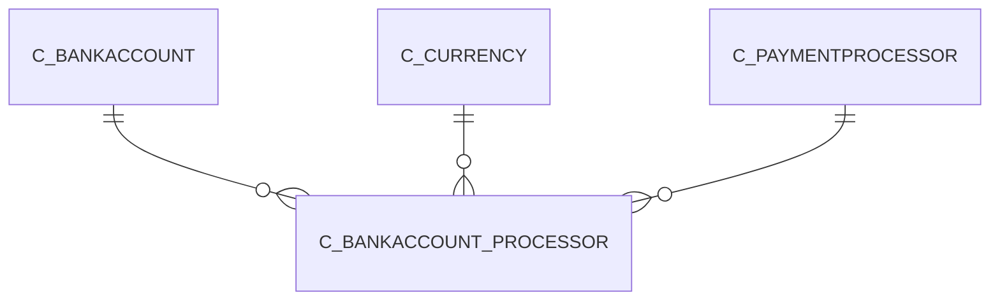

# C_BANKACCOUNT_PROCESSOR

Area [C](../../data-model/c/index.md) · class **business** (proposed) · read from database `idempiere-db` (owner `ADEMPIERE`) · 2 row(s) when profiled

Application model: `org.compiere.model.X_C_BankAccount_Processor`, access level 3 - Client - Org.

## Columns

| column | type | key | not null | business name | references (code) | nulls | distinct |
|---|---|---|---|---|---|---|---|
| `AD_CLIENT_ID` | NUMBER(10,0) |  | yes | Tenant |  | 0 | 1 |
| `AD_ORG_ID` | NUMBER(10,0) |  | yes | Organization |  | 0 | 1 |
| `C_BANKACCOUNT_ID` | NUMBER(10,0) | PK | yes | Bank Account | [C_BANKACCOUNT](../../data-model/c/c_bankaccount.md) | 0 | 2 |
| `C_BANKACCOUNT_PROCESSOR_UU` | VARCHAR2(36 CHAR) |  |  | C_BankAccount_Processor_UU |  | 0 | 2 |
| `C_PAYMENTPROCESSOR_ID` | NUMBER(10,0) | PK | yes | Payment Processor | [C_PAYMENTPROCESSOR](../../data-model/c/c_paymentprocessor.md) | 0 | 2 |
| `CREATED` | DATE |  | yes | Created |  | 0 | 2 |
| `CREATEDBY` | NUMBER(10,0) |  | yes | Created By |  | 0 | 1 |
| `ISACTIVE` | CHAR(1) |  | yes | Active |  | 0 | 1 |
| `UPDATED` | DATE |  | yes | Updated |  | 0 | 1 |
| `UPDATEDBY` | NUMBER(10,0) |  | yes | Updated By |  | 0 | 1 |
| `ACCEPTAMEX` | CHAR(1) |  | yes | Accept AMEX |  | 0 | 2 |
| `ACCEPTATM` | CHAR(1) |  | yes | Accept ATM |  | 0 | 1 |
| `ACCEPTCHECK` | CHAR(1) |  | yes | Accept Electronic Check |  | 0 | 1 |
| `ACCEPTCORPORATE` | CHAR(1) |  | yes | Accept Corporate |  | 0 | 2 |
| `ACCEPTDINERS` | CHAR(1) |  | yes | Accept Diners |  | 0 | 2 |
| `ACCEPTDIRECTDEBIT` | CHAR(1) |  | yes | Accept Direct Debit |  | 0 | 1 |
| `ACCEPTDIRECTDEPOSIT` | CHAR(1) |  | yes | Accept Direct Deposit |  | 0 | 1 |
| `ACCEPTDISCOVER` | CHAR(1) |  | yes | Accept Discover |  | 0 | 2 |
| `ACCEPTMC` | CHAR(1) |  | yes | Accept MasterCard |  | 0 | 2 |
| `ACCEPTVISA` | CHAR(1) |  | yes | Accept Visa |  | 0 | 2 |
| `PARTNERID` | VARCHAR2(60 CHAR) |  |  | Partner ID |  | 0 | 1 |
| `VENDORID` | VARCHAR2(60 CHAR) |  |  | Vendor ID |  | 0 | 1 |
| `USERID` | VARCHAR2(100 CHAR) |  | yes | User ID |  | 0 | 1 |
| `PASSWORD` | VARCHAR2(60 CHAR) |  | yes |  |  | 0 | 1 |
| `MINIMUMAMT` | NUMBER |  |  | Minimum Amt |  | 0 | 1 |
| `C_CURRENCY_ID` | NUMBER(10,0) |  |  | Currency | [C_CURRENCY](../../data-model/c/c_currency.md) | 0 | 1 |
| `REQUIREVV` | CHAR(1) |  | yes | Require Credit Card Verification Code |  | 0 | 1 |

*references (code)* is the table the application model's code says a column points to; *Foreign keys* below are the constraints the database declares. Counts come from the profile; no value is ever shown.

## Check constraints

| name | expression |
|---|---|
| `SYS_C0022398` | `IsActive IN ('Y','N')` |
| `SYS_C0022399` | `AcceptDirectDeposit IN ('Y','N')` |
| `SYS_C0022401` | `AcceptDiners IN ('Y','N')` |
| `SYS_C0022402` | `AcceptMC IN ('Y','N')` |
| `SYS_C0022403` | `RequireVV IN ('Y','N')` |
| `SYS_C0022404` | `AcceptCheck IN ('Y','N')` |
| `SYS_C0022405` | `AcceptDiscover IN ('Y','N')` |
| `SYS_C0022406` | `AcceptATM IN ('Y','N')` |
| `SYS_C0022407` | `AcceptAMEX IN ('Y','N')` |
| `SYS_C0022408` | `AcceptCorporate IN ('Y','N')` |
| `SYS_C0022410` | `AcceptDirectDebit IN ('Y','N')` |
| `SYS_C0022411` | `AcceptVisa IN ('Y','N')` |

## Foreign keys

**References**

| table | columns | on delete |
|---|---|---|
| [C_BANKACCOUNT](../../data-model/c/c_bankaccount.md) | C_BANKACCOUNT_PROCESSOR.C_BANKACCOUNT_ID → C_BANKACCOUNT.C_BANKACCOUNT_ID | NO ACTION |
| [C_CURRENCY](../../data-model/c/c_currency.md) | C_BANKACCOUNT_PROCESSOR.C_CURRENCY_ID → C_CURRENCY.C_CURRENCY_ID | NO ACTION |
| [C_PAYMENTPROCESSOR](../../data-model/c/c_paymentprocessor.md) | C_BANKACCOUNT_PROCESSOR.C_PAYMENTPROCESSOR_ID → C_PAYMENTPROCESSOR.C_PAYMENTPROCESSOR_ID | NO ACTION |

**Referenced by**

_None._

## Write behaviour

- updates: **po_only**
- deletes: **soft_delete_only**
- change log: **recorded**
- evidence: 1 citation(s)

## Schema history

101 change(s); the latest:

| applied | release | operation | column | tickets |
|---|---|---|---|---|
| 2023-04-09T15:47 | iD11 | `add_constraint` |  | IDEMPIERE-5567 |
| 2023-04-09T15:47 | iD11 | `add_constraint` |  | IDEMPIERE-5567 |
| 2021-12-05T16:45 | i8.2z | `drop_constraint` |  | IDEMPIERE-5075 |
| 2021-12-05T16:45 | i8.2z | `add_constraint` |  | IDEMPIERE-5075 |
| 2021-12-05T16:45 | i8.2z | `drop_constraint` |  | IDEMPIERE-5075 |
| 2021-12-05T16:45 | i8.2z | `add_constraint` |  | IDEMPIERE-5075 |
| 2020-08-04T01:00 | i7.1z | `modify_column` | USERID | IDEMPIERE-3862 |
| 2020-08-04T01:00 | i7.1z | `add_column` | tmp_col_2_tmp | IDEMPIERE-3862 |
| 2020-08-04T01:00 | i7.1z | `modify_column` | PASSWORD | IDEMPIERE-3862 |
| 2020-08-04T01:00 | i7.1z | `modify_column` | C_BANKACCOUNT_PROCESSOR_UU | IDEMPIERE-3862 |
| 2020-08-04T01:00 | i7.1z | `drop_column` | tmp_col_2_tmp | IDEMPIERE-3862 |
| 2020-08-04T01:00 | i7.1z | `drop_column` | tmp_col_5_tmp | IDEMPIERE-3862 |
| 2020-08-04T01:00 | i7.1z | `add_column` | tmp_col_5_tmp | IDEMPIERE-3862 |
| 2020-08-04T01:00 | i7.1z | `modify_column` | PARTNERID | IDEMPIERE-3862 |
| 2020-08-04T01:00 | i7.1z | `add_column` | tmp_col_1_tmp | IDEMPIERE-3862 |

## Notes

<!-- ekos:manual id="table.c_bankaccount_processor.notes" -->
_Business notes about this table._
<!-- /ekos:manual -->
