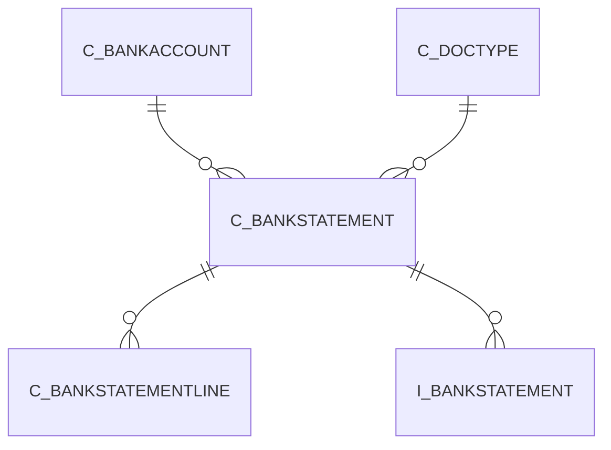

# C_BANKSTATEMENT

Area [C](../../data-model/c/index.md) · class **business** (proposed) · read from database `idempiere-db` (owner `ADEMPIERE`) · 2 row(s) when profiled

Application model: `org.compiere.model.X_C_BankStatement`, access level 3 - Client - Org.

## Columns

| column | type | key | not null | business name | references (code) | nulls | distinct |
|---|---|---|---|---|---|---|---|
| `C_BANKSTATEMENT_ID` | NUMBER(10,0) | PK | yes | Bank Statement |  | 0 | 2 |
| `AD_CLIENT_ID` | NUMBER(10,0) |  | yes | Tenant |  | 0 | 1 |
| `AD_ORG_ID` | NUMBER(10,0) |  | yes | Organization |  | 0 | 1 |
| `ISACTIVE` | CHAR(1) |  | yes | Active |  | 0 | 1 |
| `CREATED` | DATE |  | yes | Created |  | 0 | 2 |
| `CREATEDBY` | NUMBER(10,0) |  | yes | Created By |  | 0 | 1 |
| `UPDATED` | DATE |  | yes | Updated |  | 0 | 2 |
| `UPDATEDBY` | NUMBER(10,0) |  | yes | Updated By |  | 0 | 2 |
| `C_BANKACCOUNT_ID` | NUMBER(10,0) |  | yes | Bank Account | [C_BANKACCOUNT](../../data-model/c/c_bankaccount.md) | 0 | 1 |
| `NAME` | VARCHAR2(60 CHAR) |  | yes | Name |  | 0 | 2 |
| `DESCRIPTION` | VARCHAR2(255 CHAR) |  |  | Description |  | 1 | 1 |
| `ISMANUAL` | CHAR(1) |  | yes | Manual |  | 0 | 1 |
| `STATEMENTDATE` | DATE |  | yes | Statement date |  | 0 | 2 |
| `BEGINNINGBALANCE` | NUMBER |  |  | Beginning Balance |  | 0 | 1 |
| `ENDINGBALANCE` | NUMBER |  | yes | Ending balance |  | 0 | 2 |
| `STATEMENTDIFFERENCE` | NUMBER |  |  | Statement difference |  | 0 | 2 |
| `CREATEFROM` | CHAR(1) |  |  | Create lines from |  | 0 | 1 |
| `PROCESSING` | CHAR(1) |  |  | Process Now |  | 0 | 1 |
| `PROCESSED` | CHAR(1) |  | yes | Processed |  | 0 | 2 |
| `POSTED` | CHAR(1) |  | yes | Posted |  | 0 | 1 |
| `EFTSTATEMENTREFERENCE` | VARCHAR2(60 CHAR) |  |  | EFT Statement Reference |  | 2 | 0 |
| `EFTSTATEMENTDATE` | DATE |  |  | EFT Statement Date |  | 2 | 0 |
| `MATCHSTATEMENT` | CHAR(1) |  |  | Match Statement |  | 1 | 1 |
| `ISAPPROVED` | CHAR(1) |  | yes | Approved |  | 0 | 2 |
| `DOCSTATUS` | CHAR(2) |  | yes | Document Status |  | 0 | 2 |
| `DOCACTION` | CHAR(2) |  | yes | Document Action |  | 0 | 2 |
| `PROCESSEDON` | NUMBER |  |  | Processed On |  | 1 | 1 |
| `C_BANKSTATEMENT_UU` | VARCHAR2(36 CHAR) |  |  | C_BankStatement_UU |  | 0 | 2 |
| `COPYFROM` | CHAR(1) |  |  | Copy From |  | 0 | 1 |
| `DATEACCT` | DATE |  | yes | Account Date |  | 0 | 2 |
| `CREATEFROMBATCH` | CHAR(1) |  |  | Create From Batch |  | 2 | 0 |
| `C_DOCTYPE_ID` | NUMBER(10,0) |  | yes | Document Type | [C_DOCTYPE](../../data-model/c/c_doctype.md) | 0 | 1 |
| `DOCUMENTNO` | VARCHAR2(60 CHAR) |  | yes | Document No |  | 0 | 2 |

*references (code)* is the table the application model's code says a column points to; *Foreign keys* below are the constraints the database declares. Counts come from the profile; no value is ever shown.

## Check constraints

| name | expression |
|---|---|
| `SYS_C0021249` | `IsManual in ('Y','N')` |
| `SYS_C0021250` | `Processed in ('Y','N')` |
| `SYS_C0021251` | `IsActive in ('Y','N')` |
| `SYS_C0021253` | `CreateFrom in ('Y','N')` |

## Foreign keys

**References**

| table | columns | on delete |
|---|---|---|
| [C_BANKACCOUNT](../../data-model/c/c_bankaccount.md) | C_BANKSTATEMENT.C_BANKACCOUNT_ID → C_BANKACCOUNT.C_BANKACCOUNT_ID | NO ACTION |
| [C_DOCTYPE](../../data-model/c/c_doctype.md) | C_BANKSTATEMENT.C_DOCTYPE_ID → C_DOCTYPE.C_DOCTYPE_ID | NO ACTION |

**Referenced by**

| table | columns | on delete |
|---|---|---|
| [C_BANKSTATEMENTLINE](../../data-model/c/c_bankstatementline.md) | C_BANKSTATEMENTLINE.C_BANKSTATEMENT_ID → C_BANKSTATEMENT.C_BANKSTATEMENT_ID | CASCADE |
| `I_BANKSTATEMENT` | I_BANKSTATEMENT.C_BANKSTATEMENT_ID → C_BANKSTATEMENT.C_BANKSTATEMENT_ID | SET NULL |

## Write behaviour

- updates: **raw_sql_skips_updated**
- deletes: **deleted_by_users**
- change log: **recorded**
- evidence: 3 citation(s)

## Read by

| kind | name |
|---|---|
| View | `RV_UNPOSTED` |
| View | `RV_UNPROCESSED` |
| View | `rv_unposted` |
| View | `rv_unprocessed` |

## Schema history

48 change(s); the latest:

| applied | release | operation | column | tickets |
|---|---|---|---|---|
| 2023-06-06T12:39 | iD10 | `modify_column` | C_DocType_ID | IDEMPIERE-5746 |
| 2023-06-06T12:39 | iD10 | `add_column` | C_DocType_ID | IDEMPIERE-5746 |
| 2023-06-06T12:39 | iD10 | `modify_column` | DocumentNo | IDEMPIERE-5746 |
| 2023-06-06T12:39 | iD10 | `modify_column` | DocumentNo | IDEMPIERE-5746 |
| 2023-06-06T12:39 | iD10 | `add_constraint` |  | IDEMPIERE-5746 |
| 2023-06-06T12:39 | iD10 | `modify_column` | C_DocType_ID | IDEMPIERE-5746 |
| 2023-06-06T12:39 | iD10 | `modify_column` | DocumentNo | IDEMPIERE-5746 |
| 2023-06-06T12:39 | iD10 | `modify_column` | C_DocType_ID | IDEMPIERE-5746 |
| 2023-06-06T12:39 | iD10 | `add_column` | DocumentNo | IDEMPIERE-5746 |
| 2023-06-06T12:39 | iD10 | `add_column` | C_DocType_ID | IDEMPIERE-5746 |
| 2023-06-06T12:39 | iD10 | `modify_column` | DocumentNo | IDEMPIERE-5746 |
| 2023-06-06T12:39 | iD10 | `modify_column` | C_DocType_ID | IDEMPIERE-5746 |
| 2023-06-06T12:39 | iD10 | `add_constraint` |  | IDEMPIERE-5746 |
| 2023-06-06T12:39 | iD10 | `add_column` | DocumentNo | IDEMPIERE-5746 |
| 2023-04-09T15:47 | iD11 | `add_constraint` |  | IDEMPIERE-5567 |

## Notes

<!-- ekos:manual id="table.c_bankstatement.notes" -->
_Business notes about this table._
<!-- /ekos:manual -->
