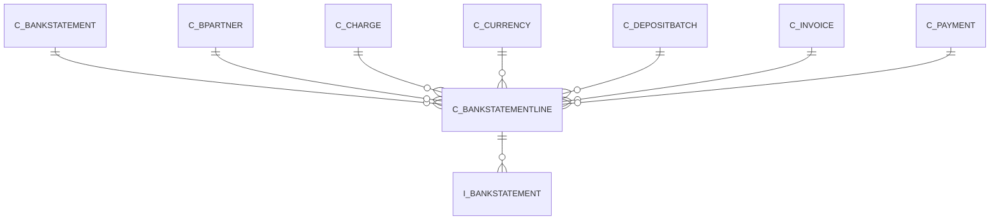

# C_BANKSTATEMENTLINE

Area [C](../../data-model/c/index.md) · class **business** (proposed) · read from database `idempiere-db` (owner `ADEMPIERE`) · 2 row(s) when profiled

Application model: `org.compiere.model.X_C_BankStatementLine`, access level 3 - Client - Org.

## Columns

| column | type | key | not null | business name | references (code) | nulls | distinct |
|---|---|---|---|---|---|---|---|
| `C_BANKSTATEMENTLINE_ID` | NUMBER(10,0) | PK | yes | Bank statement line |  | 0 | 2 |
| `AD_CLIENT_ID` | NUMBER(10,0) |  | yes | Tenant |  | 0 | 1 |
| `AD_ORG_ID` | NUMBER(10,0) |  | yes | Organization |  | 0 | 1 |
| `ISACTIVE` | CHAR(1) |  | yes | Active |  | 0 | 1 |
| `CREATED` | DATE |  | yes | Created |  | 0 | 2 |
| `CREATEDBY` | NUMBER(10,0) |  | yes | Created By |  | 0 | 1 |
| `UPDATED` | DATE |  | yes | Updated |  | 0 | 2 |
| `UPDATEDBY` | NUMBER(10,0) |  | yes | Updated By |  | 0 | 1 |
| `C_BANKSTATEMENT_ID` | NUMBER(10,0) |  | yes | Bank Statement | [C_BANKSTATEMENT](../../data-model/c/c_bankstatement.md) | 0 | 1 |
| `LINE` | NUMBER(10,0) |  | yes | Line No |  | 0 | 2 |
| `DESCRIPTION` | VARCHAR2(1000 CHAR) |  |  | Description |  | 2 | 0 |
| `ISREVERSAL` | CHAR(1) |  | yes | Reversal |  | 0 | 1 |
| `C_PAYMENT_ID` | NUMBER(10,0) |  |  | Payment | [C_PAYMENT](../../data-model/c/c_payment.md) | 0 | 2 |
| `VALUTADATE` | DATE |  | yes | Effective date |  | 0 | 1 |
| `DATEACCT` | DATE |  | yes | Account Date |  | 0 | 1 |
| `C_CURRENCY_ID` | NUMBER(10,0) |  | yes | Currency | [C_CURRENCY](../../data-model/c/c_currency.md) | 0 | 1 |
| `TRXAMT` | NUMBER |  | yes | Transaction Amount |  | 0 | 2 |
| `STMTAMT` | NUMBER |  | yes | Statement amount |  | 0 | 2 |
| `C_CHARGE_ID` | NUMBER(10,0) |  |  | Charge | [C_CHARGE](../../data-model/c/c_charge.md) | 0 | 1 |
| `CHARGEAMT` | NUMBER |  | yes | Charge amount |  | 0 | 2 |
| `INTERESTAMT` | NUMBER |  | yes | Interest Amount |  | 0 | 2 |
| `MEMO` | VARCHAR2(4000 CHAR) |  |  | Memo |  | 2 | 0 |
| `REFERENCENO` | VARCHAR2(255 CHAR) |  |  | Reference No |  | 2 | 0 |
| `ISMANUAL` | CHAR(1) |  | yes | Manual |  | 0 | 1 |
| `EFTTRXID` | VARCHAR2(40 CHAR) |  |  | EFT Trx ID |  | 2 | 0 |
| `EFTTRXTYPE` | VARCHAR2(255 CHAR) |  |  | EFT Trx Type |  | 2 | 0 |
| `EFTMEMO` | VARCHAR2(4000 CHAR) |  |  | EFT Memo |  | 2 | 0 |
| `EFTPAYEE` | VARCHAR2(255 CHAR) |  |  | EFT Payee |  | 2 | 0 |
| `EFTPAYEEACCOUNT` | VARCHAR2(40 CHAR) |  |  | EFT Payee Account |  | 2 | 0 |
| `CREATEPAYMENT` | CHAR(1) |  |  | Create Payment |  | 2 | 0 |
| `STATEMENTLINEDATE` | DATE |  | yes | Statement Line Date |  | 0 | 1 |
| `EFTSTATEMENTLINEDATE` | DATE |  |  | EFT Statement Line Date |  | 2 | 0 |
| `EFTVALUTADATE` | DATE |  |  | EFT Effective Date |  | 2 | 0 |
| `EFTREFERENCE` | VARCHAR2(255 CHAR) |  |  | EFT Reference |  | 2 | 0 |
| `EFTCURRENCY` | VARCHAR2(20 CHAR) |  |  | EFT Currency |  | 2 | 0 |
| `EFTAMT` | NUMBER |  |  | EFT Amount |  | 0 | 1 |
| `EFTCHECKNO` | VARCHAR2(20 CHAR) |  |  | EFT Check No |  | 2 | 0 |
| `MATCHSTATEMENT` | CHAR(1) |  |  | Match Statement |  | 2 | 0 |
| `C_BPARTNER_ID` | NUMBER(10,0) |  |  | Business Partner | [C_BPARTNER](../../data-model/c/c_bpartner.md) | 2 | 0 |
| `C_INVOICE_ID` | NUMBER(10,0) |  |  | Invoice | [C_INVOICE](../../data-model/c/c_invoice.md) | 2 | 0 |
| `PROCESSED` | CHAR(1) |  | yes | Processed |  | 0 | 1 |
| `C_BANKSTATEMENTLINE_UU` | VARCHAR2(36 CHAR) |  |  | C_BankStatementLine_UU |  | 0 | 2 |
| `C_DEPOSITBATCH_ID` | NUMBER(10,0) |  |  | Deposit Batch | [C_DEPOSITBATCH](../../data-model/c/c_depositbatch.md) | 2 | 0 |

*references (code)* is the table the application model's code says a column points to; *Foreign keys* below are the constraints the database declares. Counts come from the profile; no value is ever shown.

## Check constraints

| name | expression |
|---|---|
| `SYS_C0021664` | `IsActive in ('Y','N')` |
| `SYS_C0021665` | `IsReversal in ('Y','N')` |

## Foreign keys

**References**

| table | columns | on delete |
|---|---|---|
| [C_BANKSTATEMENT](../../data-model/c/c_bankstatement.md) | C_BANKSTATEMENTLINE.C_BANKSTATEMENT_ID → C_BANKSTATEMENT.C_BANKSTATEMENT_ID | CASCADE |
| [C_BPARTNER](../../data-model/c/c_bpartner.md) | C_BANKSTATEMENTLINE.C_BPARTNER_ID → C_BPARTNER.C_BPARTNER_ID | NO ACTION |
| [C_CHARGE](../../data-model/c/c_charge.md) | C_BANKSTATEMENTLINE.C_CHARGE_ID → C_CHARGE.C_CHARGE_ID | NO ACTION |
| [C_CURRENCY](../../data-model/c/c_currency.md) | C_BANKSTATEMENTLINE.C_CURRENCY_ID → C_CURRENCY.C_CURRENCY_ID | NO ACTION |
| [C_DEPOSITBATCH](../../data-model/c/c_depositbatch.md) | C_BANKSTATEMENTLINE.C_DEPOSITBATCH_ID → C_DEPOSITBATCH.C_DEPOSITBATCH_ID | NO ACTION |
| [C_INVOICE](../../data-model/c/c_invoice.md) | C_BANKSTATEMENTLINE.C_INVOICE_ID → C_INVOICE.C_INVOICE_ID | NO ACTION |
| [C_PAYMENT](../../data-model/c/c_payment.md) | C_BANKSTATEMENTLINE.C_PAYMENT_ID → C_PAYMENT.C_PAYMENT_ID | NO ACTION |

**Referenced by**

| table | columns | on delete |
|---|---|---|
| `I_BANKSTATEMENT` | I_BANKSTATEMENT.C_BANKSTATEMENTLINE_ID → C_BANKSTATEMENTLINE.C_BANKSTATEMENTLINE_ID | SET NULL |

## Write behaviour

- updates: **raw_sql_skips_updated**
- deletes: **deleted_by_users, deleted_by_cascade**
- change log: **recorded**
- evidence: 3 citation(s)

## Schema history

66 change(s); the latest:

| applied | release | operation | column | tickets |
|---|---|---|---|---|
| 2024-04-30T12:00 | iD12 | `add_constraint` |  | IDEMPERIE-5329 |
| 2024-04-30T12:00 | iD12 | `add_constraint` |  | IDEMPERIE-5329 |
| 2024-04-30T12:00 | iD12 | `add_column` | C_DepositBatch_ID | IDEMPERIE-5329 |
| 2024-04-30T12:00 | iD12 | `add_column` | C_DepositBatch_ID | IDEMPERIE-5329 |
| 2023-04-09T15:47 | iD11 | `add_constraint` |  | IDEMPIERE-5567 |
| 2023-04-09T15:47 | iD11 | `add_constraint` |  | IDEMPIERE-5567 |
| 2022-01-10T20:35 | i9 | `modify_column` | Memo | IDEMPIERE-5146 |
| 2022-01-10T20:35 | i9 | `modify_column` | EftReference | IDEMPIERE-5146 |
| 2022-01-10T20:35 | i9 | `modify_column` | EftTrxType | IDEMPIERE-5146 |
| 2022-01-10T20:35 | i9 | `modify_column` | ReferenceNo | IDEMPIERE-5146 |
| 2022-01-10T20:35 | i9 | `modify_column` | EftMemo | IDEMPIERE-5146 |
| 2022-01-10T20:35 | i9 | `modify_column` | Memo | IDEMPIERE-5146 |
| 2022-01-10T20:35 | i9 | `modify_column` | Description | IDEMPIERE-5146 |
| 2022-01-10T20:35 | i9 | `modify_column` | EftReference | IDEMPIERE-5146 |
| 2022-01-10T20:35 | i9 | `modify_column` | EftTrxType | IDEMPIERE-5146 |

## Notes

<!-- ekos:manual id="table.c_bankstatementline.notes" -->
_Business notes about this table._
<!-- /ekos:manual -->
