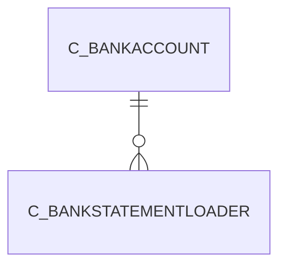

# C_BANKSTATEMENTLOADER

Area [C](../../data-model/c/index.md) · class **business** (proposed) · read from database `idempiere-db` (owner `ADEMPIERE`) · 0 row(s) when profiled

Application model: `org.compiere.model.X_C_BankStatementLoader`, access level 3 - Client - Org.

## Columns

| column | type | key | not null | business name | references (code) | nulls | distinct |
|---|---|---|---|---|---|---|---|
| `C_BANKSTATEMENTLOADER_ID` | NUMBER(10,0) | PK | yes | Bank Statement Loader |  | 0 | 0 |
| `AD_CLIENT_ID` | NUMBER(10,0) |  | yes | Tenant |  | 0 | 0 |
| `AD_ORG_ID` | NUMBER(10,0) |  | yes | Organization |  | 0 | 0 |
| `ISACTIVE` | CHAR(1) |  | yes | Active |  | 0 | 0 |
| `CREATED` | DATE |  | yes | Created |  | 0 | 0 |
| `CREATEDBY` | NUMBER(10,0) |  | yes | Created By |  | 0 | 0 |
| `UPDATED` | DATE |  | yes | Updated |  | 0 | 0 |
| `UPDATEDBY` | NUMBER(10,0) |  | yes | Updated By |  | 0 | 0 |
| `NAME` | VARCHAR2(60 CHAR) |  | yes | Name |  | 0 | 0 |
| `DESCRIPTION` | VARCHAR2(255 CHAR) |  |  | Description |  | 0 | 0 |
| `C_BANKACCOUNT_ID` | NUMBER(10,0) |  | yes | Bank Account | [C_BANKACCOUNT](../../data-model/c/c_bankaccount.md) | 0 | 0 |
| `STMTLOADERCLASS` | VARCHAR2(60 CHAR) |  |  | Statement Loader Class |  | 0 | 0 |
| `FINANCIALINSTITUTIONID` | VARCHAR2(20 CHAR) |  |  | Financial Institution ID |  | 0 | 0 |
| `BRANCHID` | VARCHAR2(20 CHAR) |  |  | Branch ID |  | 0 | 0 |
| `USERID` | VARCHAR2(60 CHAR) |  |  | User ID |  | 0 | 0 |
| `PASSWORD` | VARCHAR2(60 CHAR) |  |  |  |  | 0 | 0 |
| `PIN` | VARCHAR2(20 CHAR) |  |  | PIN |  | 0 | 0 |
| `ACCOUNTNO` | VARCHAR2(20 CHAR) |  |  | Account No |  | 0 | 0 |
| `HOSTADDRESS` | VARCHAR2(60 CHAR) |  |  | Host Address |  | 0 | 0 |
| `HOSTPORT` | NUMBER(10,0) |  |  | Host port |  | 0 | 0 |
| `PROXYADDRESS` | VARCHAR2(60 CHAR) |  |  | Proxy address |  | 0 | 0 |
| `PROXYPORT` | NUMBER(10,0) |  |  | Proxy port |  | 0 | 0 |
| `PROXYLOGON` | VARCHAR2(60 CHAR) |  |  | Proxy logon |  | 0 | 0 |
| `PROXYPASSWORD` | VARCHAR2(60 CHAR) |  |  | Proxy password |  | 0 | 0 |
| `FILENAME` | VARCHAR2(120 CHAR) |  |  | File Name |  | 0 | 0 |
| `DATELASTRUN` | DATE |  |  | Date Last Run |  | 0 | 0 |
| `DATEFORMAT` | VARCHAR2(20 CHAR) |  |  | Date Format |  | 0 | 0 |
| `C_BANKSTATEMENTLOADER_UU` | VARCHAR2(36 CHAR) |  |  | C_BankStatementLoader_UU |  | 0 | 0 |

*references (code)* is the table the application model's code says a column points to; *Foreign keys* below are the constraints the database declares. Counts come from the profile; no value is ever shown.

## Check constraints

| name | expression |
|---|---|
| `SYS_C0020545` | `IsActive in ('Y','N')` |

## Foreign keys

**References**

| table | columns | on delete |
|---|---|---|
| [C_BANKACCOUNT](../../data-model/c/c_bankaccount.md) | C_BANKSTATEMENTLOADER.C_BANKACCOUNT_ID → C_BANKACCOUNT.C_BANKACCOUNT_ID | NO ACTION |

**Referenced by**

_None._

## Write behaviour

- updates: **po_only**
- deletes: **deleted_by_users**
- change log: **recorded**
- evidence: 1 citation(s)

## Schema history

54 change(s); the latest:

| applied | release | operation | column | tickets |
|---|---|---|---|---|
| 2023-04-09T15:47 | iD11 | `add_constraint` |  | IDEMPIERE-5567 |
| 2023-04-09T15:47 | iD11 | `add_constraint` |  | IDEMPIERE-5567 |
| 2021-12-05T16:45 | i8.2z | `add_constraint` |  | IDEMPIERE-5075 |
| 2021-12-05T16:45 | i8.2z | `drop_constraint` |  | IDEMPIERE-5075 |
| 2020-08-04T01:00 | i7.1z | `drop_column` | tmp_col_16_tmp | IDEMPIERE-3862 |
| 2020-08-04T01:00 | i7.1z | `modify_column` | STMTLOADERCLASS | IDEMPIERE-3862 |
| 2020-08-04T01:00 | i7.1z | `modify_column` | PROXYADDRESS | IDEMPIERE-3862 |
| 2020-08-04T01:00 | i7.1z | `drop_column` | tmp_col_7_tmp | IDEMPIERE-3862 |
| 2020-08-04T01:00 | i7.1z | `modify_column` | FINANCIALINSTITUTIONID | IDEMPIERE-3862 |
| 2020-08-04T01:00 | i7.1z | `modify_column` | C_BANKSTATEMENTLOADER_UU | IDEMPIERE-3862 |
| 2020-08-04T01:00 | i7.1z | `add_column` | tmp_col_1_tmp | IDEMPIERE-3862 |
| 2020-08-04T01:00 | i7.1z | `drop_column` | tmp_col_1_tmp | IDEMPIERE-3862 |
| 2020-08-04T01:00 | i7.1z | `modify_column` | PROXYPASSWORD | IDEMPIERE-3862 |
| 2020-08-04T01:00 | i7.1z | `add_column` | tmp_col_4_tmp | IDEMPIERE-3862 |
| 2020-08-04T01:00 | i7.1z | `drop_column` | tmp_col_10_tmp | IDEMPIERE-3862 |

## Notes

<!-- ekos:manual id="table.c_bankstatementloader.notes" -->
_Business notes about this table._
<!-- /ekos:manual -->
