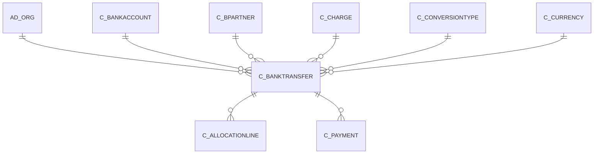

# C_BANKTRANSFER

Area [C](../../data-model/c/index.md) · class **business** (proposed) · read from database `idempiere-db` (owner `ADEMPIERE`) · 0 row(s) when profiled

Application model: `org.compiere.model.X_C_BankTransfer`, access level 1 - Org.

## Columns

| column | type | key | not null | business name | references (code) | nulls | distinct |
|---|---|---|---|---|---|---|---|
| `C_BANKTRANSFER_ID` | NUMBER(10,0) | PK | yes | Bank Transfer |  | 0 | 0 |
| `AD_CLIENT_ID` | NUMBER(10,0) |  | yes | Tenant |  | 0 | 0 |
| `AD_ORG_ID` | NUMBER(10,0) |  | yes | Organization |  | 0 | 0 |
| `CREATED` | DATE |  | yes | Created |  | 0 | 0 |
| `CREATEDBY` | NUMBER(10,0) |  | yes | Created By |  | 0 | 0 |
| `DESCRIPTION` | VARCHAR2(255 CHAR) |  |  | Description |  | 0 | 0 |
| `DOCACTION` | CHAR(2) |  | yes | Document Action |  | 0 | 0 |
| `DOCSTATUS` | CHAR(2) |  | yes | Document Status |  | 0 | 0 |
| `DOCUMENTNO` | VARCHAR2(30 CHAR) |  | yes | Document No |  | 0 | 0 |
| `ISACTIVE` | CHAR(1) |  | yes | Active |  | 0 | 0 |
| `C_BANKTRANSFER_UU` | VARCHAR2(36 CHAR) |  |  | C_BankTransfer_UU |  | 0 | 0 |
| `PROCESSED` | CHAR(1) |  | yes | Processed |  | 0 | 0 |
| `PROCESSING` | CHAR(1) |  |  | Process Now |  | 0 | 0 |
| `UPDATED` | DATE |  | yes | Updated |  | 0 | 0 |
| `UPDATEDBY` | NUMBER(10,0) |  | yes | Updated By |  | 0 | 0 |
| `PAYDATE` | DATE |  | yes | Payment date |  | 0 | 0 |
| `FROM_C_BANKACCOUNT_ID` | NUMBER(10,0) |  | yes | From Bank Account | [C_BANKACCOUNT](../../data-model/c/c_bankaccount.md) | 0 | 0 |
| `FROM_AD_ORG_ID` | NUMBER(10,0) |  | yes | From Organization |  | 0 | 0 |
| `FROM_C_CHARGE_ID` | NUMBER(10,0) |  | yes | From Charge | [C_CHARGE](../../data-model/c/c_charge.md) | 0 | 0 |
| `FROM_C_CURRENCY_ID` | NUMBER(10,0) |  | yes | From Bank Currency | [C_CURRENCY](../../data-model/c/c_currency.md) | 0 | 0 |
| `FROM_AMT` | NUMBER |  | yes | From Amount |  | 0 | 0 |
| `TO_C_BANKACCOUNT_ID` | NUMBER(10,0) |  | yes | To Bank Account | [C_BANKACCOUNT](../../data-model/c/c_bankaccount.md) | 0 | 0 |
| `TO_AD_ORG_ID` | NUMBER(10,0) |  | yes | To Organization |  | 0 | 0 |
| `TO_C_CHARGE_ID` | NUMBER(10,0) |  | yes | To Charge | [C_CHARGE](../../data-model/c/c_charge.md) | 0 | 0 |
| `TO_C_CURRENCY_ID` | NUMBER(10,0) |  | yes | To Bank Currency | [C_CURRENCY](../../data-model/c/c_currency.md) | 0 | 0 |
| `TO_AMT` | NUMBER |  | yes | To Amount |  | 0 | 0 |
| `RATE` | NUMBER |  | yes | Rate |  | 0 | 0 |
| `FROM_TENDERTYPE` | CHAR(1) |  | yes | From Tender Type |  | 0 | 0 |
| `TO_TENDERTYPE` | CHAR(1) |  | yes | To Tender Type |  | 0 | 0 |
| `TO_C_BPARTNER_ID` | NUMBER(10,0) |  | yes | To Business Partner | [C_BPARTNER](../../data-model/c/c_bpartner.md) | 0 | 0 |
| `FROM_C_BPARTNER_ID` | NUMBER(10,0) |  | yes | From Business Partner | [C_BPARTNER](../../data-model/c/c_bpartner.md) | 0 | 0 |
| `DATEACCT` | DATE |  | yes | Account Date |  | 0 | 0 |
| `C_CONVERSIONTYPE_ID` | NUMBER(10,0) |  |  | Currency Type | [C_CONVERSIONTYPE](../../data-model/c/c_conversiontype.md) | 0 | 0 |
| `ISOVERRIDECURRENCYRATE` | CHAR(1) |  | yes | Override Currency Conversion Rate |  | 0 | 0 |

*references (code)* is the table the application model's code says a column points to; *Foreign keys* below are the constraints the database declares. Counts come from the profile; no value is ever shown.

## Check constraints

| name | expression |
|---|---|
| `SYS_C0022139` | `Processing IN ('Y','N')` |
| `SYS_C0022140` | `IsOverrideCurrencyRate IN ('Y','N')` |
| `SYS_C0022141` | `Processed IN ('Y','N')` |
| `SYS_C0022143` | `IsActive IN ('Y','N')` |

## Foreign keys

**References**

| table | columns | on delete |
|---|---|---|
| [AD_ORG](../../data-model/ad/ad_org.md) | C_BANKTRANSFER.FROM_AD_ORG_ID → AD_ORG.AD_ORG_ID | NO ACTION |
| [C_BANKACCOUNT](../../data-model/c/c_bankaccount.md) | C_BANKTRANSFER.FROM_C_BANKACCOUNT_ID → C_BANKACCOUNT.C_BANKACCOUNT_ID | NO ACTION |
| [C_BPARTNER](../../data-model/c/c_bpartner.md) | C_BANKTRANSFER.FROM_C_BPARTNER_ID → C_BPARTNER.C_BPARTNER_ID | NO ACTION |
| [C_CHARGE](../../data-model/c/c_charge.md) | C_BANKTRANSFER.FROM_C_CHARGE_ID → C_CHARGE.C_CHARGE_ID | NO ACTION |
| [C_CONVERSIONTYPE](../../data-model/c/c_conversiontype.md) | C_BANKTRANSFER.C_CONVERSIONTYPE_ID → C_CONVERSIONTYPE.C_CONVERSIONTYPE_ID | NO ACTION |
| [C_CURRENCY](../../data-model/c/c_currency.md) | C_BANKTRANSFER.FROM_C_CURRENCY_ID → C_CURRENCY.C_CURRENCY_ID | NO ACTION |

**Referenced by**

| table | columns | on delete |
|---|---|---|
| [C_ALLOCATIONLINE](../../data-model/c/c_allocationline.md) | C_ALLOCATIONLINE.C_BANKTRANSFER_ID → C_BANKTRANSFER.C_BANKTRANSFER_ID | NO ACTION |
| [C_PAYMENT](../../data-model/c/c_payment.md) | C_PAYMENT.C_BANKTRANSFER_ID → C_BANKTRANSFER.C_BANKTRANSFER_ID | NO ACTION |

## Write behaviour

- updates: **po_only**
- deletes: **deleted_by_users**
- change log: **recorded**
- evidence: 1 citation(s)

## Schema history

120 change(s); the latest:

| applied | release | operation | column | tickets |
|---|---|---|---|---|
| 2026-03-03T14:21 | iD13 | `add_column` | To_DocType_ID | IDEMPIERE-6841 |
| 2026-03-03T14:21 | iD13 | `add_column` | From_DocType_ID | IDEMPIERE-6841 |
| 2026-03-03T14:21 | iD13 | `add_constraint` |  | IDEMPIERE-6841 |
| 2026-03-03T14:21 | iD13 | `add_column` | To_DocType_ID | IDEMPIERE-6841 |
| 2026-03-03T14:21 | iD13 | `add_constraint` |  | IDEMPIERE-6841 |
| 2026-03-03T14:21 | iD13 | `add_constraint` |  | IDEMPIERE-6841 |
| 2026-03-03T14:21 | iD13 | `add_column` | From_DocType_ID | IDEMPIERE-6841 |
| 2026-03-03T14:21 | iD13 | `add_constraint` |  | IDEMPIERE-6841 |
| 2022-04-13T15:52 | iD10 | `add_column` | IsOverrideCurrencyRate | IDEMPIERE-5088 |
| 2022-04-13T15:52 | iD10 | `modify_column` | From_C_BPartner_ID | IDEMPIERE-5088 |
| 2022-04-13T15:52 | iD10 | `modify_column` | To_C_BPartner_ID | IDEMPIERE-5088 |
| 2022-04-13T15:52 | iD10 | `modify_column` | From_C_BPartner_ID | IDEMPIERE-5088 |
| 2022-04-13T15:52 | iD10 | `add_column` | DateAcct | IDEMPIERE-5088 |
| 2022-04-13T15:52 | iD10 | `add_column` | C_ConversionType_ID | IDEMPIERE-5088 |
| 2022-04-13T15:52 | iD10 | `add_column` | C_ConversionType_ID | IDEMPIERE-5088 |

## Open conflicts

| type | attribute | explanation |
|---|---|---|
| `model_column_missing` | `columns.From_DocType_ID` | unexplained |
| `model_column_missing` | `columns.To_DocType_ID` | unexplained |

## Notes

<!-- ekos:manual id="table.c_banktransfer.notes" -->
_Business notes about this table._
<!-- /ekos:manual -->
