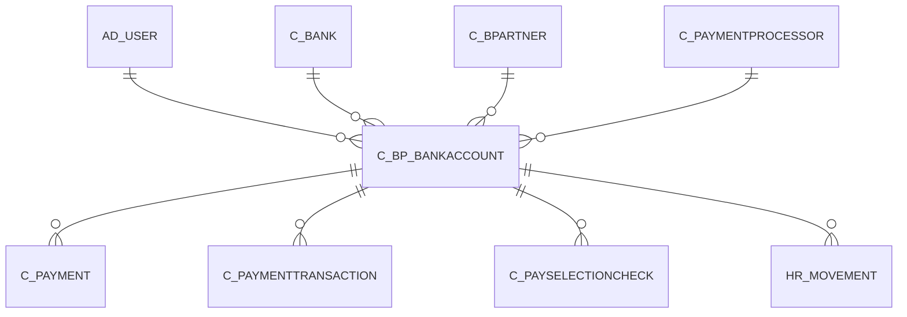

# C_BP_BANKACCOUNT

Default Payment Info

Area [C](../../data-model/c/index.md) · class **business** (proposed) · read from database `idempiere-db` (owner `ADEMPIERE`) · 1 row(s) when profiled

Application model: `org.compiere.model.X_C_BP_BankAccount`, access level 3 - Client - Org.

## Columns

| column | type | key | not null | business name | references (code) | nulls | distinct |
|---|---|---|---|---|---|---|---|
| `C_BP_BANKACCOUNT_ID` | NUMBER(10,0) | PK | yes | Partner Bank Account |  | 0 | 1 |
| `AD_CLIENT_ID` | NUMBER(10,0) |  | yes | Tenant |  | 0 | 1 |
| `AD_ORG_ID` | NUMBER(10,0) |  | yes | Organization |  | 0 | 1 |
| `CREATED` | DATE |  | yes | Created |  | 0 | 1 |
| `UPDATED` | DATE |  | yes | Updated |  | 0 | 1 |
| `ISACTIVE` | CHAR(1) |  | yes | Active |  | 0 | 1 |
| `CREATEDBY` | NUMBER(10,0) |  | yes | Created By |  | 0 | 1 |
| `UPDATEDBY` | NUMBER(10,0) |  | yes | Updated By |  | 0 | 1 |
| `C_BPARTNER_ID` | NUMBER(10,0) |  | yes | Business Partner | [C_BPARTNER](../../data-model/c/c_bpartner.md) | 0 | 1 |
| `C_BANK_ID` | NUMBER(10,0) |  |  | Bank | [C_BANK](../../data-model/c/c_bank.md) | 1 | 0 |
| `ISACH` | CHAR(1) |  | yes | ACH |  | 0 | 1 |
| `BANKACCOUNTTYPE` | CHAR(1) |  |  | Bank Account Type |  | 1 | 0 |
| `ROUTINGNO` | VARCHAR2(20 CHAR) |  |  | Routing No |  | 1 | 0 |
| `ACCOUNTNO` | VARCHAR2(20 CHAR) |  |  | Account No |  | 1 | 0 |
| `CREDITCARDTYPE` | CHAR(1) |  |  | Credit Card |  | 1 | 0 |
| `CREDITCARDNUMBER` | VARCHAR2(20 CHAR) |  |  | Number |  | 1 | 0 |
| `CREDITCARDVV` | VARCHAR2(4 CHAR) |  |  | Verification Code |  | 1 | 0 |
| `CREDITCARDEXPMM` | NUMBER(10,0) |  |  | Exp. Month |  | 0 | 1 |
| `CREDITCARDEXPYY` | NUMBER(10,0) |  |  | Exp. Year |  | 0 | 1 |
| `A_NAME` | VARCHAR2(60 CHAR) |  |  | Account Name |  | 0 | 1 |
| `A_STREET` | VARCHAR2(60 CHAR) |  |  | Account Street |  | 1 | 0 |
| `A_CITY` | VARCHAR2(60 CHAR) |  |  | Account City |  | 1 | 0 |
| `A_STATE` | VARCHAR2(40 CHAR) |  |  | Account State |  | 1 | 0 |
| `A_ZIP` | VARCHAR2(20 CHAR) |  |  | Account Zip/Postal |  | 1 | 0 |
| `A_IDENT_DL` | VARCHAR2(20 CHAR) |  |  | Driver License |  | 1 | 0 |
| `A_EMAIL` | VARCHAR2(60 CHAR) |  |  | Account EMail |  | 1 | 0 |
| `A_IDENT_SSN` | VARCHAR2(20 CHAR) |  |  | Social Security No |  | 1 | 0 |
| `R_AVSADDR` | CHAR(1) |  |  | Address verified |  | 1 | 0 |
| `R_AVSZIP` | CHAR(1) |  |  | Zip verified |  | 1 | 0 |
| `A_COUNTRY` | VARCHAR2(40 CHAR) |  |  | Account Country |  | 1 | 0 |
| `AD_USER_ID` | NUMBER(10,0) |  |  | User/Contact | [AD_USER](../../data-model/ad/ad_user.md) | 1 | 0 |
| `BPBANKACCTUSE` | CHAR(1) |  |  | Account Usage |  | 1 | 0 |
| `C_BP_BANKACCOUNT_UU` | VARCHAR2(36 CHAR) |  |  | C_BP_BankAccount_UU |  | 0 | 1 |
| `CUSTOMERPAYMENTPROFILEID` | VARCHAR2(60 CHAR) |  |  | Customer Payment Profile ID |  | 1 | 0 |
| `C_PAYMENTPROCESSOR_ID` | NUMBER(10,0) |  |  | Payment Processor | [C_PAYMENTPROCESSOR](../../data-model/c/c_paymentprocessor.md) | 1 | 0 |
| `IBAN` | VARCHAR2(40 CHAR) |  |  | IBAN |  | 1 | 0 |

*references (code)* is the table the application model's code says a column points to; *Foreign keys* below are the constraints the database declares. Counts come from the profile; no value is ever shown.

## Check constraints

| name | expression |
|---|---|
| `SYS_C0021850` | `IsActive in ('Y','N')` |
| `SYS_C0021852` | `IsACH in ('Y','N')` |

## Foreign keys

**References**

| table | columns | on delete |
|---|---|---|
| [AD_USER](../../data-model/ad/ad_user.md) | C_BP_BANKACCOUNT.AD_USER_ID → AD_USER.AD_USER_ID | NO ACTION |
| [C_BANK](../../data-model/c/c_bank.md) | C_BP_BANKACCOUNT.C_BANK_ID → C_BANK.C_BANK_ID | SET NULL |
| [C_BPARTNER](../../data-model/c/c_bpartner.md) | C_BP_BANKACCOUNT.C_BPARTNER_ID → C_BPARTNER.C_BPARTNER_ID | CASCADE |
| [C_PAYMENTPROCESSOR](../../data-model/c/c_paymentprocessor.md) | C_BP_BANKACCOUNT.C_PAYMENTPROCESSOR_ID → C_PAYMENTPROCESSOR.C_PAYMENTPROCESSOR_ID | NO ACTION |

**Referenced by**

| table | columns | on delete |
|---|---|---|
| [C_PAYMENT](../../data-model/c/c_payment.md) | C_PAYMENT.C_BP_BANKACCOUNT_ID → C_BP_BANKACCOUNT.C_BP_BANKACCOUNT_ID | SET NULL |
| [C_PAYMENTTRANSACTION](../../data-model/c/c_paymenttransaction.md) | C_PAYMENTTRANSACTION.C_BP_BANKACCOUNT_ID → C_BP_BANKACCOUNT.C_BP_BANKACCOUNT_ID | NO ACTION |
| [C_PAYSELECTIONCHECK](../../data-model/c/c_payselectioncheck.md) | C_PAYSELECTIONCHECK.C_BP_BANKACCOUNT_ID → C_BP_BANKACCOUNT.C_BP_BANKACCOUNT_ID | NO ACTION |
| [HR_MOVEMENT](../../data-model/hr/hr_movement.md) | HR_MOVEMENT.C_BP_BANKACCOUNT_ID → C_BP_BANKACCOUNT.C_BP_BANKACCOUNT_ID | NO ACTION |

## Write behaviour

- updates: **po_only**
- deletes: **deleted_by_users, deleted_by_cascade**
- change log: **recorded**
- evidence: 2 citation(s)

## Schema history

58 change(s); the latest:

| applied | release | operation | column | tickets |
|---|---|---|---|---|
| 2023-04-09T15:47 | iD11 | `add_constraint` |  | IDEMPIERE-5567 |
| 2023-04-09T15:47 | iD11 | `add_constraint` |  | IDEMPIERE-5567 |
| 2021-12-05T16:45 | i8.2z | `drop_constraint` |  | IDEMPIERE-5075 |
| 2021-12-05T16:45 | i8.2z | `add_constraint` |  | IDEMPIERE-5075 |
| 2021-12-05T16:45 | i8.2z | `drop_constraint` |  | IDEMPIERE-5075 |
| 2021-12-05T16:45 | i8.2z | `add_constraint` |  | IDEMPIERE-5075 |
| 2021-12-05T16:45 | i8.2z | `drop_constraint` |  | IDEMPIERE-5075 |
| 2021-12-05T16:45 | i8.2z | `add_constraint` |  | IDEMPIERE-5075 |
| 2020-08-04T01:00 | i7.1z | `modify_column` | A_ZIP | IDEMPIERE-3862 |
| 2020-08-04T01:00 | i7.1z | `drop_column` | tmp_col_6_tmp | IDEMPIERE-3862 |
| 2020-08-04T01:00 | i7.1z | `modify_column` | A_IDENT_SSN | IDEMPIERE-3862 |
| 2020-08-04T01:00 | i7.1z | `drop_column` | tmp_col_12_tmp | IDEMPIERE-3862 |
| 2020-08-04T01:00 | i7.1z | `modify_column` | ACCOUNTNO | IDEMPIERE-3862 |
| 2020-08-04T01:00 | i7.1z | `add_column` | tmp_col_8_tmp | IDEMPIERE-3862 |
| 2020-08-04T01:00 | i7.1z | `add_column` | tmp_col_4_tmp | IDEMPIERE-3862 |

## Open conflicts

| type | attribute | explanation |
|---|---|---|
| `mandatory_but_nullable` | `columns.A_Name.nullable` | unexplained |

## Notes

<!-- ekos:manual id="table.c_bp_bankaccount.notes" -->
_Business notes about this table._
<!-- /ekos:manual -->
