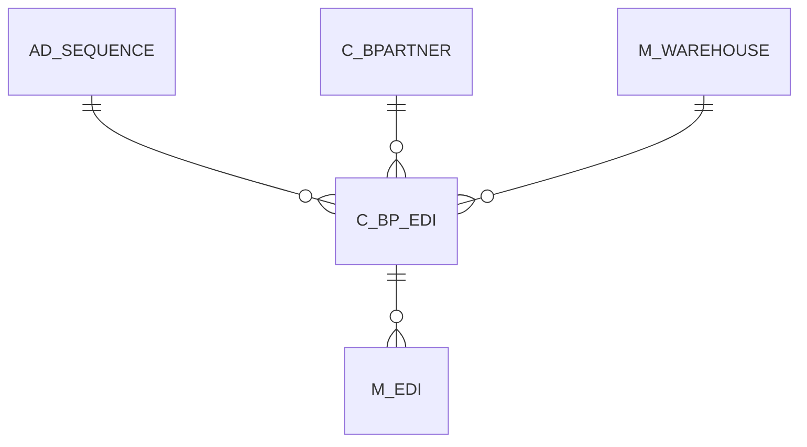

# C_BP_EDI

Area [C](../../data-model/c/index.md) · class **business** (proposed) · read from database `idempiere-db` (owner `ADEMPIERE`) · 0 row(s) when profiled

Application model: `org.compiere.model.X_C_BP_EDI`, access level 3 - Client - Org.

## Columns

| column | type | key | not null | business name | references (code) | nulls | distinct |
|---|---|---|---|---|---|---|---|
| `C_BP_EDI_ID` | NUMBER(10,0) | PK | yes | EDI Definition |  | 0 | 0 |
| `AD_CLIENT_ID` | NUMBER(10,0) |  | yes | Tenant |  | 0 | 0 |
| `AD_ORG_ID` | NUMBER(10,0) |  | yes | Organization |  | 0 | 0 |
| `ISACTIVE` | CHAR(1) |  | yes | Active |  | 0 | 0 |
| `CREATED` | DATE |  | yes | Created |  | 0 | 0 |
| `CREATEDBY` | NUMBER(10,0) |  | yes | Created By |  | 0 | 0 |
| `UPDATED` | DATE |  | yes | Updated |  | 0 | 0 |
| `UPDATEDBY` | NUMBER(10,0) |  | yes | Updated By |  | 0 | 0 |
| `NAME` | VARCHAR2(60 CHAR) |  | yes | Name |  | 0 | 0 |
| `DESCRIPTION` | VARCHAR2(255 CHAR) |  |  | Description |  | 0 | 0 |
| `C_BPARTNER_ID` | NUMBER(10,0) |  | yes | Business Partner | [C_BPARTNER](../../data-model/c/c_bpartner.md) | 0 | 0 |
| `M_WAREHOUSE_ID` | NUMBER(10,0) |  | yes | Warehouse | [M_WAREHOUSE](../../data-model/m/m_warehouse.md) | 0 | 0 |
| `EDITYPE` | CHAR(1) |  | yes | EDI Type |  | 0 | 0 |
| `ISAUDITED` | CHAR(1) |  | yes | Activate Audit |  | 0 | 0 |
| `CUSTOMERNO` | VARCHAR2(20 CHAR) |  | yes | Customer No |  | 0 | 0 |
| `AD_SEQUENCE_ID` | NUMBER(10,0) |  | yes | Sequence | [AD_SEQUENCE](../../data-model/ad/ad_sequence.md) | 0 | 0 |
| `EMAIL_TO` | VARCHAR2(60 CHAR) |  |  | To EMail |  | 0 | 0 |
| `EMAIL_FROM` | VARCHAR2(60 CHAR) |  |  | From EMail |  | 0 | 0 |
| `EMAIL_FROM_UID` | VARCHAR2(20 CHAR) |  |  | From EMail User ID |  | 0 | 0 |
| `EMAIL_FROM_PWD` | VARCHAR2(20 CHAR) |  |  | From EMail Password |  | 0 | 0 |
| `EMAIL_ERROR_TO` | VARCHAR2(60 CHAR) |  | yes | Error EMail |  | 0 | 0 |
| `ISINFOSENT` | CHAR(1) |  | yes | Send Info |  | 0 | 0 |
| `EMAIL_INFO_TO` | VARCHAR2(60 CHAR) |  | yes | Info EMail |  | 0 | 0 |
| `SENDINQUIRY` | CHAR(1) |  | yes | Send Inquiry |  | 0 | 0 |
| `RECEIVEINQUIRYREPLY` | CHAR(1) |  | yes | Received Inquiry Reply |  | 0 | 0 |
| `SENDORDER` | CHAR(1) |  | yes | Send Order |  | 0 | 0 |
| `RECEIVEORDERREPLY` | CHAR(1) |  | yes | Receive Order Reply |  | 0 | 0 |
| `C_BP_EDI_UU` | VARCHAR2(36 CHAR) |  |  | C_BP_EDI_UU |  | 0 | 0 |

*references (code)* is the table the application model's code says a column points to; *Foreign keys* below are the constraints the database declares. Counts come from the profile; no value is ever shown.

## Check constraints

| name | expression |
|---|---|
| `SYS_C0020093` | `IsInfoSent in ('Y','N')` |
| `SYS_C0020094` | `ReceiveInquiryReply in ('Y','N')` |
| `SYS_C0020095` | `IsAudited in ('Y','N')` |
| `SYS_C0020096` | `ReceiveOrderReply in ('Y','N')` |
| `SYS_C0020097` | `IsActive in ('Y','N')` |
| `SYS_C0020100` | `SendOrder in ('Y','N')` |
| `SYS_C0020101` | `SendInquiry in ('Y','N')` |

## Foreign keys

**References**

| table | columns | on delete |
|---|---|---|
| [AD_SEQUENCE](../../data-model/ad/ad_sequence.md) | C_BP_EDI.AD_SEQUENCE_ID → AD_SEQUENCE.AD_SEQUENCE_ID | NO ACTION |
| [C_BPARTNER](../../data-model/c/c_bpartner.md) | C_BP_EDI.C_BPARTNER_ID → C_BPARTNER.C_BPARTNER_ID | NO ACTION |
| [M_WAREHOUSE](../../data-model/m/m_warehouse.md) | C_BP_EDI.M_WAREHOUSE_ID → M_WAREHOUSE.M_WAREHOUSE_ID | NO ACTION |

**Referenced by**

| table | columns | on delete |
|---|---|---|
| [M_EDI](../../data-model/m/m_edi.md) | M_EDI.C_BP_EDI_ID → C_BP_EDI.C_BP_EDI_ID | NO ACTION |

## Write behaviour

- updates: **po_only**
- deletes: **deleted_by_users**
- change log: **recorded**
- evidence: 1 citation(s)

## Schema history

46 change(s); the latest:

| applied | release | operation | column | tickets |
|---|---|---|---|---|
| 2023-04-09T15:47 | iD11 | `add_constraint` |  | IDEMPIERE-5567 |
| 2023-04-09T15:47 | iD11 | `add_constraint` |  | IDEMPIERE-5567 |
| 2021-12-05T16:45 | i8.2z | `drop_constraint` |  | IDEMPIERE-5075 |
| 2021-12-05T16:45 | i8.2z | `drop_constraint` |  | IDEMPIERE-5075 |
| 2021-12-05T16:45 | i8.2z | `add_constraint` |  | IDEMPIERE-5075 |
| 2021-12-05T16:45 | i8.2z | `drop_constraint` |  | IDEMPIERE-5075 |
| 2021-12-05T16:45 | i8.2z | `add_constraint` |  | IDEMPIERE-5075 |
| 2021-12-05T16:45 | i8.2z | `add_constraint` |  | IDEMPIERE-5075 |
| 2020-08-04T01:00 | i7.1z | `modify_column` | EMAIL_ERROR_TO | IDEMPIERE-3862 |
| 2020-08-04T01:00 | i7.1z | `modify_column` | NAME | IDEMPIERE-3862 |
| 2020-08-04T01:00 | i7.1z | `add_column` | tmp_col_3_tmp | IDEMPIERE-3862 |
| 2020-08-04T01:00 | i7.1z | `drop_column` | tmp_col_8_tmp | IDEMPIERE-3862 |
| 2020-08-04T01:00 | i7.1z | `add_column` | tmp_col_5_tmp | IDEMPIERE-3862 |
| 2020-08-04T01:00 | i7.1z | `drop_column` | tmp_col_10_tmp | IDEMPIERE-3862 |
| 2020-08-04T01:00 | i7.1z | `modify_column` | CUSTOMERNO | IDEMPIERE-3862 |

## Notes

<!-- ekos:manual id="table.c_bp_edi.notes" -->
_Business notes about this table._
<!-- /ekos:manual -->
