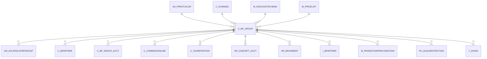

# C_BP_GROUP

Area [C](../../data-model/c/index.md) · class **business** (proposed) · read from database `idempiere-db` (owner `ADEMPIERE`) · 3 row(s) when profiled

Application model: `org.compiere.model.X_C_BP_Group`, access level 3 - Client - Org.

## Columns

| column | type | key | not null | business name | references (code) | nulls | distinct |
|---|---|---|---|---|---|---|---|
| `C_BP_GROUP_ID` | NUMBER(10,0) | PK | yes | Business Partner Group |  | 0 | 3 |
| `AD_CLIENT_ID` | NUMBER(10,0) |  | yes | Tenant |  | 0 | 1 |
| `AD_ORG_ID` | NUMBER(10,0) |  | yes | Organization |  | 0 | 2 |
| `ISACTIVE` | CHAR(1) |  | yes | Active |  | 0 | 1 |
| `CREATED` | DATE |  | yes | Created |  | 0 | 3 |
| `CREATEDBY` | NUMBER(10,0) |  | yes | Created By |  | 0 | 2 |
| `UPDATED` | DATE |  | yes | Updated |  | 0 | 3 |
| `UPDATEDBY` | NUMBER(10,0) |  | yes | Updated By |  | 0 | 2 |
| `VALUE` | VARCHAR2(40 CHAR) |  | yes | Search Key |  | 0 | 3 |
| `NAME` | VARCHAR2(60 CHAR) |  | yes | Name |  | 0 | 3 |
| `DESCRIPTION` | VARCHAR2(255 CHAR) |  |  | Description |  | 3 | 0 |
| `ISDEFAULT` | CHAR(1) |  | yes | Default |  | 0 | 2 |
| `AD_PRINTCOLOR_ID` | NUMBER(10,0) |  |  | Print Color | [AD_PRINTCOLOR](../../data-model/ad/ad_printcolor.md) | 1 | 2 |
| `ISCONFIDENTIALINFO` | CHAR(1) |  | yes | Confidential Info |  | 0 | 1 |
| `PRIORITYBASE` | CHAR(1) |  |  | Priority Base |  | 3 | 0 |
| `M_PRICELIST_ID` | NUMBER(10,0) |  |  | Price List | [M_PRICELIST](../../data-model/m/m_pricelist.md) | 3 | 0 |
| `PO_PRICELIST_ID` | NUMBER(10,0) |  |  | Purchase Price List | [M_PRICELIST](../../data-model/m/m_pricelist.md) | 3 | 0 |
| `M_DISCOUNTSCHEMA_ID` | NUMBER(10,0) |  |  | Discount Schema | [M_DISCOUNTSCHEMA](../../data-model/m/m_discountschema.md) | 3 | 0 |
| `PO_DISCOUNTSCHEMA_ID` | NUMBER(10,0) |  |  | PO Discount Schema | [M_DISCOUNTSCHEMA](../../data-model/m/m_discountschema.md) | 3 | 0 |
| `CREDITWATCHPERCENT` | NUMBER |  |  | Credit Watch % |  | 2 | 1 |
| `PRICEMATCHTOLERANCE` | NUMBER |  |  | Price Match Tolerance |  | 3 | 0 |
| `C_DUNNING_ID` | NUMBER(10,0) |  |  | Dunning | [C_DUNNING](../../data-model/c/c_dunning.md) | 3 | 0 |
| `C_BP_GROUP_UU` | VARCHAR2(36 CHAR) |  |  | C_BP_Group_UU |  | 0 | 3 |

*references (code)* is the table the application model's code says a column points to; *Foreign keys* below are the constraints the database declares. Counts come from the profile; no value is ever shown.

## Check constraints

| name | expression |
|---|---|
| `SYS_C0021447` | `IsActive in ('Y','N')` |

## Foreign keys

**References**

| table | columns | on delete |
|---|---|---|
| [AD_PRINTCOLOR](../../data-model/ad/ad_printcolor.md) | C_BP_GROUP.AD_PRINTCOLOR_ID → AD_PRINTCOLOR.AD_PRINTCOLOR_ID | NO ACTION |
| [C_DUNNING](../../data-model/c/c_dunning.md) | C_BP_GROUP.C_DUNNING_ID → C_DUNNING.C_DUNNING_ID | NO ACTION |
| [M_DISCOUNTSCHEMA](../../data-model/m/m_discountschema.md) | C_BP_GROUP.PO_DISCOUNTSCHEMA_ID → M_DISCOUNTSCHEMA.M_DISCOUNTSCHEMA_ID | SET NULL |
| [M_PRICELIST](../../data-model/m/m_pricelist.md) | C_BP_GROUP.PO_PRICELIST_ID → M_PRICELIST.M_PRICELIST_ID | SET NULL |

**Referenced by**

| table | columns | on delete |
|---|---|---|
| [CM_ACCESSLISTBPGROUP](../../data-model/cm/cm_accesslistbpgroup.md) | CM_ACCESSLISTBPGROUP.C_BP_GROUP_ID → C_BP_GROUP.C_BP_GROUP_ID | CASCADE |
| [C_BPARTNER](../../data-model/c/c_bpartner.md) | C_BPARTNER.C_BP_GROUP_ID → C_BP_GROUP.C_BP_GROUP_ID | NO ACTION |
| [C_BP_GROUP_ACCT](../../data-model/c/c_bp_group_acct.md) | C_BP_GROUP_ACCT.C_BP_GROUP_ID → C_BP_GROUP.C_BP_GROUP_ID | CASCADE |
| [C_COMMISSIONLINE](../../data-model/c/c_commissionline.md) | C_COMMISSIONLINE.C_BP_GROUP_ID → C_BP_GROUP.C_BP_GROUP_ID | NO ACTION |
| [C_TAXDEFINITION](../../data-model/c/c_taxdefinition.md) | C_TAXDEFINITION.C_BP_GROUP_ID → C_BP_GROUP.C_BP_GROUP_ID | NO ACTION |
| [HR_CONCEPT_ACCT](../../data-model/hr/hr_concept_acct.md) | HR_CONCEPT_ACCT.C_BP_GROUP_ID → C_BP_GROUP.C_BP_GROUP_ID | NO ACTION |
| [HR_MOVEMENT](../../data-model/hr/hr_movement.md) | HR_MOVEMENT.C_BP_GROUP_ID → C_BP_GROUP.C_BP_GROUP_ID | NO ACTION |
| `I_BPARTNER` | I_BPARTNER.C_BP_GROUP_ID → C_BP_GROUP.C_BP_GROUP_ID | SET NULL |
| [M_PROMOTIONPRECONDITION](../../data-model/m/m_promotionprecondition.md) | M_PROMOTIONPRECONDITION.C_BP_GROUP_ID → C_BP_GROUP.C_BP_GROUP_ID | NO ACTION |
| [PA_GOALRESTRICTION](../../data-model/pa/pa_goalrestriction.md) | PA_GOALRESTRICTION.C_BP_GROUP_ID → C_BP_GROUP.C_BP_GROUP_ID | NO ACTION |
| `T_AGING` | T_AGING.C_BP_GROUP_ID → C_BP_GROUP.C_BP_GROUP_ID | CASCADE |

## Write behaviour

- updates: **po_only**
- deletes: **deleted_by_users**
- change log: **recorded**
- evidence: 1 citation(s)

## Read by

| kind | name |
|---|---|
| Procedure | [C_AcctSchema_Default_Copy](../../logic/c_acctschema_default_copy.md) |
| View | `RV_FACT_ADAXA` |
| View | `rv_fact_adaxa` |

## Schema history

31 change(s); the latest:

| applied | release | operation | column | tickets |
|---|---|---|---|---|
| 2023-04-09T15:47 | iD11 | `add_constraint` |  | IDEMPIERE-5567 |
| 2023-04-09T15:47 | iD11 | `add_constraint` |  | IDEMPIERE-5567 |
| 2021-12-05T16:45 | i8.2z | `drop_constraint` |  | IDEMPIERE-5075 |
| 2021-12-05T16:45 | i8.2z | `drop_constraint` |  | IDEMPIERE-5075 |
| 2021-12-05T16:45 | i8.2z | `drop_constraint` |  | IDEMPIERE-5075 |
| 2021-12-05T16:45 | i8.2z | `add_constraint` |  | IDEMPIERE-5075 |
| 2021-12-05T16:45 | i8.2z | `add_constraint` |  | IDEMPIERE-5075 |
| 2021-12-05T16:45 | i8.2z | `add_constraint` |  | IDEMPIERE-5075 |
| 2021-12-05T16:45 | i8.2z | `drop_constraint` |  | IDEMPIERE-5075 |
| 2021-12-05T16:45 | i8.2z | `add_constraint` |  | IDEMPIERE-5075 |
| 2021-12-05T16:45 | i8.2z | `drop_constraint` |  | IDEMPIERE-5075 |
| 2021-12-05T16:45 | i8.2z | `drop_constraint` |  | IDEMPIERE-5075 |
| 2021-12-05T16:45 | i8.2z | `add_constraint` |  | IDEMPIERE-5075 |
| 2021-12-05T16:45 | i8.2z | `add_constraint` |  | IDEMPIERE-5075 |
| 2020-08-04T01:00 | i7.1z | `modify_column` | DESCRIPTION | IDEMPIERE-3862 |

## Notes

<!-- ekos:manual id="table.c_bp_group.notes" -->
_Business notes about this table._
<!-- /ekos:manual -->
