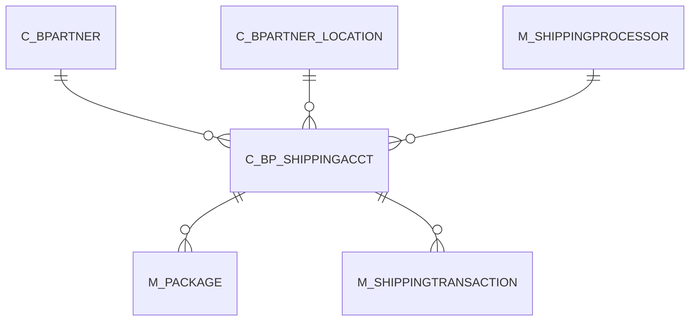

# C_BP_SHIPPINGACCT

Area [C](../../data-model/c/index.md) · class **business** (proposed) · read from database `idempiere-db` (owner `ADEMPIERE`) · 0 row(s) when profiled

Application model: `org.compiere.model.X_C_BP_ShippingAcct`, access level 3 - Client - Org.

## Columns

| column | type | key | not null | business name | references (code) | nulls | distinct |
|---|---|---|---|---|---|---|---|
| `AD_CLIENT_ID` | NUMBER(10,0) |  | yes | Tenant |  | 0 | 0 |
| `AD_ORG_ID` | NUMBER(10,0) |  | yes | Organization |  | 0 | 0 |
| `C_BP_SHIPPINGACCT_ID` | NUMBER(10,0) | PK | yes | Business Partner Shipping Account |  | 0 | 0 |
| `C_BP_SHIPPINGACCT_UU` | VARCHAR2(36 CHAR) |  |  | C_BP_ShippingAcct_UU |  | 0 | 0 |
| `C_BPARTNER_ID` | NUMBER(10,0) |  | yes | Business Partner | [C_BPARTNER](../../data-model/c/c_bpartner.md) | 0 | 0 |
| `C_BPARTNER_LOCATION_ID` | NUMBER(10,0) |  |  | Partner Location | [C_BPARTNER_LOCATION](../../data-model/c/c_bpartner_location.md) | 0 | 0 |
| `CREATED` | DATE |  | yes | Created |  | 0 | 0 |
| `CREATEDBY` | NUMBER(10,0) |  | yes | Created By |  | 0 | 0 |
| `DUTIESSHIPPERACCOUNT` | VARCHAR2(40 CHAR) |  |  | Duties Shipper Account |  | 0 | 0 |
| `ISACTIVE` | CHAR(1) |  | yes | Active |  | 0 | 0 |
| `M_SHIPPINGPROCESSOR_ID` | NUMBER(10,0) |  |  | Shipping Processor | [M_SHIPPINGPROCESSOR](../../data-model/m/m_shippingprocessor.md) | 0 | 0 |
| `SHIPPERACCOUNT` | VARCHAR2(40 CHAR) |  |  | Shipper Account Number |  | 0 | 0 |
| `UPDATED` | DATE |  | yes | Updated |  | 0 | 0 |
| `UPDATEDBY` | NUMBER(10,0) |  | yes | Updated By |  | 0 | 0 |
| `SHIPPERMETER` | VARCHAR2(255 CHAR) |  |  | Shipper Meter |  | 0 | 0 |

*references (code)* is the table the application model's code says a column points to; *Foreign keys* below are the constraints the database declares. Counts come from the profile; no value is ever shown.

## Check constraints

| name | expression |
|---|---|
| `SYS_C0021772` | `IsActive IN ('Y','N')` |

## Foreign keys

**References**

| table | columns | on delete |
|---|---|---|
| [C_BPARTNER](../../data-model/c/c_bpartner.md) | C_BP_SHIPPINGACCT.C_BPARTNER_ID → C_BPARTNER.C_BPARTNER_ID | NO ACTION |
| [C_BPARTNER_LOCATION](../../data-model/c/c_bpartner_location.md) | C_BP_SHIPPINGACCT.C_BPARTNER_LOCATION_ID → C_BPARTNER_LOCATION.C_BPARTNER_LOCATION_ID | NO ACTION |
| [M_SHIPPINGPROCESSOR](../../data-model/m/m_shippingprocessor.md) | C_BP_SHIPPINGACCT.M_SHIPPINGPROCESSOR_ID → M_SHIPPINGPROCESSOR.M_SHIPPINGPROCESSOR_ID | NO ACTION |

**Referenced by**

| table | columns | on delete |
|---|---|---|
| [M_PACKAGE](../../data-model/m/m_package.md) | M_PACKAGE.C_BP_SHIPPINGACCT_ID → C_BP_SHIPPINGACCT.C_BP_SHIPPINGACCT_ID | NO ACTION |
| [M_SHIPPINGTRANSACTION](../../data-model/m/m_shippingtransaction.md) | M_SHIPPINGTRANSACTION.C_BP_SHIPPINGACCT_ID → C_BP_SHIPPINGACCT.C_BP_SHIPPINGACCT_ID | NO ACTION |

## Write behaviour

- updates: **po_only**
- deletes: **deleted_by_users**
- change log: **recorded**
- evidence: 1 citation(s)

## Schema history

34 change(s); the latest:

| applied | release | operation | column | tickets |
|---|---|---|---|---|
| 2023-04-09T15:47 | iD11 | `add_constraint` |  | IDEMPIERE-5567 |
| 2023-04-09T15:47 | iD11 | `add_constraint` |  | IDEMPIERE-5567 |
| 2020-08-04T01:00 | i7.1z | `modify_column` | SHIPPERACCOUNT | IDEMPIERE-3862 |
| 2020-08-04T01:00 | i7.1z | `drop_column` | tmp_col_2_tmp | IDEMPIERE-3862 |
| 2020-08-04T01:00 | i7.1z | `add_column` | tmp_col_1_tmp | IDEMPIERE-3862 |
| 2020-08-04T01:00 | i7.1z | `modify_column` | C_BP_SHIPPINGACCT_UU | IDEMPIERE-3862 |
| 2020-08-04T01:00 | i7.1z | `add_column` | tmp_col_4_tmp | IDEMPIERE-3862 |
| 2020-08-04T01:00 | i7.1z | `add_column` | tmp_col_2_tmp | IDEMPIERE-3862 |
| 2020-08-04T01:00 | i7.1z | `drop_column` | tmp_col_4_tmp | IDEMPIERE-3862 |
| 2020-08-04T01:00 | i7.1z | `modify_column` | SHIPPERMETER | IDEMPIERE-3862 |
| 2020-08-04T01:00 | i7.1z | `modify_column` | DUTIESSHIPPERACCOUNT | IDEMPIERE-3862 |
| 2020-08-04T01:00 | i7.1z | `add_column` | tmp_col_3_tmp | IDEMPIERE-3862 |
| 2020-08-04T01:00 | i7.1z | `drop_column` | tmp_col_3_tmp | IDEMPIERE-3862 |
| 2020-08-04T01:00 | i7.1z | `drop_column` | tmp_col_1_tmp | IDEMPIERE-3862 |
| 2014-05-02T10:09 | i2.0 | `modify_column` | updated | IDEMPIERE-709 |

## Notes

<!-- ekos:manual id="table.c_bp_shippingacct.notes" -->
_Business notes about this table._
<!-- /ekos:manual -->
