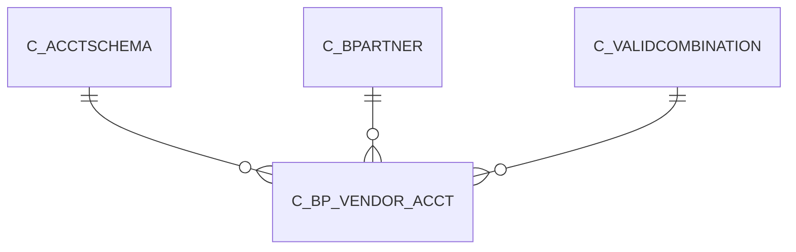

# C_BP_VENDOR_ACCT

Area [C](../../data-model/c/index.md) · class **business** (proposed) · read from database `idempiere-db` (owner `ADEMPIERE`) · 36 row(s) when profiled

Application model: `org.compiere.model.X_C_BP_Vendor_Acct`, access level 3 - Client - Org.

## Columns

| column | type | key | not null | business name | references (code) | nulls | distinct |
|---|---|---|---|---|---|---|---|
| `C_ACCTSCHEMA_ID` | NUMBER(10,0) | PK | yes | Accounting Schema | [C_ACCTSCHEMA](../../data-model/c/c_acctschema.md) | 0 | 2 |
| `C_BPARTNER_ID` | NUMBER(10,0) | PK | yes | Business Partner | [C_BPARTNER](../../data-model/c/c_bpartner.md) | 0 | 18 |
| `AD_CLIENT_ID` | NUMBER(10,0) |  | yes | Tenant |  | 0 | 1 |
| `AD_ORG_ID` | NUMBER(10,0) |  | yes | Organization |  | 0 | 2 |
| `ISACTIVE` | CHAR(1) |  | yes | Active |  | 0 | 1 |
| `CREATED` | DATE |  | yes | Created |  | 0 | 15 |
| `CREATEDBY` | NUMBER(10,0) |  | yes | Created By |  | 0 | 2 |
| `UPDATED` | DATE |  | yes | Updated |  | 0 | 12 |
| `UPDATEDBY` | NUMBER(10,0) |  | yes | Updated By |  | 0 | 2 |
| `V_LIABILITY_ACCT` | NUMBER(10,0) |  |  | Vendor Liability |  | 0 | 4 |
| `V_LIABILITY_SERVICES_ACCT` | NUMBER(10,0) |  |  | Vendor Service Liability |  | 18 | 1 |
| `V_PREPAYMENT_ACCT` | NUMBER(10,0) |  |  | Vendor Prepayment |  | 0 | 2 |
| `C_BP_VENDOR_ACCT_UU` | VARCHAR2(36 CHAR) |  |  | C_BP_Vendor_Acct_UU |  | 0 | 36 |

*references (code)* is the table the application model's code says a column points to; *Foreign keys* below are the constraints the database declares. Counts come from the profile; no value is ever shown.

## Check constraints

| name | expression |
|---|---|
| `SYS_C0021531` | `IsActive in ('Y','N')` |

## Foreign keys

**References**

| table | columns | on delete |
|---|---|---|
| [C_ACCTSCHEMA](../../data-model/c/c_acctschema.md) | C_BP_VENDOR_ACCT.C_ACCTSCHEMA_ID → C_ACCTSCHEMA.C_ACCTSCHEMA_ID | CASCADE |
| [C_BPARTNER](../../data-model/c/c_bpartner.md) | C_BP_VENDOR_ACCT.C_BPARTNER_ID → C_BPARTNER.C_BPARTNER_ID | CASCADE |
| [C_VALIDCOMBINATION](../../data-model/c/c_validcombination.md) | C_BP_VENDOR_ACCT.V_LIABILITY_SERVICES_ACCT → C_VALIDCOMBINATION.C_VALIDCOMBINATION_ID | NO ACTION |

**Referenced by**

_None._

## Write behaviour

- updates: **raw_sql_skips_updated**
- deletes: **deleted_by_cascade**
- change log: **recorded**
- evidence: 7 citation(s)

## Read by

| kind | name |
|---|---|
| Procedure | [C_BP_Group_Acct_Copy](../../logic/c_bp_group_acct_copy.md) |

## Written by

| kind | name |
|---|---|
| Procedure | [C_BP_Group_Acct_Copy](../../logic/c_bp_group_acct_copy.md) |

## Schema history

15 change(s); the latest:

| applied | release | operation | column | tickets |
|---|---|---|---|---|
| 2023-04-09T15:47 | iD11 | `add_constraint` |  | IDEMPIERE-5567 |
| 2023-04-09T15:47 | iD11 | `add_constraint` |  | IDEMPIERE-5567 |
| 2021-12-05T16:45 | i8.2z | `add_constraint` |  | IDEMPIERE-5075 |
| 2021-12-05T16:45 | i8.2z | `drop_constraint` |  | IDEMPIERE-5075 |
| 2021-12-05T16:45 | i8.2z | `drop_constraint` |  | IDEMPIERE-5075 |
| 2021-12-05T16:45 | i8.2z | `add_constraint` |  | IDEMPIERE-5075 |
| 2021-12-05T16:45 | i8.2z | `drop_constraint` |  | IDEMPIERE-5075 |
| 2021-12-05T16:45 | i8.2z | `add_constraint` |  | IDEMPIERE-5075 |
| 2021-12-05T16:45 | i8.2z | `drop_constraint` |  | IDEMPIERE-5075 |
| 2021-12-05T16:45 | i8.2z | `drop_constraint` |  | IDEMPIERE-5075 |
| 2021-12-05T16:45 | i8.2z | `add_constraint` |  | IDEMPIERE-5075 |
| 2021-12-05T16:45 | i8.2z | `add_constraint` |  | IDEMPIERE-5075 |
| 2020-08-04T01:00 | i7.1z | `drop_column` | tmp_col_1_tmp | IDEMPIERE-3862 |
| 2020-08-04T01:00 | i7.1z | `add_column` | tmp_col_1_tmp | IDEMPIERE-3862 |
| 2020-08-04T01:00 | i7.1z | `modify_column` | C_BP_VENDOR_ACCT_UU | IDEMPIERE-3862 |

## Open conflicts

| type | attribute | explanation |
|---|---|---|
| `mandatory_but_nullable` | `columns.V_Liability_Acct.nullable` | unexplained |
| `mandatory_but_nullable` | `columns.V_Prepayment_Acct.nullable` | unexplained |

## Notes

<!-- ekos:manual id="table.c_bp_vendor_acct.notes" -->
_Business notes about this table._
<!-- /ekos:manual -->
