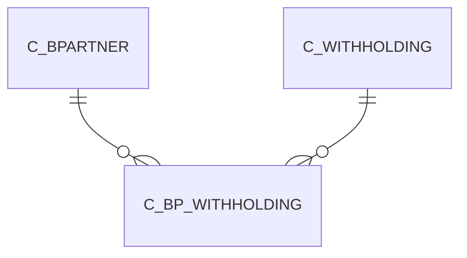

# C_BP_WITHHOLDING

Area [C](../../data-model/c/index.md) · class **business** (proposed) · read from database `idempiere-db` (owner `ADEMPIERE`) · 0 row(s) when profiled

Application model: `org.compiere.model.X_C_BP_Withholding`, access level 3 - Client - Org.

## Columns

| column | type | key | not null | business name | references (code) | nulls | distinct |
|---|---|---|---|---|---|---|---|
| `C_BPARTNER_ID` | NUMBER(10,0) | PK | yes | Business Partner | [C_BPARTNER](../../data-model/c/c_bpartner.md) | 0 | 0 |
| `C_WITHHOLDING_ID` | NUMBER(10,0) | PK | yes | Withholding | [C_WITHHOLDING](../../data-model/c/c_withholding.md) | 0 | 0 |
| `AD_CLIENT_ID` | NUMBER(10,0) |  | yes | Tenant |  | 0 | 0 |
| `AD_ORG_ID` | NUMBER(10,0) |  | yes | Organization |  | 0 | 0 |
| `ISACTIVE` | CHAR(1) |  | yes | Active |  | 0 | 0 |
| `CREATED` | DATE |  | yes | Created |  | 0 | 0 |
| `CREATEDBY` | NUMBER(10,0) |  | yes | Created By |  | 0 | 0 |
| `UPDATED` | DATE |  | yes | Updated |  | 0 | 0 |
| `UPDATEDBY` | NUMBER(10,0) |  | yes | Updated By |  | 0 | 0 |
| `ISMANDATORYWITHHOLDING` | CHAR(1) |  | yes | Mandatory Withholding |  | 0 | 0 |
| `ISTEMPORARYEXEMPT` | CHAR(1) |  | yes | Temporary exempt |  | 0 | 0 |
| `EXEMPTREASON` | VARCHAR2(20 CHAR) |  |  | Exempt reason |  | 0 | 0 |
| `C_BP_WITHHOLDING_UU` | VARCHAR2(36 CHAR) |  |  | C_BP_Withholding_UU |  | 0 | 0 |

*references (code)* is the table the application model's code says a column points to; *Foreign keys* below are the constraints the database declares. Counts come from the profile; no value is ever shown.

## Check constraints

| name | expression |
|---|---|
| `SYS_C0020374` | `IsTemporaryExempt in ('Y','N')` |
| `SYS_C0020376` | `IsMandatoryWithholding in ('Y','N')` |
| `SYS_C0020378` | `IsActive in ('Y','N')` |

## Foreign keys

**References**

| table | columns | on delete |
|---|---|---|
| [C_BPARTNER](../../data-model/c/c_bpartner.md) | C_BP_WITHHOLDING.C_BPARTNER_ID → C_BPARTNER.C_BPARTNER_ID | CASCADE |
| [C_WITHHOLDING](../../data-model/c/c_withholding.md) | C_BP_WITHHOLDING.C_WITHHOLDING_ID → C_WITHHOLDING.C_WITHHOLDING_ID | NO ACTION |

**Referenced by**

_None._

## Write behaviour

- updates: **raw_sql_skips_updated**
- deletes: **deleted_by_users, deleted_by_cascade**
- change log: **recorded**
- evidence: 3 citation(s)

## Schema history

12 change(s); the latest:

| applied | release | operation | column | tickets |
|---|---|---|---|---|
| 2023-04-09T15:47 | iD11 | `add_constraint` |  | IDEMPIERE-5567 |
| 2023-04-09T15:47 | iD11 | `add_constraint` |  | IDEMPIERE-5567 |
| 2021-12-05T16:45 | i8.2z | `drop_constraint` |  | IDEMPIERE-5075 |
| 2021-12-05T16:45 | i8.2z | `drop_constraint` |  | IDEMPIERE-5075 |
| 2021-12-05T16:45 | i8.2z | `add_constraint` |  | IDEMPIERE-5075 |
| 2021-12-05T16:45 | i8.2z | `add_constraint` |  | IDEMPIERE-5075 |
| 2020-08-04T01:00 | i7.1z | `add_column` | tmp_col_1_tmp | IDEMPIERE-3862 |
| 2020-08-04T01:00 | i7.1z | `drop_column` | tmp_col_2_tmp | IDEMPIERE-3862 |
| 2020-08-04T01:00 | i7.1z | `drop_column` | tmp_col_1_tmp | IDEMPIERE-3862 |
| 2020-08-04T01:00 | i7.1z | `modify_column` | EXEMPTREASON | IDEMPIERE-3862 |
| 2020-08-04T01:00 | i7.1z | `modify_column` | C_BP_WITHHOLDING_UU | IDEMPIERE-3862 |
| 2020-08-04T01:00 | i7.1z | `add_column` | tmp_col_2_tmp | IDEMPIERE-3862 |

## Notes

<!-- ekos:manual id="table.c_bp_withholding.notes" -->
_Business notes about this table._
<!-- /ekos:manual -->
