# C_BPARTNER

Area [C](../../data-model/c/index.md) · class **business** (proposed) · read from database `idempiere-db` (owner `ADEMPIERE`) · 18 row(s) when profiled

Application model: `org.compiere.model.X_C_BPartner`, access level 3 - Client - Org.

## Columns

| column | type | key | not null | business name | references (code) | nulls | distinct |
|---|---|---|---|---|---|---|---|
| `C_BPARTNER_ID` | NUMBER(10,0) | PK | yes | Business Partner |  | 0 | 18 |
| `AD_CLIENT_ID` | NUMBER(10,0) |  | yes | Tenant |  | 0 | 1 |
| `AD_ORG_ID` | NUMBER(10,0) |  | yes | Organization |  | 0 | 2 |
| `ISACTIVE` | CHAR(1) |  | yes | Active |  | 0 | 1 |
| `CREATED` | DATE |  | yes | Created |  | 0 | 18 |
| `CREATEDBY` | NUMBER(10,0) |  | yes | Created By |  | 0 | 2 |
| `UPDATED` | DATE |  | yes | Updated |  | 0 | 18 |
| `UPDATEDBY` | NUMBER(10,0) |  | yes | Updated By |  | 0 | 2 |
| `VALUE` | VARCHAR2(40 CHAR) |  | yes | Search Key |  | 0 | 18 |
| `NAME` | VARCHAR2(120 CHAR) |  | yes | Name |  | 0 | 18 |
| `NAME2` | VARCHAR2(60 CHAR) |  |  | Name 2 |  | 17 | 1 |
| `DESCRIPTION` | VARCHAR2(255 CHAR) |  |  | Description |  | 15 | 3 |
| `ISSUMMARY` | CHAR(1) |  | yes | Summary Level |  | 0 | 1 |
| `C_BP_GROUP_ID` | NUMBER(10,0) |  | yes | Business Partner Group | [C_BP_GROUP](../../data-model/c/c_bp_group.md) | 0 | 3 |
| `ISONETIME` | CHAR(1) |  | yes | One time transaction |  | 0 | 1 |
| `ISPROSPECT` | CHAR(1) |  | yes | Prospect |  | 0 | 2 |
| `ISVENDOR` | CHAR(1) |  | yes | Vendor |  | 0 | 2 |
| `ISCUSTOMER` | CHAR(1) |  | yes | Customer |  | 0 | 2 |
| `ISEMPLOYEE` | CHAR(1) |  | yes | Employee |  | 0 | 2 |
| `ISSALESREP` | CHAR(1) |  | yes | Sales Representative |  | 0 | 2 |
| `REFERENCENO` | VARCHAR2(40 CHAR) |  |  | Reference No |  | 17 | 1 |
| `DUNS` | VARCHAR2(11 CHAR) |  |  | D-U-N-S |  | 18 | 0 |
| `URL` | VARCHAR2(120 CHAR) |  |  | URL |  | 18 | 0 |
| `AD_LANGUAGE` | VARCHAR2(6 CHAR) |  |  | Language |  | 3 | 1 |
| `TAXID` | VARCHAR2(20 CHAR) |  |  | Tax ID |  | 18 | 0 |
| `ISTAXEXEMPT` | CHAR(1) |  |  | SO Tax exempt |  | 0 | 1 |
| `C_INVOICESCHEDULE_ID` | NUMBER(10,0) |  |  | Invoice Schedule | [C_INVOICESCHEDULE](../../data-model/c/c_invoiceschedule.md) | 18 | 0 |
| `RATING` | CHAR(1) |  |  | Rating |  | 18 | 0 |
| `SALESVOLUME` | NUMBER(10,0) |  |  | Sales Volume in 1.000 |  | 2 | 1 |
| `NUMBEREMPLOYEES` | NUMBER(10,0) |  |  | Employees |  | 2 | 1 |
| `NAICS` | VARCHAR2(6 CHAR) |  |  | NAICS/SIC |  | 18 | 0 |
| `FIRSTSALE` | DATE |  |  | First Sale |  | 13 | 4 |
| `ACQUSITIONCOST` | NUMBER |  |  | Acquisition Cost |  | 0 | 1 |
| `POTENTIALLIFETIMEVALUE` | NUMBER |  |  | Potential Life Time Value |  | 0 | 1 |
| `ACTUALLIFETIMEVALUE` | NUMBER |  |  | Actual Life Time Value |  | 0 | 4 |
| `SHAREOFCUSTOMER` | NUMBER(10,0) |  |  | Share |  | 2 | 1 |
| `PAYMENTRULE` | CHAR(1) |  |  | Payment Rule |  | 15 | 1 |
| `SO_CREDITLIMIT` | NUMBER |  |  | Credit Limit |  | 0 | 2 |
| `SO_CREDITUSED` | NUMBER |  |  | Credit Used |  | 0 | 3 |
| `C_PAYMENTTERM_ID` | NUMBER(10,0) |  |  | Payment Term | [C_PAYMENTTERM](../../data-model/c/c_paymentterm.md) | 5 | 2 |
| `M_PRICELIST_ID` | NUMBER(10,0) |  |  | Price List | [M_PRICELIST](../../data-model/m/m_pricelist.md) | 5 | 2 |
| `M_DISCOUNTSCHEMA_ID` | NUMBER(10,0) |  |  | Discount Schema | [M_DISCOUNTSCHEMA](../../data-model/m/m_discountschema.md) | 16 | 2 |
| `C_DUNNING_ID` | NUMBER(10,0) |  |  | Dunning | [C_DUNNING](../../data-model/c/c_dunning.md) | 6 | 1 |
| `ISDISCOUNTPRINTED` | CHAR(1) |  |  | Discount Printed |  | 0 | 2 |
| `SO_DESCRIPTION` | VARCHAR2(255 CHAR) |  |  | Order Description |  | 17 | 1 |
| `POREFERENCE` | VARCHAR2(20 CHAR) |  |  | Order Reference |  | 17 | 1 |
| `PAYMENTRULEPO` | CHAR(1) |  |  | Payment Rule |  | 11 | 3 |
| `PO_PRICELIST_ID` | NUMBER(10,0) |  |  | Purchase Price List | [M_PRICELIST](../../data-model/m/m_pricelist.md) | 10 | 3 |
| `PO_DISCOUNTSCHEMA_ID` | NUMBER(10,0) |  |  | PO Discount Schema | [M_DISCOUNTSCHEMA](../../data-model/m/m_discountschema.md) | 16 | 2 |
| `PO_PAYMENTTERM_ID` | NUMBER(10,0) |  |  | PO Payment Term | [C_PAYMENTTERM](../../data-model/c/c_paymentterm.md) | 10 | 4 |
| `DOCUMENTCOPIES` | NUMBER(10,0) |  |  | Document Copies |  | 8 | 1 |
| `C_GREETING_ID` | NUMBER(10,0) |  |  | Greeting | [C_GREETING](../../data-model/c/c_greeting.md) | 17 | 1 |
| `INVOICERULE` | CHAR(1) |  |  | Invoice Rule |  | 15 | 2 |
| `DELIVERYRULE` | CHAR(1) |  |  | Delivery Rule |  | 15 | 1 |
| `FREIGHTCOSTRULE` | CHAR(1) |  |  | Freight Cost Rule |  | 18 | 0 |
| `DELIVERYVIARULE` | CHAR(1) |  |  | Delivery Via |  | 18 | 0 |
| `SALESREP_ID` | NUMBER(10,0) |  |  | Sales Representative | [AD_USER](../../data-model/ad/ad_user.md) | 8 | 2 |
| `SENDEMAIL` | CHAR(1) |  | yes | Send EMail |  | 0 | 1 |
| `BPARTNER_PARENT_ID` | NUMBER(10,0) |  |  | Partner Parent |  | 18 | 0 |
| `INVOICE_PRINTFORMAT_ID` | NUMBER(10,0) |  |  | Invoice Print Format | [AD_PRINTFORMAT](../../data-model/ad/ad_printformat.md) | 18 | 0 |
| `SOCREDITSTATUS` | CHAR(1) |  |  | Credit Status |  | 0 | 2 |
| `SHELFLIFEMINPCT` | NUMBER(10,0) |  |  | Min Shelf Life % |  | 8 | 1 |
| `AD_ORGBP_ID` | NUMBER(10,0) |  |  | Linked Organization |  | 13 | 5 |
| `FLATDISCOUNT` | NUMBER |  |  | Flat Discount % |  | 7 | 2 |
| `TOTALOPENBALANCE` | NUMBER |  |  | Open Balance |  | 0 | 5 |
| `DUNNINGGRACE` | DATE |  |  | Dunning Grace Date |  | 18 | 0 |
| `C_TAXGROUP_ID` | NUMBER(10,0) |  |  | Tax Group | [C_TAXGROUP](../../data-model/c/c_taxgroup.md) | 18 | 0 |
| `LOGO_ID` | NUMBER(10,0) |  |  | Logo |  | 18 | 0 |
| `ISPOTAXEXEMPT` | CHAR(1) |  | yes | PO Tax exempt |  | 0 | 1 |
| `ISMANUFACTURER` | CHAR(1) |  |  | Is Manufacturer |  | 0 | 1 |
| `C_BPARTNER_UU` | VARCHAR2(36 CHAR) |  |  | C_BPartner_UU |  | 0 | 18 |
| `CUSTOMERPROFILEID` | VARCHAR2(60 CHAR) |  |  | Customer Profile ID |  | 18 | 0 |
| `DEFAULT1099BOX_ID` | NUMBER(10,0) |  |  | Default 1099 Box | [C_1099BOX](../../data-model/c/c_1099box.md) | 18 | 0 |
| `IS1099VENDOR` | CHAR(1) |  | yes | 1099 Vendor |  | 0 | 1 |
| `EKOS_CONTACT_EMAIL` | VARCHAR2(60) |  |  |  |  | 18 | 0 |

*references (code)* is the table the application model's code says a column points to; *Foreign keys* below are the constraints the database declares. Counts come from the profile; no value is ever shown.

## Check constraints

| name | expression |
|---|---|
| `SYS_C0023032` | `IsActive in ('Y','N')` |
| `SYS_C0023033` | `Is1099Vendor IN ('Y','N')` |
| `SYS_C0023034` | `IsProspect in ('Y','N')` |
| `SYS_C0023035` | `IsPOTaxExempt IN ('Y','N')` |
| `SYS_C0023036` | `IsEmployee in ('Y','N')` |
| `SYS_C0023037` | `IsTaxExempt in ('Y','N')` |
| `SYS_C0023038` | `IsVendor in ('Y','N')` |
| `SYS_C0023040` | `IsManufacturer IN ('Y','N')` |
| `SYS_C0023041` | `IsDiscountPrinted in ('Y','N')` |
| `SYS_C0023042` | `IsSalesRep in ('Y','N')` |
| `SYS_C0023043` | `IsCustomer in ('Y','N')` |
| `SYS_C0023044` | `IsOneTime in ('Y','N')` |
| `SYS_C0023045` | `IsSummary in ('Y','N')` |

## Foreign keys

**References**

| table | columns | on delete |
|---|---|---|
| [AD_CLIENT](../../data-model/ad/ad_client.md) | C_BPARTNER.AD_CLIENT_ID → AD_CLIENT.AD_CLIENT_ID | NO ACTION |
| [AD_IMAGE](../../data-model/ad/ad_image.md) | C_BPARTNER.LOGO_ID → AD_IMAGE.AD_IMAGE_ID | NO ACTION |
| [AD_LANGUAGE](../../data-model/ad/ad_language.md) | C_BPARTNER.AD_LANGUAGE → AD_LANGUAGE.AD_LANGUAGE | NO ACTION |
| [AD_ORG](../../data-model/ad/ad_org.md) | C_BPARTNER.AD_ORG_ID → AD_ORG.AD_ORG_ID | NO ACTION |
| [AD_PRINTFORMAT](../../data-model/ad/ad_printformat.md) | C_BPARTNER.INVOICE_PRINTFORMAT_ID → AD_PRINTFORMAT.AD_PRINTFORMAT_ID | NO ACTION |
| [AD_USER](../../data-model/ad/ad_user.md) | C_BPARTNER.SALESREP_ID → AD_USER.AD_USER_ID | SET NULL |
| [C_1099BOX](../../data-model/c/c_1099box.md) | C_BPARTNER.DEFAULT1099BOX_ID → C_1099BOX.C_1099BOX_ID | NO ACTION |
| [C_BPARTNER](../../data-model/c/c_bpartner.md) | C_BPARTNER.BPARTNER_PARENT_ID → C_BPARTNER.C_BPARTNER_ID | NO ACTION |
| [C_BP_GROUP](../../data-model/c/c_bp_group.md) | C_BPARTNER.C_BP_GROUP_ID → C_BP_GROUP.C_BP_GROUP_ID | NO ACTION |
| [C_DUNNING](../../data-model/c/c_dunning.md) | C_BPARTNER.C_DUNNING_ID → C_DUNNING.C_DUNNING_ID | NO ACTION |
| [C_GREETING](../../data-model/c/c_greeting.md) | C_BPARTNER.C_GREETING_ID → C_GREETING.C_GREETING_ID | NO ACTION |
| [C_INVOICESCHEDULE](../../data-model/c/c_invoiceschedule.md) | C_BPARTNER.C_INVOICESCHEDULE_ID → C_INVOICESCHEDULE.C_INVOICESCHEDULE_ID | NO ACTION |
| [C_PAYMENTTERM](../../data-model/c/c_paymentterm.md) | C_BPARTNER.C_PAYMENTTERM_ID → C_PAYMENTTERM.C_PAYMENTTERM_ID | NO ACTION |
| [C_TAXGROUP](../../data-model/c/c_taxgroup.md) | C_BPARTNER.C_TAXGROUP_ID → C_TAXGROUP.C_TAXGROUP_ID | NO ACTION |
| [M_DISCOUNTSCHEMA](../../data-model/m/m_discountschema.md) | C_BPARTNER.PO_DISCOUNTSCHEMA_ID → M_DISCOUNTSCHEMA.M_DISCOUNTSCHEMA_ID | NO ACTION |
| [M_PRICELIST](../../data-model/m/m_pricelist.md) | C_BPARTNER.PO_PRICELIST_ID → M_PRICELIST.M_PRICELIST_ID | SET NULL |

**Referenced by**

| table | columns | on delete |
|---|---|---|
| [AD_ARCHIVE](../../data-model/ad/ad_archive.md) | AD_ARCHIVE.C_BPARTNER_ID → C_BPARTNER.C_BPARTNER_ID | NO ACTION |
| [AD_CLIENTINFO](../../data-model/ad/ad_clientinfo.md) | AD_CLIENTINFO.C_BPARTNERCASHTRX_ID → C_BPARTNER.C_BPARTNER_ID | NO ACTION |
| [AD_USER](../../data-model/ad/ad_user.md) | AD_USER.C_BPARTNER_ID → C_BPARTNER.C_BPARTNER_ID | CASCADE |
| [AD_WF_NODE](../../data-model/ad/ad_wf_node.md) | AD_WF_NODE.C_BPARTNER_ID → C_BPARTNER.C_BPARTNER_ID | NO ACTION |
| [A_ASSET](../../data-model/a/a_asset.md) | A_ASSET.C_BPARTNERSR_ID → C_BPARTNER.C_BPARTNER_ID | NO ACTION |
| [A_ASSET_CHANGE](../../data-model/a/a_asset_change.md) | A_ASSET_CHANGE.C_BPARTNER_ID → C_BPARTNER.C_BPARTNER_ID | NO ACTION |
| [A_ASSET_INFO_FIN](../../data-model/a/a_asset_info_fin.md) | A_ASSET_INFO_FIN.C_BPARTNER_ID → C_BPARTNER.C_BPARTNER_ID | NO ACTION |
| [A_REGISTRATION](../../data-model/a/a_registration.md) | A_REGISTRATION.C_BPARTNER_ID → C_BPARTNER.C_BPARTNER_ID | NO ACTION |
| [C_ACCTSCHEMA_ELEMENT](../../data-model/c/c_acctschema_element.md) | C_ACCTSCHEMA_ELEMENT.C_BPARTNER_ID → C_BPARTNER.C_BPARTNER_ID | NO ACTION |
| [C_ALLOCATIONLINE](../../data-model/c/c_allocationline.md) | C_ALLOCATIONLINE.C_BPARTNER_ID → C_BPARTNER.C_BPARTNER_ID | NO ACTION |
| [C_BANKSTATEMENTLINE](../../data-model/c/c_bankstatementline.md) | C_BANKSTATEMENTLINE.C_BPARTNER_ID → C_BPARTNER.C_BPARTNER_ID | NO ACTION |
| [C_BANKTRANSFER](../../data-model/c/c_banktransfer.md) | C_BANKTRANSFER.FROM_C_BPARTNER_ID → C_BPARTNER.C_BPARTNER_ID | NO ACTION |
| [C_BPARTNER](../../data-model/c/c_bpartner.md) | C_BPARTNER.BPARTNER_PARENT_ID → C_BPARTNER.C_BPARTNER_ID | NO ACTION |
| [C_BPARTNER_LOCATION](../../data-model/c/c_bpartner_location.md) | C_BPARTNER_LOCATION.C_BPARTNER_ID → C_BPARTNER.C_BPARTNER_ID | CASCADE |
| [C_BPARTNER_PRODUCT](../../data-model/c/c_bpartner_product.md) | C_BPARTNER_PRODUCT.C_BPARTNER_ID → C_BPARTNER.C_BPARTNER_ID | CASCADE |
| [C_BP_BANKACCOUNT](../../data-model/c/c_bp_bankaccount.md) | C_BP_BANKACCOUNT.C_BPARTNER_ID → C_BPARTNER.C_BPARTNER_ID | CASCADE |
| [C_BP_CUSTOMER_ACCT](../../data-model/c/c_bp_customer_acct.md) | C_BP_CUSTOMER_ACCT.C_BPARTNER_ID → C_BPARTNER.C_BPARTNER_ID | CASCADE |
| [C_BP_EDI](../../data-model/c/c_bp_edi.md) | C_BP_EDI.C_BPARTNER_ID → C_BPARTNER.C_BPARTNER_ID | NO ACTION |
| [C_BP_EMPLOYEE_ACCT](../../data-model/c/c_bp_employee_acct.md) | C_BP_EMPLOYEE_ACCT.C_BPARTNER_ID → C_BPARTNER.C_BPARTNER_ID | CASCADE |
| [C_BP_RELATION](../../data-model/c/c_bp_relation.md) | C_BP_RELATION.C_BPARTNER_ID → C_BPARTNER.C_BPARTNER_ID | NO ACTION |
| [C_BP_SHIPPINGACCT](../../data-model/c/c_bp_shippingacct.md) | C_BP_SHIPPINGACCT.C_BPARTNER_ID → C_BPARTNER.C_BPARTNER_ID | NO ACTION |
| [C_BP_VENDOR_ACCT](../../data-model/c/c_bp_vendor_acct.md) | C_BP_VENDOR_ACCT.C_BPARTNER_ID → C_BPARTNER.C_BPARTNER_ID | CASCADE |
| [C_BP_WITHHOLDING](../../data-model/c/c_bp_withholding.md) | C_BP_WITHHOLDING.C_BPARTNER_ID → C_BPARTNER.C_BPARTNER_ID | CASCADE |
| [C_CASHPLAN](../../data-model/c/c_cashplan.md) | C_CASHPLAN.C_BPARTNER_ID → C_BPARTNER.C_BPARTNER_ID | NO ACTION |
| [C_CASHPLANLINE](../../data-model/c/c_cashplanline.md) | C_CASHPLANLINE.C_BPARTNER_ID → C_BPARTNER.C_BPARTNER_ID | NO ACTION |
| [C_CHARGE](../../data-model/c/c_charge.md) | C_CHARGE.C_BPARTNER_ID → C_BPARTNER.C_BPARTNER_ID | NO ACTION |
| [C_COMMISSION](../../data-model/c/c_commission.md) | C_COMMISSION.C_BPARTNER_ID → C_BPARTNER.C_BPARTNER_ID | NO ACTION |
| [C_COMMISSIONLINE](../../data-model/c/c_commissionline.md) | C_COMMISSIONLINE.C_BPARTNER_ID → C_BPARTNER.C_BPARTNER_ID | NO ACTION |
| [C_DUNNINGRUNENTRY](../../data-model/c/c_dunningrunentry.md) | C_DUNNINGRUNENTRY.C_BPARTNER_ID → C_BPARTNER.C_BPARTNER_ID | NO ACTION |
| [C_INVOICE](../../data-model/c/c_invoice.md) | C_INVOICE.C_BPARTNER_ID → C_BPARTNER.C_BPARTNER_ID | NO ACTION |
| [C_INVOICEBATCHLINE](../../data-model/c/c_invoicebatchline.md) | C_INVOICEBATCHLINE.C_BPARTNER_ID → C_BPARTNER.C_BPARTNER_ID | NO ACTION |
| [C_OPPORTUNITY](../../data-model/c/c_opportunity.md) | C_OPPORTUNITY.C_BPARTNER_ID → C_BPARTNER.C_BPARTNER_ID | NO ACTION |
| [C_ORDER](../../data-model/c/c_order.md) | C_ORDER.BILL_BPARTNER_ID → C_BPARTNER.C_BPARTNER_ID | NO ACTION |
| [C_ORDERLINE](../../data-model/c/c_orderline.md) | C_ORDERLINE.C_BPARTNER_ID → C_BPARTNER.C_BPARTNER_ID | NO ACTION |
| [C_PAYMENT](../../data-model/c/c_payment.md) | C_PAYMENT.C_BPARTNER_ID → C_BPARTNER.C_BPARTNER_ID | NO ACTION |
| [C_PAYMENTTRANSACTION](../../data-model/c/c_paymenttransaction.md) | C_PAYMENTTRANSACTION.C_BPARTNER_ID → C_BPARTNER.C_BPARTNER_ID | NO ACTION |
| [C_PAYSELECTIONCHECK](../../data-model/c/c_payselectioncheck.md) | C_PAYSELECTIONCHECK.C_BPARTNER_ID → C_BPARTNER.C_BPARTNER_ID | NO ACTION |
| [C_POS](../../data-model/c/c_pos.md) | C_POS.C_BPARTNERCASHTRX_ID → C_BPARTNER.C_BPARTNER_ID | NO ACTION |
| [C_PROJECT](../../data-model/c/c_project.md) | C_PROJECT.C_BPARTNERSR_ID → C_BPARTNER.C_BPARTNER_ID | NO ACTION |
| [C_RFQ](../../data-model/c/c_rfq.md) | C_RFQ.C_BPARTNER_ID → C_BPARTNER.C_BPARTNER_ID | NO ACTION |
| [C_RFQRESPONSE](../../data-model/c/c_rfqresponse.md) | C_RFQRESPONSE.C_BPARTNER_ID → C_BPARTNER.C_BPARTNER_ID | NO ACTION |
| [C_RFQ_TOPICSUBSCRIBER](../../data-model/c/c_rfq_topicsubscriber.md) | C_RFQ_TOPICSUBSCRIBER.C_BPARTNER_ID → C_BPARTNER.C_BPARTNER_ID | NO ACTION |
| [C_SUBSCRIPTION](../../data-model/c/c_subscription.md) | C_SUBSCRIPTION.C_BPARTNER_ID → C_BPARTNER.C_BPARTNER_ID | NO ACTION |
| [C_TAXDECLARATIONLINE](../../data-model/c/c_taxdeclarationline.md) | C_TAXDECLARATIONLINE.C_BPARTNER_ID → C_BPARTNER.C_BPARTNER_ID | NO ACTION |
| [C_TAXDEFINITION](../../data-model/c/c_taxdefinition.md) | C_TAXDEFINITION.C_BPARTNER_ID → C_BPARTNER.C_BPARTNER_ID | NO ACTION |
| [C_VALIDCOMBINATION](../../data-model/c/c_validcombination.md) | C_VALIDCOMBINATION.C_BPARTNER_ID → C_BPARTNER.C_BPARTNER_ID | NO ACTION |
| [C_WITHHOLDING](../../data-model/c/c_withholding.md) | C_WITHHOLDING.BENEFICIARY → C_BPARTNER.C_BPARTNER_ID | NO ACTION |
| [DD_ORDER](../../data-model/dd/dd_order.md) | DD_ORDER.C_BPARTNER_ID → C_BPARTNER.C_BPARTNER_ID | NO ACTION |
| [FACT_ACCT](../../data-model/fact/fact_acct.md) | FACT_ACCT.C_BPARTNER_ID → C_BPARTNER.C_BPARTNER_ID | NO ACTION |
| [FACT_ACCT_SUMMARY](../../data-model/fact/fact_acct_summary.md) | FACT_ACCT_SUMMARY.C_BPARTNER_ID → C_BPARTNER.C_BPARTNER_ID | NO ACTION |
| [GL_DISTRIBUTION](../../data-model/gl/gl_distribution.md) | GL_DISTRIBUTION.C_BPARTNER_ID → C_BPARTNER.C_BPARTNER_ID | NO ACTION |
| [GL_DISTRIBUTIONLINE](../../data-model/gl/gl_distributionline.md) | GL_DISTRIBUTIONLINE.C_BPARTNER_ID → C_BPARTNER.C_BPARTNER_ID | NO ACTION |
| [GL_JOURNALGENERATORLINE](../../data-model/gl/gl_journalgeneratorline.md) | GL_JOURNALGENERATORLINE.C_BPARTNER_ID → C_BPARTNER.C_BPARTNER_ID | NO ACTION |
| [GL_JOURNALLINE](../../data-model/gl/gl_journalline.md) | GL_JOURNALLINE.C_BPARTNER_ID → C_BPARTNER.C_BPARTNER_ID | NO ACTION |
| [HR_ATTRIBUTE](../../data-model/hr/hr_attribute.md) | HR_ATTRIBUTE.C_BPARTNER_ID → C_BPARTNER.C_BPARTNER_ID | NO ACTION |
| [HR_CONTRACT](../../data-model/hr/hr_contract.md) | HR_CONTRACT.C_BPARTNER_ID → C_BPARTNER.C_BPARTNER_ID | NO ACTION |
| [HR_EMPLOYEE](../../data-model/hr/hr_employee.md) | HR_EMPLOYEE.C_BPARTNER_ID → C_BPARTNER.C_BPARTNER_ID | NO ACTION |
| [HR_MOVEMENT](../../data-model/hr/hr_movement.md) | HR_MOVEMENT.C_BPARTNER_ID → C_BPARTNER.C_BPARTNER_ID | NO ACTION |
| [HR_PROCESS](../../data-model/hr/hr_process.md) | HR_PROCESS.C_BPARTNER_ID → C_BPARTNER.C_BPARTNER_ID | NO ACTION |
| `I_ASSET` | I_ASSET.C_BPARTNER_ID → C_BPARTNER.C_BPARTNER_ID | NO ACTION |
| `I_BANKSTATEMENT` | I_BANKSTATEMENT.C_BPARTNER_ID → C_BPARTNER.C_BPARTNER_ID | SET NULL |
| `I_BPARTNER` | I_BPARTNER.C_BPARTNER_ID → C_BPARTNER.C_BPARTNER_ID | SET NULL |
| `I_FAJOURNAL` | I_FAJOURNAL.C_BPARTNER_ID → C_BPARTNER.C_BPARTNER_ID | NO ACTION |
| `I_FIXEDASSET` | I_FIXEDASSET.C_BPARTNERSR_ID → C_BPARTNER.C_BPARTNER_ID | NO ACTION |
| `I_GLJOURNAL` | I_GLJOURNAL.C_BPARTNER_ID → C_BPARTNER.C_BPARTNER_ID | SET NULL |
| `I_HR_MOVEMENT` | I_HR_MOVEMENT.C_BPARTNER_ID → C_BPARTNER.C_BPARTNER_ID | NO ACTION |
| `I_INVOICE` | I_INVOICE.C_BPARTNER_ID → C_BPARTNER.C_BPARTNER_ID | SET NULL |
| `I_MOVEMENT` | I_MOVEMENT.C_BPARTNER_ID → C_BPARTNER.C_BPARTNER_ID | NO ACTION |
| `I_ORDER` | I_ORDER.C_BPARTNER_ID → C_BPARTNER.C_BPARTNER_ID | SET NULL |
| `I_PAYMENT` | I_PAYMENT.C_BPARTNER_ID → C_BPARTNER.C_BPARTNER_ID | SET NULL |
| `I_PRICELIST` | I_PRICELIST.C_BPARTNER_ID → C_BPARTNER.C_BPARTNER_ID | NO ACTION |
| `I_PRODUCT` | I_PRODUCT.C_BPARTNER_ID → C_BPARTNER.C_BPARTNER_ID | SET NULL |
| `I_PRODUCTPLANNING` | I_PRODUCTPLANNING.C_BPARTNER_ID → C_BPARTNER.C_BPARTNER_ID | NO ACTION |
| [M_BP_PRICE](../../data-model/m/m_bp_price.md) | M_BP_PRICE.C_BPARTNER_ID → C_BPARTNER.C_BPARTNER_ID | NO ACTION |
| [M_DISCOUNTSCHEMALINE](../../data-model/m/m_discountschemaline.md) | M_DISCOUNTSCHEMALINE.C_BPARTNER_ID → C_BPARTNER.C_BPARTNER_ID | NO ACTION |
| [M_DISTRIBUTIONLISTLINE](../../data-model/m/m_distributionlistline.md) | M_DISTRIBUTIONLISTLINE.C_BPARTNER_ID → C_BPARTNER.C_BPARTNER_ID | NO ACTION |
| [M_DISTRIBUTIONRUN](../../data-model/m/m_distributionrun.md) | M_DISTRIBUTIONRUN.C_BPARTNER_ID → C_BPARTNER.C_BPARTNER_ID | NO ACTION |
| [M_INOUT](../../data-model/m/m_inout.md) | M_INOUT.C_BPARTNER_ID → C_BPARTNER.C_BPARTNER_ID | NO ACTION |
| [M_MOVEMENT](../../data-model/m/m_movement.md) | M_MOVEMENT.C_BPARTNER_ID → C_BPARTNER.C_BPARTNER_ID | NO ACTION |
| [M_PRODUCTION](../../data-model/m/m_production.md) | M_PRODUCTION.C_BPARTNER_ID → C_BPARTNER.C_BPARTNER_ID | NO ACTION |
| [M_PRODUCTPRICEVENDORBREAK](../../data-model/m/m_productpricevendorbreak.md) | M_PRODUCTPRICEVENDORBREAK.C_BPARTNER_ID → C_BPARTNER.C_BPARTNER_ID | NO ACTION |
| [M_PRODUCT_PO](../../data-model/m/m_product_po.md) | M_PRODUCT_PO.C_BPARTNER_ID → C_BPARTNER.C_BPARTNER_ID | NO ACTION |
| [M_PROMOTIONPRECONDITION](../../data-model/m/m_promotionprecondition.md) | M_PROMOTIONPRECONDITION.C_BPARTNER_ID → C_BPARTNER.C_BPARTNER_ID | NO ACTION |
| [M_REQUISITIONLINE](../../data-model/m/m_requisitionline.md) | M_REQUISITIONLINE.C_BPARTNER_ID → C_BPARTNER.C_BPARTNER_ID | NO ACTION |
| [M_RMA](../../data-model/m/m_rma.md) | M_RMA.C_BPARTNER_ID → C_BPARTNER.C_BPARTNER_ID | NO ACTION |
| [M_SHIPPER](../../data-model/m/m_shipper.md) | M_SHIPPER.C_BPARTNER_ID → C_BPARTNER.C_BPARTNER_ID | NO ACTION |
| [M_SHIPPINGTRANSACTION](../../data-model/m/m_shippingtransaction.md) | M_SHIPPINGTRANSACTION.C_BPARTNER_ID → C_BPARTNER.C_BPARTNER_ID | NO ACTION |
| [PA_GOALRESTRICTION](../../data-model/pa/pa_goalrestriction.md) | PA_GOALRESTRICTION.C_BPARTNER_ID → C_BPARTNER.C_BPARTNER_ID | NO ACTION |
| [PA_REPORTCOLUMN](../../data-model/pa/pa_reportcolumn.md) | PA_REPORTCOLUMN.C_BPARTNER_ID → C_BPARTNER.C_BPARTNER_ID | NO ACTION |
| [PA_REPORTSOURCE](../../data-model/pa/pa_reportsource.md) | PA_REPORTSOURCE.C_BPARTNER_ID → C_BPARTNER.C_BPARTNER_ID | NO ACTION |
| [PA_SLA_GOAL](../../data-model/pa/pa_sla_goal.md) | PA_SLA_GOAL.C_BPARTNER_ID → C_BPARTNER.C_BPARTNER_ID | NO ACTION |
| [PP_MRP](../../data-model/pp/pp_mrp.md) | PP_MRP.C_BPARTNER_ID → C_BPARTNER.C_BPARTNER_ID | NO ACTION |
| [PP_ORDER_NODE](../../data-model/pp/pp_order_node.md) | PP_ORDER_NODE.C_BPARTNER_ID → C_BPARTNER.C_BPARTNER_ID | NO ACTION |
| [R_REQUEST](../../data-model/r/r_request.md) | R_REQUEST.C_BPARTNER_ID → C_BPARTNER.C_BPARTNER_ID | NO ACTION |
| [R_REQUESTACTION](../../data-model/r/r_requestaction.md) | R_REQUESTACTION.C_BPARTNER_ID → C_BPARTNER.C_BPARTNER_ID | NO ACTION |
| [S_TIMEEXPENSE](../../data-model/s/s_timeexpense.md) | S_TIMEEXPENSE.C_BPARTNER_ID → C_BPARTNER.C_BPARTNER_ID | NO ACTION |
| [S_TIMEEXPENSELINE](../../data-model/s/s_timeexpenseline.md) | S_TIMEEXPENSELINE.C_BPARTNER_ID → C_BPARTNER.C_BPARTNER_ID | NO ACTION |
| `T_AGING` | T_AGING.C_BPARTNER_ID → C_BPARTNER.C_BPARTNER_ID | CASCADE |
| `T_DISTRIBUTIONRUNDETAIL` | T_DISTRIBUTIONRUNDETAIL.C_BPARTNER_ID → C_BPARTNER.C_BPARTNER_ID | CASCADE |
| [U_POSTERMINAL](../../data-model/u/u_posterminal.md) | U_POSTERMINAL.C_CASHBPARTNER_ID → C_BPARTNER.C_BPARTNER_ID | NO ACTION |
| [W_ADVERTISEMENT](../../data-model/w/w_advertisement.md) | W_ADVERTISEMENT.C_BPARTNER_ID → C_BPARTNER.C_BPARTNER_ID | NO ACTION |
| [W_BASKET](../../data-model/w/w_basket.md) | W_BASKET.C_BPARTNER_ID → C_BPARTNER.C_BPARTNER_ID | NO ACTION |
| [W_CLICKCOUNT](../../data-model/w/w_clickcount.md) | W_CLICKCOUNT.C_BPARTNER_ID → C_BPARTNER.C_BPARTNER_ID | NO ACTION |
| [W_COUNTERCOUNT](../../data-model/w/w_countercount.md) | W_COUNTERCOUNT.C_BPARTNER_ID → C_BPARTNER.C_BPARTNER_ID | NO ACTION |

```mermaid
erDiagram
  AD_CLIENT ||--o{ C_BPARTNER : ""
  AD_IMAGE ||--o{ C_BPARTNER : ""
  AD_LANGUAGE ||--o{ C_BPARTNER : ""
  AD_ORG ||--o{ C_BPARTNER : ""
  AD_PRINTFORMAT ||--o{ C_BPARTNER : ""
  AD_USER ||--o{ C_BPARTNER : ""
  C_1099BOX ||--o{ C_BPARTNER : ""
  C_BPARTNER ||--o{ AD_ARCHIVE : ""
  C_BPARTNER ||--o{ AD_CLIENTINFO : ""
  C_BPARTNER ||--o{ AD_USER : ""
  C_BPARTNER ||--o{ AD_WF_NODE : ""
  C_BPARTNER ||--o{ A_ASSET : ""
  C_BPARTNER ||--o{ A_ASSET_CHANGE : ""
  C_BPARTNER ||--o{ A_ASSET_INFO_FIN : ""
  C_BPARTNER ||--o{ A_REGISTRATION : ""
  C_BPARTNER ||--o{ C_ACCTSCHEMA_ELEMENT : ""
  C_BPARTNER ||--o{ C_ALLOCATIONLINE : ""
  C_BPARTNER ||--o{ C_BANKSTATEMENTLINE : ""
  C_BPARTNER ||--o{ C_BANKTRANSFER : ""
  C_BPARTNER ||--o{ C_BPARTNER : ""
  C_BPARTNER ||--o{ C_BPARTNER_LOCATION : ""
  C_BPARTNER ||--o{ C_BPARTNER_PRODUCT : ""
  C_BPARTNER ||--o{ C_BP_BANKACCOUNT : ""
  C_BPARTNER ||--o{ C_BP_CUSTOMER_ACCT : ""
  C_BPARTNER ||--o{ C_BP_EDI : ""
  C_BPARTNER ||--o{ C_BP_EMPLOYEE_ACCT : ""
  C_BPARTNER ||--o{ C_BP_RELATION : ""
  C_BPARTNER ||--o{ C_BP_SHIPPINGACCT : ""
  C_BPARTNER ||--o{ C_BP_VENDOR_ACCT : ""
  C_BPARTNER ||--o{ C_BP_WITHHOLDING : ""
  C_BP_GROUP ||--o{ C_BPARTNER : ""
```

88 more neighbour(s) not drawn.

## Write behaviour

- updates: **po_only**
- deletes: **deleted_by_users**
- change log: **recorded**
- evidence: 1 citation(s)

## Read by

| kind | name |
|---|---|
| Procedure | [C_AcctSchema_Default_Copy](../../logic/c_acctschema_default_copy.md) |
| Procedure | [C_BP_Group_Acct_Copy](../../logic/c_bp_group_acct_copy.md) |
| View | `AD_ORG_V` |
| View | `C_DUNNING_HEADER_V` |
| View | `C_DUNNING_HEADER_VT` |
| View | `C_INVOICE_CANDIDATE_V` |
| View | `C_INVOICE_HEADER_V` |
| View | `C_INVOICE_HEADER_VT` |
| View | `C_ORDER_HEADER_V` |
| View | `C_ORDER_HEADER_VT` |
| View | `C_ORDER_LINETAX_V` |
| View | `C_ORDER_LINETAX_VT` |
| View | `C_PAYSELECTION_CHECK_V` |
| View | `C_PAYSELECTION_CHECK_VT` |
| View | `C_PROJECT_HEADER_V` |
| View | `C_PROJECT_HEADER_VT` |
| View | `C_RFQRESPONSE_V` |
| View | `C_RFQRESPONSE_VT` |
| View | `DD_ORDER_HEADER_V` |
| View | `DD_ORDER_HEADER_VT` |
| View | `M_INOUT_CANDIDATE_V` |
| View | `M_INOUT_HEADER_V` |
| View | `M_INOUT_HEADER_VT` |
| View | `RV_BPARTNER` |
| View | `RV_C_INVOICE` |
| View | `RV_C_INVOICETAX` |
| View | `RV_DD_ORDERDETAIL` |
| View | `RV_FACT_ACCT` |
| View | `RV_FACT_ADAXA` |
| View | `ad_org_v` |
| View | `c_dunning_header_v` |
| View | `c_dunning_header_vt` |
| View | `c_invoice_candidate_v` |
| View | `c_invoice_header_v` |
| View | `c_invoice_header_vt` |
| View | `c_order_header_v` |
| View | `c_order_header_vt` |
| View | `c_order_linetax_v` |
| View | `c_order_linetax_vt` |
| View | `c_payselection_check_v` |
| View | `c_payselection_check_vt` |
| View | `c_project_header_v` |
| View | `c_project_header_vt` |
| View | `c_rfqresponse_v` |
| View | `c_rfqresponse_vt` |
| View | `dd_order_header_v` |
| View | `dd_order_header_vt` |
| View | `m_inout_candidate_v` |
| View | `m_inout_header_v` |
| View | `m_inout_header_vt` |
| View | `rv_bpartner` |
| View | `rv_c_invoice` |
| View | `rv_c_invoicetax` |
| View | `rv_dd_orderdetail` |
| View | `rv_fact_acct` |
| View | `rv_fact_adaxa` |

## Schema history

92 change(s); the latest:

| applied | release | operation | column | tickets |
|---|---|---|---|---|
| 2023-04-09T15:47 | iD11 | `add_constraint` |  | IDEMPIERE-5567 |
| 2023-04-09T15:47 | iD11 | `add_constraint` |  | IDEMPIERE-5567 |
| 2021-12-05T16:45 | i8.2z | `drop_constraint` |  | IDEMPIERE-5075 |
| 2021-12-05T16:45 | i8.2z | `drop_constraint` |  | IDEMPIERE-5075 |
| 2021-12-05T16:45 | i8.2z | `add_constraint` |  | IDEMPIERE-5075 |
| 2021-12-05T16:45 | i8.2z | `drop_constraint` |  | IDEMPIERE-5075 |
| 2021-12-05T16:45 | i8.2z | `drop_constraint` |  | IDEMPIERE-5075 |
| 2021-12-05T16:45 | i8.2z | `add_constraint` |  | IDEMPIERE-5075 |
| 2021-12-05T16:45 | i8.2z | `add_constraint` |  | IDEMPIERE-5075 |
| 2021-12-05T16:45 | i8.2z | `add_constraint` |  | IDEMPIERE-5075 |
| 2021-12-05T16:45 | i8.2z | `add_constraint` |  | IDEMPIERE-5075 |
| 2021-12-05T16:45 | i8.2z | `add_constraint` |  | IDEMPIERE-5075 |
| 2021-12-05T16:45 | i8.2z | `add_constraint` |  | IDEMPIERE-5075 |
| 2021-12-05T16:45 | i8.2z | `drop_constraint` |  | IDEMPIERE-5075 |
| 2021-12-05T16:45 | i8.2z | `add_constraint` |  | IDEMPIERE-5075 |

## Open conflicts

| type | attribute | explanation |
|---|---|---|
| `mandatory_but_nullable` | `columns.SO_CreditLimit.nullable` | unexplained |
| `mandatory_but_nullable` | `columns.SO_CreditUsed.nullable` | unexplained |

## Notes

<!-- ekos:manual id="table.c_bpartner.notes" -->
_Business notes about this table._
<!-- /ekos:manual -->
