# C_BPARTNER_LOCATION

Area [C](../../data-model/c/index.md) · class **business** (proposed) · read from database `idempiere-db` (owner `ADEMPIERE`) · 16 row(s) when profiled

Application model: `org.compiere.model.X_C_BPartner_Location`, access level 3 - Client - Org.

## Columns

| column | type | key | not null | business name | references (code) | nulls | distinct |
|---|---|---|---|---|---|---|---|
| `C_BPARTNER_LOCATION_ID` | NUMBER(10,0) | PK | yes | Partner Location |  | 0 | 16 |
| `AD_CLIENT_ID` | NUMBER(10,0) |  | yes | Tenant |  | 0 | 1 |
| `AD_ORG_ID` | NUMBER(10,0) |  | yes | Organization |  | 0 | 1 |
| `ISACTIVE` | CHAR(1) |  | yes | Active |  | 0 | 1 |
| `CREATED` | DATE |  | yes | Created |  | 0 | 16 |
| `CREATEDBY` | NUMBER(10,0) |  | yes | Created By |  | 0 | 2 |
| `UPDATED` | DATE |  | yes | Updated |  | 0 | 16 |
| `UPDATEDBY` | NUMBER(10,0) |  | yes | Updated By |  | 0 | 2 |
| `NAME` | VARCHAR2(60 CHAR) |  | yes | Name |  | 0 | 16 |
| `ISBILLTO` | CHAR(1) |  | yes | Invoice Address |  | 0 | 1 |
| `ISSHIPTO` | CHAR(1) |  | yes | Ship Address |  | 0 | 1 |
| `ISPAYFROM` | CHAR(1) |  | yes | Pay-From |  | 0 | 1 |
| `ISREMITTO` | CHAR(1) |  | yes | Remit-To Address |  | 0 | 1 |
| `PHONE` | VARCHAR2(40 CHAR) |  |  | Phone |  | 16 | 0 |
| `PHONE2` | VARCHAR2(40 CHAR) |  |  | 2nd Phone |  | 16 | 0 |
| `FAX` | VARCHAR2(40 CHAR) |  |  | Fax |  | 16 | 0 |
| `ISDN` | VARCHAR2(40 CHAR) |  |  | ISDN |  | 16 | 0 |
| `C_SALESREGION_ID` | NUMBER(10,0) |  |  | Sales Region | [C_SALESREGION](../../data-model/c/c_salesregion.md) | 16 | 0 |
| `C_BPARTNER_ID` | NUMBER(10,0) |  | yes | Business Partner | [C_BPARTNER](../../data-model/c/c_bpartner.md) | 0 | 16 |
| `C_LOCATION_ID` | NUMBER(10,0) |  |  | Address | [C_LOCATION](../../data-model/c/c_location.md) | 0 | 16 |
| `C_BPARTNER_LOCATION_UU` | VARCHAR2(36 CHAR) |  |  | C_BPartner_Location_UU |  | 0 | 16 |
| `CUSTOMERADDRESSID` | VARCHAR2(60 CHAR) |  |  | Customer Address ID |  | 16 | 0 |
| `ISPRESERVECUSTOMNAME` | CHAR(1) |  | yes | Preserve custom name |  | 0 | 1 |

*references (code)* is the table the application model's code says a column points to; *Foreign keys* below are the constraints the database declares. Counts come from the profile; no value is ever shown.

## Check constraints

| name | expression |
|---|---|
| `SYS_C0021577` | `IsActive in ('Y','N')` |
| `SYS_C0021578` | `IsRemitTo in ('Y','N')` |
| `SYS_C0021579` | `IsPayFrom in ('Y','N')` |
| `SYS_C0021581` | `IsPreserveCustomName IN ('Y','N')` |
| `SYS_C0021582` | `IsBillTo in ('Y','N')` |
| `SYS_C0021583` | `IsShipTo in ('Y','N')` |

## Foreign keys

**References**

| table | columns | on delete |
|---|---|---|
| [AD_CLIENT](../../data-model/ad/ad_client.md) | C_BPARTNER_LOCATION.AD_CLIENT_ID → AD_CLIENT.AD_CLIENT_ID | NO ACTION |
| [AD_ORG](../../data-model/ad/ad_org.md) | C_BPARTNER_LOCATION.AD_ORG_ID → AD_ORG.AD_ORG_ID | NO ACTION |
| [C_BPARTNER](../../data-model/c/c_bpartner.md) | C_BPARTNER_LOCATION.C_BPARTNER_ID → C_BPARTNER.C_BPARTNER_ID | CASCADE |
| [C_LOCATION](../../data-model/c/c_location.md) | C_BPARTNER_LOCATION.C_LOCATION_ID → C_LOCATION.C_LOCATION_ID | NO ACTION |
| [C_SALESREGION](../../data-model/c/c_salesregion.md) | C_BPARTNER_LOCATION.C_SALESREGION_ID → C_SALESREGION.C_SALESREGION_ID | SET NULL |

**Referenced by**

| table | columns | on delete |
|---|---|---|
| [AD_USER](../../data-model/ad/ad_user.md) | AD_USER.C_BPARTNER_LOCATION_ID → C_BPARTNER_LOCATION.C_BPARTNER_LOCATION_ID | NO ACTION |
| [A_ASSET](../../data-model/a/a_asset.md) | A_ASSET.C_BPARTNER_LOCATION_ID → C_BPARTNER_LOCATION.C_BPARTNER_LOCATION_ID | NO ACTION |
| [A_ASSET_CHANGE](../../data-model/a/a_asset_change.md) | A_ASSET_CHANGE.C_BPARTNER_LOCATION_ID → C_BPARTNER_LOCATION.C_BPARTNER_LOCATION_ID | NO ACTION |
| [C_BP_RELATION](../../data-model/c/c_bp_relation.md) | C_BP_RELATION.C_BPARTNER_LOCATION_ID → C_BPARTNER_LOCATION.C_BPARTNER_LOCATION_ID | NO ACTION |
| [C_BP_SHIPPINGACCT](../../data-model/c/c_bp_shippingacct.md) | C_BP_SHIPPINGACCT.C_BPARTNER_LOCATION_ID → C_BPARTNER_LOCATION.C_BPARTNER_LOCATION_ID | NO ACTION |
| [C_DUNNINGRUNENTRY](../../data-model/c/c_dunningrunentry.md) | C_DUNNINGRUNENTRY.C_BPARTNER_LOCATION_ID → C_BPARTNER_LOCATION.C_BPARTNER_LOCATION_ID | NO ACTION |
| [C_INVOICE](../../data-model/c/c_invoice.md) | C_INVOICE.C_BPARTNER_LOCATION_ID → C_BPARTNER_LOCATION.C_BPARTNER_LOCATION_ID | NO ACTION |
| [C_INVOICEBATCHLINE](../../data-model/c/c_invoicebatchline.md) | C_INVOICEBATCHLINE.C_BPARTNER_LOCATION_ID → C_BPARTNER_LOCATION.C_BPARTNER_LOCATION_ID | NO ACTION |
| [C_ORDER](../../data-model/c/c_order.md) | C_ORDER.C_BPARTNER_LOCATION_ID → C_BPARTNER_LOCATION.C_BPARTNER_LOCATION_ID | NO ACTION |
| [C_ORDERLINE](../../data-model/c/c_orderline.md) | C_ORDERLINE.C_BPARTNER_LOCATION_ID → C_BPARTNER_LOCATION.C_BPARTNER_LOCATION_ID | NO ACTION |
| [C_PROJECT](../../data-model/c/c_project.md) | C_PROJECT.C_BPARTNER_LOCATION_ID → C_BPARTNER_LOCATION.C_BPARTNER_LOCATION_ID | NO ACTION |
| [C_RFQ](../../data-model/c/c_rfq.md) | C_RFQ.C_BPARTNER_LOCATION_ID → C_BPARTNER_LOCATION.C_BPARTNER_LOCATION_ID | NO ACTION |
| [C_RFQRESPONSE](../../data-model/c/c_rfqresponse.md) | C_RFQRESPONSE.C_BPARTNER_LOCATION_ID → C_BPARTNER_LOCATION.C_BPARTNER_LOCATION_ID | NO ACTION |
| [C_RFQ_TOPICSUBSCRIBER](../../data-model/c/c_rfq_topicsubscriber.md) | C_RFQ_TOPICSUBSCRIBER.C_BPARTNER_LOCATION_ID → C_BPARTNER_LOCATION.C_BPARTNER_LOCATION_ID | NO ACTION |
| [DD_ORDER](../../data-model/dd/dd_order.md) | DD_ORDER.C_BPARTNER_LOCATION_ID → C_BPARTNER_LOCATION.C_BPARTNER_LOCATION_ID | NO ACTION |
| `I_ASSET` | I_ASSET.C_BPARTNER_LOCATION_ID → C_BPARTNER_LOCATION.C_BPARTNER_LOCATION_ID | NO ACTION |
| `I_BPARTNER` | I_BPARTNER.C_BPARTNER_LOCATION_ID → C_BPARTNER_LOCATION.C_BPARTNER_LOCATION_ID | SET NULL |
| `I_INVOICE` | I_INVOICE.C_BPARTNER_LOCATION_ID → C_BPARTNER_LOCATION.C_BPARTNER_LOCATION_ID | SET NULL |
| `I_ORDER` | I_ORDER.C_BPARTNER_LOCATION_ID → C_BPARTNER_LOCATION.C_BPARTNER_LOCATION_ID | SET NULL |
| [M_DISTRIBUTIONLISTLINE](../../data-model/m/m_distributionlistline.md) | M_DISTRIBUTIONLISTLINE.C_BPARTNER_LOCATION_ID → C_BPARTNER_LOCATION.C_BPARTNER_LOCATION_ID | NO ACTION |
| [M_DISTRIBUTIONRUN](../../data-model/m/m_distributionrun.md) | M_DISTRIBUTIONRUN.C_BPARTNER_LOCATION_ID → C_BPARTNER_LOCATION.C_BPARTNER_LOCATION_ID | NO ACTION |
| [M_INOUT](../../data-model/m/m_inout.md) | M_INOUT.DROPSHIP_LOCATION_ID → C_BPARTNER_LOCATION.C_BPARTNER_LOCATION_ID | NO ACTION |
| [M_MOVEMENT](../../data-model/m/m_movement.md) | M_MOVEMENT.C_BPARTNER_LOCATION_ID → C_BPARTNER_LOCATION.C_BPARTNER_LOCATION_ID | NO ACTION |
| [M_PACKAGE](../../data-model/m/m_package.md) | M_PACKAGE.C_BPARTNER_LOCATION_ID → C_BPARTNER_LOCATION.C_BPARTNER_LOCATION_ID | NO ACTION |
| [M_SHIPPINGTRANSACTION](../../data-model/m/m_shippingtransaction.md) | M_SHIPPINGTRANSACTION.BILL_LOCATION_ID → C_BPARTNER_LOCATION.C_BPARTNER_LOCATION_ID | NO ACTION |
| `T_DISTRIBUTIONRUNDETAIL` | T_DISTRIBUTIONRUNDETAIL.C_BPARTNER_LOCATION_ID → C_BPARTNER_LOCATION.C_BPARTNER_LOCATION_ID | CASCADE |

```mermaid
erDiagram
  AD_CLIENT ||--o{ C_BPARTNER_LOCATION : ""
  AD_ORG ||--o{ C_BPARTNER_LOCATION : ""
  C_BPARTNER ||--o{ C_BPARTNER_LOCATION : ""
  C_BPARTNER_LOCATION ||--o{ AD_USER : ""
  C_BPARTNER_LOCATION ||--o{ A_ASSET : ""
  C_BPARTNER_LOCATION ||--o{ A_ASSET_CHANGE : ""
  C_BPARTNER_LOCATION ||--o{ C_BP_RELATION : ""
  C_BPARTNER_LOCATION ||--o{ C_BP_SHIPPINGACCT : ""
  C_BPARTNER_LOCATION ||--o{ C_DUNNINGRUNENTRY : ""
  C_BPARTNER_LOCATION ||--o{ C_INVOICE : ""
  C_BPARTNER_LOCATION ||--o{ C_INVOICEBATCHLINE : ""
  C_BPARTNER_LOCATION ||--o{ C_ORDER : ""
  C_BPARTNER_LOCATION ||--o{ C_ORDERLINE : ""
  C_BPARTNER_LOCATION ||--o{ C_PROJECT : ""
  C_BPARTNER_LOCATION ||--o{ C_RFQ : ""
  C_BPARTNER_LOCATION ||--o{ C_RFQRESPONSE : ""
  C_BPARTNER_LOCATION ||--o{ C_RFQ_TOPICSUBSCRIBER : ""
  C_BPARTNER_LOCATION ||--o{ DD_ORDER : ""
  C_BPARTNER_LOCATION ||--o{ I_ASSET : ""
  C_BPARTNER_LOCATION ||--o{ I_BPARTNER : ""
  C_BPARTNER_LOCATION ||--o{ I_INVOICE : ""
  C_BPARTNER_LOCATION ||--o{ I_ORDER : ""
  C_BPARTNER_LOCATION ||--o{ M_DISTRIBUTIONLISTLINE : ""
  C_BPARTNER_LOCATION ||--o{ M_DISTRIBUTIONRUN : ""
  C_BPARTNER_LOCATION ||--o{ M_INOUT : ""
  C_BPARTNER_LOCATION ||--o{ M_MOVEMENT : ""
  C_BPARTNER_LOCATION ||--o{ M_PACKAGE : ""
  C_LOCATION ||--o{ C_BPARTNER_LOCATION : ""
  C_SALESREGION ||--o{ C_BPARTNER_LOCATION : ""
```

2 more neighbour(s) not drawn.

## Write behaviour

- updates: **po_only**
- deletes: **deleted_by_users, deleted_by_cascade**
- change log: **recorded**
- evidence: 2 citation(s)

## Read by

| kind | name |
|---|---|
| Procedure | [bpartnerRemitLocation](../../logic/bpartnerremitlocation.md) |
| View | `C_DUNNING_HEADER_V` |
| View | `C_DUNNING_HEADER_VT` |
| View | `C_INVOICE_HEADER_V` |
| View | `C_INVOICE_HEADER_VT` |
| View | `C_ORDER_HEADER_V` |
| View | `C_ORDER_HEADER_VT` |
| View | `C_ORDER_LINETAX_V` |
| View | `C_ORDER_LINETAX_VT` |
| View | `C_PROJECT_HEADER_V` |
| View | `C_PROJECT_HEADER_VT` |
| View | `C_RFQRESPONSE_V` |
| View | `C_RFQRESPONSE_VT` |
| View | `DD_ORDER_HEADER_V` |
| View | `DD_ORDER_HEADER_VT` |
| View | `M_INOUT_HEADER_V` |
| View | `M_INOUT_HEADER_VT` |
| View | `RV_BPARTNER` |
| View | `RV_C_INVOICE` |
| View | `c_dunning_header_v` |
| View | `c_dunning_header_vt` |
| View | `c_invoice_header_v` |
| View | `c_invoice_header_vt` |
| View | `c_order_header_v` |
| View | `c_order_header_vt` |
| View | `c_order_linetax_v` |
| View | `c_order_linetax_vt` |
| View | `c_project_header_v` |
| View | `c_project_header_vt` |
| View | `c_rfqresponse_v` |
| View | `c_rfqresponse_vt` |
| View | `dd_order_header_v` |
| View | `dd_order_header_vt` |
| View | `m_inout_header_v` |
| View | `m_inout_header_vt` |
| View | `rv_bpartner` |
| View | `rv_c_invoice` |

## Schema history

37 change(s); the latest:

| applied | release | operation | column | tickets |
|---|---|---|---|---|
| 2023-04-09T15:47 | iD11 | `add_constraint` |  | IDEMPIERE-5567 |
| 2023-04-09T15:47 | iD11 | `add_constraint` |  | IDEMPIERE-5567 |
| 2021-12-05T16:45 | i8.2z | `add_constraint` |  | IDEMPIERE-5075 |
| 2021-12-05T16:45 | i8.2z | `drop_constraint` |  | IDEMPIERE-5075 |
| 2021-12-05T16:45 | i8.2z | `drop_constraint` |  | IDEMPIERE-5075 |
| 2021-12-05T16:45 | i8.2z | `add_constraint` |  | IDEMPIERE-5075 |
| 2021-12-05T16:45 | i8.2z | `drop_constraint` |  | IDEMPIERE-5075 |
| 2021-12-05T16:45 | i8.2z | `drop_constraint` |  | IDEMPIERE-5075 |
| 2021-12-05T16:45 | i8.2z | `add_constraint` |  | IDEMPIERE-5075 |
| 2021-12-05T16:45 | i8.2z | `add_constraint` |  | IDEMPIERE-5075 |
| 2021-12-05T16:45 | i8.2z | `drop_constraint` |  | IDEMPIERE-5075 |
| 2021-12-05T16:45 | i8.2z | `add_constraint` |  | IDEMPIERE-5075 |
| 2020-08-04T01:00 | i7.1z | `drop_column` | tmp_col_6_tmp | IDEMPIERE-3862 |
| 2020-08-04T01:00 | i7.1z | `add_column` | tmp_col_5_tmp | IDEMPIERE-3862 |
| 2020-08-04T01:00 | i7.1z | `modify_column` | ISDN | IDEMPIERE-3862 |

## Open conflicts

| type | attribute | explanation |
|---|---|---|
| `mandatory_but_nullable` | `columns.C_Location_ID.nullable` | unexplained |

## Notes

<!-- ekos:manual id="table.c_bpartner_location.notes" -->
_Business notes about this table._
<!-- /ekos:manual -->
