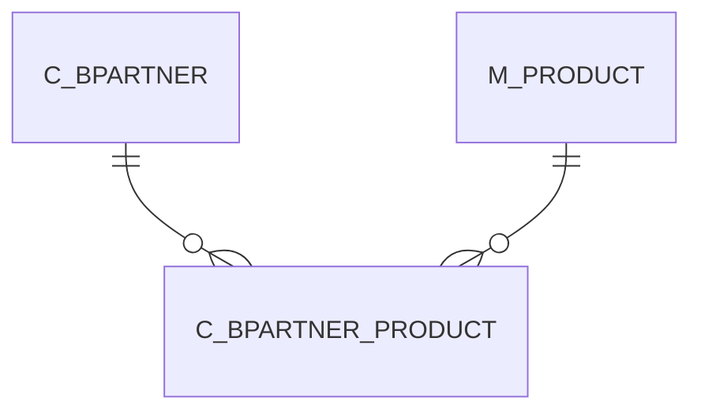

# C_BPARTNER_PRODUCT

Area [C](../../data-model/c/index.md) · class **business** (proposed) · read from database `idempiere-db` (owner `ADEMPIERE`) · 1 row(s) when profiled

Application model: `org.compiere.model.X_C_BPartner_Product`, access level 3 - Client - Org.

## Columns

| column | type | key | not null | business name | references (code) | nulls | distinct |
|---|---|---|---|---|---|---|---|
| `C_BPARTNER_ID` | NUMBER(10,0) | PK | yes | Business Partner | [C_BPARTNER](../../data-model/c/c_bpartner.md) | 0 | 1 |
| `M_PRODUCT_ID` | NUMBER(10,0) | PK | yes | Product | [M_PRODUCT](../../data-model/m/m_product.md) | 0 | 1 |
| `AD_CLIENT_ID` | NUMBER(10,0) |  | yes | Tenant |  | 0 | 1 |
| `AD_ORG_ID` | NUMBER(10,0) |  | yes | Organization |  | 0 | 1 |
| `ISACTIVE` | CHAR(1) |  | yes | Active |  | 0 | 1 |
| `CREATED` | DATE |  | yes | Created |  | 0 | 1 |
| `CREATEDBY` | NUMBER(10,0) |  | yes | Created By |  | 0 | 1 |
| `UPDATED` | DATE |  | yes | Updated |  | 0 | 1 |
| `UPDATEDBY` | NUMBER(10,0) |  | yes | Updated By |  | 0 | 1 |
| `DESCRIPTION` | VARCHAR2(255 CHAR) |  |  | Description |  | 1 | 0 |
| `SHELFLIFEMINPCT` | NUMBER(10,0) |  | yes | Min Shelf Life % |  | 0 | 1 |
| `SHELFLIFEMINDAYS` | NUMBER(10,0) |  | yes | Min Shelf Life Days |  | 0 | 1 |
| `QUALITYRATING` | NUMBER |  |  | Quality Rating |  | 0 | 1 |
| `VENDORPRODUCTNO` | VARCHAR2(30 CHAR) |  |  | Partner Product Key |  | 1 | 0 |
| `VENDORCATEGORY` | VARCHAR2(30 CHAR) |  |  | Partner Category |  | 1 | 0 |
| `MANUFACTURER` | VARCHAR2(30 CHAR) |  |  | Manufacturer |  | 1 | 0 |
| `ISMANUFACTURER` | CHAR(1) |  | yes | Is Manufacturer |  | 0 | 1 |
| `C_BPARTNER_PRODUCT_UU` | VARCHAR2(36 CHAR) |  |  | C_BPartner_Product_UU |  | 0 | 1 |

*references (code)* is the table the application model's code says a column points to; *Foreign keys* below are the constraints the database declares. Counts come from the profile; no value is ever shown.

## Check constraints

| name | expression |
|---|---|
| `SYS_C0020084` | `IsManufacturer IN ('Y','N')` |
| `SYS_C0020085` | `IsActive in ('Y','N')` |

## Foreign keys

**References**

| table | columns | on delete |
|---|---|---|
| [C_BPARTNER](../../data-model/c/c_bpartner.md) | C_BPARTNER_PRODUCT.C_BPARTNER_ID → C_BPARTNER.C_BPARTNER_ID | CASCADE |
| [M_PRODUCT](../../data-model/m/m_product.md) | C_BPARTNER_PRODUCT.M_PRODUCT_ID → M_PRODUCT.M_PRODUCT_ID | CASCADE |

**Referenced by**

_None._

## Write behaviour

- updates: **raw_sql_skips_updated**
- deletes: **deleted_by_users, deleted_by_cascade**
- change log: **recorded**
- evidence: 4 citation(s)

## Read by

| kind | name |
|---|---|
| View | `C_INVOICE_LINETAX_V` |
| View | `C_INVOICE_LINETAX_VT` |
| View | `C_ORDER_LINETAX_V` |
| View | `C_ORDER_LINETAX_VT` |
| View | `c_invoice_linetax_v` |
| View | `c_invoice_linetax_vt` |
| View | `c_order_linetax_v` |
| View | `c_order_linetax_vt` |

## Schema history

21 change(s); the latest:

| applied | release | operation | column | tickets |
|---|---|---|---|---|
| 2023-04-09T15:47 | iD11 | `add_constraint` |  | IDEMPIERE-5567 |
| 2023-04-09T15:47 | iD11 | `add_constraint` |  | IDEMPIERE-5567 |
| 2021-12-05T16:45 | i8.2z | `add_constraint` |  | IDEMPIERE-5075 |
| 2021-12-05T16:45 | i8.2z | `add_constraint` |  | IDEMPIERE-5075 |
| 2021-12-05T16:45 | i8.2z | `drop_constraint` |  | IDEMPIERE-5075 |
| 2021-12-05T16:45 | i8.2z | `drop_constraint` |  | IDEMPIERE-5075 |
| 2020-08-04T01:00 | i7.1z | `drop_column` | tmp_col_1_tmp | IDEMPIERE-3862 |
| 2020-08-04T01:00 | i7.1z | `drop_column` | tmp_col_5_tmp | IDEMPIERE-3862 |
| 2020-08-04T01:00 | i7.1z | `drop_column` | tmp_col_3_tmp | IDEMPIERE-3862 |
| 2020-08-04T01:00 | i7.1z | `modify_column` | VENDORCATEGORY | IDEMPIERE-3862 |
| 2020-08-04T01:00 | i7.1z | `drop_column` | tmp_col_2_tmp | IDEMPIERE-3862 |
| 2020-08-04T01:00 | i7.1z | `add_column` | tmp_col_3_tmp | IDEMPIERE-3862 |
| 2020-08-04T01:00 | i7.1z | `add_column` | tmp_col_1_tmp | IDEMPIERE-3862 |
| 2020-08-04T01:00 | i7.1z | `add_column` | tmp_col_4_tmp | IDEMPIERE-3862 |
| 2020-08-04T01:00 | i7.1z | `modify_column` | VENDORPRODUCTNO | IDEMPIERE-3862 |

## Notes

<!-- ekos:manual id="table.c_bpartner_product.notes" -->
_Business notes about this table._
<!-- /ekos:manual -->
