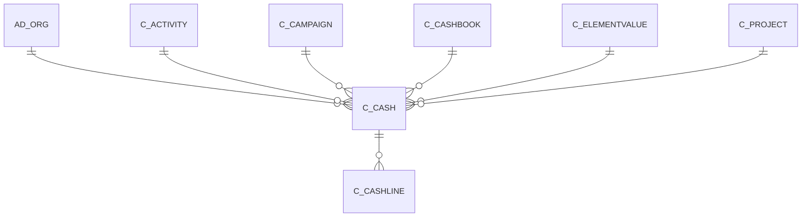

# C_CASH

Area [C](../../data-model/c/index.md) · class **business** (proposed) · read from database `idempiere-db` (owner `ADEMPIERE`) · 3 row(s) when profiled

Application model: `org.compiere.model.X_C_Cash`, access level 3 - Client - Org.

## Columns

| column | type | key | not null | business name | references (code) | nulls | distinct |
|---|---|---|---|---|---|---|---|
| `C_CASH_ID` | NUMBER(10,0) | PK | yes | Cash Journal |  | 0 | 3 |
| `AD_CLIENT_ID` | NUMBER(10,0) |  | yes | Tenant |  | 0 | 1 |
| `AD_ORG_ID` | NUMBER(10,0) |  | yes | Organization |  | 0 | 1 |
| `ISACTIVE` | CHAR(1) |  | yes | Active |  | 0 | 1 |
| `CREATED` | DATE |  | yes | Created |  | 0 | 3 |
| `CREATEDBY` | NUMBER(10,0) |  | yes | Created By |  | 0 | 2 |
| `UPDATED` | DATE |  | yes | Updated |  | 0 | 3 |
| `UPDATEDBY` | NUMBER(10,0) |  | yes | Updated By |  | 0 | 1 |
| `C_CASHBOOK_ID` | NUMBER(10,0) |  | yes | Cash Book | [C_CASHBOOK](../../data-model/c/c_cashbook.md) | 0 | 1 |
| `NAME` | VARCHAR2(60 CHAR) |  | yes | Name |  | 0 | 3 |
| `DESCRIPTION` | VARCHAR2(255 CHAR) |  |  | Description |  | 3 | 0 |
| `STATEMENTDATE` | DATE |  | yes | Statement date |  | 0 | 2 |
| `DATEACCT` | DATE |  | yes | Account Date |  | 0 | 2 |
| `BEGINNINGBALANCE` | NUMBER |  | yes | Beginning Balance |  | 0 | 1 |
| `ENDINGBALANCE` | NUMBER |  | yes | Ending balance |  | 0 | 3 |
| `STATEMENTDIFFERENCE` | NUMBER |  |  | Statement difference |  | 0 | 3 |
| `PROCESSING` | CHAR(1) |  |  | Process Now |  | 0 | 1 |
| `PROCESSED` | CHAR(1) |  | yes | Processed |  | 0 | 2 |
| `POSTED` | CHAR(1) |  | yes | Posted |  | 0 | 1 |
| `AD_ORGTRX_ID` | NUMBER(10,0) |  |  | Trx Organization |  | 3 | 0 |
| `C_PROJECT_ID` | NUMBER(10,0) |  |  | Project | [C_PROJECT](../../data-model/c/c_project.md) | 3 | 0 |
| `C_CAMPAIGN_ID` | NUMBER(10,0) |  |  | Campaign | [C_CAMPAIGN](../../data-model/c/c_campaign.md) | 3 | 0 |
| `C_ACTIVITY_ID` | NUMBER(10,0) |  |  | Activity | [C_ACTIVITY](../../data-model/c/c_activity.md) | 3 | 0 |
| `USER1_ID` | NUMBER(10,0) |  |  | User Element List 1 | [C_ELEMENTVALUE](../../data-model/c/c_elementvalue.md) | 3 | 0 |
| `USER2_ID` | NUMBER(10,0) |  |  | User Element List 2 | [C_ELEMENTVALUE](../../data-model/c/c_elementvalue.md) | 3 | 0 |
| `ISAPPROVED` | CHAR(1) |  | yes | Approved |  | 0 | 1 |
| `DOCSTATUS` | CHAR(2) |  | yes | Document Status |  | 0 | 2 |
| `DOCACTION` | CHAR(2) |  | yes | Document Action |  | 0 | 2 |
| `PROCESSEDON` | NUMBER |  |  | Processed On |  | 1 | 2 |
| `C_CASH_UU` | VARCHAR2(36 CHAR) |  |  | C_Cash_UU |  | 0 | 3 |

*references (code)* is the table the application model's code says a column points to; *Foreign keys* below are the constraints the database declares. Counts come from the profile; no value is ever shown.

## Check constraints

| name | expression |
|---|---|
| `SYS_C0021029` | `IsActive in ('Y','N')` |
| `SYS_C0021031` | `Processed in ('Y','N')` |

## Foreign keys

**References**

| table | columns | on delete |
|---|---|---|
| [AD_ORG](../../data-model/ad/ad_org.md) | C_CASH.AD_ORGTRX_ID → AD_ORG.AD_ORG_ID | NO ACTION |
| [C_ACTIVITY](../../data-model/c/c_activity.md) | C_CASH.C_ACTIVITY_ID → C_ACTIVITY.C_ACTIVITY_ID | NO ACTION |
| [C_CAMPAIGN](../../data-model/c/c_campaign.md) | C_CASH.C_CAMPAIGN_ID → C_CAMPAIGN.C_CAMPAIGN_ID | NO ACTION |
| [C_CASHBOOK](../../data-model/c/c_cashbook.md) | C_CASH.C_CASHBOOK_ID → C_CASHBOOK.C_CASHBOOK_ID | NO ACTION |
| [C_ELEMENTVALUE](../../data-model/c/c_elementvalue.md) | C_CASH.USER1_ID → C_ELEMENTVALUE.C_ELEMENTVALUE_ID | NO ACTION |
| [C_PROJECT](../../data-model/c/c_project.md) | C_CASH.C_PROJECT_ID → C_PROJECT.C_PROJECT_ID | NO ACTION |

**Referenced by**

| table | columns | on delete |
|---|---|---|
| [C_CASHLINE](../../data-model/c/c_cashline.md) | C_CASHLINE.C_CASH_ID → C_CASH.C_CASH_ID | CASCADE |

## Write behaviour

- updates: **raw_sql_skips_updated**
- deletes: **deleted_by_users**
- change log: **recorded**
- evidence: 3 citation(s)

## Read by

| kind | name |
|---|---|
| Procedure | [migr_fix_payment_cashline](../../logic/migr_fix_payment_cashline.md) |
| View | `RV_CASH_DETAIL` |
| View | `RV_UNPOSTED` |
| View | `RV_UNPROCESSED` |
| View | `rv_cash_detail` |
| View | `rv_unposted` |
| View | `rv_unprocessed` |

## Schema history

31 change(s); the latest:

| applied | release | operation | column | tickets |
|---|---|---|---|---|
| 2023-04-09T15:47 | iD11 | `add_constraint` |  | IDEMPIERE-5567 |
| 2023-04-09T15:47 | iD11 | `add_constraint` |  | IDEMPIERE-5567 |
| 2021-12-05T16:45 | i8.2z | `add_constraint` |  | IDEMPIERE-5075 |
| 2021-12-05T16:45 | i8.2z | `add_constraint` |  | IDEMPIERE-5075 |
| 2021-12-05T16:45 | i8.2z | `drop_constraint` |  | IDEMPIERE-5075 |
| 2021-12-05T16:45 | i8.2z | `drop_constraint` |  | IDEMPIERE-5075 |
| 2021-12-05T16:45 | i8.2z | `add_constraint` |  | IDEMPIERE-5075 |
| 2021-12-05T16:45 | i8.2z | `drop_constraint` |  | IDEMPIERE-5075 |
| 2021-12-05T16:45 | i8.2z | `drop_constraint` |  | IDEMPIERE-5075 |
| 2021-12-05T16:45 | i8.2z | `drop_constraint` |  | IDEMPIERE-5075 |
| 2021-12-05T16:45 | i8.2z | `add_constraint` |  | IDEMPIERE-5075 |
| 2021-12-05T16:45 | i8.2z | `drop_constraint` |  | IDEMPIERE-5075 |
| 2021-12-05T16:45 | i8.2z | `add_constraint` |  | IDEMPIERE-5075 |
| 2021-12-05T16:45 | i8.2z | `drop_constraint` |  | IDEMPIERE-5075 |
| 2021-12-05T16:45 | i8.2z | `add_constraint` |  | IDEMPIERE-5075 |

## Notes

<!-- ekos:manual id="table.c_cash.notes" -->
_Business notes about this table._
<!-- /ekos:manual -->
