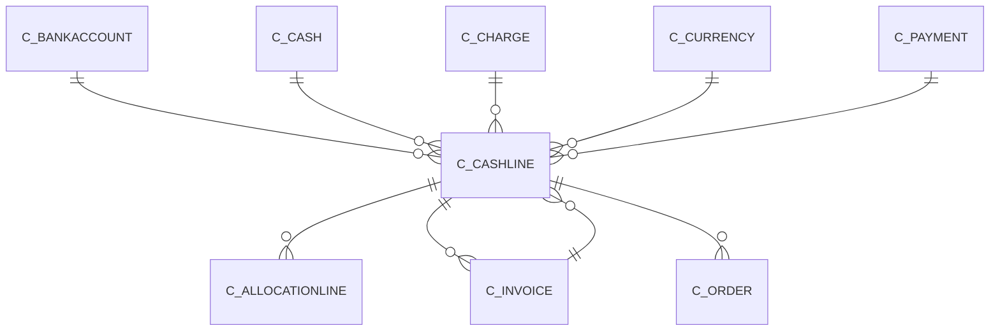

# C_CASHLINE

Area [C](../../data-model/c/index.md) · class **business** (proposed) · read from database `idempiere-db` (owner `ADEMPIERE`) · 5 row(s) when profiled

Application model: `org.compiere.model.X_C_CashLine`, access level 3 - Client - Org.

## Columns

| column | type | key | not null | business name | references (code) | nulls | distinct |
|---|---|---|---|---|---|---|---|
| `C_CASHLINE_ID` | NUMBER(10,0) | PK | yes | Cash Journal Line |  | 0 | 5 |
| `AD_CLIENT_ID` | NUMBER(10,0) |  | yes | Tenant |  | 0 | 1 |
| `AD_ORG_ID` | NUMBER(10,0) |  | yes | Organization |  | 0 | 1 |
| `ISACTIVE` | CHAR(1) |  | yes | Active |  | 0 | 1 |
| `CREATED` | DATE |  | yes | Created |  | 0 | 5 |
| `CREATEDBY` | NUMBER(10,0) |  | yes | Created By |  | 0 | 2 |
| `UPDATED` | DATE |  | yes | Updated |  | 0 | 5 |
| `UPDATEDBY` | NUMBER(10,0) |  | yes | Updated By |  | 0 | 2 |
| `C_CASH_ID` | NUMBER(10,0) |  | yes | Cash Journal | [C_CASH](../../data-model/c/c_cash.md) | 0 | 3 |
| `LINE` | NUMBER(10,0) |  | yes | Line No |  | 0 | 3 |
| `DESCRIPTION` | VARCHAR2(255 CHAR) |  |  | Description |  | 3 | 2 |
| `CASHTYPE` | CHAR(1) |  | yes | Cash Type |  | 0 | 4 |
| `C_BANKACCOUNT_ID` | NUMBER(10,0) |  |  | Bank Account | [C_BANKACCOUNT](../../data-model/c/c_bankaccount.md) | 2 | 1 |
| `C_CHARGE_ID` | NUMBER(10,0) |  |  | Charge | [C_CHARGE](../../data-model/c/c_charge.md) | 5 | 0 |
| `C_INVOICE_ID` | NUMBER(10,0) |  |  | Invoice | [C_INVOICE](../../data-model/c/c_invoice.md) | 3 | 2 |
| `C_CURRENCY_ID` | NUMBER(10,0) |  |  | Currency | [C_CURRENCY](../../data-model/c/c_currency.md) | 0 | 1 |
| `AMOUNT` | NUMBER |  | yes | Amount |  | 0 | 5 |
| `DISCOUNTAMT` | NUMBER |  |  | Discount Amount |  | 0 | 1 |
| `WRITEOFFAMT` | NUMBER |  |  | Write-off Amount |  | 0 | 1 |
| `ISGENERATED` | CHAR(1) |  |  | Generated |  | 0 | 2 |
| `PROCESSED` | CHAR(1) |  | yes | Processed |  | 0 | 2 |
| `C_PAYMENT_ID` | NUMBER(10,0) |  |  | Payment | [C_PAYMENT](../../data-model/c/c_payment.md) | 5 | 0 |
| `C_CASHLINE_UU` | VARCHAR2(36 CHAR) |  |  | C_CashLine_UU |  | 0 | 5 |

*references (code)* is the table the application model's code says a column points to; *Foreign keys* below are the constraints the database declares. Counts come from the profile; no value is ever shown.

## Check constraints

| name | expression |
|---|---|
| `SYS_C0022735` | `IsGenerated in ('Y','N')` |
| `SYS_C0022737` | `IsActive in ('Y','N')` |

## Foreign keys

**References**

| table | columns | on delete |
|---|---|---|
| [C_BANKACCOUNT](../../data-model/c/c_bankaccount.md) | C_CASHLINE.C_BANKACCOUNT_ID → C_BANKACCOUNT.C_BANKACCOUNT_ID | NO ACTION |
| [C_CASH](../../data-model/c/c_cash.md) | C_CASHLINE.C_CASH_ID → C_CASH.C_CASH_ID | CASCADE |
| [C_CHARGE](../../data-model/c/c_charge.md) | C_CASHLINE.C_CHARGE_ID → C_CHARGE.C_CHARGE_ID | NO ACTION |
| [C_CURRENCY](../../data-model/c/c_currency.md) | C_CASHLINE.C_CURRENCY_ID → C_CURRENCY.C_CURRENCY_ID | NO ACTION |
| [C_INVOICE](../../data-model/c/c_invoice.md) | C_CASHLINE.C_INVOICE_ID → C_INVOICE.C_INVOICE_ID | NO ACTION |
| [C_PAYMENT](../../data-model/c/c_payment.md) | C_CASHLINE.C_PAYMENT_ID → C_PAYMENT.C_PAYMENT_ID | NO ACTION |

**Referenced by**

| table | columns | on delete |
|---|---|---|
| [C_ALLOCATIONLINE](../../data-model/c/c_allocationline.md) | C_ALLOCATIONLINE.C_CASHLINE_ID → C_CASHLINE.C_CASHLINE_ID | NO ACTION |
| [C_INVOICE](../../data-model/c/c_invoice.md) | C_INVOICE.C_CASHLINE_ID → C_CASHLINE.C_CASHLINE_ID | NO ACTION |
| [C_ORDER](../../data-model/c/c_order.md) | C_ORDER.C_CASHLINE_ID → C_CASHLINE.C_CASHLINE_ID | NO ACTION |

## Write behaviour

- updates: **raw_sql_skips_updated**
- deletes: **deleted_by_users, deleted_by_cascade**
- change log: **recorded**
- evidence: 3 citation(s)

## Read by

| kind | name |
|---|---|
| Procedure | [migr_fix_payment_cashline](../../logic/migr_fix_payment_cashline.md) |
| View | `RV_CASH_DETAIL` |
| View | `rv_cash_detail` |

## Written by

| kind | name |
|---|---|
| Procedure | [migr_fix_payment_cashline](../../logic/migr_fix_payment_cashline.md) |

## Schema history

20 change(s); the latest:

| applied | release | operation | column | tickets |
|---|---|---|---|---|
| 2023-04-09T15:47 | iD11 | `add_constraint` |  | IDEMPIERE-5567 |
| 2023-04-09T15:47 | iD11 | `add_constraint` |  | IDEMPIERE-5567 |
| 2021-12-05T16:45 | i8.2z | `add_constraint` |  | IDEMPIERE-5075 |
| 2021-12-05T16:45 | i8.2z | `add_constraint` |  | IDEMPIERE-5075 |
| 2021-12-05T16:45 | i8.2z | `add_constraint` |  | IDEMPIERE-5075 |
| 2021-12-05T16:45 | i8.2z | `add_constraint` |  | IDEMPIERE-5075 |
| 2021-12-05T16:45 | i8.2z | `add_constraint` |  | IDEMPIERE-5075 |
| 2021-12-05T16:45 | i8.2z | `drop_constraint` |  | IDEMPIERE-5075 |
| 2021-12-05T16:45 | i8.2z | `drop_constraint` |  | IDEMPIERE-5075 |
| 2021-12-05T16:45 | i8.2z | `add_constraint` |  | IDEMPIERE-5075 |
| 2021-12-05T16:45 | i8.2z | `drop_constraint` |  | IDEMPIERE-5075 |
| 2021-12-05T16:45 | i8.2z | `drop_constraint` |  | IDEMPIERE-5075 |
| 2021-12-05T16:45 | i8.2z | `drop_constraint` |  | IDEMPIERE-5075 |
| 2021-12-05T16:45 | i8.2z | `drop_constraint` |  | IDEMPIERE-5075 |
| 2020-08-04T01:00 | i7.1z | `modify_column` | C_CASHLINE_UU | IDEMPIERE-3862 |

## Notes

<!-- ekos:manual id="table.c_cashline.notes" -->
_Business notes about this table._
<!-- /ekos:manual -->
