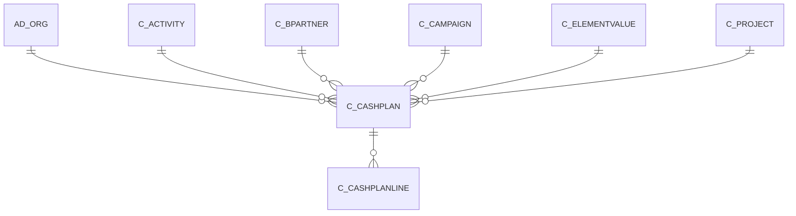

# C_CASHPLAN

Area [C](../../data-model/c/index.md) · class **business** (proposed) · read from database `idempiere-db` (owner `ADEMPIERE`) · 0 row(s) when profiled

Application model: `org.compiere.model.X_C_CashPlan`, access level 1 - Org.

## Columns

| column | type | key | not null | business name | references (code) | nulls | distinct |
|---|---|---|---|---|---|---|---|
| `AD_CLIENT_ID` | NUMBER(10,0) |  | yes | Tenant |  | 0 | 0 |
| `AD_ORG_ID` | NUMBER(10,0) |  | yes | Organization |  | 0 | 0 |
| `AD_ORGTRX_ID` | NUMBER(10,0) |  |  | Trx Organization |  | 0 | 0 |
| `C_ACTIVITY_ID` | NUMBER(10,0) |  |  | Activity | [C_ACTIVITY](../../data-model/c/c_activity.md) | 0 | 0 |
| `CASHFLOWTYPE` | CHAR(1) |  |  | Cash Flow Type |  | 0 | 0 |
| `C_BPARTNER_ID` | NUMBER(10,0) |  |  | Business Partner | [C_BPARTNER](../../data-model/c/c_bpartner.md) | 0 | 0 |
| `C_CAMPAIGN_ID` | NUMBER(10,0) |  |  | Campaign | [C_CAMPAIGN](../../data-model/c/c_campaign.md) | 0 | 0 |
| `C_CASHPLAN_ID` | NUMBER(10,0) | PK | yes | Cash Plan |  | 0 | 0 |
| `COPYFROM` | CHAR(1) |  |  | Copy From |  | 0 | 0 |
| `C_PROJECT_ID` | NUMBER(10,0) |  |  | Project | [C_PROJECT](../../data-model/c/c_project.md) | 0 | 0 |
| `CREATED` | DATE |  | yes | Created |  | 0 | 0 |
| `CREATEDBY` | NUMBER(10,0) |  | yes | Created By |  | 0 | 0 |
| `DATEDOC` | DATE |  | yes | Document Date |  | 0 | 0 |
| `DESCRIPTION` | VARCHAR2(255 CHAR) |  |  | Description |  | 0 | 0 |
| `DOCUMENTNO` | VARCHAR2(30 CHAR) |  | yes | Document No |  | 0 | 0 |
| `GENERATEPERIODIC` | CHAR(1) |  |  | Generate Periodic Plan |  | 0 | 0 |
| `GRANDTOTAL` | NUMBER |  | yes | Grand Total |  | 0 | 0 |
| `ISACTIVE` | CHAR(1) |  | yes | Active |  | 0 | 0 |
| `ISAPPROVED` | CHAR(1) |  | yes | Approved |  | 0 | 0 |
| `ISSOTRX` | CHAR(1) |  | yes | Sales Transaction |  | 0 | 0 |
| `PROCESSED` | CHAR(1) |  | yes | Processed |  | 0 | 0 |
| `UPDATED` | DATE |  | yes | Updated |  | 0 | 0 |
| `UPDATEDBY` | NUMBER(10,0) |  | yes | Updated By |  | 0 | 0 |
| `USER1_ID` | NUMBER(10,0) |  |  | User Element List 1 | [C_ELEMENTVALUE](../../data-model/c/c_elementvalue.md) | 0 | 0 |
| `USER2_ID` | NUMBER(10,0) |  |  | User Element List 2 | [C_ELEMENTVALUE](../../data-model/c/c_elementvalue.md) | 0 | 0 |
| `C_CASHPLAN_UU` | VARCHAR2(36 CHAR) |  |  | C_CashPlan_UU |  | 0 | 0 |

*references (code)* is the table the application model's code says a column points to; *Foreign keys* below are the constraints the database declares. Counts come from the profile; no value is ever shown.

## Check constraints

| name | expression |
|---|---|
| `SYS_C0020030` | `IsActive IN ('Y','N')` |
| `SYS_C0020031` | `IsSOTrx IN ('Y','N')` |
| `SYS_C0020032` | `Processed IN ('Y','N')` |
| `SYS_C0020035` | `IsApproved IN ('Y','N')` |

## Foreign keys

**References**

| table | columns | on delete |
|---|---|---|
| [AD_ORG](../../data-model/ad/ad_org.md) | C_CASHPLAN.AD_ORGTRX_ID → AD_ORG.AD_ORG_ID | NO ACTION |
| [C_ACTIVITY](../../data-model/c/c_activity.md) | C_CASHPLAN.C_ACTIVITY_ID → C_ACTIVITY.C_ACTIVITY_ID | NO ACTION |
| [C_BPARTNER](../../data-model/c/c_bpartner.md) | C_CASHPLAN.C_BPARTNER_ID → C_BPARTNER.C_BPARTNER_ID | NO ACTION |
| [C_CAMPAIGN](../../data-model/c/c_campaign.md) | C_CASHPLAN.C_CAMPAIGN_ID → C_CAMPAIGN.C_CAMPAIGN_ID | NO ACTION |
| [C_ELEMENTVALUE](../../data-model/c/c_elementvalue.md) | C_CASHPLAN.USER1_ID → C_ELEMENTVALUE.C_ELEMENTVALUE_ID | NO ACTION |
| [C_PROJECT](../../data-model/c/c_project.md) | C_CASHPLAN.C_PROJECT_ID → C_PROJECT.C_PROJECT_ID | NO ACTION |

**Referenced by**

| table | columns | on delete |
|---|---|---|
| [C_CASHPLANLINE](../../data-model/c/c_cashplanline.md) | C_CASHPLANLINE.C_CASHPLAN_ID → C_CASHPLAN.C_CASHPLAN_ID | NO ACTION |

## Write behaviour

- updates: **raw_sql_skips_updated**
- deletes: **deleted_by_users**
- change log: **recorded**
- evidence: 2 citation(s)

## Schema history

37 change(s); the latest:

| applied | release | operation | column | tickets |
|---|---|---|---|---|
| 2023-04-09T15:47 | iD11 | `add_constraint` |  | IDEMPIERE-5567 |
| 2023-04-09T15:47 | iD11 | `add_constraint` |  | IDEMPIERE-5567 |
| 2022-08-11T15:53 | i9 | `modify_column` | IsApproved | IDEMPIERE-5372 |
| 2022-08-11T15:53 | i9 | `modify_column` | IsApproved | IDEMPIERE-5372 |
| 2021-12-05T16:45 | i8.2z | `add_constraint` |  | IDEMPIERE-5075 |
| 2021-12-05T16:45 | i8.2z | `add_constraint` |  | IDEMPIERE-5075 |
| 2021-12-05T16:45 | i8.2z | `add_constraint` |  | IDEMPIERE-5075 |
| 2021-12-05T16:45 | i8.2z | `add_constraint` |  | IDEMPIERE-5075 |
| 2021-12-05T16:45 | i8.2z | `drop_constraint` |  | IDEMPIERE-5075 |
| 2021-12-05T16:45 | i8.2z | `drop_constraint` |  | IDEMPIERE-5075 |
| 2021-12-05T16:45 | i8.2z | `drop_constraint` |  | IDEMPIERE-5075 |
| 2021-12-05T16:45 | i8.2z | `drop_constraint` |  | IDEMPIERE-5075 |
| 2021-12-05T16:45 | i8.2z | `drop_constraint` |  | IDEMPIERE-5075 |
| 2021-12-05T16:45 | i8.2z | `add_constraint` |  | IDEMPIERE-5075 |
| 2021-12-05T16:45 | i8.2z | `add_constraint` |  | IDEMPIERE-5075 |

## Notes

<!-- ekos:manual id="table.c_cashplan.notes" -->
_Business notes about this table._
<!-- /ekos:manual -->
