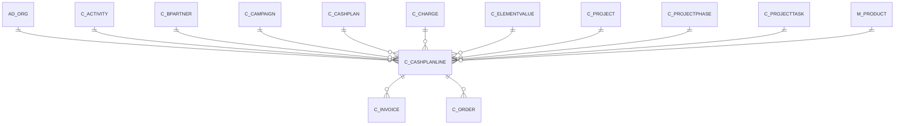

# C_CASHPLANLINE

Area [C](../../data-model/c/index.md) · class **business** (proposed) · read from database `idempiere-db` (owner `ADEMPIERE`) · 0 row(s) when profiled

Application model: `org.compiere.model.X_C_CashPlanLine`, access level 1 - Org.

## Columns

| column | type | key | not null | business name | references (code) | nulls | distinct |
|---|---|---|---|---|---|---|---|
| `AD_CLIENT_ID` | NUMBER(10,0) |  | yes | Tenant |  | 0 | 0 |
| `AD_ORG_ID` | NUMBER(10,0) |  | yes | Organization |  | 0 | 0 |
| `AD_ORGTRX_ID` | NUMBER(10,0) |  |  | Trx Organization |  | 0 | 0 |
| `C_ACTIVITY_ID` | NUMBER(10,0) |  |  | Activity | [C_ACTIVITY](../../data-model/c/c_activity.md) | 0 | 0 |
| `C_BPARTNER_ID` | NUMBER(10,0) |  |  | Business Partner | [C_BPARTNER](../../data-model/c/c_bpartner.md) | 0 | 0 |
| `C_CAMPAIGN_ID` | NUMBER(10,0) |  |  | Campaign | [C_CAMPAIGN](../../data-model/c/c_campaign.md) | 0 | 0 |
| `C_CASHPLAN_ID` | NUMBER(10,0) |  | yes | Cash Plan | [C_CASHPLAN](../../data-model/c/c_cashplan.md) | 0 | 0 |
| `C_CASHPLANLINE_ID` | NUMBER(10,0) | PK | yes | Cash Plan Line |  | 0 | 0 |
| `C_CHARGE_ID` | NUMBER(10,0) |  |  | Charge | [C_CHARGE](../../data-model/c/c_charge.md) | 0 | 0 |
| `C_PROJECT_ID` | NUMBER(10,0) |  |  | Project | [C_PROJECT](../../data-model/c/c_project.md) | 0 | 0 |
| `C_PROJECTPHASE_ID` | NUMBER(10,0) |  |  | Project Phase | [C_PROJECTPHASE](../../data-model/c/c_projectphase.md) | 0 | 0 |
| `C_PROJECTTASK_ID` | NUMBER(10,0) |  |  | Project Task | [C_PROJECTTASK](../../data-model/c/c_projecttask.md) | 0 | 0 |
| `CREATED` | DATE |  | yes | Created |  | 0 | 0 |
| `CREATEDBY` | NUMBER(10,0) |  | yes | Created By |  | 0 | 0 |
| `DATETRX` | DATE |  | yes | Transaction Date |  | 0 | 0 |
| `DESCRIPTION` | VARCHAR2(255 CHAR) |  |  | Description |  | 0 | 0 |
| `ISACTIVE` | CHAR(1) |  | yes | Active |  | 0 | 0 |
| `LINE` | NUMBER(10,0) |  | yes | Line No |  | 0 | 0 |
| `LINETOTALAMT` | NUMBER |  |  | Line Total |  | 0 | 0 |
| `M_PRODUCT_ID` | NUMBER(10,0) |  |  | Product | [M_PRODUCT](../../data-model/m/m_product.md) | 0 | 0 |
| `NAME` | VARCHAR2(60 CHAR) |  |  | Name |  | 0 | 0 |
| `PROBABILITY` | NUMBER |  |  | Probability |  | 0 | 0 |
| `PROCESSED` | CHAR(1) |  | yes | Processed |  | 0 | 0 |
| `QTYENTERED` | NUMBER |  | yes | Quantity |  | 0 | 0 |
| `UPDATED` | DATE |  | yes | Updated |  | 0 | 0 |
| `UPDATEDBY` | NUMBER(10,0) |  | yes | Updated By |  | 0 | 0 |
| `USER1_ID` | NUMBER(10,0) |  |  | User Element List 1 | [C_ELEMENTVALUE](../../data-model/c/c_elementvalue.md) | 0 | 0 |
| `USER2_ID` | NUMBER(10,0) |  |  | User Element List 2 | [C_ELEMENTVALUE](../../data-model/c/c_elementvalue.md) | 0 | 0 |
| `C_CASHPLANLINE_UU` | VARCHAR2(36 CHAR) |  |  | C_CashPlanLine_UU |  | 0 | 0 |

*references (code)* is the table the application model's code says a column points to; *Foreign keys* below are the constraints the database declares. Counts come from the profile; no value is ever shown.

## Check constraints

| name | expression |
|---|---|
| `SYS_C0019982` | `Processed IN ('Y','N')` |
| `SYS_C0019983` | `IsActive IN ('Y','N')` |

## Foreign keys

**References**

| table | columns | on delete |
|---|---|---|
| [AD_ORG](../../data-model/ad/ad_org.md) | C_CASHPLANLINE.AD_ORGTRX_ID → AD_ORG.AD_ORG_ID | NO ACTION |
| [C_ACTIVITY](../../data-model/c/c_activity.md) | C_CASHPLANLINE.C_ACTIVITY_ID → C_ACTIVITY.C_ACTIVITY_ID | NO ACTION |
| [C_BPARTNER](../../data-model/c/c_bpartner.md) | C_CASHPLANLINE.C_BPARTNER_ID → C_BPARTNER.C_BPARTNER_ID | NO ACTION |
| [C_CAMPAIGN](../../data-model/c/c_campaign.md) | C_CASHPLANLINE.C_CAMPAIGN_ID → C_CAMPAIGN.C_CAMPAIGN_ID | NO ACTION |
| [C_CASHPLAN](../../data-model/c/c_cashplan.md) | C_CASHPLANLINE.C_CASHPLAN_ID → C_CASHPLAN.C_CASHPLAN_ID | NO ACTION |
| [C_CHARGE](../../data-model/c/c_charge.md) | C_CASHPLANLINE.C_CHARGE_ID → C_CHARGE.C_CHARGE_ID | NO ACTION |
| [C_ELEMENTVALUE](../../data-model/c/c_elementvalue.md) | C_CASHPLANLINE.USER1_ID → C_ELEMENTVALUE.C_ELEMENTVALUE_ID | NO ACTION |
| [C_PROJECT](../../data-model/c/c_project.md) | C_CASHPLANLINE.C_PROJECT_ID → C_PROJECT.C_PROJECT_ID | NO ACTION |
| [C_PROJECTPHASE](../../data-model/c/c_projectphase.md) | C_CASHPLANLINE.C_PROJECTPHASE_ID → C_PROJECTPHASE.C_PROJECTPHASE_ID | NO ACTION |
| [C_PROJECTTASK](../../data-model/c/c_projecttask.md) | C_CASHPLANLINE.C_PROJECTTASK_ID → C_PROJECTTASK.C_PROJECTTASK_ID | NO ACTION |
| [M_PRODUCT](../../data-model/m/m_product.md) | C_CASHPLANLINE.M_PRODUCT_ID → M_PRODUCT.M_PRODUCT_ID | NO ACTION |

**Referenced by**

| table | columns | on delete |
|---|---|---|
| [C_INVOICE](../../data-model/c/c_invoice.md) | C_INVOICE.C_CASHPLANLINE_ID → C_CASHPLANLINE.C_CASHPLANLINE_ID | NO ACTION |
| [C_ORDER](../../data-model/c/c_order.md) | C_ORDER.C_CASHPLANLINE_ID → C_CASHPLANLINE.C_CASHPLANLINE_ID | NO ACTION |

## Write behaviour

- updates: **po_only**
- deletes: **deleted_by_app, deleted_by_users**
- change log: **recorded**
- evidence: 2 citation(s)

## Schema history

43 change(s); the latest:

| applied | release | operation | column | tickets |
|---|---|---|---|---|
| 2023-04-09T15:47 | iD11 | `add_constraint` |  | IDEMPIERE-5567 |
| 2023-04-09T15:47 | iD11 | `add_constraint` |  | IDEMPIERE-5567 |
| 2021-12-05T16:45 | i8.2z | `add_constraint` |  | IDEMPIERE-5075 |
| 2021-12-05T16:45 | i8.2z | `drop_constraint` |  | IDEMPIERE-5075 |
| 2021-12-05T16:45 | i8.2z | `drop_constraint` |  | IDEMPIERE-5075 |
| 2021-12-05T16:45 | i8.2z | `add_constraint` |  | IDEMPIERE-5075 |
| 2021-12-05T16:45 | i8.2z | `add_constraint` |  | IDEMPIERE-5075 |
| 2021-12-05T16:45 | i8.2z | `add_constraint` |  | IDEMPIERE-5075 |
| 2021-12-05T16:45 | i8.2z | `drop_constraint` |  | IDEMPIERE-5075 |
| 2021-12-05T16:45 | i8.2z | `drop_constraint` |  | IDEMPIERE-5075 |
| 2021-12-05T16:45 | i8.2z | `add_constraint` |  | IDEMPIERE-5075 |
| 2021-12-05T16:45 | i8.2z | `drop_constraint` |  | IDEMPIERE-5075 |
| 2021-12-05T16:45 | i8.2z | `add_constraint` |  | IDEMPIERE-5075 |
| 2021-12-05T16:45 | i8.2z | `drop_constraint` |  | IDEMPIERE-5075 |
| 2021-12-05T16:45 | i8.2z | `add_constraint` |  | IDEMPIERE-5075 |

## Notes

<!-- ekos:manual id="table.c_cashplanline.notes" -->
_Business notes about this table._
<!-- /ekos:manual -->
