# C_CHARGE

Area [C](../../data-model/c/index.md) · class **business** (proposed) · read from database `idempiere-db` (owner `ADEMPIERE`) · 3 row(s) when profiled

Application model: `org.compiere.model.X_C_Charge`, access level 3 - Client - Org.

## Columns

| column | type | key | not null | business name | references (code) | nulls | distinct |
|---|---|---|---|---|---|---|---|
| `C_CHARGE_ID` | NUMBER(10,0) | PK | yes | Charge |  | 0 | 3 |
| `AD_CLIENT_ID` | NUMBER(10,0) |  | yes | Tenant |  | 0 | 1 |
| `AD_ORG_ID` | NUMBER(10,0) |  | yes | Organization |  | 0 | 2 |
| `ISACTIVE` | CHAR(1) |  | yes | Active |  | 0 | 1 |
| `CREATED` | DATE |  | yes | Created |  | 0 | 3 |
| `CREATEDBY` | NUMBER(10,0) |  | yes | Created By |  | 0 | 1 |
| `UPDATED` | DATE |  | yes | Updated |  | 0 | 3 |
| `UPDATEDBY` | NUMBER(10,0) |  | yes | Updated By |  | 0 | 2 |
| `NAME` | VARCHAR2(60 CHAR) |  | yes | Name |  | 0 | 3 |
| `DESCRIPTION` | VARCHAR2(255 CHAR) |  |  | Description |  | 3 | 0 |
| `CHARGEAMT` | NUMBER |  | yes | Charge amount |  | 0 | 1 |
| `ISSAMETAX` | CHAR(1) |  | yes | Same Tax |  | 0 | 2 |
| `ISSAMECURRENCY` | CHAR(1) |  | yes | Same Currency |  | 0 | 2 |
| `C_TAXCATEGORY_ID` | NUMBER(10,0) |  |  | Tax Category | [C_TAXCATEGORY](../../data-model/c/c_taxcategory.md) | 0 | 1 |
| `ISTAXINCLUDED` | CHAR(1) |  | yes | Price includes Tax |  | 0 | 1 |
| `C_BPARTNER_ID` | NUMBER(10,0) |  |  | Business Partner | [C_BPARTNER](../../data-model/c/c_bpartner.md) | 3 | 0 |
| `C_CHARGETYPE_ID` | NUMBER(10,0) |  |  | Charge Type | [C_CHARGETYPE](../../data-model/c/c_chargetype.md) | 3 | 0 |
| `C_CHARGE_UU` | VARCHAR2(36 CHAR) |  |  | C_Charge_UU |  | 0 | 3 |

*references (code)* is the table the application model's code says a column points to; *Foreign keys* below are the constraints the database declares. Counts come from the profile; no value is ever shown.

## Check constraints

| name | expression |
|---|---|
| `SYS_C0020336` | `IsSameCurrency in ('Y','N')` |
| `SYS_C0020338` | `IsActive in ('Y','N')` |
| `SYS_C0020339` | `IsSameTax in ('Y','N')` |

## Foreign keys

**References**

| table | columns | on delete |
|---|---|---|
| [C_BPARTNER](../../data-model/c/c_bpartner.md) | C_CHARGE.C_BPARTNER_ID → C_BPARTNER.C_BPARTNER_ID | NO ACTION |
| [C_CHARGETYPE](../../data-model/c/c_chargetype.md) | C_CHARGE.C_CHARGETYPE_ID → C_CHARGETYPE.C_CHARGETYPE_ID | NO ACTION |
| [C_TAXCATEGORY](../../data-model/c/c_taxcategory.md) | C_CHARGE.C_TAXCATEGORY_ID → C_TAXCATEGORY.C_TAXCATEGORY_ID | NO ACTION |

**Referenced by**

| table | columns | on delete |
|---|---|---|
| [AD_CLIENTINFO](../../data-model/ad/ad_clientinfo.md) | AD_CLIENTINFO.C_CHARGEFREIGHT_ID → C_CHARGE.C_CHARGE_ID | NO ACTION |
| [A_ASSET_ADDITION](../../data-model/a/a_asset_addition.md) | A_ASSET_ADDITION.C_CHARGE_ID → C_CHARGE.C_CHARGE_ID | NO ACTION |
| [C_ALLOCATIONLINE](../../data-model/c/c_allocationline.md) | C_ALLOCATIONLINE.C_CHARGE_ID → C_CHARGE.C_CHARGE_ID | NO ACTION |
| [C_BANKSTATEMENTLINE](../../data-model/c/c_bankstatementline.md) | C_BANKSTATEMENTLINE.C_CHARGE_ID → C_CHARGE.C_CHARGE_ID | NO ACTION |
| [C_BANKTRANSFER](../../data-model/c/c_banktransfer.md) | C_BANKTRANSFER.FROM_C_CHARGE_ID → C_CHARGE.C_CHARGE_ID | NO ACTION |
| [C_CASHLINE](../../data-model/c/c_cashline.md) | C_CASHLINE.C_CHARGE_ID → C_CHARGE.C_CHARGE_ID | NO ACTION |
| [C_CASHPLANLINE](../../data-model/c/c_cashplanline.md) | C_CASHPLANLINE.C_CHARGE_ID → C_CHARGE.C_CHARGE_ID | NO ACTION |
| [C_CHARGE_ACCT](../../data-model/c/c_charge_acct.md) | C_CHARGE_ACCT.C_CHARGE_ID → C_CHARGE.C_CHARGE_ID | CASCADE |
| [C_CHARGE_TRL](../../data-model/c/c_charge_trl.md) | C_CHARGE_TRL.C_CHARGE_ID → C_CHARGE.C_CHARGE_ID | NO ACTION |
| [C_COMMISSION](../../data-model/c/c_commission.md) | C_COMMISSION.C_CHARGE_ID → C_CHARGE.C_CHARGE_ID | NO ACTION |
| [C_INVOICE](../../data-model/c/c_invoice.md) | C_INVOICE.C_CHARGE_ID → C_CHARGE.C_CHARGE_ID | NO ACTION |
| [C_INVOICEBATCHLINE](../../data-model/c/c_invoicebatchline.md) | C_INVOICEBATCHLINE.C_CHARGE_ID → C_CHARGE.C_CHARGE_ID | NO ACTION |
| [C_INVOICELINE](../../data-model/c/c_invoiceline.md) | C_INVOICELINE.C_CHARGE_ID → C_CHARGE.C_CHARGE_ID | NO ACTION |
| [C_ORDER](../../data-model/c/c_order.md) | C_ORDER.C_CHARGE_ID → C_CHARGE.C_CHARGE_ID | NO ACTION |
| [C_ORDERLINE](../../data-model/c/c_orderline.md) | C_ORDERLINE.C_CHARGE_ID → C_CHARGE.C_CHARGE_ID | NO ACTION |
| [C_PAYMENT](../../data-model/c/c_payment.md) | C_PAYMENT.C_CHARGE_ID → C_CHARGE.C_CHARGE_ID | NO ACTION |
| [C_PAYMENTTRANSACTION](../../data-model/c/c_paymenttransaction.md) | C_PAYMENTTRANSACTION.C_CHARGE_ID → C_CHARGE.C_CHARGE_ID | NO ACTION |
| [DD_ORDER](../../data-model/dd/dd_order.md) | DD_ORDER.C_CHARGE_ID → C_CHARGE.C_CHARGE_ID | NO ACTION |
| [DD_ORDERLINE](../../data-model/dd/dd_orderline.md) | DD_ORDERLINE.C_CHARGE_ID → C_CHARGE.C_CHARGE_ID | NO ACTION |
| [HR_PAYROLL](../../data-model/hr/hr_payroll.md) | HR_PAYROLL.C_CHARGE_ID → C_CHARGE.C_CHARGE_ID | NO ACTION |
| [HR_PROCESS](../../data-model/hr/hr_process.md) | HR_PROCESS.C_CHARGE_ID → C_CHARGE.C_CHARGE_ID | NO ACTION |
| `I_BANKSTATEMENT` | I_BANKSTATEMENT.C_CHARGE_ID → C_CHARGE.C_CHARGE_ID | SET NULL |
| `I_INVENTORY` | I_INVENTORY.C_CHARGE_ID → C_CHARGE.C_CHARGE_ID | NO ACTION |
| `I_INVOICE` | I_INVOICE.C_CHARGE_ID → C_CHARGE.C_CHARGE_ID | NO ACTION |
| `I_ORDER` | I_ORDER.C_CHARGE_ID → C_CHARGE.C_CHARGE_ID | NO ACTION |
| `I_PAYMENT` | I_PAYMENT.C_CHARGE_ID → C_CHARGE.C_CHARGE_ID | SET NULL |
| [M_INOUT](../../data-model/m/m_inout.md) | M_INOUT.C_CHARGE_ID → C_CHARGE.C_CHARGE_ID | NO ACTION |
| [M_INOUTLINE](../../data-model/m/m_inoutline.md) | M_INOUTLINE.C_CHARGE_ID → C_CHARGE.C_CHARGE_ID | NO ACTION |
| [M_INVENTORYLINE](../../data-model/m/m_inventoryline.md) | M_INVENTORYLINE.C_CHARGE_ID → C_CHARGE.C_CHARGE_ID | NO ACTION |
| [M_MOVEMENT](../../data-model/m/m_movement.md) | M_MOVEMENT.C_CHARGE_ID → C_CHARGE.C_CHARGE_ID | NO ACTION |
| [M_PROMOTIONREWARD](../../data-model/m/m_promotionreward.md) | M_PROMOTIONREWARD.C_CHARGE_ID → C_CHARGE.C_CHARGE_ID | NO ACTION |
| [M_REQUISITIONLINE](../../data-model/m/m_requisitionline.md) | M_REQUISITIONLINE.C_CHARGE_ID → C_CHARGE.C_CHARGE_ID | NO ACTION |
| [M_RMALINE](../../data-model/m/m_rmaline.md) | M_RMALINE.C_CHARGE_ID → C_CHARGE.C_CHARGE_ID | NO ACTION |

```mermaid
erDiagram
  C_BPARTNER ||--o{ C_CHARGE : ""
  C_CHARGE ||--o{ AD_CLIENTINFO : ""
  C_CHARGE ||--o{ A_ASSET_ADDITION : ""
  C_CHARGE ||--o{ C_ALLOCATIONLINE : ""
  C_CHARGE ||--o{ C_BANKSTATEMENTLINE : ""
  C_CHARGE ||--o{ C_BANKTRANSFER : ""
  C_CHARGE ||--o{ C_CASHLINE : ""
  C_CHARGE ||--o{ C_CASHPLANLINE : ""
  C_CHARGE ||--o{ C_CHARGE_ACCT : ""
  C_CHARGE ||--o{ C_CHARGE_TRL : ""
  C_CHARGE ||--o{ C_COMMISSION : ""
  C_CHARGE ||--o{ C_INVOICE : ""
  C_CHARGE ||--o{ C_INVOICEBATCHLINE : ""
  C_CHARGE ||--o{ C_INVOICELINE : ""
  C_CHARGE ||--o{ C_ORDER : ""
  C_CHARGE ||--o{ C_ORDERLINE : ""
  C_CHARGE ||--o{ C_PAYMENT : ""
  C_CHARGE ||--o{ C_PAYMENTTRANSACTION : ""
  C_CHARGE ||--o{ DD_ORDER : ""
  C_CHARGE ||--o{ DD_ORDERLINE : ""
  C_CHARGE ||--o{ HR_PAYROLL : ""
  C_CHARGE ||--o{ HR_PROCESS : ""
  C_CHARGE ||--o{ I_BANKSTATEMENT : ""
  C_CHARGE ||--o{ I_INVENTORY : ""
  C_CHARGE ||--o{ I_INVOICE : ""
  C_CHARGE ||--o{ I_ORDER : ""
  C_CHARGE ||--o{ I_PAYMENT : ""
  C_CHARGETYPE ||--o{ C_CHARGE : ""
  C_TAXCATEGORY ||--o{ C_CHARGE : ""
```

7 more neighbour(s) not drawn.

## Write behaviour

- updates: **po_only**
- deletes: **deleted_by_users**
- change log: **recorded**
- evidence: 1 citation(s)

## Read by

| kind | name |
|---|---|
| Procedure | [C_AcctSchema_Default_Copy](../../logic/c_acctschema_default_copy.md) |
| Procedure | [invoiceDiscount](../../logic/invoicediscount.md) |
| View | `C_INVOICE_CREATEFROM_V` |
| View | `C_INVOICE_LINETAX_V` |
| View | `C_INVOICE_LINETAX_VT` |
| View | `C_ORDER_LINETAX_V` |
| View | `C_ORDER_LINETAX_VT` |
| View | `M_INOUT_CREATEFROM_V` |
| View | `M_INOUT_LINE_V` |
| View | `M_INOUT_LINE_VT` |
| View | `c_invoice_createfrom_v` |
| View | `c_invoice_linetax_v` |
| View | `c_invoice_linetax_vt` |
| View | `c_order_linetax_v` |
| View | `c_order_linetax_vt` |
| View | `m_inout_createfrom_v` |
| View | `m_inout_line_v` |
| View | `m_inout_line_vt` |

## Schema history

22 change(s); the latest:

| applied | release | operation | column | tickets |
|---|---|---|---|---|
| 2025-06-18T14:41 | iD12 | `add_column` | IsExcludedFromDiscount | IDEMPIERE-6588 |
| 2025-06-18T14:41 | iD12 | `add_column` | IsExcludedFromDiscount | IDEMPIERE-6588 |
| 2023-04-09T15:47 | iD11 | `add_constraint` |  | IDEMPIERE-5567 |
| 2023-04-09T15:47 | iD11 | `add_constraint` |  | IDEMPIERE-5567 |
| 2021-12-05T16:45 | i8.2z | `add_constraint` |  | IDEMPIERE-5075 |
| 2021-12-05T16:45 | i8.2z | `drop_constraint` |  | IDEMPIERE-5075 |
| 2021-12-05T16:45 | i8.2z | `add_constraint` |  | IDEMPIERE-5075 |
| 2021-12-05T16:45 | i8.2z | `drop_constraint` |  | IDEMPIERE-5075 |
| 2021-12-05T16:45 | i8.2z | `add_constraint` |  | IDEMPIERE-5075 |
| 2021-12-05T16:45 | i8.2z | `drop_constraint` |  | IDEMPIERE-5075 |
| 2020-08-04T01:00 | i7.1z | `drop_column` | tmp_col_3_tmp | IDEMPIERE-3862 |
| 2020-08-04T01:00 | i7.1z | `modify_column` | NAME | IDEMPIERE-3862 |
| 2020-08-04T01:00 | i7.1z | `add_column` | tmp_col_1_tmp | IDEMPIERE-3862 |
| 2020-08-04T01:00 | i7.1z | `create_index` |  | IDEMPIERE-3862 |
| 2020-08-04T01:00 | i7.1z | `drop_column` | tmp_col_2_tmp | IDEMPIERE-3862 |

## Open conflicts

| type | attribute | explanation |
|---|---|---|
| `mandatory_but_nullable` | `columns.C_TaxCategory_ID.nullable` | unexplained |
| `model_column_missing` | `columns.IsExcludedFromDiscount` | unexplained |

## Notes

<!-- ekos:manual id="table.c_charge.notes" -->
_Business notes about this table._
<!-- /ekos:manual -->
