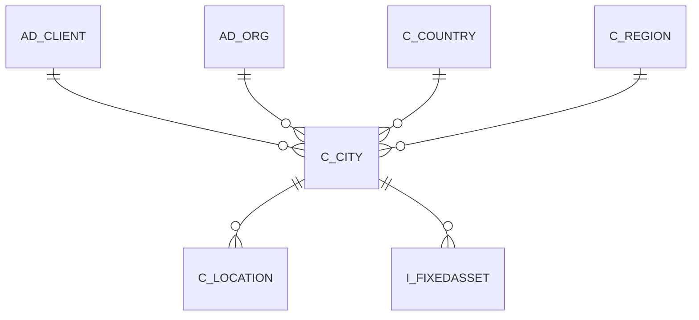

# C_CITY

Area [C](../../data-model/c/index.md) · class **business** (proposed) · read from database `idempiere-db` (owner `ADEMPIERE`) · 1 row(s) when profiled

Application model: `org.compiere.model.X_C_City`, access level 6 - System - Client.

## Columns

| column | type | key | not null | business name | references (code) | nulls | distinct |
|---|---|---|---|---|---|---|---|
| `C_CITY_ID` | NUMBER(10,0) | PK | yes | City |  | 0 | 1 |
| `AD_CLIENT_ID` | NUMBER(10,0) |  | yes | Tenant |  | 0 | 1 |
| `AD_ORG_ID` | NUMBER(10,0) |  | yes | Organization |  | 0 | 1 |
| `ISACTIVE` | CHAR(1) |  | yes | Active |  | 0 | 1 |
| `CREATED` | DATE |  | yes | Created |  | 0 | 1 |
| `CREATEDBY` | NUMBER(10,0) |  | yes | Created By |  | 0 | 1 |
| `UPDATED` | DATE |  | yes | Updated |  | 0 | 1 |
| `UPDATEDBY` | NUMBER(10,0) |  | yes | Updated By |  | 0 | 1 |
| `NAME` | VARCHAR2(60 CHAR) |  | yes | Name |  | 0 | 1 |
| `LOCODE` | VARCHAR2(10 CHAR) |  |  | Locode |  | 1 | 0 |
| `COORDINATES` | VARCHAR2(15 CHAR) |  |  | Coordinates |  | 1 | 0 |
| `POSTAL` | VARCHAR2(10 CHAR) |  |  | ZIP |  | 0 | 1 |
| `AREACODE` | VARCHAR2(10 CHAR) |  |  | Area Code |  | 0 | 1 |
| `C_COUNTRY_ID` | NUMBER(10,0) |  |  | Country | [C_COUNTRY](../../data-model/c/c_country.md) | 0 | 1 |
| `C_REGION_ID` | NUMBER(10,0) |  |  | Region | [C_REGION](../../data-model/c/c_region.md) | 1 | 0 |
| `C_CITY_UU` | VARCHAR2(36 CHAR) |  |  | C_City_UU |  | 0 | 1 |

*references (code)* is the table the application model's code says a column points to; *Foreign keys* below are the constraints the database declares. Counts come from the profile; no value is ever shown.

## Check constraints

| name | expression |
|---|---|
| `SYS_C0020379` | `IsActive in ('Y','N')` |

## Foreign keys

**References**

| table | columns | on delete |
|---|---|---|
| [AD_CLIENT](../../data-model/ad/ad_client.md) | C_CITY.AD_CLIENT_ID → AD_CLIENT.AD_CLIENT_ID | NO ACTION |
| [AD_ORG](../../data-model/ad/ad_org.md) | C_CITY.AD_ORG_ID → AD_ORG.AD_ORG_ID | NO ACTION |
| [C_COUNTRY](../../data-model/c/c_country.md) | C_CITY.C_COUNTRY_ID → C_COUNTRY.C_COUNTRY_ID | NO ACTION |
| [C_REGION](../../data-model/c/c_region.md) | C_CITY.C_REGION_ID → C_REGION.C_REGION_ID | NO ACTION |

**Referenced by**

| table | columns | on delete |
|---|---|---|
| [C_LOCATION](../../data-model/c/c_location.md) | C_LOCATION.C_CITY_ID → C_CITY.C_CITY_ID | NO ACTION |
| `I_FIXEDASSET` | I_FIXEDASSET.C_CITY_ID → C_CITY.C_CITY_ID | NO ACTION |

## Write behaviour

- updates: **po_only**
- deletes: **deleted_by_users**
- change log: **recorded**
- evidence: 1 citation(s)

## Schema history

22 change(s); the latest:

| applied | release | operation | column | tickets |
|---|---|---|---|---|
| 2023-04-09T15:47 | iD11 | `add_constraint` |  | IDEMPIERE-5567 |
| 2023-04-09T15:47 | iD11 | `add_constraint` |  | IDEMPIERE-5567 |
| 2021-12-05T16:45 | i8.2z | `add_constraint` |  | IDEMPIERE-5075 |
| 2021-12-05T16:45 | i8.2z | `drop_constraint` |  | IDEMPIERE-5075 |
| 2021-12-05T16:45 | i8.2z | `drop_constraint` |  | IDEMPIERE-5075 |
| 2021-12-05T16:45 | i8.2z | `add_constraint` |  | IDEMPIERE-5075 |
| 2021-12-05T16:45 | i8.2z | `drop_constraint` |  | IDEMPIERE-5075 |
| 2021-12-05T16:45 | i8.2z | `drop_constraint` |  | IDEMPIERE-5075 |
| 2021-12-05T16:45 | i8.2z | `add_constraint` |  | IDEMPIERE-5075 |
| 2021-12-05T16:45 | i8.2z | `add_constraint` |  | IDEMPIERE-5075 |
| 2020-08-04T01:00 | i7.1z | `drop_column` | tmp_col_2_tmp | IDEMPIERE-3862 |
| 2020-08-04T01:00 | i7.1z | `modify_column` | NAME | IDEMPIERE-3862 |
| 2020-08-04T01:00 | i7.1z | `modify_column` | NAME | IDEMPIERE-3862 |
| 2020-08-04T01:00 | i7.1z | `add_column` | tmp_col_2_tmp | IDEMPIERE-3862 |
| 2020-08-04T01:00 | i7.1z | `modify_column` | C_CITY_UU | IDEMPIERE-3862 |

## Notes

<!-- ekos:manual id="table.c_city.notes" -->
_Business notes about this table._
<!-- /ekos:manual -->
