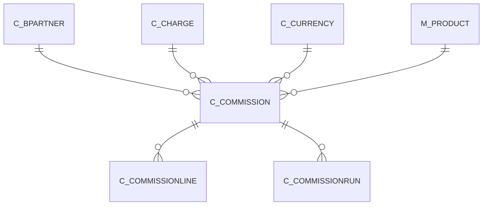

# C_COMMISSION

Area [C](../../data-model/c/index.md) · class **business** (proposed) · read from database `idempiere-db` (owner `ADEMPIERE`) · 1 row(s) when profiled

Application model: `org.compiere.model.X_C_Commission`, access level 3 - Client - Org.

## Columns

| column | type | key | not null | business name | references (code) | nulls | distinct |
|---|---|---|---|---|---|---|---|
| `C_COMMISSION_ID` | NUMBER(10,0) | PK | yes | Commission |  | 0 | 1 |
| `AD_CLIENT_ID` | NUMBER(10,0) |  | yes | Tenant |  | 0 | 1 |
| `AD_ORG_ID` | NUMBER(10,0) |  | yes | Organization |  | 0 | 1 |
| `ISACTIVE` | CHAR(1) |  | yes | Active |  | 0 | 1 |
| `CREATED` | DATE |  | yes | Created |  | 0 | 1 |
| `CREATEDBY` | NUMBER(10,0) |  | yes | Created By |  | 0 | 1 |
| `UPDATED` | DATE |  | yes | Updated |  | 0 | 1 |
| `UPDATEDBY` | NUMBER(10,0) |  | yes | Updated By |  | 0 | 1 |
| `NAME` | VARCHAR2(60 CHAR) |  | yes | Name |  | 0 | 1 |
| `DESCRIPTION` | VARCHAR2(255 CHAR) |  |  | Description |  | 0 | 1 |
| `C_BPARTNER_ID` | NUMBER(10,0) |  | yes | Business Partner | [C_BPARTNER](../../data-model/c/c_bpartner.md) | 0 | 1 |
| `C_CURRENCY_ID` | NUMBER(10,0) |  | yes | Currency | [C_CURRENCY](../../data-model/c/c_currency.md) | 0 | 1 |
| `FREQUENCYTYPE` | CHAR(1) |  | yes | Frequency Type |  | 0 | 1 |
| `DOCBASISTYPE` | CHAR(1) |  | yes | Calculation Basis |  | 0 | 1 |
| `LISTDETAILS` | CHAR(1) |  | yes | List Details |  | 0 | 1 |
| `DATELASTRUN` | DATE |  |  | Date Last Run |  | 0 | 1 |
| `CREATEFROM` | CHAR(1) |  |  | Create lines from |  | 0 | 1 |
| `PROCESSING` | CHAR(1) |  |  | Process Now |  | 0 | 1 |
| `C_CHARGE_ID` | NUMBER(10,0) |  |  | Charge | [C_CHARGE](../../data-model/c/c_charge.md) | 0 | 1 |
| `C_COMMISSION_UU` | VARCHAR2(36 CHAR) |  |  | C_Commission_UU |  | 0 | 1 |
| `M_PRODUCT_ID` | NUMBER(10,0) |  |  | Product | [M_PRODUCT](../../data-model/m/m_product.md) | 1 | 0 |

*references (code)* is the table the application model's code says a column points to; *Foreign keys* below are the constraints the database declares. Counts come from the profile; no value is ever shown.

## Check constraints

| name | expression |
|---|---|
| `SYS_C0020701` | `ListDetails in ('Y','N')` |
| `SYS_C0020703` | `IsActive in ('Y','N')` |
| `SYS_C0020704` | `CreateFrom in ('Y','N')` |

## Foreign keys

**References**

| table | columns | on delete |
|---|---|---|
| [C_BPARTNER](../../data-model/c/c_bpartner.md) | C_COMMISSION.C_BPARTNER_ID → C_BPARTNER.C_BPARTNER_ID | NO ACTION |
| [C_CHARGE](../../data-model/c/c_charge.md) | C_COMMISSION.C_CHARGE_ID → C_CHARGE.C_CHARGE_ID | NO ACTION |
| [C_CURRENCY](../../data-model/c/c_currency.md) | C_COMMISSION.C_CURRENCY_ID → C_CURRENCY.C_CURRENCY_ID | NO ACTION |
| [M_PRODUCT](../../data-model/m/m_product.md) | C_COMMISSION.M_PRODUCT_ID → M_PRODUCT.M_PRODUCT_ID | NO ACTION |

**Referenced by**

| table | columns | on delete |
|---|---|---|
| [C_COMMISSIONLINE](../../data-model/c/c_commissionline.md) | C_COMMISSIONLINE.C_COMMISSION_ID → C_COMMISSION.C_COMMISSION_ID | CASCADE |
| [C_COMMISSIONRUN](../../data-model/c/c_commissionrun.md) | C_COMMISSIONRUN.C_COMMISSION_ID → C_COMMISSION.C_COMMISSION_ID | NO ACTION |

## Write behaviour

- updates: **po_only**
- deletes: **deleted_by_users**
- change log: **recorded**
- evidence: 1 citation(s)

## Read by

| kind | name |
|---|---|
| View | `RV_COMMISSIONRUNDETAIL` |
| View | `rv_commissionrundetail` |

## Schema history

27 change(s); the latest:

| applied | release | operation | column | tickets |
|---|---|---|---|---|
| 2023-04-09T15:47 | iD11 | `add_constraint` |  | IDEMPIERE-5567 |
| 2023-04-09T15:47 | iD11 | `add_constraint` |  | IDEMPIERE-5567 |
| 2021-12-05T16:45 | i8.2z | `drop_constraint` |  | IDEMPIERE-5075 |
| 2021-12-05T16:45 | i8.2z | `add_constraint` |  | IDEMPIERE-5075 |
| 2021-12-05T16:45 | i8.2z | `drop_constraint` |  | IDEMPIERE-5075 |
| 2021-12-05T16:45 | i8.2z | `drop_constraint` |  | IDEMPIERE-5075 |
| 2021-12-05T16:45 | i8.2z | `add_constraint` |  | IDEMPIERE-5075 |
| 2021-12-05T16:45 | i8.2z | `add_constraint` |  | IDEMPIERE-5075 |
| 2021-10-11T19:22 | i8.2 | `modify_column` | C_Charge_ID | IDEMPIERE-4997 |
| 2021-10-11T19:22 | i8.2 | `modify_column` | C_Charge_ID | IDEMPIERE-4997 |
| 2021-10-11T19:22 | i8.2 | `add_column` | M_Product_ID | IDEMPIERE-4997 |
| 2021-10-11T19:22 | i8.2 | `add_column` | M_Product_ID | IDEMPIERE-4997 |
| 2021-10-11T19:22 | i8.2 | `modify_column` | C_Charge_ID | IDEMPIERE-4997 |
| 2021-10-11T19:22 | i8.2 | `add_constraint` |  | IDEMPIERE-4997 |
| 2021-10-11T19:22 | i8.2 | `modify_column` | C_Charge_ID | IDEMPIERE-4997 |

## Notes

<!-- ekos:manual id="table.c_commission.notes" -->
_Business notes about this table._
<!-- /ekos:manual -->
