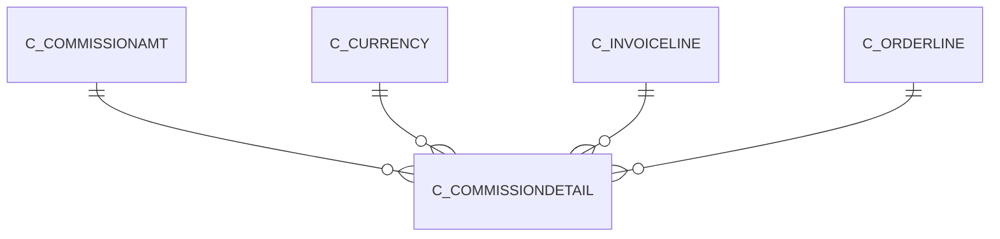

# C_COMMISSIONDETAIL

Area [C](../../data-model/c/index.md) · class **business** (proposed) · read from database `idempiere-db` (owner `ADEMPIERE`) · 0 row(s) when profiled

Application model: `org.compiere.model.X_C_CommissionDetail`, access level 1 - Org.

## Columns

| column | type | key | not null | business name | references (code) | nulls | distinct |
|---|---|---|---|---|---|---|---|
| `C_COMMISSIONDETAIL_ID` | NUMBER(10,0) | PK | yes | Commission Detail |  | 0 | 0 |
| `AD_CLIENT_ID` | NUMBER(10,0) |  | yes | Tenant |  | 0 | 0 |
| `AD_ORG_ID` | NUMBER(10,0) |  | yes | Organization |  | 0 | 0 |
| `ISACTIVE` | CHAR(1) |  | yes | Active |  | 0 | 0 |
| `CREATED` | DATE |  | yes | Created |  | 0 | 0 |
| `CREATEDBY` | NUMBER(10,0) |  | yes | Created By |  | 0 | 0 |
| `UPDATED` | DATE |  | yes | Updated |  | 0 | 0 |
| `UPDATEDBY` | NUMBER(10,0) |  | yes | Updated By |  | 0 | 0 |
| `C_COMMISSIONAMT_ID` | NUMBER(10,0) |  | yes | Commission Amount | [C_COMMISSIONAMT](../../data-model/c/c_commissionamt.md) | 0 | 0 |
| `REFERENCE` | VARCHAR2(60 CHAR) |  |  | Reference |  | 0 | 0 |
| `C_ORDERLINE_ID` | NUMBER(10,0) |  |  | Sales Order Line | [C_ORDERLINE](../../data-model/c/c_orderline.md) | 0 | 0 |
| `C_INVOICELINE_ID` | NUMBER(10,0) |  |  | Invoice Line | [C_INVOICELINE](../../data-model/c/c_invoiceline.md) | 0 | 0 |
| `INFO` | VARCHAR2(60 CHAR) |  |  | Info |  | 0 | 0 |
| `C_CURRENCY_ID` | NUMBER(10,0) |  | yes | Currency | [C_CURRENCY](../../data-model/c/c_currency.md) | 0 | 0 |
| `ACTUALAMT` | NUMBER |  | yes | Actual Amount |  | 0 | 0 |
| `CONVERTEDAMT` | NUMBER |  | yes | Converted Amount |  | 0 | 0 |
| `ACTUALQTY` | NUMBER |  | yes | Actual Quantity |  | 0 | 0 |
| `C_COMMISSIONDETAIL_UU` | VARCHAR2(36 CHAR) |  |  | C_CommissionDetail_UU |  | 0 | 0 |

*references (code)* is the table the application model's code says a column points to; *Foreign keys* below are the constraints the database declares. Counts come from the profile; no value is ever shown.

## Check constraints

| name | expression |
|---|---|
| `SYS_C0022992` | `IsActive in ('Y','N')` |

## Foreign keys

**References**

| table | columns | on delete |
|---|---|---|
| [C_COMMISSIONAMT](../../data-model/c/c_commissionamt.md) | C_COMMISSIONDETAIL.C_COMMISSIONAMT_ID → C_COMMISSIONAMT.C_COMMISSIONAMT_ID | CASCADE |
| [C_CURRENCY](../../data-model/c/c_currency.md) | C_COMMISSIONDETAIL.C_CURRENCY_ID → C_CURRENCY.C_CURRENCY_ID | NO ACTION |
| [C_INVOICELINE](../../data-model/c/c_invoiceline.md) | C_COMMISSIONDETAIL.C_INVOICELINE_ID → C_INVOICELINE.C_INVOICELINE_ID | NO ACTION |
| [C_ORDERLINE](../../data-model/c/c_orderline.md) | C_COMMISSIONDETAIL.C_ORDERLINE_ID → C_ORDERLINE.C_ORDERLINE_ID | NO ACTION |

**Referenced by**

_None._

## Write behaviour

- updates: **po_only**
- deletes: **deleted_by_users, deleted_by_cascade**
- change log: **recorded**
- evidence: 2 citation(s)

## Read by

| kind | name |
|---|---|
| View | `RV_COMMISSIONRUNDETAIL` |
| View | `rv_commissionrundetail` |

## Schema history

19 change(s); the latest:

| applied | release | operation | column | tickets |
|---|---|---|---|---|
| 2023-04-09T15:47 | iD11 | `add_constraint` |  | IDEMPIERE-5567 |
| 2023-04-09T15:47 | iD11 | `add_constraint` |  | IDEMPIERE-5567 |
| 2021-12-05T16:45 | i8.2z | `drop_constraint` |  | IDEMPIERE-5075 |
| 2021-12-05T16:45 | i8.2z | `add_constraint` |  | IDEMPIERE-5075 |
| 2021-12-05T16:45 | i8.2z | `drop_constraint` |  | IDEMPIERE-5075 |
| 2021-12-05T16:45 | i8.2z | `drop_constraint` |  | IDEMPIERE-5075 |
| 2021-12-05T16:45 | i8.2z | `add_constraint` |  | IDEMPIERE-5075 |
| 2021-12-05T16:45 | i8.2z | `drop_constraint` |  | IDEMPIERE-5075 |
| 2021-12-05T16:45 | i8.2z | `add_constraint` |  | IDEMPIERE-5075 |
| 2021-12-05T16:45 | i8.2z | `add_constraint` |  | IDEMPIERE-5075 |
| 2020-08-04T01:00 | i7.1z | `drop_column` | tmp_col_3_tmp | IDEMPIERE-3862 |
| 2020-08-04T01:00 | i7.1z | `modify_column` | INFO | IDEMPIERE-3862 |
| 2020-08-04T01:00 | i7.1z | `add_column` | tmp_col_2_tmp | IDEMPIERE-3862 |
| 2020-08-04T01:00 | i7.1z | `modify_column` | REFERENCE | IDEMPIERE-3862 |
| 2020-08-04T01:00 | i7.1z | `modify_column` | C_COMMISSIONDETAIL_UU | IDEMPIERE-3862 |

## Notes

<!-- ekos:manual id="table.c_commissiondetail.notes" -->
_Business notes about this table._
<!-- /ekos:manual -->
