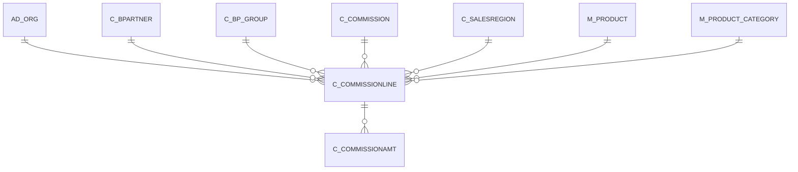

# C_COMMISSIONLINE

Area [C](../../data-model/c/index.md) · class **business** (proposed) · read from database `idempiere-db` (owner `ADEMPIERE`) · 1 row(s) when profiled

Application model: `org.compiere.model.X_C_CommissionLine`, access level 3 - Client - Org.

## Columns

| column | type | key | not null | business name | references (code) | nulls | distinct |
|---|---|---|---|---|---|---|---|
| `C_COMMISSIONLINE_ID` | NUMBER(10,0) | PK | yes | Commission Line |  | 0 | 1 |
| `AD_CLIENT_ID` | NUMBER(10,0) |  | yes | Tenant |  | 0 | 1 |
| `AD_ORG_ID` | NUMBER(10,0) |  | yes | Organization |  | 0 | 1 |
| `ISACTIVE` | CHAR(1) |  | yes | Active |  | 0 | 1 |
| `CREATED` | DATE |  | yes | Created |  | 0 | 1 |
| `CREATEDBY` | NUMBER(10,0) |  | yes | Created By |  | 0 | 1 |
| `UPDATED` | DATE |  | yes | Updated |  | 0 | 1 |
| `UPDATEDBY` | NUMBER(10,0) |  | yes | Updated By |  | 0 | 1 |
| `C_COMMISSION_ID` | NUMBER(10,0) |  | yes | Commission | [C_COMMISSION](../../data-model/c/c_commission.md) | 0 | 1 |
| `LINE` | NUMBER(10,0) |  | yes | Line No |  | 0 | 1 |
| `DESCRIPTION` | VARCHAR2(255 CHAR) |  |  | Description |  | 1 | 0 |
| `AMTSUBTRACT` | NUMBER |  | yes | Subtract Amount |  | 0 | 1 |
| `AMTMULTIPLIER` | NUMBER |  | yes | Multiplier Amount |  | 0 | 1 |
| `QTYSUBTRACT` | NUMBER |  | yes | Subtract Quantity |  | 0 | 1 |
| `QTYMULTIPLIER` | NUMBER |  | yes | Multiplier Quantity |  | 0 | 1 |
| `ISPOSITIVEONLY` | CHAR(1) |  | yes | Positive only |  | 0 | 1 |
| `COMMISSIONORDERS` | CHAR(1) |  | yes | Commission only specified Orders |  | 0 | 1 |
| `ORG_ID` | NUMBER(10,0) |  |  | Organization |  | 1 | 0 |
| `M_PRODUCT_CATEGORY_ID` | NUMBER(10,0) |  |  | Product Category | [M_PRODUCT_CATEGORY](../../data-model/m/m_product_category.md) | 1 | 0 |
| `M_PRODUCT_ID` | NUMBER(10,0) |  |  | Product | [M_PRODUCT](../../data-model/m/m_product.md) | 1 | 0 |
| `C_BP_GROUP_ID` | NUMBER(10,0) |  |  | Business Partner Group | [C_BP_GROUP](../../data-model/c/c_bp_group.md) | 1 | 0 |
| `C_BPARTNER_ID` | NUMBER(10,0) |  |  | Business Partner | [C_BPARTNER](../../data-model/c/c_bpartner.md) | 1 | 0 |
| `C_SALESREGION_ID` | NUMBER(10,0) |  |  | Sales Region | [C_SALESREGION](../../data-model/c/c_salesregion.md) | 1 | 0 |
| `PAYMENTRULE` | CHAR(1) |  |  | Payment Rule |  | 1 | 0 |
| `C_COMMISSIONLINE_UU` | VARCHAR2(36 CHAR) |  |  | C_CommissionLine_UU |  | 0 | 1 |

*references (code)* is the table the application model's code says a column points to; *Foreign keys* below are the constraints the database declares. Counts come from the profile; no value is ever shown.

## Check constraints

| name | expression |
|---|---|
| `SYS_C0019880` | `IsPositiveOnly in ('Y','N')` |
| `SYS_C0019881` | `IsActive in ('Y','N')` |
| `SYS_C0019883` | `CommissionOrders in ('Y','N')` |

## Foreign keys

**References**

| table | columns | on delete |
|---|---|---|
| [AD_ORG](../../data-model/ad/ad_org.md) | C_COMMISSIONLINE.ORG_ID → AD_ORG.AD_ORG_ID | NO ACTION |
| [C_BPARTNER](../../data-model/c/c_bpartner.md) | C_COMMISSIONLINE.C_BPARTNER_ID → C_BPARTNER.C_BPARTNER_ID | NO ACTION |
| [C_BP_GROUP](../../data-model/c/c_bp_group.md) | C_COMMISSIONLINE.C_BP_GROUP_ID → C_BP_GROUP.C_BP_GROUP_ID | NO ACTION |
| [C_COMMISSION](../../data-model/c/c_commission.md) | C_COMMISSIONLINE.C_COMMISSION_ID → C_COMMISSION.C_COMMISSION_ID | CASCADE |
| [C_SALESREGION](../../data-model/c/c_salesregion.md) | C_COMMISSIONLINE.C_SALESREGION_ID → C_SALESREGION.C_SALESREGION_ID | NO ACTION |
| [M_PRODUCT](../../data-model/m/m_product.md) | C_COMMISSIONLINE.M_PRODUCT_ID → M_PRODUCT.M_PRODUCT_ID | NO ACTION |
| [M_PRODUCT_CATEGORY](../../data-model/m/m_product_category.md) | C_COMMISSIONLINE.M_PRODUCT_CATEGORY_ID → M_PRODUCT_CATEGORY.M_PRODUCT_CATEGORY_ID | NO ACTION |

**Referenced by**

| table | columns | on delete |
|---|---|---|
| [C_COMMISSIONAMT](../../data-model/c/c_commissionamt.md) | C_COMMISSIONAMT.C_COMMISSIONLINE_ID → C_COMMISSIONLINE.C_COMMISSIONLINE_ID | NO ACTION |

## Write behaviour

- updates: **po_only**
- deletes: **deleted_by_users, deleted_by_cascade**
- change log: **recorded**
- evidence: 2 citation(s)

## Schema history

22 change(s); the latest:

| applied | release | operation | column | tickets |
|---|---|---|---|---|
| 2023-04-09T15:47 | iD11 | `add_constraint` |  | IDEMPIERE-5567 |
| 2023-04-09T15:47 | iD11 | `add_constraint` |  | IDEMPIERE-5567 |
| 2021-12-05T16:45 | i8.2z | `drop_constraint` |  | IDEMPIERE-5075 |
| 2021-12-05T16:45 | i8.2z | `drop_constraint` |  | IDEMPIERE-5075 |
| 2021-12-05T16:45 | i8.2z | `add_constraint` |  | IDEMPIERE-5075 |
| 2021-12-05T16:45 | i8.2z | `drop_constraint` |  | IDEMPIERE-5075 |
| 2021-12-05T16:45 | i8.2z | `add_constraint` |  | IDEMPIERE-5075 |
| 2021-12-05T16:45 | i8.2z | `add_constraint` |  | IDEMPIERE-5075 |
| 2021-12-05T16:45 | i8.2z | `add_constraint` |  | IDEMPIERE-5075 |
| 2021-12-05T16:45 | i8.2z | `add_constraint` |  | IDEMPIERE-5075 |
| 2021-12-05T16:45 | i8.2z | `drop_constraint` |  | IDEMPIERE-5075 |
| 2021-12-05T16:45 | i8.2z | `add_constraint` |  | IDEMPIERE-5075 |
| 2021-12-05T16:45 | i8.2z | `add_constraint` |  | IDEMPIERE-5075 |
| 2021-12-05T16:45 | i8.2z | `drop_constraint` |  | IDEMPIERE-5075 |
| 2021-12-05T16:45 | i8.2z | `drop_constraint` |  | IDEMPIERE-5075 |

## Notes

<!-- ekos:manual id="table.c_commissionline.notes" -->
_Business notes about this table._
<!-- /ekos:manual -->
