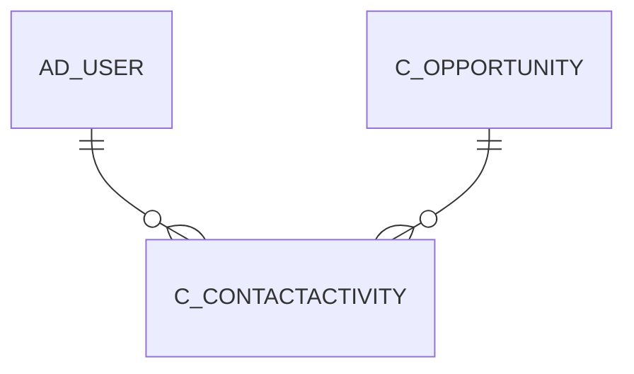

# C_CONTACTACTIVITY

Area [C](../../data-model/c/index.md) · class **business** (proposed) · read from database `idempiere-db` (owner `ADEMPIERE`) · 0 row(s) when profiled

Application model: `org.compiere.model.X_C_ContactActivity`, access level 3 - Client - Org.

## Columns

| column | type | key | not null | business name | references (code) | nulls | distinct |
|---|---|---|---|---|---|---|---|
| `C_CONTACTACTIVITY_ID` | NUMBER(10,0) | PK | yes | Contact Activity |  | 0 | 0 |
| `AD_CLIENT_ID` | NUMBER(10,0) |  | yes | Tenant |  | 0 | 0 |
| `AD_ORG_ID` | NUMBER(10,0) |  | yes | Organization |  | 0 | 0 |
| `CREATED` | DATE |  | yes | Created |  | 0 | 0 |
| `CREATEDBY` | NUMBER(10,0) |  | yes | Created By |  | 0 | 0 |
| `DESCRIPTION` | VARCHAR2(255 CHAR) |  | yes | Description |  | 0 | 0 |
| `ISACTIVE` | CHAR(1) |  | yes | Active |  | 0 | 0 |
| `UPDATED` | DATE |  | yes | Updated |  | 0 | 0 |
| `UPDATEDBY` | NUMBER(10,0) |  | yes | Updated By |  | 0 | 0 |
| `STARTDATE` | DATE |  | yes | Start Date |  | 0 | 0 |
| `ENDDATE` | DATE |  |  | End Date |  | 0 | 0 |
| `COMMENTS` | CLOB |  |  | Comments |  | 0 |  |
| `SALESREP_ID` | NUMBER(10,0) |  |  | Sales Representative | [AD_USER](../../data-model/ad/ad_user.md) | 0 | 0 |
| `AD_USER_ID` | NUMBER(10,0) |  |  | User/Contact | [AD_USER](../../data-model/ad/ad_user.md) | 0 | 0 |
| `CONTACTACTIVITYTYPE` | VARCHAR2(10 CHAR) |  | yes | Activity Type |  | 0 | 0 |
| `ISCOMPLETE` | CHAR(1) |  |  | Complete |  | 0 | 0 |
| `C_OPPORTUNITY_ID` | NUMBER(10,0) |  |  | Sales Opportunity | [C_OPPORTUNITY](../../data-model/c/c_opportunity.md) | 0 | 0 |
| `C_CONTACTACTIVITY_UU` | VARCHAR2(36 CHAR) |  |  | C_ContactActivity_UU |  | 0 | 0 |

*references (code)* is the table the application model's code says a column points to; *Foreign keys* below are the constraints the database declares. Counts come from the profile; no value is ever shown.

## Check constraints

| name | expression |
|---|---|
| `SYS_C0020921` | `IsComplete IN ('Y','N')` |
| `SYS_C0020922` | `IsActive IN ('Y','N')` |

## Foreign keys

**References**

| table | columns | on delete |
|---|---|---|
| [AD_USER](../../data-model/ad/ad_user.md) | C_CONTACTACTIVITY.AD_USER_ID → AD_USER.AD_USER_ID | NO ACTION |
| [C_OPPORTUNITY](../../data-model/c/c_opportunity.md) | C_CONTACTACTIVITY.C_OPPORTUNITY_ID → C_OPPORTUNITY.C_OPPORTUNITY_ID | NO ACTION |

**Referenced by**

_None._

## Write behaviour

- updates: **po_only**
- deletes: **deleted_by_users**
- change log: **recorded**
- evidence: 1 citation(s)

## Schema history

65 change(s); the latest:

| applied | release | operation | column | tickets |
|---|---|---|---|---|
| 2020-08-04T01:00 | i7.1z | `drop_column` | tmp_col_3_tmp | IDEMPIERE-3862 |
| 2020-08-04T01:00 | i7.1z | `add_column` | tmp_col_3_tmp | IDEMPIERE-3862 |
| 2020-08-04T01:00 | i7.1z | `modify_column` | CONTACTACTIVITYTYPE | IDEMPIERE-3862 |
| 2020-08-04T01:00 | i7.1z | `modify_column` | CONTACTACTIVITYTYPE | IDEMPIERE-3862 |
| 2020-08-04T01:00 | i7.1z | `drop_column` | tmp_col_1_tmp | IDEMPIERE-3862 |
| 2020-08-04T01:00 | i7.1z | `modify_column` | C_CONTACTACTIVITY_UU | IDEMPIERE-3862 |
| 2020-08-04T01:00 | i7.1z | `modify_column` | DESCRIPTION | IDEMPIERE-3862 |
| 2020-08-04T01:00 | i7.1z | `add_column` | tmp_col_1_tmp | IDEMPIERE-3862 |
| 2020-08-04T01:00 | i7.1z | `add_column` | tmp_col_2_tmp | IDEMPIERE-3862 |
| 2020-08-04T01:00 | i7.1z | `drop_column` | tmp_col_2_tmp | IDEMPIERE-3862 |
| 2020-08-04T01:00 | i7.1z | `modify_column` | CONTACTACTIVITYTYPE | IDEMPIERE-3862 |
| 2020-08-04T01:00 | i7.1z | `modify_column` | DESCRIPTION | IDEMPIERE-3862 |
| 2020-08-04T01:00 | i7.1z | `modify_column` | DESCRIPTION | IDEMPIERE-3862 |
| 2014-10-30T19:04 | i2.0z | `add_constraint` |  |  |
| 2014-10-30T19:04 | i2.0z | `add_constraint` |  |  |

## Notes

<!-- ekos:manual id="table.c_contactactivity.notes" -->
_Business notes about this table._
<!-- /ekos:manual -->
