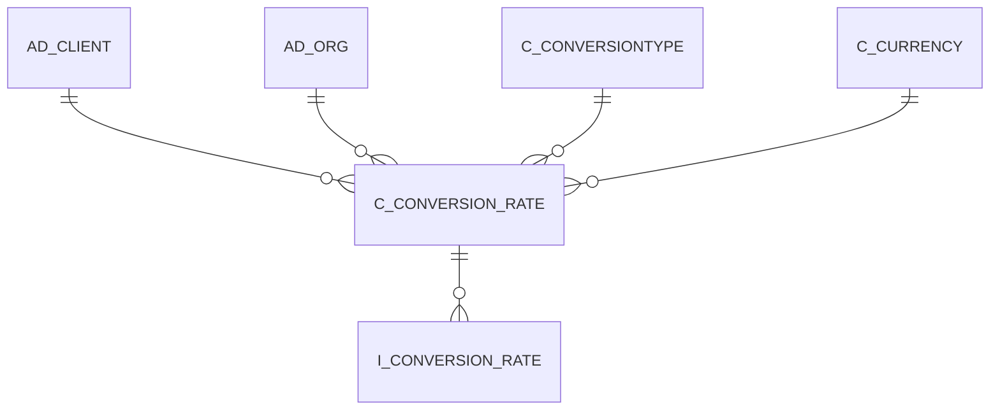

# C_CONVERSION_RATE

Area [C](../../data-model/c/index.md) · class **business** (proposed) · read from database `idempiere-db` (owner `ADEMPIERE`) · 4 row(s) when profiled

Application model: `org.compiere.model.X_C_Conversion_Rate`, access level 6 - System - Client.

## Columns

| column | type | key | not null | business name | references (code) | nulls | distinct |
|---|---|---|---|---|---|---|---|
| `C_CONVERSION_RATE_ID` | NUMBER(10,0) | PK | yes | Conversion Rate |  | 0 | 4 |
| `AD_CLIENT_ID` | NUMBER(10,0) |  | yes | Tenant |  | 0 | 1 |
| `AD_ORG_ID` | NUMBER(10,0) |  | yes | Organization |  | 0 | 1 |
| `ISACTIVE` | CHAR(1) |  | yes | Active |  | 0 | 2 |
| `CREATED` | DATE |  | yes | Created |  | 0 | 1 |
| `CREATEDBY` | NUMBER(10,0) |  | yes | Created By |  | 0 | 1 |
| `UPDATED` | DATE |  | yes | Updated |  | 0 | 3 |
| `UPDATEDBY` | NUMBER(10,0) |  | yes | Updated By |  | 0 | 1 |
| `C_CURRENCY_ID` | NUMBER(10,0) |  | yes | Currency | [C_CURRENCY](../../data-model/c/c_currency.md) | 0 | 2 |
| `C_CURRENCY_ID_TO` | NUMBER(10,0) |  | yes | Currency To |  | 0 | 2 |
| `VALIDFROM` | DATE |  | yes | Valid from |  | 0 | 2 |
| `VALIDTO` | DATE |  |  | Valid to |  | 0 | 1 |
| `MULTIPLYRATE` | NUMBER |  | yes | Multiply Rate |  | 0 | 4 |
| `DIVIDERATE` | NUMBER |  | yes | Divide Rate |  | 0 | 4 |
| `C_CONVERSIONTYPE_ID` | NUMBER(10,0) |  | yes | Currency Type | [C_CONVERSIONTYPE](../../data-model/c/c_conversiontype.md) | 0 | 1 |
| `C_CONVERSION_RATE_UU` | VARCHAR2(36 CHAR) |  |  | C_Conversion_Rate_UU |  | 0 | 4 |

*references (code)* is the table the application model's code says a column points to; *Foreign keys* below are the constraints the database declares. Counts come from the profile; no value is ever shown.

## Check constraints

| name | expression |
|---|---|
| `SYS_C0022960` | `IsActive in ('Y','N')` |

## Foreign keys

**References**

| table | columns | on delete |
|---|---|---|
| [AD_CLIENT](../../data-model/ad/ad_client.md) | C_CONVERSION_RATE.AD_CLIENT_ID → AD_CLIENT.AD_CLIENT_ID | NO ACTION |
| [AD_ORG](../../data-model/ad/ad_org.md) | C_CONVERSION_RATE.AD_ORG_ID → AD_ORG.AD_ORG_ID | NO ACTION |
| [C_CONVERSIONTYPE](../../data-model/c/c_conversiontype.md) | C_CONVERSION_RATE.C_CONVERSIONTYPE_ID → C_CONVERSIONTYPE.C_CONVERSIONTYPE_ID | NO ACTION |
| [C_CURRENCY](../../data-model/c/c_currency.md) | C_CONVERSION_RATE.C_CURRENCY_ID → C_CURRENCY.C_CURRENCY_ID | NO ACTION |

**Referenced by**

| table | columns | on delete |
|---|---|---|
| `I_CONVERSION_RATE` | I_CONVERSION_RATE.C_CONVERSION_RATE_ID → C_CONVERSION_RATE.C_CONVERSION_RATE_ID | SET NULL |

## Write behaviour

- updates: **po_only**
- deletes: **deleted_by_app, deleted_by_users**
- change log: **recorded**
- evidence: 2 citation(s)

## Read by

| kind | name |
|---|---|
| Procedure | [currencyRate](../../logic/currencyrate.md) |

## Schema history

17 change(s); the latest:

| applied | release | operation | column | tickets |
|---|---|---|---|---|
| 2023-04-09T15:47 | iD11 | `add_constraint` |  | IDEMPIERE-5567 |
| 2023-04-09T15:47 | iD11 | `add_constraint` |  | IDEMPIERE-5567 |
| 2021-12-05T16:45 | i8.2z | `add_constraint` |  | IDEMPIERE-5075 |
| 2021-12-05T16:45 | i8.2z | `drop_constraint` |  | IDEMPIERE-5075 |
| 2021-12-05T16:45 | i8.2z | `add_constraint` |  | IDEMPIERE-5075 |
| 2021-12-05T16:45 | i8.2z | `drop_constraint` |  | IDEMPIERE-5075 |
| 2021-12-05T16:45 | i8.2z | `add_constraint` |  | IDEMPIERE-5075 |
| 2021-12-05T16:45 | i8.2z | `add_constraint` |  | IDEMPIERE-5075 |
| 2021-12-05T16:45 | i8.2z | `drop_constraint` |  | IDEMPIERE-5075 |
| 2021-12-05T16:45 | i8.2z | `add_constraint` |  | IDEMPIERE-5075 |
| 2021-12-05T16:45 | i8.2z | `drop_constraint` |  | IDEMPIERE-5075 |
| 2021-12-05T16:45 | i8.2z | `drop_constraint` |  | IDEMPIERE-5075 |
| 2020-08-04T01:00 | i7.1z | `modify_column` | C_CONVERSION_RATE_UU | IDEMPIERE-3862 |
| 2020-08-04T01:00 | i7.1z | `drop_column` | tmp_col_1_tmp | IDEMPIERE-3862 |
| 2020-08-04T01:00 | i7.1z | `add_column` | tmp_col_1_tmp | IDEMPIERE-3862 |

## Notes

<!-- ekos:manual id="table.c_conversion_rate.notes" -->
_Business notes about this table._
<!-- /ekos:manual -->
