# C_CONVERSIONTYPE

Area [C](../../data-model/c/index.md) · class **business** (proposed) · read from database `idempiere-db` (owner `ADEMPIERE`) · 4 row(s) when profiled

Application model: `org.compiere.model.X_C_ConversionType`, access level 6 - System - Client.

## Columns

| column | type | key | not null | business name | references (code) | nulls | distinct |
|---|---|---|---|---|---|---|---|
| `C_CONVERSIONTYPE_ID` | NUMBER(10,0) | PK | yes | Currency Type |  | 0 | 4 |
| `AD_CLIENT_ID` | NUMBER(10,0) |  | yes | Tenant |  | 0 | 1 |
| `AD_ORG_ID` | NUMBER(10,0) |  | yes | Organization |  | 0 | 1 |
| `ISACTIVE` | CHAR(1) |  | yes | Active |  | 0 | 1 |
| `CREATED` | DATE |  | yes | Created |  | 0 | 1 |
| `CREATEDBY` | NUMBER(10,0) |  | yes | Created By |  | 0 | 1 |
| `UPDATED` | DATE |  | yes | Updated |  | 0 | 1 |
| `UPDATEDBY` | NUMBER(10,0) |  | yes | Updated By |  | 0 | 1 |
| `VALUE` | VARCHAR2(40 CHAR) |  | yes | Search Key |  | 0 | 4 |
| `NAME` | VARCHAR2(60 CHAR) |  | yes | Name |  | 0 | 4 |
| `DESCRIPTION` | VARCHAR2(255 CHAR) |  |  | Description |  | 0 | 4 |
| `ISDEFAULT` | CHAR(1) |  | yes | Default |  | 0 | 2 |
| `C_CONVERSIONTYPE_UU` | VARCHAR2(36 CHAR) |  |  | C_ConversionType_UU |  | 0 | 4 |

*references (code)* is the table the application model's code says a column points to; *Foreign keys* below are the constraints the database declares. Counts come from the profile; no value is ever shown.

## Check constraints

| name | expression |
|---|---|
| `SYS_C0022817` | `IsDefault in ('Y','N')` |

## Foreign keys

**References**

_None._

**Referenced by**

| table | columns | on delete |
|---|---|---|
| [A_ASSET_ADDITION](../../data-model/a/a_asset_addition.md) | A_ASSET_ADDITION.C_CONVERSIONTYPE_ID → C_CONVERSIONTYPE.C_CONVERSIONTYPE_ID | NO ACTION |
| [C_BANKTRANSFER](../../data-model/c/c_banktransfer.md) | C_BANKTRANSFER.C_CONVERSIONTYPE_ID → C_CONVERSIONTYPE.C_CONVERSIONTYPE_ID | NO ACTION |
| [C_CONVERSION_RATE](../../data-model/c/c_conversion_rate.md) | C_CONVERSION_RATE.C_CONVERSIONTYPE_ID → C_CONVERSIONTYPE.C_CONVERSIONTYPE_ID | NO ACTION |
| [C_INVOICE](../../data-model/c/c_invoice.md) | C_INVOICE.C_CONVERSIONTYPE_ID → C_CONVERSIONTYPE.C_CONVERSIONTYPE_ID | NO ACTION |
| [C_INVOICEBATCH](../../data-model/c/c_invoicebatch.md) | C_INVOICEBATCH.C_CONVERSIONTYPE_ID → C_CONVERSIONTYPE.C_CONVERSIONTYPE_ID | NO ACTION |
| [C_ORDER](../../data-model/c/c_order.md) | C_ORDER.C_CONVERSIONTYPE_ID → C_CONVERSIONTYPE.C_CONVERSIONTYPE_ID | NO ACTION |
| [C_PAYMENT](../../data-model/c/c_payment.md) | C_PAYMENT.C_CONVERSIONTYPE_ID → C_CONVERSIONTYPE.C_CONVERSIONTYPE_ID | NO ACTION |
| [C_PAYMENTTRANSACTION](../../data-model/c/c_paymenttransaction.md) | C_PAYMENTTRANSACTION.C_CONVERSIONTYPE_ID → C_CONVERSIONTYPE.C_CONVERSIONTYPE_ID | NO ACTION |
| [GL_JOURNAL](../../data-model/gl/gl_journal.md) | GL_JOURNAL.C_CONVERSIONTYPE_ID → C_CONVERSIONTYPE.C_CONVERSIONTYPE_ID | NO ACTION |
| [GL_JOURNALLINE](../../data-model/gl/gl_journalline.md) | GL_JOURNALLINE.C_CONVERSIONTYPE_ID → C_CONVERSIONTYPE.C_CONVERSIONTYPE_ID | NO ACTION |
| `I_CONVERSION_RATE` | I_CONVERSION_RATE.C_CONVERSIONTYPE_ID → C_CONVERSIONTYPE.C_CONVERSIONTYPE_ID | SET NULL |
| `I_GLJOURNAL` | I_GLJOURNAL.C_CONVERSIONTYPE_ID → C_CONVERSIONTYPE.C_CONVERSIONTYPE_ID | SET NULL |
| [M_DISCOUNTSCHEMALINE](../../data-model/m/m_discountschemaline.md) | M_DISCOUNTSCHEMALINE.C_CONVERSIONTYPE_ID → C_CONVERSIONTYPE.C_CONVERSIONTYPE_ID | NO ACTION |
| [M_INVENTORY](../../data-model/m/m_inventory.md) | M_INVENTORY.C_CONVERSIONTYPE_ID → C_CONVERSIONTYPE.C_CONVERSIONTYPE_ID | NO ACTION |
| `T_INVOICEGL` | T_INVOICEGL.C_CONVERSIONTYPEREVAL_ID → C_CONVERSIONTYPE.C_CONVERSIONTYPE_ID | CASCADE |

```mermaid
erDiagram
  C_CONVERSIONTYPE ||--o{ A_ASSET_ADDITION : ""
  C_CONVERSIONTYPE ||--o{ C_BANKTRANSFER : ""
  C_CONVERSIONTYPE ||--o{ C_CONVERSION_RATE : ""
  C_CONVERSIONTYPE ||--o{ C_INVOICE : ""
  C_CONVERSIONTYPE ||--o{ C_INVOICEBATCH : ""
  C_CONVERSIONTYPE ||--o{ C_ORDER : ""
  C_CONVERSIONTYPE ||--o{ C_PAYMENT : ""
  C_CONVERSIONTYPE ||--o{ C_PAYMENTTRANSACTION : ""
  C_CONVERSIONTYPE ||--o{ GL_JOURNAL : ""
  C_CONVERSIONTYPE ||--o{ GL_JOURNALLINE : ""
  C_CONVERSIONTYPE ||--o{ I_CONVERSION_RATE : ""
  C_CONVERSIONTYPE ||--o{ I_GLJOURNAL : ""
  C_CONVERSIONTYPE ||--o{ M_DISCOUNTSCHEMALINE : ""
  C_CONVERSIONTYPE ||--o{ M_INVENTORY : ""
  C_CONVERSIONTYPE ||--o{ T_INVOICEGL : ""
```

## Write behaviour

- updates: **po_only**
- deletes: **deleted_by_users**
- change log: **recorded**
- evidence: 1 citation(s)

## Read by

| kind | name |
|---|---|
| Procedure | [currencyRate](../../logic/currencyrate.md) |

## Schema history

18 change(s); the latest:

| applied | release | operation | column | tickets |
|---|---|---|---|---|
| 2023-04-09T15:47 | iD11 | `add_constraint` |  | IDEMPIERE-5567 |
| 2023-04-09T15:47 | iD11 | `add_constraint` |  | IDEMPIERE-5567 |
| 2020-08-04T01:00 | i7.1z | `drop_column` | tmp_col_3_tmp | IDEMPIERE-3862 |
| 2020-08-04T01:00 | i7.1z | `add_column` | tmp_col_3_tmp | IDEMPIERE-3862 |
| 2020-08-04T01:00 | i7.1z | `modify_column` | DESCRIPTION | IDEMPIERE-3862 |
| 2020-08-04T01:00 | i7.1z | `modify_column` | NAME | IDEMPIERE-3862 |
| 2020-08-04T01:00 | i7.1z | `add_column` | tmp_col_2_tmp | IDEMPIERE-3862 |
| 2020-08-04T01:00 | i7.1z | `modify_column` | VALUE | IDEMPIERE-3862 |
| 2020-08-04T01:00 | i7.1z | `drop_column` | tmp_col_1_tmp | IDEMPIERE-3862 |
| 2020-08-04T01:00 | i7.1z | `add_column` | tmp_col_1_tmp | IDEMPIERE-3862 |
| 2020-08-04T01:00 | i7.1z | `drop_column` | tmp_col_4_tmp | IDEMPIERE-3862 |
| 2020-08-04T01:00 | i7.1z | `modify_column` | C_CONVERSIONTYPE_UU | IDEMPIERE-3862 |
| 2020-08-04T01:00 | i7.1z | `modify_column` | NAME | IDEMPIERE-3862 |
| 2020-08-04T01:00 | i7.1z | `modify_column` | NAME | IDEMPIERE-3862 |
| 2020-08-04T01:00 | i7.1z | `drop_column` | tmp_col_2_tmp | IDEMPIERE-3862 |

## Notes

<!-- ekos:manual id="table.c_conversiontype.notes" -->
_Business notes about this table._
<!-- /ekos:manual -->
