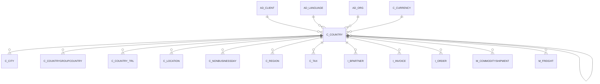

# C_COUNTRY

Area [C](../../data-model/c/index.md) · class **business** (proposed) · read from database `idempiere-db` (owner `ADEMPIERE`) · 251 row(s) when profiled

Application model: `org.compiere.model.X_C_Country`, access level 6 - System - Client.

## Columns

| column | type | key | not null | business name | references (code) | nulls | distinct |
|---|---|---|---|---|---|---|---|
| `C_COUNTRY_ID` | NUMBER(10,0) | PK | yes | Country |  | 0 | 251 |
| `AD_CLIENT_ID` | NUMBER(10,0) |  | yes | Tenant |  | 0 | 1 |
| `AD_ORG_ID` | NUMBER(10,0) |  | yes | Organization |  | 0 | 1 |
| `ISACTIVE` | CHAR(1) |  | yes | Active |  | 0 | 2 |
| `CREATED` | DATE |  | yes | Created |  | 0 | 20 |
| `CREATEDBY` | NUMBER(10,0) |  | yes | Created By |  | 0 | 2 |
| `UPDATED` | DATE |  | yes | Updated |  | 0 | 13 |
| `UPDATEDBY` | NUMBER(10,0) |  | yes | Updated By |  | 0 | 2 |
| `NAME` | VARCHAR2(60 CHAR) |  | yes | Name |  | 0 | 251 |
| `DESCRIPTION` | VARCHAR2(255 CHAR) |  |  | Description |  | 0 | 251 |
| `COUNTRYCODE` | CHAR(2) |  | yes | ISO Country Code |  | 0 | 251 |
| `HASREGION` | CHAR(1) |  | yes | Country has Region |  | 0 | 2 |
| `REGIONNAME` | VARCHAR2(60 CHAR) |  |  | Region |  | 231 | 8 |
| `EXPRESSIONPHONE` | VARCHAR2(20 CHAR) |  |  | Phone Format |  | 249 | 2 |
| `DISPLAYSEQUENCE` | VARCHAR2(20 CHAR) |  | yes | Address Print Format |  | 0 | 15 |
| `EXPRESSIONPOSTAL` | VARCHAR2(20 CHAR) |  |  | Postal Code Format |  | 250 | 1 |
| `HASPOSTAL_ADD` | CHAR(1) |  | yes | Additional Postal code |  | 0 | 2 |
| `EXPRESSIONPOSTAL_ADD` | VARCHAR2(20 CHAR) |  |  | Additional Postal Format |  | 251 | 0 |
| `AD_LANGUAGE` | VARCHAR2(6 CHAR) |  |  | Language |  | 159 | 84 |
| `C_CURRENCY_ID` | NUMBER(10,0) |  |  | Currency | [C_CURRENCY](../../data-model/c/c_currency.md) | 18 | 159 |
| `DISPLAYSEQUENCELOCAL` | VARCHAR2(20 CHAR) |  |  | Local Address Format |  | 242 | 3 |
| `ISADDRESSLINESREVERSE` | CHAR(1) |  | yes | Reverse Address Lines |  | 0 | 1 |
| `ISADDRESSLINESLOCALREVERSE` | CHAR(1) |  | yes | Reverse Local Address Lines |  | 0 | 2 |
| `EXPRESSIONBANKROUTINGNO` | VARCHAR2(20 CHAR) |  |  | Bank Routing No Format |  | 251 | 0 |
| `EXPRESSIONBANKACCOUNTNO` | VARCHAR2(20 CHAR) |  |  | Bank Account No Format |  | 251 | 0 |
| `MEDIASIZE` | VARCHAR2(40 CHAR) |  |  | Media Size |  | 251 | 0 |
| `ISPOSTCODELOOKUP` | CHAR(1) |  | yes |  |  | 0 | 1 |
| `LOOKUPCLASSNAME` | VARCHAR2(255 CHAR) |  |  |  |  | 251 | 0 |
| `LOOKUPCLIENTID` | VARCHAR2(50 CHAR) |  |  |  |  | 251 | 0 |
| `LOOKUPPASSWORD` | VARCHAR2(50 CHAR) |  |  |  |  | 251 | 0 |
| `LOOKUPURL` | VARCHAR2(100 CHAR) |  |  |  |  | 251 | 0 |
| `ALLOWCITIESOUTOFLIST` | CHAR(1) |  |  | Allow Cities out of List |  | 0 | 1 |
| `CAPTURESEQUENCE` | VARCHAR2(60 CHAR) |  |  | Capture Sequence |  | 0 | 20 |
| `C_COUNTRY_UU` | VARCHAR2(36 CHAR) |  |  | C_Country_UU |  | 0 | 251 |
| `PLACEHOLDERADDRESS1` | VARCHAR2(255 CHAR) |  |  | Placeholder for Address 1 |  | 251 | 0 |
| `PLACEHOLDERADDRESS2` | VARCHAR2(255 CHAR) |  |  | Placeholder for Address 2 |  | 251 | 0 |
| `PLACEHOLDERADDRESS3` | VARCHAR2(255 CHAR) |  |  | Placeholder for Address 3 |  | 251 | 0 |
| `PLACEHOLDERADDRESS4` | VARCHAR2(255 CHAR) |  |  | Placeholder for Address 4 |  | 251 | 0 |
| `PLACEHOLDERADDRESS5` | VARCHAR2(255 CHAR) |  |  | Placeholder for Address 5 |  | 251 | 0 |
| `PLACEHOLDERCITY` | VARCHAR2(255 CHAR) |  |  | Placeholder for city |  | 251 | 0 |
| `PLACEHOLDERCOMMENTS` | VARCHAR2(255 CHAR) |  |  | Placeholder for comments |  | 251 | 0 |
| `PLACEHOLDERPOSTAL` | VARCHAR2(255 CHAR) |  |  | Placeholder for postal |  | 251 | 0 |
| `PLACEHOLDERPOSTAL_ADD` | VARCHAR2(255 CHAR) |  |  | Placeholder for additional zip |  | 251 | 0 |

*references (code)* is the table the application model's code says a column points to; *Foreign keys* below are the constraints the database declares. Counts come from the profile; no value is ever shown.

## Check constraints

| name | expression |
|---|---|
| `SYS_C0022170` | `IsActive in ('Y','N')` |
| `SYS_C0022171` | `IsPostcodeLookup IN ('Y','N')` |
| `SYS_C0022172` | `HasPostal_Add in ('Y','N')` |
| `SYS_C0022173` | `AllowCitiesOutOfList IN ('Y','N')` |
| `SYS_C0022175` | `HasRegion in ('Y','N')` |

## Foreign keys

**References**

| table | columns | on delete |
|---|---|---|
| [AD_CLIENT](../../data-model/ad/ad_client.md) | C_COUNTRY.AD_CLIENT_ID → AD_CLIENT.AD_CLIENT_ID | NO ACTION |
| [AD_LANGUAGE](../../data-model/ad/ad_language.md) | C_COUNTRY.AD_LANGUAGE → AD_LANGUAGE.AD_LANGUAGE | NO ACTION |
| [AD_ORG](../../data-model/ad/ad_org.md) | C_COUNTRY.AD_ORG_ID → AD_ORG.AD_ORG_ID | NO ACTION |
| [C_COUNTRY](../../data-model/c/c_country.md) | C_COUNTRY.C_COUNTRY_ID → C_COUNTRY.C_COUNTRY_ID | NO ACTION |
| [C_CURRENCY](../../data-model/c/c_currency.md) | C_COUNTRY.C_CURRENCY_ID → C_CURRENCY.C_CURRENCY_ID | NO ACTION |

**Referenced by**

| table | columns | on delete |
|---|---|---|
| [C_CITY](../../data-model/c/c_city.md) | C_CITY.C_COUNTRY_ID → C_COUNTRY.C_COUNTRY_ID | NO ACTION |
| [C_COUNTRY](../../data-model/c/c_country.md) | C_COUNTRY.C_COUNTRY_ID → C_COUNTRY.C_COUNTRY_ID | NO ACTION |
| [C_COUNTRYGROUPCOUNTRY](../../data-model/c/c_countrygroupcountry.md) | C_COUNTRYGROUPCOUNTRY.C_COUNTRY_ID → C_COUNTRY.C_COUNTRY_ID | NO ACTION |
| [C_COUNTRY_TRL](../../data-model/c/c_country_trl.md) | C_COUNTRY_TRL.C_COUNTRY_ID → C_COUNTRY.C_COUNTRY_ID | CASCADE |
| [C_LOCATION](../../data-model/c/c_location.md) | C_LOCATION.C_COUNTRY_ID → C_COUNTRY.C_COUNTRY_ID | NO ACTION |
| [C_NONBUSINESSDAY](../../data-model/c/c_nonbusinessday.md) | C_NONBUSINESSDAY.C_COUNTRY_ID → C_COUNTRY.C_COUNTRY_ID | NO ACTION |
| [C_REGION](../../data-model/c/c_region.md) | C_REGION.C_COUNTRY_ID → C_COUNTRY.C_COUNTRY_ID | NO ACTION |
| [C_TAX](../../data-model/c/c_tax.md) | C_TAX.TO_COUNTRY_ID → C_COUNTRY.C_COUNTRY_ID | NO ACTION |
| `I_BPARTNER` | I_BPARTNER.C_COUNTRY_ID → C_COUNTRY.C_COUNTRY_ID | SET NULL |
| `I_INVOICE` | I_INVOICE.C_COUNTRY_ID → C_COUNTRY.C_COUNTRY_ID | SET NULL |
| `I_ORDER` | I_ORDER.C_COUNTRY_ID → C_COUNTRY.C_COUNTRY_ID | SET NULL |
| [M_COMMODITYSHIPMENT](../../data-model/m/m_commodityshipment.md) | M_COMMODITYSHIPMENT.COUNTRYOFMANUFACTURE_ID → C_COUNTRY.C_COUNTRY_ID | NO ACTION |
| [M_FREIGHT](../../data-model/m/m_freight.md) | M_FREIGHT.TO_COUNTRY_ID → C_COUNTRY.C_COUNTRY_ID | NO ACTION |

## Write behaviour

- updates: **po_only**
- deletes: **deleted_by_users**
- change log: **recorded**
- evidence: 1 citation(s)

## Read by

| kind | name |
|---|---|
| Procedure | [nextBusinessDay](../../logic/nextbusinessday.md) |
| Procedure | [nextbusinessday](../../logic/nextbusinessday.md) |
| View | `RV_BPARTNER` |
| View | `RV_T_1099EXTRACT` |
| View | `rv_bpartner` |
| View | `rv_t_1099extract` |

## Schema history

109 change(s); the latest:

| applied | release | operation | column | tickets |
|---|---|---|---|---|
| 2024-12-26T13:58 | iD12 | `add_column` | M49Code | IDEMPIERE-6349 |
| 2024-12-26T13:58 | iD12 | `add_column` | ISOCountryCodeAlpha3 | IDEMPIERE-6349 |
| 2024-12-26T13:58 | iD12 | `add_column` | M49Code | IDEMPIERE-6349 |
| 2024-12-26T13:58 | iD12 | `add_column` | ISOCountryCodeAlpha3 | IDEMPIERE-6349 |
| 2023-04-09T15:47 | iD11 | `add_constraint` |  | IDEMPIERE-5567 |
| 2023-04-09T15:47 | iD11 | `add_constraint` |  | IDEMPIERE-5567 |
| 2021-12-05T16:45 | i8.2z | `add_constraint` |  | IDEMPIERE-5075 |
| 2021-12-05T16:45 | i8.2z | `drop_constraint` |  | IDEMPIERE-5075 |
| 2021-12-05T16:45 | i8.2z | `drop_constraint` |  | IDEMPIERE-5075 |
| 2021-12-05T16:45 | i8.2z | `drop_constraint` |  | IDEMPIERE-5075 |
| 2021-12-05T16:45 | i8.2z | `add_constraint` |  | IDEMPIERE-5075 |
| 2021-12-05T16:45 | i8.2z | `drop_constraint` |  | IDEMPIERE-5075 |
| 2021-12-05T16:45 | i8.2z | `add_constraint` |  | IDEMPIERE-5075 |
| 2021-12-05T16:45 | i8.2z | `drop_constraint` |  | IDEMPIERE-5075 |
| 2021-12-05T16:45 | i8.2z | `add_constraint` |  | IDEMPIERE-5075 |

## Open conflicts

| type | attribute | explanation |
|---|---|---|
| `model_column_missing` | `columns.ISOCountryCodeAlpha3` | unexplained |
| `model_column_missing` | `columns.M49Code` | unexplained |

## Notes

<!-- ekos:manual id="table.c_country.notes" -->
_Business notes about this table._
<!-- /ekos:manual -->
