# C_CURRENCY

Area [C](../../data-model/c/index.md) · class **business** (proposed) · read from database `idempiere-db` (owner `ADEMPIERE`) · 175 row(s) when profiled

Application model: `org.compiere.model.X_C_Currency`, access level 6 - System - Client.

## Columns

| column | type | key | not null | business name | references (code) | nulls | distinct |
|---|---|---|---|---|---|---|---|
| `C_CURRENCY_ID` | NUMBER(10,0) | PK | yes | Currency |  | 0 | 175 |
| `AD_CLIENT_ID` | NUMBER(10,0) |  | yes | Tenant |  | 0 | 1 |
| `AD_ORG_ID` | NUMBER(10,0) |  | yes | Organization |  | 0 | 1 |
| `ISACTIVE` | CHAR(1) |  | yes | Active |  | 0 | 2 |
| `CREATED` | DATE |  | yes | Created |  | 0 | 43 |
| `CREATEDBY` | NUMBER(10,0) |  | yes | Created By |  | 0 | 2 |
| `UPDATED` | DATE |  | yes | Updated |  | 0 | 7 |
| `UPDATEDBY` | NUMBER(10,0) |  | yes | Updated By |  | 0 | 2 |
| `ISO_CODE` | CHAR(3) |  | yes | ISO Currency Code |  | 0 | 175 |
| `CURSYMBOL` | VARCHAR2(10 CHAR) |  |  | Symbol |  | 28 | 125 |
| `DESCRIPTION` | VARCHAR2(255 CHAR) |  | yes | Description |  | 0 | 174 |
| `STDPRECISION` | NUMBER(10,0) |  | yes | Standard Precision |  | 0 | 3 |
| `COSTINGPRECISION` | NUMBER(10,0) |  | yes | Costing Precision |  | 0 | 4 |
| `ISEURO` | CHAR(1) |  | yes | The Euro Currency |  | 0 | 2 |
| `ISEMUMEMBER` | CHAR(1) |  | yes | EMU Member |  | 0 | 2 |
| `EMUENTRYDATE` | DATE |  |  | EMU Entry Date |  | 165 | 1 |
| `EMURATE` | NUMBER |  |  | EMU Rate |  | 0 | 11 |
| `ROUNDOFFFACTOR` | NUMBER |  |  | Round Off Factor |  | 175 | 0 |
| `C_CURRENCY_UU` | VARCHAR2(36 CHAR) |  |  | C_Currency_UU |  | 0 | 175 |

*references (code)* is the table the application model's code says a column points to; *Foreign keys* below are the constraints the database declares. Counts come from the profile; no value is ever shown.

## Check constraints

| name | expression |
|---|---|
| `SYS_C0020040` | `IsEuro in ('Y','N')` |
| `SYS_C0020041` | `IsEMUMember in ('Y','N')` |
| `SYS_C0020043` | `IsActive in ('Y','N')` |

## Foreign keys

**References**

| table | columns | on delete |
|---|---|---|
| [AD_CLIENT](../../data-model/ad/ad_client.md) | C_CURRENCY.AD_CLIENT_ID → AD_CLIENT.AD_CLIENT_ID | NO ACTION |
| [AD_ORG](../../data-model/ad/ad_org.md) | C_CURRENCY.AD_ORG_ID → AD_ORG.AD_ORG_ID | NO ACTION |

**Referenced by**

| table | columns | on delete |
|---|---|---|
| [AD_REGISTRATION](../../data-model/ad/ad_registration.md) | AD_REGISTRATION.C_CURRENCY_ID → C_CURRENCY.C_CURRENCY_ID | NO ACTION |
| [AD_ROLE](../../data-model/ad/ad_role.md) | AD_ROLE.C_CURRENCY_ID → C_CURRENCY.C_CURRENCY_ID | NO ACTION |
| [A_ASSET_ADDITION](../../data-model/a/a_asset_addition.md) | A_ASSET_ADDITION.C_CURRENCY_ID → C_CURRENCY.C_CURRENCY_ID | NO ACTION |
| [A_ASSET_REVAL_ENTRY](../../data-model/a/a_asset_reval_entry.md) | A_ASSET_REVAL_ENTRY.C_CURRENCY_ID → C_CURRENCY.C_CURRENCY_ID | NO ACTION |
| [A_DEPRECIATION_ENTRY](../../data-model/a/a_depreciation_entry.md) | A_DEPRECIATION_ENTRY.C_CURRENCY_ID → C_CURRENCY.C_CURRENCY_ID | NO ACTION |
| [C_ACCTSCHEMA](../../data-model/c/c_acctschema.md) | C_ACCTSCHEMA.C_CURRENCY_ID → C_CURRENCY.C_CURRENCY_ID | NO ACTION |
| [C_ALLOCATIONHDR](../../data-model/c/c_allocationhdr.md) | C_ALLOCATIONHDR.C_CURRENCY_ID → C_CURRENCY.C_CURRENCY_ID | NO ACTION |
| [C_BANKACCOUNT](../../data-model/c/c_bankaccount.md) | C_BANKACCOUNT.C_CURRENCY_ID → C_CURRENCY.C_CURRENCY_ID | NO ACTION |
| [C_BANKACCOUNT_PROCESSOR](../../data-model/c/c_bankaccount_processor.md) | C_BANKACCOUNT_PROCESSOR.C_CURRENCY_ID → C_CURRENCY.C_CURRENCY_ID | NO ACTION |
| [C_BANKSTATEMENTLINE](../../data-model/c/c_bankstatementline.md) | C_BANKSTATEMENTLINE.C_CURRENCY_ID → C_CURRENCY.C_CURRENCY_ID | NO ACTION |
| [C_BANKTRANSFER](../../data-model/c/c_banktransfer.md) | C_BANKTRANSFER.FROM_C_CURRENCY_ID → C_CURRENCY.C_CURRENCY_ID | NO ACTION |
| [C_CASHBOOK](../../data-model/c/c_cashbook.md) | C_CASHBOOK.C_CURRENCY_ID → C_CURRENCY.C_CURRENCY_ID | NO ACTION |
| [C_CASHLINE](../../data-model/c/c_cashline.md) | C_CASHLINE.C_CURRENCY_ID → C_CURRENCY.C_CURRENCY_ID | NO ACTION |
| [C_COMMISSION](../../data-model/c/c_commission.md) | C_COMMISSION.C_CURRENCY_ID → C_CURRENCY.C_CURRENCY_ID | NO ACTION |
| [C_COMMISSIONDETAIL](../../data-model/c/c_commissiondetail.md) | C_COMMISSIONDETAIL.C_CURRENCY_ID → C_CURRENCY.C_CURRENCY_ID | NO ACTION |
| [C_CONVERSION_RATE](../../data-model/c/c_conversion_rate.md) | C_CONVERSION_RATE.C_CURRENCY_ID → C_CURRENCY.C_CURRENCY_ID | NO ACTION |
| [C_COUNTRY](../../data-model/c/c_country.md) | C_COUNTRY.C_CURRENCY_ID → C_CURRENCY.C_CURRENCY_ID | NO ACTION |
| [C_CURRENCY_ACCT](../../data-model/c/c_currency_acct.md) | C_CURRENCY_ACCT.C_CURRENCY_ID → C_CURRENCY.C_CURRENCY_ID | CASCADE |
| [C_CURRENCY_TRL](../../data-model/c/c_currency_trl.md) | C_CURRENCY_TRL.C_CURRENCY_ID → C_CURRENCY.C_CURRENCY_ID | CASCADE |
| [C_CYCLE](../../data-model/c/c_cycle.md) | C_CYCLE.C_CURRENCY_ID → C_CURRENCY.C_CURRENCY_ID | NO ACTION |
| [C_DEPOSITBATCH](../../data-model/c/c_depositbatch.md) | C_DEPOSITBATCH.C_CURRENCY_ID → C_CURRENCY.C_CURRENCY_ID | NO ACTION |
| [C_DUNNINGRUNENTRY](../../data-model/c/c_dunningrunentry.md) | C_DUNNINGRUNENTRY.C_CURRENCY_ID → C_CURRENCY.C_CURRENCY_ID | NO ACTION |
| [C_ELEMENTVALUE](../../data-model/c/c_elementvalue.md) | C_ELEMENTVALUE.C_CURRENCY_ID → C_CURRENCY.C_CURRENCY_ID | NO ACTION |
| [C_INVOICE](../../data-model/c/c_invoice.md) | C_INVOICE.C_CURRENCY_ID → C_CURRENCY.C_CURRENCY_ID | NO ACTION |
| [C_INVOICEBATCH](../../data-model/c/c_invoicebatch.md) | C_INVOICEBATCH.C_CURRENCY_ID → C_CURRENCY.C_CURRENCY_ID | NO ACTION |
| [C_OPPORTUNITY](../../data-model/c/c_opportunity.md) | C_OPPORTUNITY.C_CURRENCY_ID → C_CURRENCY.C_CURRENCY_ID | NO ACTION |
| [C_ORDER](../../data-model/c/c_order.md) | C_ORDER.C_CURRENCY_ID → C_CURRENCY.C_CURRENCY_ID | NO ACTION |
| [C_ORDERLINE](../../data-model/c/c_orderline.md) | C_ORDERLINE.C_CURRENCY_ID → C_CURRENCY.C_CURRENCY_ID | NO ACTION |
| [C_PAYMENT](../../data-model/c/c_payment.md) | C_PAYMENT.C_CURRENCY_ID → C_CURRENCY.C_CURRENCY_ID | NO ACTION |
| [C_PAYMENTPROCESSOR](../../data-model/c/c_paymentprocessor.md) | C_PAYMENTPROCESSOR.C_CURRENCY_ID → C_CURRENCY.C_CURRENCY_ID | NO ACTION |
| [C_PAYMENTTRANSACTION](../../data-model/c/c_paymenttransaction.md) | C_PAYMENTTRANSACTION.C_CURRENCY_ID → C_CURRENCY.C_CURRENCY_ID | NO ACTION |
| [C_PROJECT](../../data-model/c/c_project.md) | C_PROJECT.C_CURRENCY_ID → C_CURRENCY.C_CURRENCY_ID | NO ACTION |
| [C_REVENUERECOGNITION_PLAN](../../data-model/c/c_revenuerecognition_plan.md) | C_REVENUERECOGNITION_PLAN.C_CURRENCY_ID → C_CURRENCY.C_CURRENCY_ID | NO ACTION |
| [C_RFQ](../../data-model/c/c_rfq.md) | C_RFQ.C_CURRENCY_ID → C_CURRENCY.C_CURRENCY_ID | NO ACTION |
| [C_RFQRESPONSE](../../data-model/c/c_rfqresponse.md) | C_RFQRESPONSE.C_CURRENCY_ID → C_CURRENCY.C_CURRENCY_ID | NO ACTION |
| [C_TAXDECLARATIONLINE](../../data-model/c/c_taxdeclarationline.md) | C_TAXDECLARATIONLINE.C_CURRENCY_ID → C_CURRENCY.C_CURRENCY_ID | NO ACTION |
| [FACT_ACCT](../../data-model/fact/fact_acct.md) | FACT_ACCT.C_CURRENCY_ID → C_CURRENCY.C_CURRENCY_ID | NO ACTION |
| [GL_JOURNAL](../../data-model/gl/gl_journal.md) | GL_JOURNAL.C_CURRENCY_ID → C_CURRENCY.C_CURRENCY_ID | NO ACTION |
| [GL_JOURNALBATCH](../../data-model/gl/gl_journalbatch.md) | GL_JOURNALBATCH.C_CURRENCY_ID → C_CURRENCY.C_CURRENCY_ID | NO ACTION |
| [GL_JOURNALLINE](../../data-model/gl/gl_journalline.md) | GL_JOURNALLINE.C_CURRENCY_ID → C_CURRENCY.C_CURRENCY_ID | NO ACTION |
| `I_BANKSTATEMENT` | I_BANKSTATEMENT.C_CURRENCY_ID → C_CURRENCY.C_CURRENCY_ID | SET NULL |
| `I_CONVERSION_RATE` | I_CONVERSION_RATE.C_CURRENCY_ID → C_CURRENCY.C_CURRENCY_ID | SET NULL |
| `I_FAJOURNAL` | I_FAJOURNAL.C_CURRENCY_ID → C_CURRENCY.C_CURRENCY_ID | NO ACTION |
| `I_FIXEDASSET` | I_FIXEDASSET.C_CURRENCY_ID → C_CURRENCY.C_CURRENCY_ID | NO ACTION |
| `I_GLJOURNAL` | I_GLJOURNAL.C_CURRENCY_ID → C_CURRENCY.C_CURRENCY_ID | SET NULL |
| `I_INVOICE` | I_INVOICE.C_CURRENCY_ID → C_CURRENCY.C_CURRENCY_ID | SET NULL |
| `I_ORDER` | I_ORDER.C_CURRENCY_ID → C_CURRENCY.C_CURRENCY_ID | SET NULL |
| `I_PAYMENT` | I_PAYMENT.C_CURRENCY_ID → C_CURRENCY.C_CURRENCY_ID | NO ACTION |
| `I_PRICELIST` | I_PRICELIST.C_CURRENCY_ID → C_CURRENCY.C_CURRENCY_ID | NO ACTION |
| `I_PRODUCT` | I_PRODUCT.C_CURRENCY_ID → C_CURRENCY.C_CURRENCY_ID | SET NULL |
| [M_BP_PRICE](../../data-model/m/m_bp_price.md) | M_BP_PRICE.C_CURRENCY_ID → C_CURRENCY.C_CURRENCY_ID | NO ACTION |
| [M_FREIGHT](../../data-model/m/m_freight.md) | M_FREIGHT.C_CURRENCY_ID → C_CURRENCY.C_CURRENCY_ID | NO ACTION |
| [M_INVENTORY](../../data-model/m/m_inventory.md) | M_INVENTORY.C_CURRENCY_ID → C_CURRENCY.C_CURRENCY_ID | NO ACTION |
| [M_PACKAGE](../../data-model/m/m_package.md) | M_PACKAGE.C_CURRENCY_ID → C_CURRENCY.C_CURRENCY_ID | NO ACTION |
| [M_PRICELIST](../../data-model/m/m_pricelist.md) | M_PRICELIST.C_CURRENCY_ID → C_CURRENCY.C_CURRENCY_ID | NO ACTION |
| [M_PRODUCT_PO](../../data-model/m/m_product_po.md) | M_PRODUCT_PO.C_CURRENCY_ID → C_CURRENCY.C_CURRENCY_ID | NO ACTION |
| [M_RMA](../../data-model/m/m_rma.md) | M_RMA.C_CURRENCY_ID → C_CURRENCY.C_CURRENCY_ID | NO ACTION |
| [M_SHIPPINGTRANSACTION](../../data-model/m/m_shippingtransaction.md) | M_SHIPPINGTRANSACTION.C_CURRENCY_ID → C_CURRENCY.C_CURRENCY_ID | NO ACTION |
| [PA_REPORTCOLUMN](../../data-model/pa/pa_reportcolumn.md) | PA_REPORTCOLUMN.C_CURRENCY_ID → C_CURRENCY.C_CURRENCY_ID | NO ACTION |
| [S_TIMEEXPENSELINE](../../data-model/s/s_timeexpenseline.md) | S_TIMEEXPENSELINE.C_CURRENCY_ID → C_CURRENCY.C_CURRENCY_ID | NO ACTION |
| `T_AGING` | T_AGING.C_CURRENCY_ID → C_CURRENCY.C_CURRENCY_ID | CASCADE |
| `T_INVENTORYVALUE` | T_INVENTORYVALUE.C_CURRENCY_ID → C_CURRENCY.C_CURRENCY_ID | CASCADE |

```mermaid
erDiagram
  AD_CLIENT ||--o{ C_CURRENCY : ""
  AD_ORG ||--o{ C_CURRENCY : ""
  C_CURRENCY ||--o{ AD_REGISTRATION : ""
  C_CURRENCY ||--o{ AD_ROLE : ""
  C_CURRENCY ||--o{ A_ASSET_ADDITION : ""
  C_CURRENCY ||--o{ A_ASSET_REVAL_ENTRY : ""
  C_CURRENCY ||--o{ A_DEPRECIATION_ENTRY : ""
  C_CURRENCY ||--o{ C_ACCTSCHEMA : ""
  C_CURRENCY ||--o{ C_ALLOCATIONHDR : ""
  C_CURRENCY ||--o{ C_BANKACCOUNT : ""
  C_CURRENCY ||--o{ C_BANKACCOUNT_PROCESSOR : ""
  C_CURRENCY ||--o{ C_BANKSTATEMENTLINE : ""
  C_CURRENCY ||--o{ C_BANKTRANSFER : ""
  C_CURRENCY ||--o{ C_CASHBOOK : ""
  C_CURRENCY ||--o{ C_CASHLINE : ""
  C_CURRENCY ||--o{ C_COMMISSION : ""
  C_CURRENCY ||--o{ C_COMMISSIONDETAIL : ""
  C_CURRENCY ||--o{ C_CONVERSION_RATE : ""
  C_CURRENCY ||--o{ C_COUNTRY : ""
  C_CURRENCY ||--o{ C_CURRENCY_ACCT : ""
  C_CURRENCY ||--o{ C_CURRENCY_TRL : ""
  C_CURRENCY ||--o{ C_CYCLE : ""
  C_CURRENCY ||--o{ C_DEPOSITBATCH : ""
  C_CURRENCY ||--o{ C_DUNNINGRUNENTRY : ""
  C_CURRENCY ||--o{ C_ELEMENTVALUE : ""
  C_CURRENCY ||--o{ C_INVOICE : ""
  C_CURRENCY ||--o{ C_INVOICEBATCH : ""
  C_CURRENCY ||--o{ C_OPPORTUNITY : ""
  C_CURRENCY ||--o{ C_ORDER : ""
```

35 more neighbour(s) not drawn.

## Write behaviour

- updates: **po_only**
- deletes: **soft_delete_only**
- change log: **recorded**
- evidence: 1 citation(s)

## Read by

| kind | name |
|---|---|
| Procedure | [InvoiceopenToDate](../../logic/invoiceopentodate.md) |
| Procedure | [InvoicepaidToDate](../../logic/invoicepaidtodate.md) |
| Procedure | [M_PRICELIST_CREATE](../../logic/m_pricelist_create.md) |
| Procedure | [M_PriceList_Create](../../logic/m_pricelist_create.md) |
| Procedure | [currencyRate](../../logic/currencyrate.md) |
| Procedure | [currencyRound](../../logic/currencyround.md) |
| Procedure | [invoiceOpen](../../logic/invoiceopen.md) |
| Procedure | [invoicePaid](../../logic/invoicepaid.md) |
| Procedure | [invoiceopen](../../logic/invoiceopen.md) |
| Procedure | [paymentAllocated](../../logic/paymentallocated.md) |
| Procedure | [paymentAvailable](../../logic/paymentavailable.md) |
| Procedure | [paymentTermDiscount](../../logic/paymenttermdiscount.md) |
| Procedure | [paymenttermDiscount](../../logic/paymenttermdiscount.md) |
| View | `C_INVOICE_HEADER_V` |
| View | `C_ORDER_HEADER_V` |
| View | `C_RFQRESPONSE_V` |
| View | `C_RFQRESPONSE_VT` |
| View | `RV_FACT_ADAXA` |
| View | `c_invoice_header_v` |
| View | `c_order_header_v` |
| View | `c_rfqresponse_v` |
| View | `c_rfqresponse_vt` |
| View | `rv_fact_adaxa` |

## Schema history

17 change(s); the latest:

| applied | release | operation | column | tickets |
|---|---|---|---|---|
| 2023-04-09T15:47 | iD11 | `add_constraint` |  | IDEMPIERE-5567 |
| 2023-04-09T15:47 | iD11 | `add_constraint` |  | IDEMPIERE-5567 |
| 2021-12-05T16:45 | i8.2z | `drop_constraint` |  | IDEMPIERE-5075 |
| 2021-12-05T16:45 | i8.2z | `drop_constraint` |  | IDEMPIERE-5075 |
| 2021-12-05T16:45 | i8.2z | `add_constraint` |  | IDEMPIERE-5075 |
| 2021-12-05T16:45 | i8.2z | `add_constraint` |  | IDEMPIERE-5075 |
| 2020-08-04T01:00 | i7.1z | `add_column` | tmp_col_2_tmp | IDEMPIERE-3862 |
| 2020-08-04T01:00 | i7.1z | `modify_column` | CURSYMBOL | IDEMPIERE-3862 |
| 2020-08-04T01:00 | i7.1z | `drop_column` | tmp_col_2_tmp | IDEMPIERE-3862 |
| 2020-08-04T01:00 | i7.1z | `modify_column` | DESCRIPTION | IDEMPIERE-3862 |
| 2020-08-04T01:00 | i7.1z | `modify_column` | C_CURRENCY_UU | IDEMPIERE-3862 |
| 2020-08-04T01:00 | i7.1z | `drop_column` | tmp_col_1_tmp | IDEMPIERE-3862 |
| 2020-08-04T01:00 | i7.1z | `modify_column` | DESCRIPTION | IDEMPIERE-3862 |
| 2020-08-04T01:00 | i7.1z | `add_column` | tmp_col_1_tmp | IDEMPIERE-3862 |
| 2020-08-04T01:00 | i7.1z | `add_column` | tmp_col_3_tmp | IDEMPIERE-3862 |

## Open conflicts

| type | attribute | explanation |
|---|---|---|
| `mandatory_but_nullable` | `columns.RoundOffFactor.nullable` | unexplained |

## Notes

<!-- ekos:manual id="table.c_currency.notes" -->
_Business notes about this table._
<!-- /ekos:manual -->
