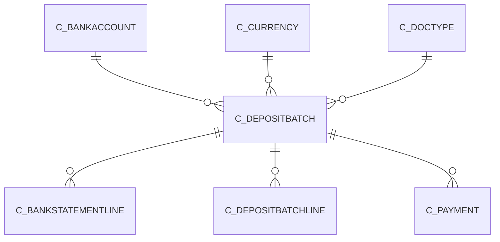

# C_DEPOSITBATCH

Area [C](../../data-model/c/index.md) · class **business** (proposed) · read from database `idempiere-db` (owner `ADEMPIERE`) · 0 row(s) when profiled

Application model: `org.compiere.model.X_C_DepositBatch`, access level 3 - Client - Org.

## Columns

| column | type | key | not null | business name | references (code) | nulls | distinct |
|---|---|---|---|---|---|---|---|
| `AD_CLIENT_ID` | NUMBER(10,0) |  | yes | Tenant |  | 0 | 0 |
| `AD_ORG_ID` | NUMBER(10,0) |  | yes | Organization |  | 0 | 0 |
| `C_BANKACCOUNT_ID` | NUMBER(10,0) |  | yes | Bank Account | [C_BANKACCOUNT](../../data-model/c/c_bankaccount.md) | 0 | 0 |
| `C_DOCTYPE_ID` | NUMBER(10,0) |  | yes | Document Type | [C_DOCTYPE](../../data-model/c/c_doctype.md) | 0 | 0 |
| `CREATED` | DATE |  | yes | Created |  | 0 | 0 |
| `CREATEDBY` | NUMBER(10,0) |  | yes | Created By |  | 0 | 0 |
| `CREATEFROM` | CHAR(1) |  |  | Create lines from |  | 0 | 0 |
| `DATEDEPOSIT` | DATE |  | yes | Deposit Date |  | 0 | 0 |
| `DATEDOC` | DATE |  | yes | Document Date |  | 0 | 0 |
| `DEPOSITAMT` | NUMBER |  | yes | Deposit Amount |  | 0 | 0 |
| `DESCRIPTION` | VARCHAR2(255 CHAR) |  |  | Description |  | 0 | 0 |
| `DOCSTATUS` | VARCHAR2(2 CHAR) |  | yes | Document Status |  | 0 | 0 |
| `DOCUMENTNO` | VARCHAR2(30 CHAR) |  | yes | Document No |  | 0 | 0 |
| `ISACTIVE` | CHAR(1) |  | yes | Active |  | 0 | 0 |
| `PROCESSED` | CHAR(1) |  | yes | Processed |  | 0 | 0 |
| `PROCESSING` | CHAR(1) |  |  |  |  | 0 | 0 |
| `UPDATED` | DATE |  | yes | Updated |  | 0 | 0 |
| `UPDATEDBY` | NUMBER(10,0) |  | yes | Updated By |  | 0 | 0 |
| `C_DEPOSITBATCH_ID` | NUMBER(10,0) | PK | yes | Deposit Batch |  | 0 | 0 |
| `C_DEPOSITBATCH_UU` | VARCHAR2(36 CHAR) |  |  | C_DepositBatch_UU |  | 0 | 0 |
| `DOCACTION` | CHAR(2) |  |  | Document Action |  | 0 | 0 |
| `C_CURRENCY_ID` | NUMBER(10,0) |  | yes | Currency | [C_CURRENCY](../../data-model/c/c_currency.md) | 0 | 0 |

*references (code)* is the table the application model's code says a column points to; *Foreign keys* below are the constraints the database declares. Counts come from the profile; no value is ever shown.

## Check constraints

| name | expression |
|---|---|
| `SYS_C0020584` | `Processed IN ('Y','N')` |
| `SYS_C0020587` | `IsActive IN ('Y','N')` |

## Foreign keys

**References**

| table | columns | on delete |
|---|---|---|
| [C_BANKACCOUNT](../../data-model/c/c_bankaccount.md) | C_DEPOSITBATCH.C_BANKACCOUNT_ID → C_BANKACCOUNT.C_BANKACCOUNT_ID | NO ACTION |
| [C_CURRENCY](../../data-model/c/c_currency.md) | C_DEPOSITBATCH.C_CURRENCY_ID → C_CURRENCY.C_CURRENCY_ID | NO ACTION |
| [C_DOCTYPE](../../data-model/c/c_doctype.md) | C_DEPOSITBATCH.C_DOCTYPE_ID → C_DOCTYPE.C_DOCTYPE_ID | NO ACTION |

**Referenced by**

| table | columns | on delete |
|---|---|---|
| [C_BANKSTATEMENTLINE](../../data-model/c/c_bankstatementline.md) | C_BANKSTATEMENTLINE.C_DEPOSITBATCH_ID → C_DEPOSITBATCH.C_DEPOSITBATCH_ID | NO ACTION |
| [C_DEPOSITBATCHLINE](../../data-model/c/c_depositbatchline.md) | C_DEPOSITBATCHLINE.C_DEPOSITBATCH_ID → C_DEPOSITBATCH.C_DEPOSITBATCH_ID | NO ACTION |
| [C_PAYMENT](../../data-model/c/c_payment.md) | C_PAYMENT.C_DEPOSITBATCH_ID → C_DEPOSITBATCH.C_DEPOSITBATCH_ID | NO ACTION |

## Write behaviour

- updates: **raw_sql_skips_updated**
- deletes: **deleted_by_users**
- change log: **recorded**
- evidence: 2 citation(s)

## Schema history

44 change(s); the latest:

| applied | release | operation | column | tickets |
|---|---|---|---|---|
| 2024-04-30T12:00 | iD12 | `add_column` | DocAction | IDEMPERIE-5329 |
| 2024-04-30T12:00 | iD12 | `add_constraint` |  | IDEMPERIE-5329 |
| 2024-04-30T12:00 | iD12 | `modify_column` | C_Currency_ID | IDEMPERIE-5329 |
| 2024-04-30T12:00 | iD12 | `add_column` | DocAction | IDEMPERIE-5329 |
| 2024-04-30T12:00 | iD12 | `add_constraint` |  | IDEMPERIE-5329 |
| 2024-04-30T12:00 | iD12 | `modify_column` | C_Currency_ID | IDEMPERIE-5329 |
| 2024-04-30T12:00 | iD12 | `add_column` | C_Currency_ID | IDEMPERIE-5329 |
| 2024-04-30T12:00 | iD12 | `add_column` | C_Currency_ID | IDEMPERIE-5329 |
| 2023-04-09T15:47 | iD11 | `add_constraint` |  | IDEMPIERE-5567 |
| 2023-04-09T15:47 | iD11 | `add_constraint` |  | IDEMPIERE-5567 |
| 2020-08-04T01:00 | i7.1z | `add_column` | tmp_col_4_tmp | IDEMPIERE-3862 |
| 2020-08-04T01:00 | i7.1z | `modify_column` | DOCSTATUS | IDEMPIERE-3862 |
| 2020-08-04T01:00 | i7.1z | `drop_column` | tmp_col_2_tmp | IDEMPIERE-3862 |
| 2020-08-04T01:00 | i7.1z | `drop_column` | tmp_col_3_tmp | IDEMPIERE-3862 |
| 2020-08-04T01:00 | i7.1z | `modify_column` | C_DEPOSITBATCH_UU | IDEMPIERE-3862 |

## Notes

<!-- ekos:manual id="table.c_depositbatch.notes" -->
_Business notes about this table._
<!-- /ekos:manual -->
