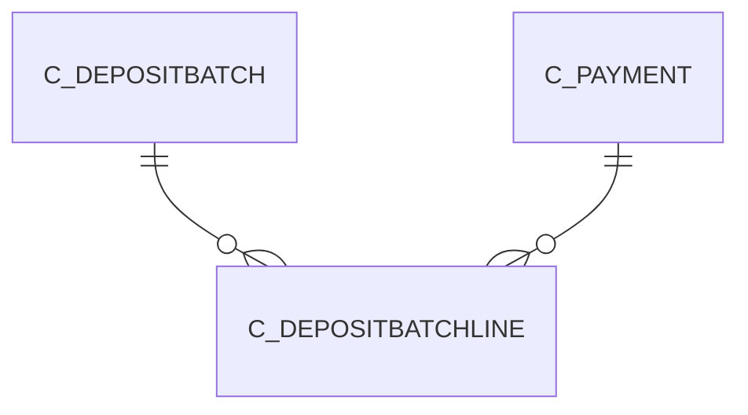

# C_DEPOSITBATCHLINE

Area [C](../../data-model/c/index.md) · class **business** (proposed) · read from database `idempiere-db` (owner `ADEMPIERE`) · 0 row(s) when profiled

Application model: `org.compiere.model.X_C_DepositBatchLine`, access level 3 - Client - Org.

## Columns

| column | type | key | not null | business name | references (code) | nulls | distinct |
|---|---|---|---|---|---|---|---|
| `AD_CLIENT_ID` | NUMBER(10,0) |  | yes | Tenant |  | 0 | 0 |
| `AD_ORG_ID` | NUMBER(10,0) |  | yes | Organization |  | 0 | 0 |
| `C_PAYMENT_ID` | NUMBER(10,0) |  | yes | Payment | [C_PAYMENT](../../data-model/c/c_payment.md) | 0 | 0 |
| `CREATED` | DATE |  | yes | Created |  | 0 | 0 |
| `CREATEDBY` | NUMBER(10,0) |  | yes | Created By |  | 0 | 0 |
| `ISACTIVE` | CHAR(1) |  | yes | Active |  | 0 | 0 |
| `LINE` | NUMBER(10,0) |  | yes | Line No |  | 0 | 0 |
| `PAYAMT` | NUMBER |  | yes | Payment amount |  | 0 | 0 |
| `PROCESSED` | CHAR(1) |  | yes | Processed |  | 0 | 0 |
| `PROCESSING` | CHAR(1) |  | yes | Process Now |  | 0 | 0 |
| `UPDATED` | DATE |  | yes | Updated |  | 0 | 0 |
| `UPDATEDBY` | NUMBER(10,0) |  | yes | Updated By |  | 0 | 0 |
| `C_DEPOSITBATCH_ID` | NUMBER(10,0) |  | yes | Deposit Batch | [C_DEPOSITBATCH](../../data-model/c/c_depositbatch.md) | 0 | 0 |
| `C_DEPOSITBATCHLINE_ID` | NUMBER(10,0) | PK | yes | Deposit Batch Line |  | 0 | 0 |
| `C_DEPOSITBATCHLINE_UU` | VARCHAR2(36 CHAR) |  |  | C_DepositBatchLine_UU |  | 0 | 0 |

*references (code)* is the table the application model's code says a column points to; *Foreign keys* below are the constraints the database declares. Counts come from the profile; no value is ever shown.

## Check constraints

| name | expression |
|---|---|
| `SYS_C0021078` | `Processed IN ('Y','N')` |
| `SYS_C0021079` | `Processing IN ('Y','N')` |
| `SYS_C0021080` | `IsActive IN ('Y','N')` |

## Foreign keys

**References**

| table | columns | on delete |
|---|---|---|
| [C_DEPOSITBATCH](../../data-model/c/c_depositbatch.md) | C_DEPOSITBATCHLINE.C_DEPOSITBATCH_ID → C_DEPOSITBATCH.C_DEPOSITBATCH_ID | NO ACTION |
| [C_PAYMENT](../../data-model/c/c_payment.md) | C_DEPOSITBATCHLINE.C_PAYMENT_ID → C_PAYMENT.C_PAYMENT_ID | NO ACTION |

**Referenced by**

_None._

## Write behaviour

- updates: **po_only**
- deletes: **deleted_by_app, deleted_by_users**
- change log: **recorded**
- evidence: 2 citation(s)

## Schema history

25 change(s); the latest:

| applied | release | operation | column | tickets |
|---|---|---|---|---|
| 2023-04-09T15:47 | iD11 | `add_constraint` |  | IDEMPIERE-5567 |
| 2023-04-09T15:47 | iD11 | `add_constraint` |  | IDEMPIERE-5567 |
| 2020-08-04T01:00 | i7.1z | `add_column` | tmp_col_1_tmp | IDEMPIERE-3862 |
| 2020-08-04T01:00 | i7.1z | `drop_column` | tmp_col_1_tmp | IDEMPIERE-3862 |
| 2020-08-04T01:00 | i7.1z | `modify_column` | C_DEPOSITBATCHLINE_UU | IDEMPIERE-3862 |
| 2014-05-02T10:09 | i2.0 | `modify_column` | created | IDEMPIERE-709 |
| 2014-05-02T10:09 | i2.0 | `modify_column` | updated | IDEMPIERE-709 |
| 2014-04-17T15:00 | i2.0 | `modify_column` | updated | IDEMPIERE-709 |
| 2014-04-17T15:00 | i2.0 | `modify_column` | updated | IDEMPIERE-709 |
| 2014-04-17T15:00 | i2.0 | `modify_column` | created | IDEMPIERE-709 |
| 2014-04-17T15:00 | i2.0 | `modify_column` | created | IDEMPIERE-709 |
| 2014-04-17T15:00 | i2.0 | `modify_column` | updated | IDEMPIERE-709 |
| 2014-04-17T15:00 | i2.0 | `modify_column` | created | IDEMPIERE-709 |
| 2013-04-18T15:26 | i1.0a-i1.0b | `create_index` |  |  |
| 2013-04-18T15:26 | i1.0a-i1.0b | `add_constraint` |  |  |

## Notes

<!-- ekos:manual id="table.c_depositbatchline.notes" -->
_Business notes about this table._
<!-- /ekos:manual -->
