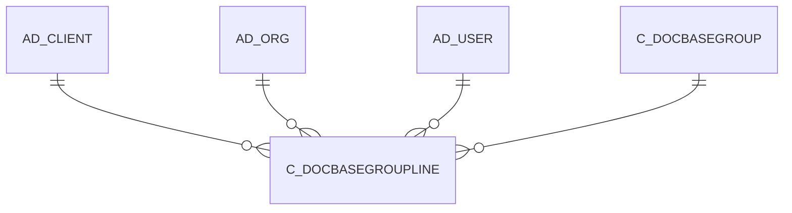

# C_DOCBASEGROUPLINE

Area [C](../../data-model/c/index.md) · class **business** (proposed) · read from database `idempiere-db` (owner `ADEMPIERE`) · 0 row(s) when profiled

Application model: `org.compiere.model.X_C_DocBaseGroupLine`, access level 6 - System - Client.

## Columns

| column | type | key | not null | business name | references (code) | nulls | distinct |
|---|---|---|---|---|---|---|---|
| `AD_CLIENT_ID` | NUMBER(10,0) |  | yes | Tenant |  | 0 | 0 |
| `AD_ORG_ID` | NUMBER(10,0) |  | yes | Organization |  | 0 | 0 |
| `C_DOCBASEGROUPLINE_ID` | NUMBER(10,0) | PK | yes | Document Base Type Group Line |  | 0 | 0 |
| `C_DOCBASEGROUPLINE_UU` | VARCHAR2(36 CHAR) |  |  | C_DocBaseGroupLine_UU |  | 0 | 0 |
| `C_DOCBASEGROUP_ID` | NUMBER(10,0) |  | yes | Document Base Type Group | [C_DOCBASEGROUP](../../data-model/c/c_docbasegroup.md) | 0 | 0 |
| `CREATED` | DATE |  | yes | Created |  | 0 | 0 |
| `CREATEDBY` | NUMBER(10,0) |  | yes | Created By |  | 0 | 0 |
| `DOCBASETYPE` | VARCHAR2(3 CHAR) |  | yes | Document Base Type |  | 0 | 0 |
| `ISACTIVE` | CHAR(1) |  | yes | Active |  | 0 | 0 |
| `UPDATED` | DATE |  | yes | Updated |  | 0 | 0 |
| `UPDATEDBY` | NUMBER(10,0) |  | yes | Updated By |  | 0 | 0 |

*references (code)* is the table the application model's code says a column points to; *Foreign keys* below are the constraints the database declares. Counts come from the profile; no value is ever shown.

## Check constraints

| name | expression |
|---|---|
| `SYS_C0022152` | `IsActive IN ('Y','N')` |

## Foreign keys

**References**

| table | columns | on delete |
|---|---|---|
| [AD_CLIENT](../../data-model/ad/ad_client.md) | C_DOCBASEGROUPLINE.AD_CLIENT_ID → AD_CLIENT.AD_CLIENT_ID | NO ACTION |
| [AD_ORG](../../data-model/ad/ad_org.md) | C_DOCBASEGROUPLINE.AD_ORG_ID → AD_ORG.AD_ORG_ID | NO ACTION |
| [AD_USER](../../data-model/ad/ad_user.md) | C_DOCBASEGROUPLINE.CREATEDBY → AD_USER.AD_USER_ID | NO ACTION |
| [C_DOCBASEGROUP](../../data-model/c/c_docbasegroup.md) | C_DOCBASEGROUPLINE.C_DOCBASEGROUP_ID → C_DOCBASEGROUP.C_DOCBASEGROUP_ID | NO ACTION |

**Referenced by**

_None._

## Write behaviour

- updates: **po_only**
- deletes: **deleted_by_users**
- change log: **recorded**
- evidence: 1 citation(s)

## Schema history

14 change(s); the latest:

| applied | release | operation | column | tickets |
|---|---|---|---|---|
| 2023-04-03T11:42 | iD11 | `create_table` |  | IDEMPIERE-5659 |
| 2023-04-03T11:42 | iD11 | `add_constraint` |  | IDEMPIERE-5659 |
| 2023-04-03T11:42 | iD11 | `add_constraint` |  | IDEMPIERE-5659 |
| 2023-04-03T11:42 | iD11 | `add_constraint` |  | IDEMPIERE-5659 |
| 2023-04-03T11:42 | iD11 | `add_constraint` |  | IDEMPIERE-5659 |
| 2023-04-03T11:42 | iD11 | `add_constraint` |  | IDEMPIERE-5659 |
| 2023-04-03T11:42 | iD11 | `create_index` |  | IDEMPIERE-5659 |
| 2023-04-03T11:42 | iD11 | `add_constraint` |  | IDEMPIERE-5659 |
| 2023-04-03T11:42 | iD11 | `create_table` |  | IDEMPIERE-5659 |
| 2023-04-03T11:42 | iD11 | `add_constraint` |  | IDEMPIERE-5659 |
| 2023-04-03T11:42 | iD11 | `add_constraint` |  | IDEMPIERE-5659 |
| 2023-04-03T11:42 | iD11 | `add_constraint` |  | IDEMPIERE-5659 |
| 2023-04-03T11:42 | iD11 | `create_index` |  | IDEMPIERE-5659 |
| 2023-04-03T11:42 | iD11 | `add_constraint` |  | IDEMPIERE-5659 |

## Notes

<!-- ekos:manual id="table.c_docbasegroupline.notes" -->
_Business notes about this table._
<!-- /ekos:manual -->
