# C_DOCTYPE

Area [C](../../data-model/c/index.md) · class **business** (proposed) · read from database `idempiere-db` (owner `ADEMPIERE`) · 52 row(s) when profiled

Application model: `org.compiere.model.X_C_DocType`, access level 6 - System - Client.

## Columns

| column | type | key | not null | business name | references (code) | nulls | distinct |
|---|---|---|---|---|---|---|---|
| `C_DOCTYPE_ID` | NUMBER(10,0) | PK | yes | Document Type |  | 0 | 52 |
| `AD_CLIENT_ID` | NUMBER(10,0) |  | yes | Tenant |  | 0 | 2 |
| `AD_ORG_ID` | NUMBER(10,0) |  | yes | Organization |  | 0 | 1 |
| `ISACTIVE` | CHAR(1) |  | yes | Active |  | 0 | 1 |
| `CREATED` | DATE |  | yes | Created |  | 0 | 20 |
| `CREATEDBY` | NUMBER(10,0) |  | yes | Created By |  | 0 | 3 |
| `UPDATED` | DATE |  | yes | Updated |  | 0 | 33 |
| `UPDATEDBY` | NUMBER(10,0) |  | yes | Updated By |  | 0 | 3 |
| `NAME` | VARCHAR2(60 CHAR) |  | yes | Name |  | 0 | 52 |
| `PRINTNAME` | VARCHAR2(60 CHAR) |  | yes | Print Text |  | 0 | 45 |
| `DESCRIPTION` | VARCHAR2(255 CHAR) |  |  | Description |  | 50 | 2 |
| `DOCBASETYPE` | CHAR(3) |  | yes | Document Base Type |  | 0 | 33 |
| `ISSOTRX` | CHAR(1) |  | yes | Sales Transaction |  | 0 | 2 |
| `DOCSUBTYPESO` | CHAR(2) |  |  | SO Sub Type |  | 41 | 8 |
| `HASPROFORMA` | CHAR(1) |  |  | Pro forma Invoice |  | 0 | 1 |
| `C_DOCTYPEPROFORMA_ID` | NUMBER(10,0) |  |  | Document Type for ProForma | [C_DOCTYPE](../../data-model/c/c_doctype.md) | 52 | 0 |
| `C_DOCTYPESHIPMENT_ID` | NUMBER(10,0) |  |  | Document Type for Shipment | [C_DOCTYPE](../../data-model/c/c_doctype.md) | 43 | 5 |
| `C_DOCTYPEINVOICE_ID` | NUMBER(10,0) |  |  | Document Type for Invoice | [C_DOCTYPE](../../data-model/c/c_doctype.md) | 44 | 5 |
| `ISDOCNOCONTROLLED` | CHAR(1) |  | yes | Document is Number Controlled |  | 0 | 2 |
| `DOCNOSEQUENCE_ID` | NUMBER(10,0) |  |  | Document Sequence | [AD_SEQUENCE](../../data-model/ad/ad_sequence.md) | 18 | 33 |
| `GL_CATEGORY_ID` | NUMBER(10,0) |  | yes | GL Category | [GL_CATEGORY](../../data-model/gl/gl_category.md) | 0 | 10 |
| `HASCHARGES` | CHAR(1) |  | yes | Charges |  | 0 | 1 |
| `DOCUMENTNOTE` | VARCHAR2(2000 CHAR) |  |  | Document Note |  | 49 | 2 |
| `ISDEFAULT` | CHAR(1) |  | yes | Default |  | 0 | 2 |
| `DOCUMENTCOPIES` | NUMBER(10,0) |  | yes | Document Copies |  | 0 | 2 |
| `AD_PRINTFORMAT_ID` | NUMBER(10,0) |  |  | Print Format | [AD_PRINTFORMAT](../../data-model/ad/ad_printformat.md) | 52 | 0 |
| `ISDEFAULTCOUNTERDOC` | CHAR(1) |  | yes | Default Counter Document |  | 0 | 2 |
| `ISSHIPCONFIRM` | CHAR(1) |  | yes | Ship/Receipt Confirmation |  | 0 | 2 |
| `ISPICKQACONFIRM` | CHAR(1) |  | yes | Pick/QA Confirmation |  | 0 | 2 |
| `ISINTRANSIT` | CHAR(1) |  | yes | In Transit |  | 0 | 1 |
| `ISSPLITWHENDIFFERENCE` | CHAR(1) |  | yes | Split when Difference |  | 0 | 1 |
| `C_DOCTYPEDIFFERENCE_ID` | NUMBER(10,0) |  |  | Difference Document | [C_DOCTYPE](../../data-model/c/c_doctype.md) | 52 | 0 |
| `ISCREATECOUNTER` | CHAR(1) |  | yes | Create Counter Document |  | 0 | 1 |
| `ISINDEXED` | CHAR(1) |  | yes | Indexed |  | 0 | 1 |
| `ISOVERWRITESEQONCOMPLETE` | CHAR(1) |  |  | Overwrite Sequence on Complete |  | 0 | 1 |
| `DEFINITESEQUENCE_ID` | NUMBER(10,0) |  |  | Definite Sequence | [AD_SEQUENCE](../../data-model/ad/ad_sequence.md) | 52 | 0 |
| `ISOVERWRITEDATEONCOMPLETE` | CHAR(1) |  |  | Overwrite Date on Complete |  | 0 | 1 |
| `ISPREPARESPLITDOCUMENT` | CHAR(1) |  | yes | Prepare Split Document |  | 0 | 1 |
| `C_DOCTYPE_UU` | VARCHAR2(36 CHAR) |  |  | C_DocType_UU |  | 0 | 52 |
| `ISCHARGEORPRODUCTMANDATORY` | CHAR(1) |  |  | Mandatory Charge or Product |  | 0 | 1 |
| `DOCSUBTYPEINV` | VARCHAR2(2 CHAR) |  |  | Inv Sub Type |  | 49 | 3 |
| `ISNOPRICELISTCHECK` | CHAR(1) |  |  | Allow Product Without Price List |  | 0 | 1 |
| `ISAUTOGENERATEINOUT` | CHAR(1) |  | yes | Generate Shipment |  | 0 | 2 |
| `ISAUTOGENERATEINVOICE` | CHAR(1) |  | yes | Generate Invoice |  | 0 | 2 |

*references (code)* is the table the application model's code says a column points to; *Foreign keys* below are the constraints the database declares. Counts come from the profile; no value is ever shown.

## Check constraints

| name | expression |
|---|---|
| `SYS_C0020119` | `IsChargeOrProductMandatory IN ('Y','N')` |
| `SYS_C0020120` | `IsOverwriteSeqOnComplete IN ('Y','N')` |
| `SYS_C0020121` | `IsAutoGenerateInout IN ('Y','N')` |
| `SYS_C0020122` | `HasCharges in ('Y','N')` |
| `SYS_C0020123` | `IsPrepareSplitDocument IN ('Y','N')` |
| `SYS_C0020124` | `IsSOTrx in ('Y','N')` |
| `SYS_C0020125` | `IsActive in ('Y','N')` |
| `SYS_C0020126` | `HasProForma in ('Y','N')` |
| `SYS_C0020127` | `IsDocNoControlled in ('Y','N')` |
| `SYS_C0020128` | `IsNoPriceListCheck IN ('Y','N')` |
| `SYS_C0020129` | `IsOverwriteDateOnComplete IN ('Y','N')` |
| `SYS_C0020132` | `IsAutoGenerateInvoice IN ('Y','N')` |

## Foreign keys

**References**

| table | columns | on delete |
|---|---|---|
| [AD_PRINTFORMAT](../../data-model/ad/ad_printformat.md) | C_DOCTYPE.AD_PRINTFORMAT_ID → AD_PRINTFORMAT.AD_PRINTFORMAT_ID | NO ACTION |
| [AD_SEQUENCE](../../data-model/ad/ad_sequence.md) | C_DOCTYPE.DOCNOSEQUENCE_ID → AD_SEQUENCE.AD_SEQUENCE_ID | NO ACTION |
| [C_DOCTYPE](../../data-model/c/c_doctype.md) | C_DOCTYPE.C_DOCTYPEDIFFERENCE_ID → C_DOCTYPE.C_DOCTYPE_ID | NO ACTION |
| [GL_CATEGORY](../../data-model/gl/gl_category.md) | C_DOCTYPE.GL_CATEGORY_ID → GL_CATEGORY.GL_CATEGORY_ID | NO ACTION |

**Referenced by**

| table | columns | on delete |
|---|---|---|
| [AD_DOCUMENT_ACTION_ACCESS](../../data-model/ad/ad_document_action_access.md) | AD_DOCUMENT_ACTION_ACCESS.C_DOCTYPE_ID → C_DOCTYPE.C_DOCTYPE_ID | NO ACTION |
| [AD_REPLICATIONDOCUMENT](../../data-model/ad/ad_replicationdocument.md) | AD_REPLICATIONDOCUMENT.C_DOCTYPE_ID → C_DOCTYPE.C_DOCTYPE_ID | NO ACTION |
| [A_ASSET_ADDITION](../../data-model/a/a_asset_addition.md) | A_ASSET_ADDITION.C_DOCTYPE_ID → C_DOCTYPE.C_DOCTYPE_ID | NO ACTION |
| [A_ASSET_DISPOSED](../../data-model/a/a_asset_disposed.md) | A_ASSET_DISPOSED.C_DOCTYPE_ID → C_DOCTYPE.C_DOCTYPE_ID | NO ACTION |
| [A_ASSET_REVAL_ENTRY](../../data-model/a/a_asset_reval_entry.md) | A_ASSET_REVAL_ENTRY.C_DOCTYPE_ID → C_DOCTYPE.C_DOCTYPE_ID | NO ACTION |
| [A_DEPRECIATION_ENTRY](../../data-model/a/a_depreciation_entry.md) | A_DEPRECIATION_ENTRY.C_DOCTYPE_ID → C_DOCTYPE.C_DOCTYPE_ID | NO ACTION |
| [C_ALLOCATIONHDR](../../data-model/c/c_allocationhdr.md) | C_ALLOCATIONHDR.C_DOCTYPE_ID → C_DOCTYPE.C_DOCTYPE_ID | NO ACTION |
| [C_BANKSTATEMENT](../../data-model/c/c_bankstatement.md) | C_BANKSTATEMENT.C_DOCTYPE_ID → C_DOCTYPE.C_DOCTYPE_ID | NO ACTION |
| [C_CHARGETYPE_DOCTYPE](../../data-model/c/c_chargetype_doctype.md) | C_CHARGETYPE_DOCTYPE.C_DOCTYPE_ID → C_DOCTYPE.C_DOCTYPE_ID | NO ACTION |
| [C_DEPOSITBATCH](../../data-model/c/c_depositbatch.md) | C_DEPOSITBATCH.C_DOCTYPE_ID → C_DOCTYPE.C_DOCTYPE_ID | NO ACTION |
| [C_DOCTYPE](../../data-model/c/c_doctype.md) | C_DOCTYPE.C_DOCTYPEDIFFERENCE_ID → C_DOCTYPE.C_DOCTYPE_ID | NO ACTION |
| [C_DOCTYPECOUNTER](../../data-model/c/c_doctypecounter.md) | C_DOCTYPECOUNTER.COUNTER_C_DOCTYPE_ID → C_DOCTYPE.C_DOCTYPE_ID | NO ACTION |
| [C_DOCTYPE_TRL](../../data-model/c/c_doctype_trl.md) | C_DOCTYPE_TRL.C_DOCTYPE_ID → C_DOCTYPE.C_DOCTYPE_ID | CASCADE |
| [C_INVOICE](../../data-model/c/c_invoice.md) | C_INVOICE.C_DOCTYPETARGET_ID → C_DOCTYPE.C_DOCTYPE_ID | NO ACTION |
| [C_INVOICEBATCHLINE](../../data-model/c/c_invoicebatchline.md) | C_INVOICEBATCHLINE.C_DOCTYPE_ID → C_DOCTYPE.C_DOCTYPE_ID | NO ACTION |
| [C_ORDER](../../data-model/c/c_order.md) | C_ORDER.C_DOCTYPETARGET_ID → C_DOCTYPE.C_DOCTYPE_ID | NO ACTION |
| [C_PAYMENT](../../data-model/c/c_payment.md) | C_PAYMENT.C_DOCTYPE_ID → C_DOCTYPE.C_DOCTYPE_ID | NO ACTION |
| [C_POS](../../data-model/c/c_pos.md) | C_POS.C_DOCTYPE_ID → C_DOCTYPE.C_DOCTYPE_ID | NO ACTION |
| [DD_ORDER](../../data-model/dd/dd_order.md) | DD_ORDER.C_DOCTYPE_ID → C_DOCTYPE.C_DOCTYPE_ID | NO ACTION |
| [GL_DISTRIBUTION](../../data-model/gl/gl_distribution.md) | GL_DISTRIBUTION.C_DOCTYPE_ID → C_DOCTYPE.C_DOCTYPE_ID | NO ACTION |
| [GL_JOURNAL](../../data-model/gl/gl_journal.md) | GL_JOURNAL.C_DOCTYPE_ID → C_DOCTYPE.C_DOCTYPE_ID | NO ACTION |
| [GL_JOURNALBATCH](../../data-model/gl/gl_journalbatch.md) | GL_JOURNALBATCH.C_DOCTYPE_ID → C_DOCTYPE.C_DOCTYPE_ID | NO ACTION |
| [GL_JOURNALGENERATOR](../../data-model/gl/gl_journalgenerator.md) | GL_JOURNALGENERATOR.C_DOCTYPE_ID → C_DOCTYPE.C_DOCTYPE_ID | NO ACTION |
| [HR_PROCESS](../../data-model/hr/hr_process.md) | HR_PROCESS.C_DOCTYPETARGET_ID → C_DOCTYPE.C_DOCTYPE_ID | NO ACTION |
| `I_FAJOURNAL` | I_FAJOURNAL.C_DOCTYPE_ID → C_DOCTYPE.C_DOCTYPE_ID | NO ACTION |
| `I_GLJOURNAL` | I_GLJOURNAL.C_DOCTYPE_ID → C_DOCTYPE.C_DOCTYPE_ID | SET NULL |
| `I_INVENTORY` | I_INVENTORY.C_DOCTYPE_ID → C_DOCTYPE.C_DOCTYPE_ID | NO ACTION |
| `I_INVOICE` | I_INVOICE.C_DOCTYPE_ID → C_DOCTYPE.C_DOCTYPE_ID | SET NULL |
| `I_MOVEMENT` | I_MOVEMENT.C_DOCTYPE_ID → C_DOCTYPE.C_DOCTYPE_ID | NO ACTION |
| `I_ORDER` | I_ORDER.C_DOCTYPE_ID → C_DOCTYPE.C_DOCTYPE_ID | SET NULL |
| `I_PAYMENT` | I_PAYMENT.C_DOCTYPE_ID → C_DOCTYPE.C_DOCTYPE_ID | SET NULL |
| [K_INDEX](../../data-model/k/k_index.md) | K_INDEX.C_DOCTYPE_ID → C_DOCTYPE.C_DOCTYPE_ID | CASCADE |
| [K_INDEXSTOP](../../data-model/k/k_indexstop.md) | K_INDEXSTOP.C_DOCTYPE_ID → C_DOCTYPE.C_DOCTYPE_ID | NO ACTION |
| [M_INOUT](../../data-model/m/m_inout.md) | M_INOUT.C_DOCTYPE_ID → C_DOCTYPE.C_DOCTYPE_ID | NO ACTION |
| [M_INVENTORY](../../data-model/m/m_inventory.md) | M_INVENTORY.C_DOCTYPE_ID → C_DOCTYPE.C_DOCTYPE_ID | NO ACTION |
| [M_MOVEMENT](../../data-model/m/m_movement.md) | M_MOVEMENT.C_DOCTYPE_ID → C_DOCTYPE.C_DOCTYPE_ID | NO ACTION |
| [M_PRODUCTION](../../data-model/m/m_production.md) | M_PRODUCTION.C_DOCTYPE_ID → C_DOCTYPE.C_DOCTYPE_ID | NO ACTION |
| [M_REQUISITION](../../data-model/m/m_requisition.md) | M_REQUISITION.C_DOCTYPE_ID → C_DOCTYPE.C_DOCTYPE_ID | NO ACTION |
| [M_RMA](../../data-model/m/m_rma.md) | M_RMA.C_DOCTYPE_ID → C_DOCTYPE.C_DOCTYPE_ID | NO ACTION |
| `M_STORAGERESERVATIONLOG` | M_STORAGERESERVATIONLOG.C_DOCTYPE_ID → C_DOCTYPE.C_DOCTYPE_ID | NO ACTION |
| [PP_COST_COLLECTOR](../../data-model/pp/pp_cost_collector.md) | PP_COST_COLLECTOR.C_DOCTYPETARGET_ID → C_DOCTYPE.C_DOCTYPE_ID | NO ACTION |
| [PP_ORDER](../../data-model/pp/pp_order.md) | PP_ORDER.C_DOCTYPETARGET_ID → C_DOCTYPE.C_DOCTYPE_ID | NO ACTION |
| `T_INVOICEGL` | T_INVOICEGL.C_DOCTYPEREVAL_ID → C_DOCTYPE.C_DOCTYPE_ID | CASCADE |
| `T_REPLENISH` | T_REPLENISH.C_DOCTYPE_ID → C_DOCTYPE.C_DOCTYPE_ID | CASCADE |

```mermaid
erDiagram
  AD_PRINTFORMAT ||--o{ C_DOCTYPE : ""
  AD_SEQUENCE ||--o{ C_DOCTYPE : ""
  C_DOCTYPE ||--o{ AD_DOCUMENT_ACTION_ACCESS : ""
  C_DOCTYPE ||--o{ AD_REPLICATIONDOCUMENT : ""
  C_DOCTYPE ||--o{ A_ASSET_ADDITION : ""
  C_DOCTYPE ||--o{ A_ASSET_DISPOSED : ""
  C_DOCTYPE ||--o{ A_ASSET_REVAL_ENTRY : ""
  C_DOCTYPE ||--o{ A_DEPRECIATION_ENTRY : ""
  C_DOCTYPE ||--o{ C_ALLOCATIONHDR : ""
  C_DOCTYPE ||--o{ C_BANKSTATEMENT : ""
  C_DOCTYPE ||--o{ C_CHARGETYPE_DOCTYPE : ""
  C_DOCTYPE ||--o{ C_DEPOSITBATCH : ""
  C_DOCTYPE ||--o{ C_DOCTYPE : ""
  C_DOCTYPE ||--o{ C_DOCTYPECOUNTER : ""
  C_DOCTYPE ||--o{ C_DOCTYPE_TRL : ""
  C_DOCTYPE ||--o{ C_INVOICE : ""
  C_DOCTYPE ||--o{ C_INVOICEBATCHLINE : ""
  C_DOCTYPE ||--o{ C_ORDER : ""
  C_DOCTYPE ||--o{ C_PAYMENT : ""
  C_DOCTYPE ||--o{ C_POS : ""
  C_DOCTYPE ||--o{ DD_ORDER : ""
  C_DOCTYPE ||--o{ GL_DISTRIBUTION : ""
  C_DOCTYPE ||--o{ GL_JOURNAL : ""
  C_DOCTYPE ||--o{ GL_JOURNALBATCH : ""
  C_DOCTYPE ||--o{ GL_JOURNALGENERATOR : ""
  C_DOCTYPE ||--o{ HR_PROCESS : ""
  C_DOCTYPE ||--o{ I_FAJOURNAL : ""
  C_DOCTYPE ||--o{ I_GLJOURNAL : ""
  C_DOCTYPE ||--o{ I_INVENTORY : ""
  GL_CATEGORY ||--o{ C_DOCTYPE : ""
```

17 more neighbour(s) not drawn.

## Write behaviour

- updates: **po_only**
- deletes: **deleted_by_app, deleted_by_users**
- change log: **recorded**
- evidence: 2 citation(s)

## Read by

| kind | name |
|---|---|
| Procedure | [AD_Sequence_DocType](../../logic/ad_sequence_doctype.md) |
| Procedure | [asu_get1099bucket](../../logic/asu_get1099bucket.md) |
| Procedure | [get1099bucket](../../logic/get1099bucket.md) |
| View | `C_DUNNING_LINE_V` |
| View | `C_INVOICE_CANDIDATE_V` |
| View | `C_INVOICE_HEADER_V` |
| View | `C_INVOICE_V` |
| View | `C_INVOICE_V1` |
| View | `C_ORDER_HEADER_V` |
| View | `C_PAYSELECTION_CHECK_V` |
| View | `DD_ORDER_HEADER_V` |
| View | `M_INOUTCONFIRM_V` |
| View | `M_INOUT_CANDIDATE_V` |
| View | `M_INOUT_HEADER_V` |
| View | `M_MOVEMENT_CANDIDATE_V` |
| View | `PP_ORDER_BOM_HEADER_V` |
| View | `PP_ORDER_HEADER_V` |
| View | `PP_ORDER_WORKFLOW_HEADER_V` |
| View | `PP_ORDER_WORKFLOW_HEADER_VT` |
| View | `RV_C_INVOICE` |
| View | `RV_C_INVOICETAX` |
| View | `RV_UNPOSTED` |
| View | `c_dunning_line_v` |
| View | `c_invoice_candidate_v` |
| View | `c_invoice_header_v` |
| View | `c_invoice_v` |
| View | `c_invoice_v1` |
| View | `c_order_header_v` |
| View | `c_payselection_check_v` |
| View | `dd_order_header_v` |
| View | `m_inout_candidate_v` |
| View | `m_inout_header_v` |
| View | `m_inoutconfirm_v` |
| View | `m_movement_candidate_v` |
| View | `pp_order_bom_header_v` |
| View | `pp_order_header_v` |
| View | `pp_order_workflow_header_v` |
| View | `pp_order_workflow_header_vt` |
| View | `rv_c_invoice` |
| View | `rv_c_invoicetax` |
| View | `rv_unposted` |

## Schema history

53 change(s); the latest:

| applied | release | operation | column | tickets |
|---|---|---|---|---|
| 2025-02-12T12:56 | iD12 | `add_column` | IsCanBeReactivated | IDEMPIERE-6067 |
| 2025-02-12T12:56 | iD12 | `add_column` | IsCanBeReactivated | IDEMPIERE-6067 |
| 2024-09-24T18:18 | iD13 | `add_column` | IsAlwaysPosted | IDEMPIERE-6254 |
| 2024-09-24T18:18 | iD13 | `add_column` | IsAlwaysPosted | IDEMPIERE-6254 |
| 2024-06-18T10:38 | iD12 | `add_column` | IsAutoGenerateInvoice | IDEMPIERE-6177 |
| 2024-06-18T10:38 | iD12 | `add_column` | IsAutoGenerateInout | IDEMPIERE-6177 |
| 2024-06-18T10:38 | iD12 | `add_column` | IsAutoGenerateInout | IDEMPIERE-6177 |
| 2024-06-18T10:38 | iD12 | `add_column` | IsAutoGenerateInvoice | IDEMPIERE-6177 |
| 2023-04-09T15:47 | iD11 | `add_constraint` |  | IDEMPIERE-5567 |
| 2023-04-09T15:47 | iD11 | `add_constraint` |  | IDEMPIERE-5567 |
| 2021-12-05T16:45 | i8.2z | `drop_constraint` |  | IDEMPIERE-5075 |
| 2021-12-05T16:45 | i8.2z | `drop_constraint` |  | IDEMPIERE-5075 |
| 2021-12-05T16:45 | i8.2z | `add_constraint` |  | IDEMPIERE-5075 |
| 2021-12-05T16:45 | i8.2z | `drop_constraint` |  | IDEMPIERE-5075 |
| 2021-12-05T16:45 | i8.2z | `add_constraint` |  | IDEMPIERE-5075 |

## Open conflicts

| type | attribute | explanation |
|---|---|---|
| `model_column_missing` | `columns.IsAlwaysPosted` | unexplained |
| `model_column_missing` | `columns.IsCanBeReactivated` | unexplained |

## Notes

<!-- ekos:manual id="table.c_doctype.notes" -->
_Business notes about this table._
<!-- /ekos:manual -->
