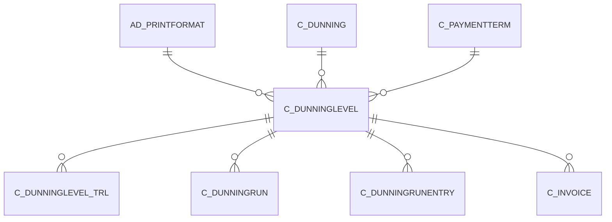

# C_DUNNINGLEVEL

Area [C](../../data-model/c/index.md) · class **business** (proposed) · read from database `idempiere-db` (owner `ADEMPIERE`) · 2 row(s) when profiled

Application model: `org.compiere.model.X_C_DunningLevel`, access level 3 - Client - Org.

## Columns

| column | type | key | not null | business name | references (code) | nulls | distinct |
|---|---|---|---|---|---|---|---|
| `C_DUNNINGLEVEL_ID` | NUMBER(10,0) | PK | yes | Dunning Level |  | 0 | 2 |
| `AD_CLIENT_ID` | NUMBER(10,0) |  | yes | Tenant |  | 0 | 1 |
| `AD_ORG_ID` | NUMBER(10,0) |  | yes | Organization |  | 0 | 1 |
| `ISACTIVE` | CHAR(1) |  | yes | Active |  | 0 | 1 |
| `CREATED` | DATE |  | yes | Created |  | 0 | 2 |
| `CREATEDBY` | NUMBER(10,0) |  | yes | Created By |  | 0 | 1 |
| `UPDATED` | DATE |  | yes | Updated |  | 0 | 2 |
| `UPDATEDBY` | NUMBER(10,0) |  | yes | Updated By |  | 0 | 1 |
| `C_DUNNING_ID` | NUMBER(10,0) |  | yes | Dunning | [C_DUNNING](../../data-model/c/c_dunning.md) | 0 | 1 |
| `PRINTNAME` | VARCHAR2(60 CHAR) |  | yes | Print Text |  | 0 | 2 |
| `DAYSAFTERDUE` | NUMBER(10,0) |  | yes | Days after due date |  | 0 | 2 |
| `DAYSBETWEENDUNNING` | NUMBER(10,0) |  | yes | Days between dunning |  | 0 | 1 |
| `NOTE` | VARCHAR2(2000 CHAR) |  |  | Note |  | 0 | 2 |
| `CHARGEINTEREST` | CHAR(1) |  | yes | Charge Interest |  | 0 | 1 |
| `INTERESTPERCENT` | NUMBER |  |  | Interest in percent |  | 0 | 1 |
| `CHARGEFEE` | CHAR(1) |  | yes | Charge fee |  | 0 | 1 |
| `FEEAMT` | NUMBER |  |  | Fee Amount |  | 0 | 1 |
| `DUNNING_PRINTFORMAT_ID` | NUMBER(10,0) |  |  | Dunning Print Format | [AD_PRINTFORMAT](../../data-model/ad/ad_printformat.md) | 0 | 1 |
| `NAME` | VARCHAR2(60 CHAR) |  | yes | Name |  | 0 | 2 |
| `DESCRIPTION` | VARCHAR2(255 CHAR) |  |  | Description |  | 1 | 1 |
| `ISSHOWALLDUE` | CHAR(1) |  | yes | Show All Due |  | 0 | 1 |
| `ISSHOWNOTDUE` | CHAR(1) |  | yes | Show Not Due |  | 0 | 2 |
| `ISSETCREDITSTOP` | CHAR(1) |  | yes | Credit Stop |  | 0 | 1 |
| `ISSETPAYMENTTERM` | CHAR(1) |  | yes | Set Payment Term |  | 0 | 1 |
| `C_PAYMENTTERM_ID` | NUMBER(10,0) |  |  | Payment Term | [C_PAYMENTTERM](../../data-model/c/c_paymentterm.md) | 2 | 0 |
| `INVOICECOLLECTIONTYPE` | CHAR(1) |  |  | Collection Status |  | 2 | 0 |
| `ISSTATEMENT` | CHAR(1) |  | yes | Is Statement |  | 0 | 2 |
| `C_DUNNINGLEVEL_UU` | VARCHAR2(36 CHAR) |  |  | C_DunningLevel_UU |  | 0 | 2 |

*references (code)* is the table the application model's code says a column points to; *Foreign keys* below are the constraints the database declares. Counts come from the profile; no value is ever shown.

## Check constraints

| name | expression |
|---|---|
| `SYS_C0020368` | `ChargeFee in ('Y','N')` |
| `SYS_C0020370` | `IsActive in ('Y','N')` |
| `SYS_C0020371` | `IsStatement IN ('Y','N')` |
| `SYS_C0020372` | `ChargeInterest in ('Y','N')` |

## Foreign keys

**References**

| table | columns | on delete |
|---|---|---|
| [AD_PRINTFORMAT](../../data-model/ad/ad_printformat.md) | C_DUNNINGLEVEL.DUNNING_PRINTFORMAT_ID → AD_PRINTFORMAT.AD_PRINTFORMAT_ID | NO ACTION |
| [C_DUNNING](../../data-model/c/c_dunning.md) | C_DUNNINGLEVEL.C_DUNNING_ID → C_DUNNING.C_DUNNING_ID | NO ACTION |
| [C_PAYMENTTERM](../../data-model/c/c_paymentterm.md) | C_DUNNINGLEVEL.C_PAYMENTTERM_ID → C_PAYMENTTERM.C_PAYMENTTERM_ID | NO ACTION |

**Referenced by**

| table | columns | on delete |
|---|---|---|
| [C_DUNNINGLEVEL_TRL](../../data-model/c/c_dunninglevel_trl.md) | C_DUNNINGLEVEL_TRL.C_DUNNINGLEVEL_ID → C_DUNNINGLEVEL.C_DUNNINGLEVEL_ID | NO ACTION |
| [C_DUNNINGRUN](../../data-model/c/c_dunningrun.md) | C_DUNNINGRUN.C_DUNNINGLEVEL_ID → C_DUNNINGLEVEL.C_DUNNINGLEVEL_ID | NO ACTION |
| [C_DUNNINGRUNENTRY](../../data-model/c/c_dunningrunentry.md) | C_DUNNINGRUNENTRY.C_DUNNINGLEVEL_ID → C_DUNNINGLEVEL.C_DUNNINGLEVEL_ID | NO ACTION |
| [C_INVOICE](../../data-model/c/c_invoice.md) | C_INVOICE.C_DUNNINGLEVEL_ID → C_DUNNINGLEVEL.C_DUNNINGLEVEL_ID | NO ACTION |

## Write behaviour

- updates: **po_only**
- deletes: **deleted_by_users**
- change log: **recorded**
- evidence: 1 citation(s)

## Read by

| kind | name |
|---|---|
| View | `C_DUNNING_HEADER_V` |
| View | `C_DUNNING_HEADER_VT` |
| View | `c_dunning_header_v` |
| View | `c_dunning_header_vt` |

## Schema history

27 change(s); the latest:

| applied | release | operation | column | tickets |
|---|---|---|---|---|
| 2023-04-09T15:47 | iD11 | `add_constraint` |  | IDEMPIERE-5567 |
| 2023-04-09T15:47 | iD11 | `add_constraint` |  | IDEMPIERE-5567 |
| 2021-12-05T16:45 | i8.2z | `add_constraint` |  | IDEMPIERE-5075 |
| 2021-12-05T16:45 | i8.2z | `drop_constraint` |  | IDEMPIERE-5075 |
| 2021-12-05T16:45 | i8.2z | `add_constraint` |  | IDEMPIERE-5075 |
| 2021-12-05T16:45 | i8.2z | `add_constraint` |  | IDEMPIERE-5075 |
| 2021-12-05T16:45 | i8.2z | `drop_constraint` |  | IDEMPIERE-5075 |
| 2021-12-05T16:45 | i8.2z | `drop_constraint` |  | IDEMPIERE-5075 |
| 2020-08-04T01:00 | i7.1z | `modify_column` | C_DUNNINGLEVEL_UU | IDEMPIERE-3862 |
| 2020-08-04T01:00 | i7.1z | `add_column` | tmp_col_4_tmp | IDEMPIERE-3862 |
| 2020-08-04T01:00 | i7.1z | `modify_column` | PRINTNAME | IDEMPIERE-3862 |
| 2020-08-04T01:00 | i7.1z | `modify_column` | NAME | IDEMPIERE-3862 |
| 2020-08-04T01:00 | i7.1z | `drop_column` | tmp_col_1_tmp | IDEMPIERE-3862 |
| 2020-08-04T01:00 | i7.1z | `drop_column` | tmp_col_5_tmp | IDEMPIERE-3862 |
| 2020-08-04T01:00 | i7.1z | `modify_column` | NOTE | IDEMPIERE-3862 |

## Notes

<!-- ekos:manual id="table.c_dunninglevel.notes" -->
_Business notes about this table._
<!-- /ekos:manual -->
