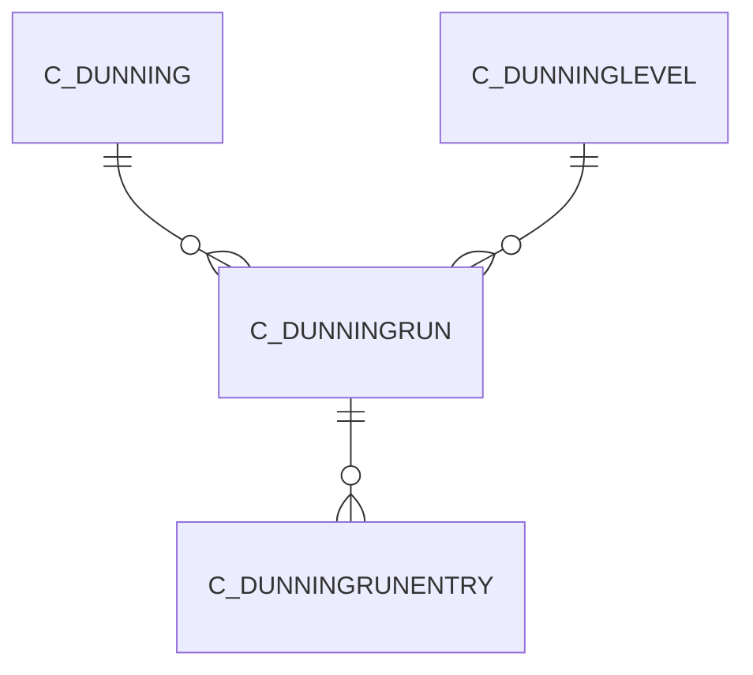

# C_DUNNINGRUN

Area [C](../../data-model/c/index.md) · class **business** (proposed) · read from database `idempiere-db` (owner `ADEMPIERE`) · 0 row(s) when profiled

Application model: `org.compiere.model.X_C_DunningRun`, access level 3 - Client - Org.

## Columns

| column | type | key | not null | business name | references (code) | nulls | distinct |
|---|---|---|---|---|---|---|---|
| `C_DUNNINGRUN_ID` | NUMBER(10,0) | PK | yes | Dunning Run |  | 0 | 0 |
| `AD_CLIENT_ID` | NUMBER(10,0) |  | yes | Tenant |  | 0 | 0 |
| `AD_ORG_ID` | NUMBER(10,0) |  | yes | Organization |  | 0 | 0 |
| `ISACTIVE` | CHAR(1) |  | yes | Active |  | 0 | 0 |
| `CREATED` | DATE |  | yes | Created |  | 0 | 0 |
| `CREATEDBY` | NUMBER(10,0) |  | yes | Created By |  | 0 | 0 |
| `UPDATED` | DATE |  | yes | Updated |  | 0 | 0 |
| `UPDATEDBY` | NUMBER(10,0) |  | yes | Updated By |  | 0 | 0 |
| `DUNNINGDATE` | DATE |  | yes | Dunning Date |  | 0 | 0 |
| `C_DUNNINGLEVEL_ID` | NUMBER(10,0) |  |  | Dunning Level | [C_DUNNINGLEVEL](../../data-model/c/c_dunninglevel.md) | 0 | 0 |
| `PROCESSED` | CHAR(1) |  | yes | Processed |  | 0 | 0 |
| `PROCESSING` | CHAR(1) |  |  | Process Now |  | 0 | 0 |
| `SENDIT` | CHAR(1) |  |  | Send |  | 0 | 0 |
| `DESCRIPTION` | VARCHAR2(255 CHAR) |  |  | Description |  | 0 | 0 |
| `C_DUNNING_ID` | NUMBER(10,0) |  | yes | Dunning | [C_DUNNING](../../data-model/c/c_dunning.md) | 0 | 0 |
| `C_DUNNINGRUN_UU` | VARCHAR2(36 CHAR) |  |  | C_DunningRun_UU |  | 0 | 0 |

*references (code)* is the table the application model's code says a column points to; *Foreign keys* below are the constraints the database declares. Counts come from the profile; no value is ever shown.

## Check constraints

| name | expression |
|---|---|
| `SYS_C0022755` | `Processed in ('Y','N')` |
| `SYS_C0022758` | `IsActive in ('Y','N')` |

## Foreign keys

**References**

| table | columns | on delete |
|---|---|---|
| [C_DUNNING](../../data-model/c/c_dunning.md) | C_DUNNINGRUN.C_DUNNING_ID → C_DUNNING.C_DUNNING_ID | NO ACTION |
| [C_DUNNINGLEVEL](../../data-model/c/c_dunninglevel.md) | C_DUNNINGRUN.C_DUNNINGLEVEL_ID → C_DUNNINGLEVEL.C_DUNNINGLEVEL_ID | NO ACTION |

**Referenced by**

| table | columns | on delete |
|---|---|---|
| [C_DUNNINGRUNENTRY](../../data-model/c/c_dunningrunentry.md) | C_DUNNINGRUNENTRY.C_DUNNINGRUN_ID → C_DUNNINGRUN.C_DUNNINGRUN_ID | CASCADE |

## Write behaviour

- updates: **po_only**
- deletes: **deleted_by_users**
- change log: **recorded**
- evidence: 1 citation(s)

## Read by

| kind | name |
|---|---|
| View | `C_DUNNING_HEADER_V` |
| View | `C_DUNNING_HEADER_VT` |
| View | `c_dunning_header_v` |
| View | `c_dunning_header_vt` |

## Schema history

12 change(s); the latest:

| applied | release | operation | column | tickets |
|---|---|---|---|---|
| 2023-04-09T15:47 | iD11 | `add_constraint` |  | IDEMPIERE-5567 |
| 2023-04-09T15:47 | iD11 | `add_constraint` |  | IDEMPIERE-5567 |
| 2021-12-05T16:45 | i8.2z | `drop_constraint` |  | IDEMPIERE-5075 |
| 2021-12-05T16:45 | i8.2z | `drop_constraint` |  | IDEMPIERE-5075 |
| 2021-12-05T16:45 | i8.2z | `add_constraint` |  | IDEMPIERE-5075 |
| 2021-12-05T16:45 | i8.2z | `add_constraint` |  | IDEMPIERE-5075 |
| 2020-08-04T01:00 | i7.1z | `add_column` | tmp_col_2_tmp | IDEMPIERE-3862 |
| 2020-08-04T01:00 | i7.1z | `modify_column` | DESCRIPTION | IDEMPIERE-3862 |
| 2020-08-04T01:00 | i7.1z | `drop_column` | tmp_col_2_tmp | IDEMPIERE-3862 |
| 2020-08-04T01:00 | i7.1z | `drop_column` | tmp_col_1_tmp | IDEMPIERE-3862 |
| 2020-08-04T01:00 | i7.1z | `add_column` | tmp_col_1_tmp | IDEMPIERE-3862 |
| 2020-08-04T01:00 | i7.1z | `modify_column` | C_DUNNINGRUN_UU | IDEMPIERE-3862 |

## Notes

<!-- ekos:manual id="table.c_dunningrun.notes" -->
_Business notes about this table._
<!-- /ekos:manual -->
