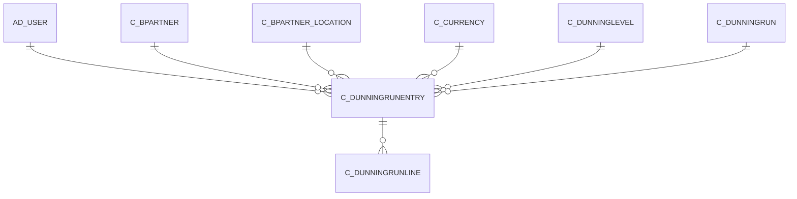

# C_DUNNINGRUNENTRY

Area [C](../../data-model/c/index.md) · class **business** (proposed) · read from database `idempiere-db` (owner `ADEMPIERE`) · 0 row(s) when profiled

Application model: `org.compiere.model.X_C_DunningRunEntry`, access level 3 - Client - Org.

## Columns

| column | type | key | not null | business name | references (code) | nulls | distinct |
|---|---|---|---|---|---|---|---|
| `C_DUNNINGRUNENTRY_ID` | NUMBER(10,0) | PK | yes | Dunning Run Entry |  | 0 | 0 |
| `AD_CLIENT_ID` | NUMBER(10,0) |  | yes | Tenant |  | 0 | 0 |
| `AD_ORG_ID` | NUMBER(10,0) |  | yes | Organization |  | 0 | 0 |
| `ISACTIVE` | CHAR(1) |  | yes | Active |  | 0 | 0 |
| `CREATED` | DATE |  | yes | Created |  | 0 | 0 |
| `CREATEDBY` | NUMBER(10,0) |  | yes | Created By |  | 0 | 0 |
| `UPDATED` | DATE |  | yes | Updated |  | 0 | 0 |
| `UPDATEDBY` | NUMBER(10,0) |  | yes | Updated By |  | 0 | 0 |
| `C_BPARTNER_ID` | NUMBER(10,0) |  | yes | Business Partner | [C_BPARTNER](../../data-model/c/c_bpartner.md) | 0 | 0 |
| `C_BPARTNER_LOCATION_ID` | NUMBER(10,0) |  | yes | Partner Location | [C_BPARTNER_LOCATION](../../data-model/c/c_bpartner_location.md) | 0 | 0 |
| `AD_USER_ID` | NUMBER(10,0) |  |  | User/Contact | [AD_USER](../../data-model/ad/ad_user.md) | 0 | 0 |
| `C_DUNNINGRUN_ID` | NUMBER(10,0) |  | yes | Dunning Run | [C_DUNNINGRUN](../../data-model/c/c_dunningrun.md) | 0 | 0 |
| `C_CURRENCY_ID` | NUMBER(10,0) |  | yes | Currency | [C_CURRENCY](../../data-model/c/c_currency.md) | 0 | 0 |
| `SALESREP_ID` | NUMBER(10,0) |  | yes | Sales Representative | [AD_USER](../../data-model/ad/ad_user.md) | 0 | 0 |
| `AMT` | NUMBER |  | yes | Amount |  | 0 | 0 |
| `QTY` | NUMBER |  | yes | Quantity |  | 0 | 0 |
| `NOTE` | VARCHAR2(2000 CHAR) |  |  | Note |  | 0 | 0 |
| `PROCESSED` | CHAR(1) |  | yes | Processed |  | 0 | 0 |
| `C_DUNNINGLEVEL_ID` | NUMBER(10,0) |  | yes | Dunning Level | [C_DUNNINGLEVEL](../../data-model/c/c_dunninglevel.md) | 0 | 0 |
| `C_DUNNINGRUNENTRY_UU` | VARCHAR2(36 CHAR) |  |  | C_DunningRunEntry_UU |  | 0 | 0 |

*references (code)* is the table the application model's code says a column points to; *Foreign keys* below are the constraints the database declares. Counts come from the profile; no value is ever shown.

## Check constraints

| name | expression |
|---|---|
| `SYS_C0019853` | `IsActive in ('Y','N')` |
| `SYS_C0019854` | `Processed in ('Y','N')` |

## Foreign keys

**References**

| table | columns | on delete |
|---|---|---|
| [AD_USER](../../data-model/ad/ad_user.md) | C_DUNNINGRUNENTRY.AD_USER_ID → AD_USER.AD_USER_ID | NO ACTION |
| [C_BPARTNER](../../data-model/c/c_bpartner.md) | C_DUNNINGRUNENTRY.C_BPARTNER_ID → C_BPARTNER.C_BPARTNER_ID | NO ACTION |
| [C_BPARTNER_LOCATION](../../data-model/c/c_bpartner_location.md) | C_DUNNINGRUNENTRY.C_BPARTNER_LOCATION_ID → C_BPARTNER_LOCATION.C_BPARTNER_LOCATION_ID | NO ACTION |
| [C_CURRENCY](../../data-model/c/c_currency.md) | C_DUNNINGRUNENTRY.C_CURRENCY_ID → C_CURRENCY.C_CURRENCY_ID | NO ACTION |
| [C_DUNNINGLEVEL](../../data-model/c/c_dunninglevel.md) | C_DUNNINGRUNENTRY.C_DUNNINGLEVEL_ID → C_DUNNINGLEVEL.C_DUNNINGLEVEL_ID | NO ACTION |
| [C_DUNNINGRUN](../../data-model/c/c_dunningrun.md) | C_DUNNINGRUNENTRY.C_DUNNINGRUN_ID → C_DUNNINGRUN.C_DUNNINGRUN_ID | CASCADE |

**Referenced by**

| table | columns | on delete |
|---|---|---|
| [C_DUNNINGRUNLINE](../../data-model/c/c_dunningrunline.md) | C_DUNNINGRUNLINE.C_DUNNINGRUNENTRY_ID → C_DUNNINGRUNENTRY.C_DUNNINGRUNENTRY_ID | CASCADE |

## Write behaviour

- updates: **raw_sql_skips_updated**
- deletes: **deleted_by_app, deleted_by_users, deleted_by_cascade**
- change log: **recorded**
- evidence: 5 citation(s)

## Read by

| kind | name |
|---|---|
| View | `C_DUNNING_HEADER_V` |
| View | `C_DUNNING_HEADER_VT` |
| View | `c_dunning_header_v` |
| View | `c_dunning_header_vt` |

## Schema history

22 change(s); the latest:

| applied | release | operation | column | tickets |
|---|---|---|---|---|
| 2023-04-09T15:47 | iD11 | `add_constraint` |  | IDEMPIERE-5567 |
| 2023-04-09T15:47 | iD11 | `add_constraint` |  | IDEMPIERE-5567 |
| 2021-12-05T16:45 | i8.2z | `drop_constraint` |  | IDEMPIERE-5075 |
| 2021-12-05T16:45 | i8.2z | `add_constraint` |  | IDEMPIERE-5075 |
| 2021-12-05T16:45 | i8.2z | `add_constraint` |  | IDEMPIERE-5075 |
| 2021-12-05T16:45 | i8.2z | `add_constraint` |  | IDEMPIERE-5075 |
| 2021-12-05T16:45 | i8.2z | `drop_constraint` |  | IDEMPIERE-5075 |
| 2021-12-05T16:45 | i8.2z | `add_constraint` |  | IDEMPIERE-5075 |
| 2021-12-05T16:45 | i8.2z | `add_constraint` |  | IDEMPIERE-5075 |
| 2021-12-05T16:45 | i8.2z | `drop_constraint` |  | IDEMPIERE-5075 |
| 2021-12-05T16:45 | i8.2z | `add_constraint` |  | IDEMPIERE-5075 |
| 2021-12-05T16:45 | i8.2z | `drop_constraint` |  | IDEMPIERE-5075 |
| 2021-12-05T16:45 | i8.2z | `add_constraint` |  | IDEMPIERE-5075 |
| 2021-12-05T16:45 | i8.2z | `drop_constraint` |  | IDEMPIERE-5075 |
| 2021-12-05T16:45 | i8.2z | `drop_constraint` |  | IDEMPIERE-5075 |

## Notes

<!-- ekos:manual id="table.c_dunningrunentry.notes" -->
_Business notes about this table._
<!-- /ekos:manual -->
