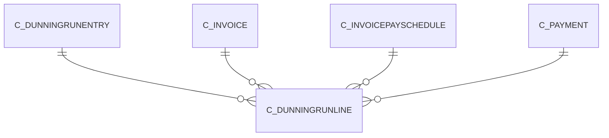

# C_DUNNINGRUNLINE

Area [C](../../data-model/c/index.md) · class **business** (proposed) · read from database `idempiere-db` (owner `ADEMPIERE`) · 0 row(s) when profiled

Application model: `org.compiere.model.X_C_DunningRunLine`, access level 3 - Client - Org.

## Columns

| column | type | key | not null | business name | references (code) | nulls | distinct |
|---|---|---|---|---|---|---|---|
| `C_DUNNINGRUNLINE_ID` | NUMBER(10,0) | PK | yes | Dunning Run Line |  | 0 | 0 |
| `AD_CLIENT_ID` | NUMBER(10,0) |  | yes | Tenant |  | 0 | 0 |
| `AD_ORG_ID` | NUMBER(10,0) |  | yes | Organization |  | 0 | 0 |
| `ISACTIVE` | CHAR(1) |  | yes | Active |  | 0 | 0 |
| `CREATED` | DATE |  | yes | Created |  | 0 | 0 |
| `CREATEDBY` | NUMBER(10,0) |  | yes | Created By |  | 0 | 0 |
| `UPDATED` | DATE |  | yes | Updated |  | 0 | 0 |
| `UPDATEDBY` | NUMBER(10,0) |  | yes | Updated By |  | 0 | 0 |
| `C_DUNNINGRUNENTRY_ID` | NUMBER(10,0) |  | yes | Dunning Run Entry | [C_DUNNINGRUNENTRY](../../data-model/c/c_dunningrunentry.md) | 0 | 0 |
| `C_INVOICE_ID` | NUMBER(10,0) |  |  | Invoice | [C_INVOICE](../../data-model/c/c_invoice.md) | 0 | 0 |
| `C_PAYMENT_ID` | NUMBER(10,0) |  |  | Payment | [C_PAYMENT](../../data-model/c/c_payment.md) | 0 | 0 |
| `AMT` | NUMBER |  | yes | Amount |  | 0 | 0 |
| `CONVERTEDAMT` | NUMBER |  | yes | Converted Amount |  | 0 | 0 |
| `DAYSDUE` | NUMBER(10,0) |  | yes | Days due |  | 0 | 0 |
| `TIMESDUNNED` | NUMBER(10,0) |  | yes | Times Dunned |  | 0 | 0 |
| `INTERESTAMT` | NUMBER |  | yes | Interest Amount |  | 0 | 0 |
| `FEEAMT` | NUMBER |  | yes | Fee Amount |  | 0 | 0 |
| `TOTALAMT` | NUMBER |  | yes | Total Amount |  | 0 | 0 |
| `PROCESSED` | CHAR(1) |  | yes | Processed |  | 0 | 0 |
| `ISINDISPUTE` | CHAR(1) |  | yes | In Dispute |  | 0 | 0 |
| `OPENAMT` | NUMBER |  | yes | Open Amount |  | 0 | 0 |
| `C_INVOICEPAYSCHEDULE_ID` | NUMBER(10,0) |  |  | Invoice Payment Schedule | [C_INVOICEPAYSCHEDULE](../../data-model/c/c_invoicepayschedule.md) | 0 | 0 |
| `C_DUNNINGRUNLINE_UU` | VARCHAR2(36 CHAR) |  |  | C_DunningRunLine_UU |  | 0 | 0 |

*references (code)* is the table the application model's code says a column points to; *Foreign keys* below are the constraints the database declares. Counts come from the profile; no value is ever shown.

## Check constraints

| name | expression |
|---|---|
| `SYS_C0021730` | `Processed in ('Y','N')` |
| `SYS_C0021732` | `IsActive in ('Y','N')` |

## Foreign keys

**References**

| table | columns | on delete |
|---|---|---|
| [C_DUNNINGRUNENTRY](../../data-model/c/c_dunningrunentry.md) | C_DUNNINGRUNLINE.C_DUNNINGRUNENTRY_ID → C_DUNNINGRUNENTRY.C_DUNNINGRUNENTRY_ID | CASCADE |
| [C_INVOICE](../../data-model/c/c_invoice.md) | C_DUNNINGRUNLINE.C_INVOICE_ID → C_INVOICE.C_INVOICE_ID | SET NULL |
| [C_INVOICEPAYSCHEDULE](../../data-model/c/c_invoicepayschedule.md) | C_DUNNINGRUNLINE.C_INVOICEPAYSCHEDULE_ID → C_INVOICEPAYSCHEDULE.C_INVOICEPAYSCHEDULE_ID | NO ACTION |
| [C_PAYMENT](../../data-model/c/c_payment.md) | C_DUNNINGRUNLINE.C_PAYMENT_ID → C_PAYMENT.C_PAYMENT_ID | SET NULL |

**Referenced by**

_None._

## Write behaviour

- updates: **po_only**
- deletes: **deleted_by_users, deleted_by_cascade**
- change log: **recorded**
- evidence: 2 citation(s)

## Read by

| kind | name |
|---|---|
| View | `C_DUNNING_LINE_V` |
| View | `C_DUNNING_LINE_VT` |
| View | `c_dunning_line_v` |
| View | `c_dunning_line_vt` |

## Schema history

13 change(s); the latest:

| applied | release | operation | column | tickets |
|---|---|---|---|---|
| 2023-04-09T15:47 | iD11 | `add_constraint` |  | IDEMPIERE-5567 |
| 2023-04-09T15:47 | iD11 | `add_constraint` |  | IDEMPIERE-5567 |
| 2021-12-05T16:45 | i8.2z | `add_constraint` |  | IDEMPIERE-5075 |
| 2021-12-05T16:45 | i8.2z | `drop_constraint` |  | IDEMPIERE-5075 |
| 2021-12-05T16:45 | i8.2z | `add_constraint` |  | IDEMPIERE-5075 |
| 2021-12-05T16:45 | i8.2z | `add_constraint` |  | IDEMPIERE-5075 |
| 2021-12-05T16:45 | i8.2z | `drop_constraint` |  | IDEMPIERE-5075 |
| 2021-12-05T16:45 | i8.2z | `drop_constraint` |  | IDEMPIERE-5075 |
| 2021-12-05T16:45 | i8.2z | `add_constraint` |  | IDEMPIERE-5075 |
| 2021-12-05T16:45 | i8.2z | `drop_constraint` |  | IDEMPIERE-5075 |
| 2020-08-04T01:00 | i7.1z | `modify_column` | C_DUNNINGRUNLINE_UU | IDEMPIERE-3862 |
| 2020-08-04T01:00 | i7.1z | `drop_column` | tmp_col_1_tmp | IDEMPIERE-3862 |
| 2020-08-04T01:00 | i7.1z | `add_column` | tmp_col_1_tmp | IDEMPIERE-3862 |

## Notes

<!-- ekos:manual id="table.c_dunningrunline.notes" -->
_Business notes about this table._
<!-- /ekos:manual -->
