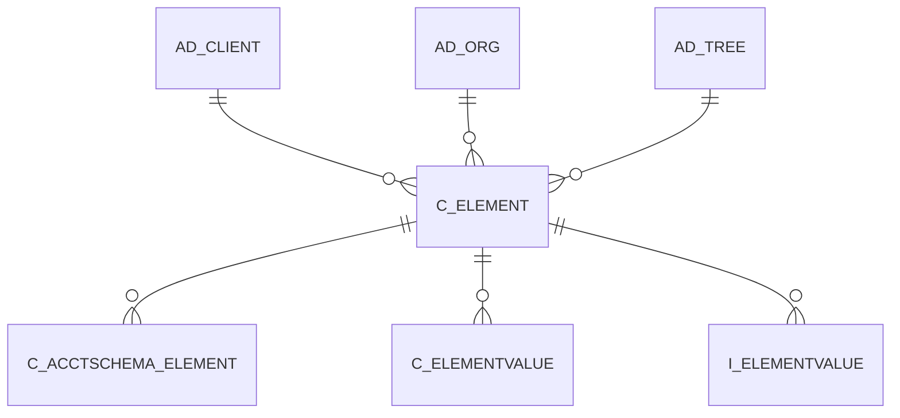

# C_ELEMENT

Defines the element of an account key

Area [C](../../data-model/c/index.md) · class **business** (proposed) · read from database `idempiere-db` (owner `ADEMPIERE`) · 1 row(s) when profiled

Application model: `org.compiere.model.X_C_Element`, access level 2 - Client.

## Columns

| column | type | key | not null | business name | references (code) | nulls | distinct |
|---|---|---|---|---|---|---|---|
| `C_ELEMENT_ID` | NUMBER(10,0) | PK | yes | Element |  | 0 | 1 |
| `AD_CLIENT_ID` | NUMBER(10,0) |  | yes | Tenant |  | 0 | 1 |
| `AD_ORG_ID` | NUMBER(10,0) |  | yes | Organization |  | 0 | 1 |
| `ISACTIVE` | CHAR(1) |  | yes | Active |  | 0 | 1 |
| `CREATED` | DATE |  | yes | Created |  | 0 | 1 |
| `CREATEDBY` | NUMBER(10,0) |  | yes | Created By |  | 0 | 1 |
| `UPDATED` | DATE |  | yes | Updated |  | 0 | 1 |
| `UPDATEDBY` | NUMBER(10,0) |  | yes | Updated By |  | 0 | 1 |
| `NAME` | VARCHAR2(60 CHAR) |  | yes | Name |  | 0 | 1 |
| `DESCRIPTION` | VARCHAR2(255 CHAR) |  |  | Description |  | 0 | 1 |
| `VFORMAT` | VARCHAR2(40 CHAR) |  |  | Value Format |  | 1 | 0 |
| `ELEMENTTYPE` | CHAR(1) |  | yes | Type |  | 0 | 1 |
| `ISBALANCING` | CHAR(1) |  | yes | Balancing |  | 0 | 1 |
| `ISNATURALACCOUNT` | CHAR(1) |  | yes | Natural Account |  | 0 | 1 |
| `AD_TREE_ID` | NUMBER(10,0) |  |  | Tree | [AD_TREE](../../data-model/ad/ad_tree.md) | 0 | 1 |
| `C_ELEMENT_UU` | VARCHAR2(36 CHAR) |  |  | C_Element_UU |  | 0 | 1 |

*references (code)* is the table the application model's code says a column points to; *Foreign keys* below are the constraints the database declares. Counts come from the profile; no value is ever shown.

## Check constraints

| name | expression |
|---|---|
| `SYS_C0020882` | `IsBalancing in ('Y','N')` |
| `SYS_C0020883` | `IsNaturalAccount in ('Y','N')` |
| `SYS_C0020885` | `IsActive in ('Y','N')` |

## Foreign keys

**References**

| table | columns | on delete |
|---|---|---|
| [AD_CLIENT](../../data-model/ad/ad_client.md) | C_ELEMENT.AD_CLIENT_ID → AD_CLIENT.AD_CLIENT_ID | NO ACTION |
| [AD_ORG](../../data-model/ad/ad_org.md) | C_ELEMENT.AD_ORG_ID → AD_ORG.AD_ORG_ID | NO ACTION |
| [AD_TREE](../../data-model/ad/ad_tree.md) | C_ELEMENT.AD_TREE_ID → AD_TREE.AD_TREE_ID | SET NULL |

**Referenced by**

| table | columns | on delete |
|---|---|---|
| [C_ACCTSCHEMA_ELEMENT](../../data-model/c/c_acctschema_element.md) | C_ACCTSCHEMA_ELEMENT.C_ELEMENT_ID → C_ELEMENT.C_ELEMENT_ID | NO ACTION |
| [C_ELEMENTVALUE](../../data-model/c/c_elementvalue.md) | C_ELEMENTVALUE.C_ELEMENT_ID → C_ELEMENT.C_ELEMENT_ID | CASCADE |
| `I_ELEMENTVALUE` | I_ELEMENTVALUE.C_ELEMENT_ID → C_ELEMENT.C_ELEMENT_ID | SET NULL |

## Write behaviour

- updates: **po_only**
- deletes: **deleted_by_users**
- change log: **recorded**
- evidence: 1 citation(s)

## Schema history

23 change(s); the latest:

| applied | release | operation | column | tickets |
|---|---|---|---|---|
| 2023-04-09T15:47 | iD11 | `add_constraint` |  | IDEMPIERE-5567 |
| 2023-04-09T15:47 | iD11 | `add_constraint` |  | IDEMPIERE-5567 |
| 2021-12-05T16:45 | i8.2z | `drop_constraint` |  | IDEMPIERE-5075 |
| 2021-12-05T16:45 | i8.2z | `add_constraint` |  | IDEMPIERE-5075 |
| 2021-12-05T16:45 | i8.2z | `add_constraint` |  | IDEMPIERE-5075 |
| 2021-12-05T16:45 | i8.2z | `drop_constraint` |  | IDEMPIERE-5075 |
| 2021-12-05T16:45 | i8.2z | `drop_constraint` |  | IDEMPIERE-5075 |
| 2021-12-05T16:45 | i8.2z | `add_constraint` |  | IDEMPIERE-5075 |
| 2020-08-04T01:00 | i7.1z | `modify_column` | NAME | IDEMPIERE-3862 |
| 2020-08-04T01:00 | i7.1z | `drop_column` | tmp_col_3_tmp | IDEMPIERE-3862 |
| 2020-08-04T01:00 | i7.1z | `drop_column` | tmp_col_2_tmp | IDEMPIERE-3862 |
| 2020-08-04T01:00 | i7.1z | `add_column` | tmp_col_4_tmp | IDEMPIERE-3862 |
| 2020-08-04T01:00 | i7.1z | `modify_column` | VFORMAT | IDEMPIERE-3862 |
| 2020-08-04T01:00 | i7.1z | `add_column` | tmp_col_1_tmp | IDEMPIERE-3862 |
| 2020-08-04T01:00 | i7.1z | `modify_column` | NAME | IDEMPIERE-3862 |

## Open conflicts

| type | attribute | explanation |
|---|---|---|
| `mandatory_but_nullable` | `columns.AD_Tree_ID.nullable` | unexplained |

## Notes

<!-- ekos:manual id="table.c_element.notes" -->
_Business notes about this table._
<!-- /ekos:manual -->
