# C_ELEMENTVALUE

Element Values

Area [C](../../data-model/c/index.md) · class **business** (proposed) · read from database `idempiere-db` (owner `ADEMPIERE`) · 379 row(s) when profiled

Application model: `org.compiere.model.X_C_ElementValue`, access level 2 - Client.

## Columns

| column | type | key | not null | business name | references (code) | nulls | distinct |
|---|---|---|---|---|---|---|---|
| `C_ELEMENTVALUE_ID` | NUMBER(10,0) | PK | yes | Account Element |  | 0 | 379 |
| `AD_CLIENT_ID` | NUMBER(10,0) |  | yes | Tenant |  | 0 | 1 |
| `AD_ORG_ID` | NUMBER(10,0) |  | yes | Organization |  | 0 | 2 |
| `ISACTIVE` | CHAR(1) |  | yes | Active |  | 0 | 1 |
| `CREATED` | DATE |  | yes | Created |  | 0 | 33 |
| `CREATEDBY` | NUMBER(10,0) |  | yes | Created By |  | 0 | 1 |
| `UPDATED` | DATE |  | yes | Updated |  | 0 | 56 |
| `UPDATEDBY` | NUMBER(10,0) |  | yes | Updated By |  | 0 | 3 |
| `VALUE` | VARCHAR2(40 CHAR) |  | yes | Search Key |  | 0 | 379 |
| `NAME` | VARCHAR2(120 CHAR) |  | yes | Name |  | 0 | 370 |
| `DESCRIPTION` | VARCHAR2(255 CHAR) |  |  | Description |  | 293 | 81 |
| `ACCOUNTTYPE` | CHAR(1) |  | yes | Account Type |  | 0 | 6 |
| `ACCOUNTSIGN` | CHAR(1) |  | yes | Account Sign |  | 0 | 1 |
| `ISDOCCONTROLLED` | CHAR(1) |  |  | Document Controlled |  | 0 | 2 |
| `C_ELEMENT_ID` | NUMBER(10,0) |  | yes | Element | [C_ELEMENT](../../data-model/c/c_element.md) | 0 | 1 |
| `ISSUMMARY` | CHAR(1) |  | yes | Summary Level |  | 0 | 2 |
| `VALIDFROM` | DATE |  |  | Valid from |  | 379 | 0 |
| `VALIDTO` | DATE |  |  | Valid to |  | 379 | 0 |
| `POSTACTUAL` | CHAR(1) |  | yes | Post Actual |  | 0 | 1 |
| `POSTBUDGET` | CHAR(1) |  | yes | Post Budget |  | 0 | 1 |
| `POSTENCUMBRANCE` | CHAR(1) |  | yes | Post Encumbrance |  | 0 | 1 |
| `POSTSTATISTICAL` | CHAR(1) |  | yes | Post Statistical |  | 0 | 1 |
| `ISBANKACCOUNT` | CHAR(1) |  |  | Bank Account |  | 0 | 1 |
| `C_BANKACCOUNT_ID` | NUMBER(10,0) |  |  | Bank Account | [C_BANKACCOUNT](../../data-model/c/c_bankaccount.md) | 378 | 1 |
| `ISFOREIGNCURRENCY` | CHAR(1) |  |  | Foreign Currency Account |  | 0 | 1 |
| `C_CURRENCY_ID` | NUMBER(10,0) |  |  | Currency | [C_CURRENCY](../../data-model/c/c_currency.md) | 378 | 1 |
| `C_ELEMENTVALUE_UU` | VARCHAR2(36 CHAR) |  |  | C_ElementValue_UU |  | 0 | 379 |
| `ISDETAILBPARTNER` | CHAR(1) |  | yes | Manage Business Partners |  | 0 | 1 |
| `ISDETAILPRODUCT` | CHAR(1) |  | yes | Manage Products |  | 0 | 1 |
| `BPARTNERTYPE` | CHAR(1) |  |  | Business Partner Type |  | 379 | 0 |

*references (code)* is the table the application model's code says a column points to; *Foreign keys* below are the constraints the database declares. Counts come from the profile; no value is ever shown.

## Check constraints

| name | expression |
|---|---|
| `SYS_C0021648` | `IsDetailBPartner IN ('Y','N')` |
| `SYS_C0021649` | `IsActive in ('Y','N')` |
| `SYS_C0021650` | `IsDocControlled in ('Y','N')` |
| `SYS_C0021652` | `PostEncumbrance in ('Y','N')` |
| `SYS_C0021653` | `IsForeignCurrency in ('Y','N')` |
| `SYS_C0021654` | `PostActual in ('Y','N')` |
| `SYS_C0021655` | `IsBankAccount in ('Y','N')` |
| `SYS_C0021657` | `PostStatistical in ('Y','N')` |
| `SYS_C0021658` | `IsDetailProduct IN ('Y','N')` |
| `SYS_C0021659` | `PostBudget in ('Y','N')` |

## Foreign keys

**References**

| table | columns | on delete |
|---|---|---|
| [AD_CLIENT](../../data-model/ad/ad_client.md) | C_ELEMENTVALUE.AD_CLIENT_ID → AD_CLIENT.AD_CLIENT_ID | NO ACTION |
| [AD_ORG](../../data-model/ad/ad_org.md) | C_ELEMENTVALUE.AD_ORG_ID → AD_ORG.AD_ORG_ID | NO ACTION |
| [C_BANKACCOUNT](../../data-model/c/c_bankaccount.md) | C_ELEMENTVALUE.C_BANKACCOUNT_ID → C_BANKACCOUNT.C_BANKACCOUNT_ID | NO ACTION |
| [C_CURRENCY](../../data-model/c/c_currency.md) | C_ELEMENTVALUE.C_CURRENCY_ID → C_CURRENCY.C_CURRENCY_ID | NO ACTION |
| [C_ELEMENT](../../data-model/c/c_element.md) | C_ELEMENTVALUE.C_ELEMENT_ID → C_ELEMENT.C_ELEMENT_ID | CASCADE |

**Referenced by**

| table | columns | on delete |
|---|---|---|
| [C_ACCTSCHEMA_ELEMENT](../../data-model/c/c_acctschema_element.md) | C_ACCTSCHEMA_ELEMENT.C_ELEMENTVALUE_ID → C_ELEMENTVALUE.C_ELEMENTVALUE_ID | NO ACTION |
| [C_CASH](../../data-model/c/c_cash.md) | C_CASH.USER1_ID → C_ELEMENTVALUE.C_ELEMENTVALUE_ID | NO ACTION |
| [C_CASHPLAN](../../data-model/c/c_cashplan.md) | C_CASHPLAN.USER1_ID → C_ELEMENTVALUE.C_ELEMENTVALUE_ID | NO ACTION |
| [C_CASHPLANLINE](../../data-model/c/c_cashplanline.md) | C_CASHPLANLINE.USER1_ID → C_ELEMENTVALUE.C_ELEMENTVALUE_ID | NO ACTION |
| [C_ELEMENTVALUE_TRL](../../data-model/c/c_elementvalue_trl.md) | C_ELEMENTVALUE_TRL.C_ELEMENTVALUE_ID → C_ELEMENTVALUE.C_ELEMENTVALUE_ID | CASCADE |
| [C_INVOICE](../../data-model/c/c_invoice.md) | C_INVOICE.USER1_ID → C_ELEMENTVALUE.C_ELEMENTVALUE_ID | NO ACTION |
| [C_INVOICEBATCHLINE](../../data-model/c/c_invoicebatchline.md) | C_INVOICEBATCHLINE.USER1_ID → C_ELEMENTVALUE.C_ELEMENTVALUE_ID | NO ACTION |
| [C_INVOICELINE](../../data-model/c/c_invoiceline.md) | C_INVOICELINE.USER1_ID → C_ELEMENTVALUE.C_ELEMENTVALUE_ID | NO ACTION |
| [C_ORDER](../../data-model/c/c_order.md) | C_ORDER.USER2_ID → C_ELEMENTVALUE.C_ELEMENTVALUE_ID | NO ACTION |
| [C_ORDERLINE](../../data-model/c/c_orderline.md) | C_ORDERLINE.USER1_ID → C_ELEMENTVALUE.C_ELEMENTVALUE_ID | NO ACTION |
| [C_PAYMENT](../../data-model/c/c_payment.md) | C_PAYMENT.USER1_ID → C_ELEMENTVALUE.C_ELEMENTVALUE_ID | NO ACTION |
| [C_PAYMENTTRANSACTION](../../data-model/c/c_paymenttransaction.md) | C_PAYMENTTRANSACTION.USER1_ID → C_ELEMENTVALUE.C_ELEMENTVALUE_ID | NO ACTION |
| [C_SUBACCT](../../data-model/c/c_subacct.md) | C_SUBACCT.C_ELEMENTVALUE_ID → C_ELEMENTVALUE.C_ELEMENTVALUE_ID | CASCADE |
| [C_VALIDCOMBINATION](../../data-model/c/c_validcombination.md) | C_VALIDCOMBINATION.ACCOUNT_ID → C_ELEMENTVALUE.C_ELEMENTVALUE_ID | CASCADE |
| [DD_ORDER](../../data-model/dd/dd_order.md) | DD_ORDER.USER1_ID → C_ELEMENTVALUE.C_ELEMENTVALUE_ID | NO ACTION |
| [DD_ORDERLINE](../../data-model/dd/dd_orderline.md) | DD_ORDERLINE.USER1_ID → C_ELEMENTVALUE.C_ELEMENTVALUE_ID | NO ACTION |
| [FACT_ACCT](../../data-model/fact/fact_acct.md) | FACT_ACCT.USER1_ID → C_ELEMENTVALUE.C_ELEMENTVALUE_ID | NO ACTION |
| [FACT_ACCT_SUMMARY](../../data-model/fact/fact_acct_summary.md) | FACT_ACCT_SUMMARY.ACCOUNT_ID → C_ELEMENTVALUE.C_ELEMENTVALUE_ID | NO ACTION |
| [GL_DISTRIBUTION](../../data-model/gl/gl_distribution.md) | GL_DISTRIBUTION.ACCOUNT_ID → C_ELEMENTVALUE.C_ELEMENTVALUE_ID | NO ACTION |
| [GL_DISTRIBUTIONLINE](../../data-model/gl/gl_distributionline.md) | GL_DISTRIBUTIONLINE.ACCOUNT_ID → C_ELEMENTVALUE.C_ELEMENTVALUE_ID | NO ACTION |
| [GL_FUNDRESTRICTION](../../data-model/gl/gl_fundrestriction.md) | GL_FUNDRESTRICTION.C_ELEMENTVALUE_ID → C_ELEMENTVALUE.C_ELEMENTVALUE_ID | NO ACTION |
| [GL_JOURNALGENERATOR](../../data-model/gl/gl_journalgenerator.md) | GL_JOURNALGENERATOR.C_ELEMENTVALUEADJUSTCR_ID → C_ELEMENTVALUE.C_ELEMENTVALUE_ID | NO ACTION |
| [GL_JOURNALGENERATORLINE](../../data-model/gl/gl_journalgeneratorline.md) | GL_JOURNALGENERATORLINE.C_ELEMENTVALUECR_ID → C_ELEMENTVALUE.C_ELEMENTVALUE_ID | NO ACTION |
| [GL_JOURNALGENERATORSOURCE](../../data-model/gl/gl_journalgeneratorsource.md) | GL_JOURNALGENERATORSOURCE.C_ELEMENTVALUE_ID → C_ELEMENTVALUE.C_ELEMENTVALUE_ID | NO ACTION |
| [GL_JOURNALLINE](../../data-model/gl/gl_journalline.md) | GL_JOURNALLINE.ACCOUNT_ID → C_ELEMENTVALUE.C_ELEMENTVALUE_ID | NO ACTION |
| [HR_CONCEPT_ACCT](../../data-model/hr/hr_concept_acct.md) | HR_CONCEPT_ACCT.USER1_ID → C_ELEMENTVALUE.C_ELEMENTVALUE_ID | NO ACTION |
| [HR_MOVEMENT](../../data-model/hr/hr_movement.md) | HR_MOVEMENT.USER1_ID → C_ELEMENTVALUE.C_ELEMENTVALUE_ID | NO ACTION |
| `I_ELEMENTVALUE` | I_ELEMENTVALUE.C_ELEMENTVALUE_ID → C_ELEMENTVALUE.C_ELEMENTVALUE_ID | SET NULL |
| `I_FAJOURNAL` | I_FAJOURNAL.ACCOUNT_ID → C_ELEMENTVALUE.C_ELEMENTVALUE_ID | NO ACTION |
| `I_GLJOURNAL` | I_GLJOURNAL.ACCOUNT_ID → C_ELEMENTVALUE.C_ELEMENTVALUE_ID | SET NULL |
| `I_REPORTLINE` | I_REPORTLINE.C_ELEMENTVALUE_ID → C_ELEMENTVALUE.C_ELEMENTVALUE_ID | SET NULL |
| [M_INOUT](../../data-model/m/m_inout.md) | M_INOUT.USER1_ID → C_ELEMENTVALUE.C_ELEMENTVALUE_ID | NO ACTION |
| [M_INOUTLINE](../../data-model/m/m_inoutline.md) | M_INOUTLINE.USER1_ID → C_ELEMENTVALUE.C_ELEMENTVALUE_ID | NO ACTION |
| [M_INVENTORY](../../data-model/m/m_inventory.md) | M_INVENTORY.USER1_ID → C_ELEMENTVALUE.C_ELEMENTVALUE_ID | NO ACTION |
| [M_MOVEMENT](../../data-model/m/m_movement.md) | M_MOVEMENT.USER1_ID → C_ELEMENTVALUE.C_ELEMENTVALUE_ID | NO ACTION |
| [M_PRODUCTION](../../data-model/m/m_production.md) | M_PRODUCTION.USER1_ID → C_ELEMENTVALUE.C_ELEMENTVALUE_ID | NO ACTION |
| [PA_RATIOELEMENT](../../data-model/pa/pa_ratioelement.md) | PA_RATIOELEMENT.ACCOUNT_ID → C_ELEMENTVALUE.C_ELEMENTVALUE_ID | NO ACTION |
| [PA_REPORTCOLUMN](../../data-model/pa/pa_reportcolumn.md) | PA_REPORTCOLUMN.C_ELEMENTVALUE_ID → C_ELEMENTVALUE.C_ELEMENTVALUE_ID | NO ACTION |
| [PA_REPORTSOURCE](../../data-model/pa/pa_reportsource.md) | PA_REPORTSOURCE.C_ELEMENTVALUE_ID → C_ELEMENTVALUE.C_ELEMENTVALUE_ID | NO ACTION |
| [PP_ORDER](../../data-model/pp/pp_order.md) | PP_ORDER.USER1_ID → C_ELEMENTVALUE.C_ELEMENTVALUE_ID | NO ACTION |

```mermaid
erDiagram
  AD_CLIENT ||--o{ C_ELEMENTVALUE : ""
  AD_ORG ||--o{ C_ELEMENTVALUE : ""
  C_BANKACCOUNT ||--o{ C_ELEMENTVALUE : ""
  C_CURRENCY ||--o{ C_ELEMENTVALUE : ""
  C_ELEMENT ||--o{ C_ELEMENTVALUE : ""
  C_ELEMENTVALUE ||--o{ C_ACCTSCHEMA_ELEMENT : ""
  C_ELEMENTVALUE ||--o{ C_CASH : ""
  C_ELEMENTVALUE ||--o{ C_CASHPLAN : ""
  C_ELEMENTVALUE ||--o{ C_CASHPLANLINE : ""
  C_ELEMENTVALUE ||--o{ C_ELEMENTVALUE_TRL : ""
  C_ELEMENTVALUE ||--o{ C_INVOICE : ""
  C_ELEMENTVALUE ||--o{ C_INVOICEBATCHLINE : ""
  C_ELEMENTVALUE ||--o{ C_INVOICELINE : ""
  C_ELEMENTVALUE ||--o{ C_ORDER : ""
  C_ELEMENTVALUE ||--o{ C_ORDERLINE : ""
  C_ELEMENTVALUE ||--o{ C_PAYMENT : ""
  C_ELEMENTVALUE ||--o{ C_PAYMENTTRANSACTION : ""
  C_ELEMENTVALUE ||--o{ C_SUBACCT : ""
  C_ELEMENTVALUE ||--o{ C_VALIDCOMBINATION : ""
  C_ELEMENTVALUE ||--o{ DD_ORDER : ""
  C_ELEMENTVALUE ||--o{ DD_ORDERLINE : ""
  C_ELEMENTVALUE ||--o{ FACT_ACCT : ""
  C_ELEMENTVALUE ||--o{ FACT_ACCT_SUMMARY : ""
  C_ELEMENTVALUE ||--o{ GL_DISTRIBUTION : ""
  C_ELEMENTVALUE ||--o{ GL_DISTRIBUTIONLINE : ""
  C_ELEMENTVALUE ||--o{ GL_FUNDRESTRICTION : ""
  C_ELEMENTVALUE ||--o{ GL_JOURNALGENERATOR : ""
  C_ELEMENTVALUE ||--o{ GL_JOURNALGENERATORLINE : ""
  C_ELEMENTVALUE ||--o{ GL_JOURNALGENERATORSOURCE : ""
```

16 more neighbour(s) not drawn.

## Write behaviour

- updates: **po_only**
- deletes: **deleted_by_users, deleted_by_cascade**
- change log: **recorded**
- evidence: 2 citation(s)

## Read by

| kind | name |
|---|---|
| Procedure | [acctBalance](../../logic/acctbalance.md) |
| View | `RV_FACT_ACCT` |
| View | `RV_FACT_ADAXA` |
| View | `rv_fact_acct` |
| View | `rv_fact_adaxa` |

## Schema history

37 change(s); the latest:

| applied | release | operation | column | tickets |
|---|---|---|---|---|
| 2023-04-09T15:47 | iD11 | `add_constraint` |  | IDEMPIERE-5567 |
| 2023-04-09T15:47 | iD11 | `add_constraint` |  | IDEMPIERE-5567 |
| 2021-12-05T16:45 | i8.2z | `drop_constraint` |  | IDEMPIERE-5075 |
| 2021-12-05T16:45 | i8.2z | `add_constraint` |  | IDEMPIERE-5075 |
| 2021-12-05T16:45 | i8.2z | `drop_constraint` |  | IDEMPIERE-5075 |
| 2021-12-05T16:45 | i8.2z | `drop_constraint` |  | IDEMPIERE-5075 |
| 2021-12-05T16:45 | i8.2z | `add_constraint` |  | IDEMPIERE-5075 |
| 2021-12-05T16:45 | i8.2z | `drop_constraint` |  | IDEMPIERE-5075 |
| 2021-12-05T16:45 | i8.2z | `add_constraint` |  | IDEMPIERE-5075 |
| 2021-12-05T16:45 | i8.2z | `drop_constraint` |  | IDEMPIERE-5075 |
| 2021-12-05T16:45 | i8.2z | `add_constraint` |  | IDEMPIERE-5075 |
| 2021-12-05T16:45 | i8.2z | `add_constraint` |  | IDEMPIERE-5075 |
| 2020-08-04T01:00 | i7.1z | `modify_column` | VALUE | IDEMPIERE-3862 |
| 2020-08-04T01:00 | i7.1z | `add_column` | tmp_col_2_tmp | IDEMPIERE-3862 |
| 2020-08-04T01:00 | i7.1z | `modify_column` | NAME | IDEMPIERE-3862 |

## Notes

<!-- ekos:manual id="table.c_elementvalue.notes" -->
_Business notes about this table._
<!-- /ekos:manual -->
