# C_INVOICE

Area [C](../../data-model/c/index.md) · class **business** (proposed) · read from database `idempiere-db` (owner `ADEMPIERE`) · 8 row(s) when profiled

Application model: `org.compiere.model.X_C_Invoice`, access level 1 - Org.

## Columns

| column | type | key | not null | business name | references (code) | nulls | distinct |
|---|---|---|---|---|---|---|---|
| `C_INVOICE_ID` | NUMBER(10,0) | PK | yes | Invoice |  | 0 | 8 |
| `AD_CLIENT_ID` | NUMBER(10,0) |  | yes | Tenant |  | 0 | 1 |
| `AD_ORG_ID` | NUMBER(10,0) |  | yes | Organization |  | 0 | 1 |
| `ISACTIVE` | CHAR(1) |  | yes | Active |  | 0 | 1 |
| `CREATED` | DATE |  | yes | Created |  | 0 | 8 |
| `CREATEDBY` | NUMBER(10,0) |  | yes | Created By |  | 0 | 2 |
| `UPDATED` | DATE |  | yes | Updated |  | 0 | 8 |
| `UPDATEDBY` | NUMBER(10,0) |  | yes | Updated By |  | 0 | 2 |
| `ISSOTRX` | CHAR(1) |  | yes | Sales Transaction |  | 0 | 2 |
| `DOCUMENTNO` | VARCHAR2(30 CHAR) |  | yes | Document No |  | 0 | 8 |
| `DOCSTATUS` | CHAR(2) |  | yes | Document Status |  | 0 | 1 |
| `DOCACTION` | CHAR(2) |  | yes | Document Action |  | 0 | 1 |
| `PROCESSING` | CHAR(1) |  |  | Process Now |  | 0 | 1 |
| `PROCESSED` | CHAR(1) |  | yes | Processed |  | 0 | 1 |
| `POSTED` | CHAR(1) |  | yes | Posted |  | 0 | 1 |
| `C_DOCTYPE_ID` | NUMBER(10,0) |  | yes | Document Type | [C_DOCTYPE](../../data-model/c/c_doctype.md) | 0 | 3 |
| `C_DOCTYPETARGET_ID` | NUMBER(10,0) |  | yes | Target Document Type | [C_DOCTYPE](../../data-model/c/c_doctype.md) | 0 | 3 |
| `C_ORDER_ID` | NUMBER(10,0) |  |  | Order | [C_ORDER](../../data-model/c/c_order.md) | 4 | 4 |
| `DESCRIPTION` | VARCHAR2(255 CHAR) |  |  | Description |  | 4 | 4 |
| `ISAPPROVED` | CHAR(1) |  | yes | Approved |  | 0 | 1 |
| `ISTRANSFERRED` | CHAR(1) |  | yes | Transferred |  | 0 | 1 |
| `ISPRINTED` | CHAR(1) |  | yes | Printed |  | 0 | 1 |
| `SALESREP_ID` | NUMBER(10,0) |  |  | Sales Representative | [AD_USER](../../data-model/ad/ad_user.md) | 2 | 1 |
| `DATEINVOICED` | DATE |  | yes | Date Invoiced |  | 0 | 6 |
| `DATEPRINTED` | DATE |  |  | Date Printed |  | 8 | 0 |
| `DATEACCT` | DATE |  | yes | Account Date |  | 0 | 6 |
| `C_BPARTNER_ID` | NUMBER(10,0) |  | yes | Business Partner | [C_BPARTNER](../../data-model/c/c_bpartner.md) | 0 | 5 |
| `C_BPARTNER_LOCATION_ID` | NUMBER(10,0) |  | yes | Partner Location | [C_BPARTNER_LOCATION](../../data-model/c/c_bpartner_location.md) | 0 | 5 |
| `POREFERENCE` | VARCHAR2(20 CHAR) |  |  | Order Reference |  | 7 | 1 |
| `ISDISCOUNTPRINTED` | CHAR(1) |  | yes | Discount Printed |  | 0 | 1 |
| `DATEORDERED` | DATE |  |  | Date Ordered |  | 4 | 3 |
| `C_CURRENCY_ID` | NUMBER(10,0) |  | yes | Currency | [C_CURRENCY](../../data-model/c/c_currency.md) | 0 | 2 |
| `PAYMENTRULE` | CHAR(1) |  | yes | Payment Rule |  | 0 | 2 |
| `C_PAYMENTTERM_ID` | NUMBER(10,0) |  | yes | Payment Term | [C_PAYMENTTERM](../../data-model/c/c_paymentterm.md) | 0 | 3 |
| `C_CHARGE_ID` | NUMBER(10,0) |  |  | Charge | [C_CHARGE](../../data-model/c/c_charge.md) | 8 | 0 |
| `CHARGEAMT` | NUMBER |  |  | Charge amount |  | 0 | 1 |
| `TOTALLINES` | NUMBER |  | yes | Total Lines |  | 0 | 8 |
| `GRANDTOTAL` | NUMBER |  | yes | Grand Total |  | 0 | 8 |
| `M_PRICELIST_ID` | NUMBER(10,0) |  | yes | Price List | [M_PRICELIST](../../data-model/m/m_pricelist.md) | 0 | 3 |
| `ISTAXINCLUDED` | CHAR(1) |  | yes | Price includes Tax |  | 0 | 1 |
| `C_CAMPAIGN_ID` | NUMBER(10,0) |  |  | Campaign | [C_CAMPAIGN](../../data-model/c/c_campaign.md) | 8 | 0 |
| `C_PROJECT_ID` | NUMBER(10,0) |  |  | Project | [C_PROJECT](../../data-model/c/c_project.md) | 8 | 0 |
| `C_ACTIVITY_ID` | NUMBER(10,0) |  |  | Activity | [C_ACTIVITY](../../data-model/c/c_activity.md) | 8 | 0 |
| `ISPAID` | CHAR(1) |  | yes | Paid |  | 0 | 2 |
| `C_PAYMENT_ID` | NUMBER(10,0) |  |  | Payment | [C_PAYMENT](../../data-model/c/c_payment.md) | 7 | 1 |
| `C_CASHLINE_ID` | NUMBER(10,0) |  |  | Cash Journal Line | [C_CASHLINE](../../data-model/c/c_cashline.md) | 6 | 2 |
| `CREATEFROM` | CHAR(1) |  |  | Create lines from |  | 6 | 1 |
| `GENERATETO` | CHAR(1) |  |  | Generate To |  | 6 | 1 |
| `SENDEMAIL` | CHAR(1) |  | yes | Send EMail |  | 0 | 1 |
| `AD_USER_ID` | NUMBER(10,0) |  |  | User/Contact | [AD_USER](../../data-model/ad/ad_user.md) | 5 | 1 |
| `COPYFROM` | CHAR(1) |  |  | Copy From |  | 8 | 0 |
| `ISSELFSERVICE` | CHAR(1) |  | yes | Self-Service |  | 0 | 1 |
| `AD_ORGTRX_ID` | NUMBER(10,0) |  |  | Trx Organization |  | 8 | 0 |
| `USER1_ID` | NUMBER(10,0) |  |  | User Element List 1 | [C_ELEMENTVALUE](../../data-model/c/c_elementvalue.md) | 8 | 0 |
| `USER2_ID` | NUMBER(10,0) |  |  | User Element List 2 | [C_ELEMENTVALUE](../../data-model/c/c_elementvalue.md) | 8 | 0 |
| `C_CONVERSIONTYPE_ID` | NUMBER(10,0) |  |  | Currency Type | [C_CONVERSIONTYPE](../../data-model/c/c_conversiontype.md) | 8 | 0 |
| `ISPAYSCHEDULEVALID` | CHAR(1) |  | yes | Pay Schedule valid |  | 0 | 2 |
| `REF_INVOICE_ID` | NUMBER(10,0) |  |  | Referenced Invoice |  | 8 | 0 |
| `ISINDISPUTE` | CHAR(1) |  | yes | In Dispute |  | 0 | 1 |
| `INVOICECOLLECTIONTYPE` | CHAR(1) |  |  | Collection Status |  | 8 | 0 |
| `M_RMA_ID` | NUMBER(10,0) |  |  | RMA | [M_RMA](../../data-model/m/m_rma.md) | 8 | 0 |
| `DUNNINGGRACE` | DATE |  |  | Dunning Grace Date |  | 8 | 0 |
| `C_DUNNINGLEVEL_ID` | NUMBER(10,0) |  |  | Dunning Level | [C_DUNNINGLEVEL](../../data-model/c/c_dunninglevel.md) | 8 | 0 |
| `REVERSAL_ID` | NUMBER(10,0) |  |  | Reversal ID | [C_INVOICE](../../data-model/c/c_invoice.md) | 8 | 0 |
| `PROCESSEDON` | NUMBER |  |  | Processed On |  | 0 | 8 |
| `C_CASHPLANLINE_ID` | NUMBER(10,0) |  |  | Cash Plan Line | [C_CASHPLANLINE](../../data-model/c/c_cashplanline.md) | 8 | 0 |
| `C_INVOICE_UU` | VARCHAR2(36 CHAR) |  |  | C_Invoice_UU |  | 0 | 8 |
| `ISFIXEDASSETINVOICE` | CHAR(1) |  |  | Is Fixed Asset Invoice |  | 8 | 0 |
| `RELATEDINVOICE_ID` | NUMBER(10,0) |  |  | Related Invoice | [C_INVOICE](../../data-model/c/c_invoice.md) | 8 | 0 |
| `ISOVERRIDECURRENCYRATE` | CHAR(1) |  | yes | Override Currency Conversion Rate |  | 0 | 1 |
| `CURRENCYRATE` | NUMBER |  |  | Rate |  | 8 | 0 |
| `CREATELINESFROM` | CHAR(1) |  |  | Create lines from |  | 8 | 0 |

*references (code)* is the table the application model's code says a column points to; *Foreign keys* below are the constraints the database declares. Counts come from the profile; no value is ever shown.

## Check constraints

| name | expression |
|---|---|
| `SYS_C0021752` | `Processed in ('Y','N')` |
| `SYS_C0021753` | `IsPaid in ('Y','N')` |
| `SYS_C0021755` | `IsDiscountPrinted in ('Y','N')` |
| `SYS_C0021756` | `IsApproved in ('Y','N')` |
| `SYS_C0021757` | `GenerateTo in ('Y','N')` |
| `SYS_C0021758` | `IsTaxIncluded in ('Y','N')` |
| `SYS_C0021759` | `IsOverrideCurrencyRate IN ('Y','N')` |
| `SYS_C0021760` | `IsSOTrx in ('Y','N')` |
| `SYS_C0021761` | `IsFixedAssetInvoice IN ('Y','N')` |
| `SYS_C0021762` | `CreateFrom in ('Y','N')` |
| `SYS_C0021763` | `IsTransferred in ('Y','N')` |
| `SYS_C0021765` | `IsActive in ('Y','N')` |
| `SYS_C0021766` | `IsPrinted in ('Y','N')` |

## Foreign keys

**References**

| table | columns | on delete |
|---|---|---|
| [AD_ORG](../../data-model/ad/ad_org.md) | C_INVOICE.AD_ORGTRX_ID → AD_ORG.AD_ORG_ID | NO ACTION |
| [AD_USER](../../data-model/ad/ad_user.md) | C_INVOICE.AD_USER_ID → AD_USER.AD_USER_ID | NO ACTION |
| [C_ACTIVITY](../../data-model/c/c_activity.md) | C_INVOICE.C_ACTIVITY_ID → C_ACTIVITY.C_ACTIVITY_ID | NO ACTION |
| [C_BPARTNER](../../data-model/c/c_bpartner.md) | C_INVOICE.C_BPARTNER_ID → C_BPARTNER.C_BPARTNER_ID | NO ACTION |
| [C_BPARTNER_LOCATION](../../data-model/c/c_bpartner_location.md) | C_INVOICE.C_BPARTNER_LOCATION_ID → C_BPARTNER_LOCATION.C_BPARTNER_LOCATION_ID | NO ACTION |
| [C_CAMPAIGN](../../data-model/c/c_campaign.md) | C_INVOICE.C_CAMPAIGN_ID → C_CAMPAIGN.C_CAMPAIGN_ID | NO ACTION |
| [C_CASHLINE](../../data-model/c/c_cashline.md) | C_INVOICE.C_CASHLINE_ID → C_CASHLINE.C_CASHLINE_ID | NO ACTION |
| [C_CASHPLANLINE](../../data-model/c/c_cashplanline.md) | C_INVOICE.C_CASHPLANLINE_ID → C_CASHPLANLINE.C_CASHPLANLINE_ID | NO ACTION |
| [C_CHARGE](../../data-model/c/c_charge.md) | C_INVOICE.C_CHARGE_ID → C_CHARGE.C_CHARGE_ID | NO ACTION |
| [C_CONVERSIONTYPE](../../data-model/c/c_conversiontype.md) | C_INVOICE.C_CONVERSIONTYPE_ID → C_CONVERSIONTYPE.C_CONVERSIONTYPE_ID | NO ACTION |
| [C_CURRENCY](../../data-model/c/c_currency.md) | C_INVOICE.C_CURRENCY_ID → C_CURRENCY.C_CURRENCY_ID | NO ACTION |
| [C_DOCTYPE](../../data-model/c/c_doctype.md) | C_INVOICE.C_DOCTYPETARGET_ID → C_DOCTYPE.C_DOCTYPE_ID | NO ACTION |
| [C_DUNNINGLEVEL](../../data-model/c/c_dunninglevel.md) | C_INVOICE.C_DUNNINGLEVEL_ID → C_DUNNINGLEVEL.C_DUNNINGLEVEL_ID | NO ACTION |
| [C_ELEMENTVALUE](../../data-model/c/c_elementvalue.md) | C_INVOICE.USER1_ID → C_ELEMENTVALUE.C_ELEMENTVALUE_ID | NO ACTION |
| [C_INVOICE](../../data-model/c/c_invoice.md) | C_INVOICE.REF_INVOICE_ID → C_INVOICE.C_INVOICE_ID | NO ACTION |
| [C_ORDER](../../data-model/c/c_order.md) | C_INVOICE.C_ORDER_ID → C_ORDER.C_ORDER_ID | NO ACTION |
| [C_PAYMENT](../../data-model/c/c_payment.md) | C_INVOICE.C_PAYMENT_ID → C_PAYMENT.C_PAYMENT_ID | NO ACTION |
| [C_PAYMENTTERM](../../data-model/c/c_paymentterm.md) | C_INVOICE.C_PAYMENTTERM_ID → C_PAYMENTTERM.C_PAYMENTTERM_ID | NO ACTION |
| [C_PROJECT](../../data-model/c/c_project.md) | C_INVOICE.C_PROJECT_ID → C_PROJECT.C_PROJECT_ID | NO ACTION |
| [M_PRICELIST](../../data-model/m/m_pricelist.md) | C_INVOICE.M_PRICELIST_ID → M_PRICELIST.M_PRICELIST_ID | NO ACTION |
| [M_RMA](../../data-model/m/m_rma.md) | C_INVOICE.M_RMA_ID → M_RMA.M_RMA_ID | NO ACTION |

**Referenced by**

| table | columns | on delete |
|---|---|---|
| [A_ASSET_ADDITION](../../data-model/a/a_asset_addition.md) | A_ASSET_ADDITION.C_INVOICE_ID → C_INVOICE.C_INVOICE_ID | NO ACTION |
| [A_ASSET_DISPOSED](../../data-model/a/a_asset_disposed.md) | A_ASSET_DISPOSED.C_INVOICE_ID → C_INVOICE.C_INVOICE_ID | NO ACTION |
| [C_ALLOCATIONLINE](../../data-model/c/c_allocationline.md) | C_ALLOCATIONLINE.C_INVOICE_ID → C_INVOICE.C_INVOICE_ID | NO ACTION |
| [C_BANKSTATEMENTLINE](../../data-model/c/c_bankstatementline.md) | C_BANKSTATEMENTLINE.C_INVOICE_ID → C_INVOICE.C_INVOICE_ID | NO ACTION |
| [C_CASHLINE](../../data-model/c/c_cashline.md) | C_CASHLINE.C_INVOICE_ID → C_INVOICE.C_INVOICE_ID | NO ACTION |
| [C_COMMISSIONRUN](../../data-model/c/c_commissionrun.md) | C_COMMISSIONRUN.C_INVOICE_ID → C_INVOICE.C_INVOICE_ID | NO ACTION |
| [C_DUNNINGRUNLINE](../../data-model/c/c_dunningrunline.md) | C_DUNNINGRUNLINE.C_INVOICE_ID → C_INVOICE.C_INVOICE_ID | SET NULL |
| [C_INVOICE](../../data-model/c/c_invoice.md) | C_INVOICE.REF_INVOICE_ID → C_INVOICE.C_INVOICE_ID | NO ACTION |
| [C_INVOICEBATCHLINE](../../data-model/c/c_invoicebatchline.md) | C_INVOICEBATCHLINE.C_INVOICE_ID → C_INVOICE.C_INVOICE_ID | NO ACTION |
| [C_INVOICELINE](../../data-model/c/c_invoiceline.md) | C_INVOICELINE.C_INVOICE_ID → C_INVOICE.C_INVOICE_ID | CASCADE |
| [C_INVOICEPAYSCHEDULE](../../data-model/c/c_invoicepayschedule.md) | C_INVOICEPAYSCHEDULE.C_INVOICE_ID → C_INVOICE.C_INVOICE_ID | CASCADE |
| [C_INVOICETAX](../../data-model/c/c_invoicetax.md) | C_INVOICETAX.C_INVOICE_ID → C_INVOICE.C_INVOICE_ID | CASCADE |
| [C_PAYMENT](../../data-model/c/c_payment.md) | C_PAYMENT.C_INVOICE_ID → C_INVOICE.C_INVOICE_ID | NO ACTION |
| [C_PAYMENTALLOCATE](../../data-model/c/c_paymentallocate.md) | C_PAYMENTALLOCATE.C_INVOICE_ID → C_INVOICE.C_INVOICE_ID | NO ACTION |
| [C_PAYMENTTRANSACTION](../../data-model/c/c_paymenttransaction.md) | C_PAYMENTTRANSACTION.C_INVOICE_ID → C_INVOICE.C_INVOICE_ID | NO ACTION |
| [C_PAYSELECTIONLINE](../../data-model/c/c_payselectionline.md) | C_PAYSELECTIONLINE.C_INVOICE_ID → C_INVOICE.C_INVOICE_ID | NO ACTION |
| [C_RECURRING](../../data-model/c/c_recurring.md) | C_RECURRING.C_INVOICE_ID → C_INVOICE.C_INVOICE_ID | NO ACTION |
| [C_RECURRING_RUN](../../data-model/c/c_recurring_run.md) | C_RECURRING_RUN.C_INVOICE_ID → C_INVOICE.C_INVOICE_ID | NO ACTION |
| [C_TAXDECLARATIONLINE](../../data-model/c/c_taxdeclarationline.md) | C_TAXDECLARATIONLINE.C_INVOICE_ID → C_INVOICE.C_INVOICE_ID | NO ACTION |
| [DD_ORDER](../../data-model/dd/dd_order.md) | DD_ORDER.C_INVOICE_ID → C_INVOICE.C_INVOICE_ID | NO ACTION |
| `I_BANKSTATEMENT` | I_BANKSTATEMENT.C_INVOICE_ID → C_INVOICE.C_INVOICE_ID | SET NULL |
| `I_INVOICE` | I_INVOICE.C_INVOICE_ID → C_INVOICE.C_INVOICE_ID | SET NULL |
| `I_PAYMENT` | I_PAYMENT.C_INVOICE_ID → C_INVOICE.C_INVOICE_ID | SET NULL |
| [M_INOUT](../../data-model/m/m_inout.md) | M_INOUT.C_INVOICE_ID → C_INVOICE.C_INVOICE_ID | NO ACTION |
| [M_INOUTCONFIRM](../../data-model/m/m_inoutconfirm.md) | M_INOUTCONFIRM.C_INVOICE_ID → C_INVOICE.C_INVOICE_ID | NO ACTION |
| [M_SHIPPINGTRANSACTION](../../data-model/m/m_shippingtransaction.md) | M_SHIPPINGTRANSACTION.C_INVOICE_ID → C_INVOICE.C_INVOICE_ID | NO ACTION |
| [R_REQUEST](../../data-model/r/r_request.md) | R_REQUEST.C_INVOICEREQUEST_ID → C_INVOICE.C_INVOICE_ID | NO ACTION |
| [R_REQUESTACTION](../../data-model/r/r_requestaction.md) | R_REQUESTACTION.C_INVOICE_ID → C_INVOICE.C_INVOICE_ID | NO ACTION |
| `T_INVOICEGL` | T_INVOICEGL.C_INVOICE_ID → C_INVOICE.C_INVOICE_ID | CASCADE |

```mermaid
erDiagram
  AD_ORG ||--o{ C_INVOICE : ""
  AD_USER ||--o{ C_INVOICE : ""
  C_ACTIVITY ||--o{ C_INVOICE : ""
  C_BPARTNER ||--o{ C_INVOICE : ""
  C_BPARTNER_LOCATION ||--o{ C_INVOICE : ""
  C_CAMPAIGN ||--o{ C_INVOICE : ""
  C_CASHLINE ||--o{ C_INVOICE : ""
  C_CASHPLANLINE ||--o{ C_INVOICE : ""
  C_CHARGE ||--o{ C_INVOICE : ""
  C_CONVERSIONTYPE ||--o{ C_INVOICE : ""
  C_CURRENCY ||--o{ C_INVOICE : ""
  C_DOCTYPE ||--o{ C_INVOICE : ""
  C_DUNNINGLEVEL ||--o{ C_INVOICE : ""
  C_ELEMENTVALUE ||--o{ C_INVOICE : ""
  C_INVOICE ||--o{ A_ASSET_ADDITION : ""
  C_INVOICE ||--o{ A_ASSET_DISPOSED : ""
  C_INVOICE ||--o{ C_ALLOCATIONLINE : ""
  C_INVOICE ||--o{ C_BANKSTATEMENTLINE : ""
  C_INVOICE ||--o{ C_CASHLINE : ""
  C_INVOICE ||--o{ C_COMMISSIONRUN : ""
  C_INVOICE ||--o{ C_DUNNINGRUNLINE : ""
  C_INVOICE ||--o{ C_INVOICE : ""
  C_INVOICE ||--o{ C_INVOICEBATCHLINE : ""
  C_INVOICE ||--o{ C_INVOICELINE : ""
  C_INVOICE ||--o{ C_INVOICEPAYSCHEDULE : ""
  C_INVOICE ||--o{ C_INVOICETAX : ""
  C_INVOICE ||--o{ C_PAYMENT : ""
  C_INVOICE ||--o{ C_PAYMENTALLOCATE : ""
  C_INVOICE ||--o{ C_PAYMENTTRANSACTION : ""
  C_ORDER ||--o{ C_INVOICE : ""
  C_PAYMENT ||--o{ C_INVOICE : ""
  C_PAYMENTTERM ||--o{ C_INVOICE : ""
```

17 more neighbour(s) not drawn.

## Write behaviour

- updates: **raw_sql_skips_updated**
- deletes: **deleted_by_users**
- change log: **recorded**
- evidence: 9 citation(s)

## Read by

| kind | name |
|---|---|
| Procedure | [asu_get1099bucket](../../logic/asu_get1099bucket.md) |
| Procedure | [currencyConvertInvoice](../../logic/currencyconvertinvoice.md) |
| Procedure | [get1099bucket](../../logic/get1099bucket.md) |
| Procedure | [invoiceDiscount](../../logic/invoicediscount.md) |
| Procedure | [invoiceWriteOff](../../logic/invoicewriteoff.md) |
| View | `C_DUNNING_LINE_V` |
| View | `C_DUNNING_LINE_VT` |
| View | `C_INVOICE_CANDIDATE_V` |
| View | `C_INVOICE_HEADER_V` |
| View | `C_INVOICE_HEADER_VT` |
| View | `C_INVOICE_LINETAX_V` |
| View | `C_INVOICE_LINETAX_VT` |
| View | `C_INVOICE_V` |
| View | `C_INVOICE_V1` |
| View | `C_PAYSELECTION_REMITTANCE_V` |
| View | `C_PAYSELECTION_REMITTANCE_VT` |
| View | `M_INOUT_CREATEFROM_V` |
| View | `RV_COMMISSIONRUNDETAIL` |
| View | `RV_C_INVOICE` |
| View | `RV_C_INVOICETAX` |
| View | `RV_C_INVOICE_CUSTOMERPRODQTR` |
| View | `RV_C_INVOICE_CUSTOMERVENDQTR` |
| View | `RV_C_INVOICE_DAY` |
| View | `RV_C_INVOICE_MONTH` |
| View | `RV_C_INVOICE_PRODMONTH` |
| View | `RV_C_INVOICE_PRODUCTMONTH` |
| View | `RV_C_INVOICE_PRODUCTQTR` |
| View | `RV_C_INVOICE_PRODWEEK` |
| View | `RV_C_INVOICE_VENDORMONTH` |
| View | `RV_C_INVOICE_WEEK` |
| View | `RV_UNPOSTED` |
| View | `RV_UNPROCESSED` |
| View | `T_INVOICEGL_V` |
| View | `c_dunning_line_v` |
| View | `c_dunning_line_vt` |
| View | `c_invoice_candidate_v` |
| View | `c_invoice_header_v` |
| View | `c_invoice_header_vt` |
| View | `c_invoice_linetax_v` |
| View | `c_invoice_linetax_vt` |
| View | `c_invoice_v` |
| View | `c_invoice_v1` |
| View | `c_payselection_remittance_v` |
| View | `c_payselection_remittance_vt` |
| View | `m_inout_createfrom_v` |
| View | `rv_c_invoice` |
| View | `rv_c_invoice_customerprodqtr` |
| View | `rv_c_invoice_customervendqtr` |
| View | `rv_c_invoice_day` |
| View | `rv_c_invoice_month` |
| View | `rv_c_invoice_prodmonth` |
| View | `rv_c_invoice_productmonth` |
| View | `rv_c_invoice_productqtr` |
| View | `rv_c_invoice_prodweek` |
| View | `rv_c_invoice_vendormonth` |
| View | `rv_c_invoice_week` |
| View | `rv_c_invoicetax` |
| View | `rv_commissionrundetail` |
| View | `rv_unposted` |
| View | `rv_unprocessed` |
| View | `t_invoicegl_v` |
| View | `t_invoicegl_vt` |

## Schema history

99 change(s); the latest:

| applied | release | operation | column | tickets |
|---|---|---|---|---|
| 2025-04-21T11:45 | iD13 | `add_constraint` |  | IDEMPIERE-5598 |
| 2025-04-21T11:45 | iD13 | `add_constraint` |  | IDEMPIERE-5598 |
| 2025-04-21T11:45 | iD13 | `add_column` | C_Employee_ID | IDEMPIERE-5598 |
| 2025-04-21T11:45 | iD13 | `add_column` | C_Employee_ID | IDEMPIERE-5598 |
| 2024-05-14T13:59 | iD13 | `add_constraint` |  | IDEMPIERE-5598 |
| 2024-05-14T13:59 | iD13 | `add_constraint` |  | IDEMPIERE-5598 |
| 2024-05-14T13:59 | iD13 | `add_column` | C_CostCenter_ID | IDEMPIERE-5598 |
| 2024-05-14T13:59 | iD13 | `add_column` | C_Department_ID | IDEMPIERE-5598 |
| 2024-05-14T13:59 | iD13 | `add_column` | C_Department_ID | IDEMPIERE-5598 |
| 2024-05-14T13:59 | iD13 | `add_column` | C_CostCenter_ID | IDEMPIERE-5598 |
| 2024-05-14T13:59 | iD13 | `add_constraint` |  | IDEMPIERE-5598 |
| 2024-05-14T13:59 | iD13 | `add_constraint` |  | IDEMPIERE-5598 |
| 2023-04-09T15:47 | iD11 | `add_constraint` |  | IDEMPIERE-5567 |
| 2023-04-09T15:47 | iD11 | `add_constraint` |  | IDEMPIERE-5567 |
| 2022-09-06T13:33 | i9 | `add_column` | CreateLinesFrom | IDEMPIERE-5396 |

## Open conflicts

| type | attribute | explanation |
|---|---|---|
| `model_column_missing` | `columns.C_CostCenter_ID` | unexplained |
| `model_column_missing` | `columns.C_Department_ID` | unexplained |
| `model_column_missing` | `columns.C_Employee_ID` | unexplained |

## Notes

<!-- ekos:manual id="table.c_invoice.notes" -->
_Business notes about this table._
<!-- /ekos:manual -->
