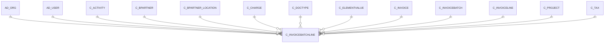

# C_INVOICEBATCHLINE

Area [C](../../data-model/c/index.md) · class **business** (proposed) · read from database `idempiere-db` (owner `ADEMPIERE`) · 0 row(s) when profiled

Application model: `org.compiere.model.X_C_InvoiceBatchLine`, access level 1 - Org.

## Columns

| column | type | key | not null | business name | references (code) | nulls | distinct |
|---|---|---|---|---|---|---|---|
| `C_INVOICEBATCHLINE_ID` | NUMBER(10,0) | PK | yes | Invoice Batch Line |  | 0 | 0 |
| `AD_CLIENT_ID` | NUMBER(10,0) |  | yes | Tenant |  | 0 | 0 |
| `AD_ORG_ID` | NUMBER(10,0) |  | yes | Organization |  | 0 | 0 |
| `ISACTIVE` | CHAR(1) |  | yes | Active |  | 0 | 0 |
| `CREATED` | DATE |  | yes | Created |  | 0 | 0 |
| `CREATEDBY` | NUMBER(10,0) |  | yes | Created By |  | 0 | 0 |
| `UPDATED` | DATE |  | yes | Updated |  | 0 | 0 |
| `UPDATEDBY` | NUMBER(10,0) |  | yes | Updated By |  | 0 | 0 |
| `C_INVOICEBATCH_ID` | NUMBER(10,0) |  | yes | Invoice Batch | [C_INVOICEBATCH](../../data-model/c/c_invoicebatch.md) | 0 | 0 |
| `LINE` | NUMBER(10,0) |  | yes | Line No |  | 0 | 0 |
| `C_DOCTYPE_ID` | NUMBER(10,0) |  | yes | Document Type | [C_DOCTYPE](../../data-model/c/c_doctype.md) | 0 | 0 |
| `DOCUMENTNO` | VARCHAR2(30 CHAR) |  | yes | Document No |  | 0 | 0 |
| `DATEINVOICED` | DATE |  | yes | Date Invoiced |  | 0 | 0 |
| `DATEACCT` | DATE |  | yes | Account Date |  | 0 | 0 |
| `C_BPARTNER_ID` | NUMBER(10,0) |  | yes | Business Partner | [C_BPARTNER](../../data-model/c/c_bpartner.md) | 0 | 0 |
| `C_BPARTNER_LOCATION_ID` | NUMBER(10,0) |  | yes | Partner Location | [C_BPARTNER_LOCATION](../../data-model/c/c_bpartner_location.md) | 0 | 0 |
| `AD_USER_ID` | NUMBER(10,0) |  |  | User/Contact | [AD_USER](../../data-model/ad/ad_user.md) | 0 | 0 |
| `C_CHARGE_ID` | NUMBER(10,0) |  | yes | Charge | [C_CHARGE](../../data-model/c/c_charge.md) | 0 | 0 |
| `QTYENTERED` | NUMBER |  | yes | Quantity |  | 0 | 0 |
| `PRICEENTERED` | NUMBER |  | yes | Price |  | 0 | 0 |
| `ISTAXINCLUDED` | CHAR(1) |  | yes | Price includes Tax |  | 0 | 0 |
| `LINENETAMT` | NUMBER |  | yes | Line Amount |  | 0 | 0 |
| `C_TAX_ID` | NUMBER(10,0) |  | yes | Tax | [C_TAX](../../data-model/c/c_tax.md) | 0 | 0 |
| `TAXAMT` | NUMBER |  | yes | Tax Amount |  | 0 | 0 |
| `LINETOTALAMT` | NUMBER |  | yes | Line Total |  | 0 | 0 |
| `C_PROJECT_ID` | NUMBER(10,0) |  |  | Project | [C_PROJECT](../../data-model/c/c_project.md) | 0 | 0 |
| `C_ACTIVITY_ID` | NUMBER(10,0) |  |  | Activity | [C_ACTIVITY](../../data-model/c/c_activity.md) | 0 | 0 |
| `AD_ORGTRX_ID` | NUMBER(10,0) |  |  | Trx Organization |  | 0 | 0 |
| `USER1_ID` | NUMBER(10,0) |  |  | User Element List 1 | [C_ELEMENTVALUE](../../data-model/c/c_elementvalue.md) | 0 | 0 |
| `USER2_ID` | NUMBER(10,0) |  |  | User Element List 2 | [C_ELEMENTVALUE](../../data-model/c/c_elementvalue.md) | 0 | 0 |
| `PROCESSED` | CHAR(1) |  | yes | Processed |  | 0 | 0 |
| `C_INVOICE_ID` | NUMBER(10,0) |  |  | Invoice | [C_INVOICE](../../data-model/c/c_invoice.md) | 0 | 0 |
| `C_INVOICELINE_ID` | NUMBER(10,0) |  |  | Invoice Line | [C_INVOICELINE](../../data-model/c/c_invoiceline.md) | 0 | 0 |
| `DESCRIPTION` | VARCHAR2(255 CHAR) |  |  | Description |  | 0 | 0 |
| `C_INVOICEBATCHLINE_UU` | VARCHAR2(36 CHAR) |  |  | C_InvoiceBatchLine_UU |  | 0 | 0 |

*references (code)* is the table the application model's code says a column points to; *Foreign keys* below are the constraints the database declares. Counts come from the profile; no value is ever shown.

## Check constraints

| name | expression |
|---|---|
| `SYS_C0020444` | `Processed in ('Y','N')` |
| `SYS_C0020445` | `IsActive in ('Y','N')` |
| `SYS_C0020447` | `IsTaxIncluded in ('Y','N')` |

## Foreign keys

**References**

| table | columns | on delete |
|---|---|---|
| [AD_ORG](../../data-model/ad/ad_org.md) | C_INVOICEBATCHLINE.AD_ORGTRX_ID → AD_ORG.AD_ORG_ID | NO ACTION |
| [AD_USER](../../data-model/ad/ad_user.md) | C_INVOICEBATCHLINE.AD_USER_ID → AD_USER.AD_USER_ID | NO ACTION |
| [C_ACTIVITY](../../data-model/c/c_activity.md) | C_INVOICEBATCHLINE.C_ACTIVITY_ID → C_ACTIVITY.C_ACTIVITY_ID | NO ACTION |
| [C_BPARTNER](../../data-model/c/c_bpartner.md) | C_INVOICEBATCHLINE.C_BPARTNER_ID → C_BPARTNER.C_BPARTNER_ID | NO ACTION |
| [C_BPARTNER_LOCATION](../../data-model/c/c_bpartner_location.md) | C_INVOICEBATCHLINE.C_BPARTNER_LOCATION_ID → C_BPARTNER_LOCATION.C_BPARTNER_LOCATION_ID | NO ACTION |
| [C_CHARGE](../../data-model/c/c_charge.md) | C_INVOICEBATCHLINE.C_CHARGE_ID → C_CHARGE.C_CHARGE_ID | NO ACTION |
| [C_DOCTYPE](../../data-model/c/c_doctype.md) | C_INVOICEBATCHLINE.C_DOCTYPE_ID → C_DOCTYPE.C_DOCTYPE_ID | NO ACTION |
| [C_ELEMENTVALUE](../../data-model/c/c_elementvalue.md) | C_INVOICEBATCHLINE.USER1_ID → C_ELEMENTVALUE.C_ELEMENTVALUE_ID | NO ACTION |
| [C_INVOICE](../../data-model/c/c_invoice.md) | C_INVOICEBATCHLINE.C_INVOICE_ID → C_INVOICE.C_INVOICE_ID | NO ACTION |
| [C_INVOICEBATCH](../../data-model/c/c_invoicebatch.md) | C_INVOICEBATCHLINE.C_INVOICEBATCH_ID → C_INVOICEBATCH.C_INVOICEBATCH_ID | CASCADE |
| [C_INVOICELINE](../../data-model/c/c_invoiceline.md) | C_INVOICEBATCHLINE.C_INVOICELINE_ID → C_INVOICELINE.C_INVOICELINE_ID | NO ACTION |
| [C_PROJECT](../../data-model/c/c_project.md) | C_INVOICEBATCHLINE.C_PROJECT_ID → C_PROJECT.C_PROJECT_ID | NO ACTION |
| [C_TAX](../../data-model/c/c_tax.md) | C_INVOICEBATCHLINE.C_TAX_ID → C_TAX.C_TAX_ID | NO ACTION |

**Referenced by**

_None._

## Write behaviour

- updates: **raw_sql_skips_updated**
- deletes: **deleted_by_users, deleted_by_cascade**
- change log: **recorded**
- evidence: 3 citation(s)

## Schema history

51 change(s); the latest:

| applied | release | operation | column | tickets |
|---|---|---|---|---|
| 2024-05-14T13:59 | iD13 | `add_constraint` |  | IDEMPIERE-5598 |
| 2024-05-14T13:59 | iD13 | `add_column` | C_Department_ID | IDEMPIERE-5598 |
| 2024-05-14T13:59 | iD13 | `add_column` | C_Department_ID | IDEMPIERE-5598 |
| 2024-05-14T13:59 | iD13 | `add_constraint` |  | IDEMPIERE-5598 |
| 2024-05-14T13:59 | iD13 | `add_constraint` |  | IDEMPIERE-5598 |
| 2024-05-14T13:59 | iD13 | `add_column` | C_CostCenter_ID | IDEMPIERE-5598 |
| 2024-05-14T13:59 | iD13 | `add_column` | C_CostCenter_ID | IDEMPIERE-5598 |
| 2024-05-14T13:59 | iD13 | `add_constraint` |  | IDEMPIERE-5598 |
| 2023-04-09T15:47 | iD11 | `add_constraint` |  | IDEMPIERE-5567 |
| 2023-04-09T15:47 | iD11 | `add_constraint` |  | IDEMPIERE-5567 |
| 2021-12-05T16:45 | i8.2z | `drop_constraint` |  | IDEMPIERE-5075 |
| 2021-12-05T16:45 | i8.2z | `add_constraint` |  | IDEMPIERE-5075 |
| 2021-12-05T16:45 | i8.2z | `add_constraint` |  | IDEMPIERE-5075 |
| 2021-12-05T16:45 | i8.2z | `add_constraint` |  | IDEMPIERE-5075 |
| 2021-12-05T16:45 | i8.2z | `drop_constraint` |  | IDEMPIERE-5075 |

## Open conflicts

| type | attribute | explanation |
|---|---|---|
| `model_column_missing` | `columns.C_CostCenter_ID` | unexplained |
| `model_column_missing` | `columns.C_Department_ID` | unexplained |

## Notes

<!-- ekos:manual id="table.c_invoicebatchline.notes" -->
_Business notes about this table._
<!-- /ekos:manual -->
