# C_INVOICELINE

Area [C](../../data-model/c/index.md) · class **business** (proposed) · read from database `idempiere-db` (owner `ADEMPIERE`) · 24 row(s) when profiled

Application model: `org.compiere.model.X_C_InvoiceLine`, access level 1 - Org.

## Columns

| column | type | key | not null | business name | references (code) | nulls | distinct |
|---|---|---|---|---|---|---|---|
| `C_INVOICELINE_ID` | NUMBER(10,0) | PK | yes | Invoice Line |  | 0 | 24 |
| `AD_CLIENT_ID` | NUMBER(10,0) |  | yes | Tenant |  | 0 | 1 |
| `AD_ORG_ID` | NUMBER(10,0) |  | yes | Organization |  | 0 | 1 |
| `ISACTIVE` | CHAR(1) |  | yes | Active |  | 0 | 1 |
| `CREATED` | DATE |  | yes | Created |  | 0 | 8 |
| `CREATEDBY` | NUMBER(10,0) |  | yes | Created By |  | 0 | 2 |
| `UPDATED` | DATE |  | yes | Updated |  | 0 | 8 |
| `UPDATEDBY` | NUMBER(10,0) |  | yes | Updated By |  | 0 | 1 |
| `C_INVOICE_ID` | NUMBER(10,0) |  | yes | Invoice | [C_INVOICE](../../data-model/c/c_invoice.md) | 0 | 8 |
| `C_ORDERLINE_ID` | NUMBER(10,0) |  |  | Sales Order Line | [C_ORDERLINE](../../data-model/c/c_orderline.md) | 2 | 22 |
| `M_INOUTLINE_ID` | NUMBER(10,0) |  |  | Shipment/Receipt Line | [M_INOUTLINE](../../data-model/m/m_inoutline.md) | 1 | 23 |
| `LINE` | NUMBER(10,0) |  | yes | Line No |  | 0 | 10 |
| `DESCRIPTION` | VARCHAR2(255 CHAR) |  |  | Description |  | 22 | 2 |
| `M_PRODUCT_ID` | NUMBER(10,0) |  |  | Product | [M_PRODUCT](../../data-model/m/m_product.md) | 0 | 17 |
| `QTYINVOICED` | NUMBER |  | yes | Quantity Invoiced |  | 0 | 10 |
| `PRICELIST` | NUMBER |  | yes | List Price |  | 0 | 16 |
| `PRICEACTUAL` | NUMBER |  | yes | Unit Price |  | 0 | 20 |
| `PRICELIMIT` | NUMBER |  | yes | Limit Price |  | 0 | 18 |
| `LINENETAMT` | NUMBER |  | yes | Line Amount |  | 0 | 21 |
| `C_CHARGE_ID` | NUMBER(10,0) |  |  | Charge | [C_CHARGE](../../data-model/c/c_charge.md) | 24 | 0 |
| `C_UOM_ID` | NUMBER(10,0) |  |  | UOM | [C_UOM](../../data-model/c/c_uom.md) | 0 | 2 |
| `C_TAX_ID` | NUMBER(10,0) |  |  | Tax | [C_TAX](../../data-model/c/c_tax.md) | 0 | 3 |
| `S_RESOURCEASSIGNMENT_ID` | NUMBER(10,0) |  |  | Resource Assignment |  | 24 | 0 |
| `A_ASSET_ID` | NUMBER(10,0) |  |  | Asset | [A_ASSET](../../data-model/a/a_asset.md) | 24 | 0 |
| `TAXAMT` | NUMBER |  |  | Tax Amount |  | 0 | 1 |
| `M_ATTRIBUTESETINSTANCE_ID` | NUMBER(10,0) |  |  | Attribute Set Instance | [M_ATTRIBUTESETINSTANCE](../../data-model/m/m_attributesetinstance.md) | 0 | 1 |
| `ISDESCRIPTION` | CHAR(1) |  | yes | Description Only |  | 0 | 1 |
| `ISPRINTED` | CHAR(1) |  | yes | Printed |  | 0 | 1 |
| `LINETOTALAMT` | NUMBER |  |  | Line Total |  | 0 | 1 |
| `REF_INVOICELINE_ID` | NUMBER(10,0) |  |  | Referenced Invoice Line |  | 24 | 0 |
| `PROCESSED` | CHAR(1) |  | yes | Processed |  | 0 | 1 |
| `QTYENTERED` | NUMBER |  | yes | Quantity |  | 0 | 10 |
| `PRICEENTERED` | NUMBER |  | yes | Price |  | 0 | 20 |
| `C_PROJECT_ID` | NUMBER(10,0) |  |  | Project | [C_PROJECT](../../data-model/c/c_project.md) | 24 | 0 |
| `C_PROJECTPHASE_ID` | NUMBER(10,0) |  |  | Project Phase | [C_PROJECTPHASE](../../data-model/c/c_projectphase.md) | 24 | 0 |
| `C_PROJECTTASK_ID` | NUMBER(10,0) |  |  | Project Task | [C_PROJECTTASK](../../data-model/c/c_projecttask.md) | 24 | 0 |
| `RRSTARTDATE` | DATE |  |  | Revenue Recognition Start |  | 24 | 0 |
| `RRAMT` | NUMBER |  |  | Revenue Recognition Amt |  | 24 | 0 |
| `C_CAMPAIGN_ID` | NUMBER(10,0) |  |  | Campaign | [C_CAMPAIGN](../../data-model/c/c_campaign.md) | 24 | 0 |
| `C_ACTIVITY_ID` | NUMBER(10,0) |  |  | Activity | [C_ACTIVITY](../../data-model/c/c_activity.md) | 24 | 0 |
| `USER1_ID` | NUMBER(10,0) |  |  | User Element List 1 | [C_ELEMENTVALUE](../../data-model/c/c_elementvalue.md) | 24 | 0 |
| `USER2_ID` | NUMBER(10,0) |  |  | User Element List 2 | [C_ELEMENTVALUE](../../data-model/c/c_elementvalue.md) | 24 | 0 |
| `AD_ORGTRX_ID` | NUMBER(10,0) |  |  | Trx Organization |  | 24 | 0 |
| `M_RMALINE_ID` | NUMBER(10,0) |  |  | RMA Line | [M_RMALINE](../../data-model/m/m_rmaline.md) | 24 | 0 |
| `A_CREATEASSET` | CHAR(1) |  |  | Create Asset |  | 0 | 1 |
| `A_PROCESSED` | CHAR(1) |  |  | Processed |  | 0 | 1 |
| `A_CAPVSEXP` | VARCHAR2(3 CHAR) |  |  | Capital/Expense |  | 24 | 0 |
| `A_ASSET_GROUP_ID` | NUMBER(10,0) |  |  | Asset Group | [A_ASSET_GROUP](../../data-model/a/a_asset_group.md) | 24 | 0 |
| `C_INVOICELINE_UU` | VARCHAR2(36 CHAR) |  |  | C_InvoiceLine_UU |  | 0 | 24 |
| `ISFIXEDASSETINVOICE` | CHAR(1) |  |  | Is Fixed Asset Invoice |  | 24 | 0 |
| `C_1099BOX_ID` | NUMBER(10,0) |  |  | 1099 Box | [C_1099BOX](../../data-model/c/c_1099box.md) | 24 | 0 |

*references (code)* is the table the application model's code says a column points to; *Foreign keys* below are the constraints the database declares. Counts come from the profile; no value is ever shown.

## Check constraints

| name | expression |
|---|---|
| `SYS_C0020105` | `A_Processed IN ('Y','N')` |
| `SYS_C0020108` | `IsFixedAssetInvoice IN ('Y','N')` |
| `SYS_C0020109` | `IsActive in ('Y','N')` |
| `SYS_C0020110` | `A_CreateAsset IN ('Y','N')` |

## Foreign keys

**References**

| table | columns | on delete |
|---|---|---|
| [AD_ORG](../../data-model/ad/ad_org.md) | C_INVOICELINE.AD_ORGTRX_ID → AD_ORG.AD_ORG_ID | NO ACTION |
| [A_ASSET](../../data-model/a/a_asset.md) | C_INVOICELINE.A_ASSET_ID → A_ASSET.A_ASSET_ID | NO ACTION |
| [A_ASSET_GROUP](../../data-model/a/a_asset_group.md) | C_INVOICELINE.A_ASSET_GROUP_ID → A_ASSET_GROUP.A_ASSET_GROUP_ID | NO ACTION |
| [C_1099BOX](../../data-model/c/c_1099box.md) | C_INVOICELINE.C_1099BOX_ID → C_1099BOX.C_1099BOX_ID | NO ACTION |
| [C_ACTIVITY](../../data-model/c/c_activity.md) | C_INVOICELINE.C_ACTIVITY_ID → C_ACTIVITY.C_ACTIVITY_ID | NO ACTION |
| [C_CAMPAIGN](../../data-model/c/c_campaign.md) | C_INVOICELINE.C_CAMPAIGN_ID → C_CAMPAIGN.C_CAMPAIGN_ID | NO ACTION |
| [C_CHARGE](../../data-model/c/c_charge.md) | C_INVOICELINE.C_CHARGE_ID → C_CHARGE.C_CHARGE_ID | NO ACTION |
| [C_ELEMENTVALUE](../../data-model/c/c_elementvalue.md) | C_INVOICELINE.USER1_ID → C_ELEMENTVALUE.C_ELEMENTVALUE_ID | NO ACTION |
| [C_INVOICE](../../data-model/c/c_invoice.md) | C_INVOICELINE.C_INVOICE_ID → C_INVOICE.C_INVOICE_ID | CASCADE |
| [C_INVOICELINE](../../data-model/c/c_invoiceline.md) | C_INVOICELINE.REF_INVOICELINE_ID → C_INVOICELINE.C_INVOICELINE_ID | NO ACTION |
| [C_ORDERLINE](../../data-model/c/c_orderline.md) | C_INVOICELINE.C_ORDERLINE_ID → C_ORDERLINE.C_ORDERLINE_ID | NO ACTION |
| [C_PROJECT](../../data-model/c/c_project.md) | C_INVOICELINE.C_PROJECT_ID → C_PROJECT.C_PROJECT_ID | NO ACTION |
| [C_PROJECTPHASE](../../data-model/c/c_projectphase.md) | C_INVOICELINE.C_PROJECTPHASE_ID → C_PROJECTPHASE.C_PROJECTPHASE_ID | SET NULL |
| [C_PROJECTTASK](../../data-model/c/c_projecttask.md) | C_INVOICELINE.C_PROJECTTASK_ID → C_PROJECTTASK.C_PROJECTTASK_ID | SET NULL |
| [C_TAX](../../data-model/c/c_tax.md) | C_INVOICELINE.C_TAX_ID → C_TAX.C_TAX_ID | NO ACTION |
| [C_UOM](../../data-model/c/c_uom.md) | C_INVOICELINE.C_UOM_ID → C_UOM.C_UOM_ID | NO ACTION |
| [M_ATTRIBUTESETINSTANCE](../../data-model/m/m_attributesetinstance.md) | C_INVOICELINE.M_ATTRIBUTESETINSTANCE_ID → M_ATTRIBUTESETINSTANCE.M_ATTRIBUTESETINSTANCE_ID | NO ACTION |
| [M_INOUTLINE](../../data-model/m/m_inoutline.md) | C_INVOICELINE.M_INOUTLINE_ID → M_INOUTLINE.M_INOUTLINE_ID | NO ACTION |
| [M_PRODUCT](../../data-model/m/m_product.md) | C_INVOICELINE.M_PRODUCT_ID → M_PRODUCT.M_PRODUCT_ID | NO ACTION |
| [M_RMALINE](../../data-model/m/m_rmaline.md) | C_INVOICELINE.M_RMALINE_ID → M_RMALINE.M_RMALINE_ID | NO ACTION |
| [S_RESOURCEASSIGNMENT](../../data-model/s/s_resourceassignment.md) | C_INVOICELINE.S_RESOURCEASSIGNMENT_ID → S_RESOURCEASSIGNMENT.S_RESOURCEASSIGNMENT_ID | NO ACTION |

**Referenced by**

| table | columns | on delete |
|---|---|---|
| [A_ASSET_ADDITION](../../data-model/a/a_asset_addition.md) | A_ASSET_ADDITION.C_INVOICELINE_ID → C_INVOICELINE.C_INVOICELINE_ID | NO ACTION |
| [A_ASSET_DISPOSED](../../data-model/a/a_asset_disposed.md) | A_ASSET_DISPOSED.C_INVOICELINE_ID → C_INVOICELINE.C_INVOICELINE_ID | NO ACTION |
| [A_ASSET_RETIREMENT](../../data-model/a/a_asset_retirement.md) | A_ASSET_RETIREMENT.C_INVOICELINE_ID → C_INVOICELINE.C_INVOICELINE_ID | NO ACTION |
| [C_COMMISSIONDETAIL](../../data-model/c/c_commissiondetail.md) | C_COMMISSIONDETAIL.C_INVOICELINE_ID → C_INVOICELINE.C_INVOICELINE_ID | NO ACTION |
| [C_INVOICEBATCHLINE](../../data-model/c/c_invoicebatchline.md) | C_INVOICEBATCHLINE.C_INVOICELINE_ID → C_INVOICELINE.C_INVOICELINE_ID | NO ACTION |
| [C_INVOICELINE](../../data-model/c/c_invoiceline.md) | C_INVOICELINE.REF_INVOICELINE_ID → C_INVOICELINE.C_INVOICELINE_ID | NO ACTION |
| [C_LANDEDCOST](../../data-model/c/c_landedcost.md) | C_LANDEDCOST.C_INVOICELINE_ID → C_INVOICELINE.C_INVOICELINE_ID | CASCADE |
| [C_LANDEDCOSTALLOCATION](../../data-model/c/c_landedcostallocation.md) | C_LANDEDCOSTALLOCATION.C_INVOICELINE_ID → C_INVOICELINE.C_INVOICELINE_ID | NO ACTION |
| [C_REVENUERECOGNITION_PLAN](../../data-model/c/c_revenuerecognition_plan.md) | C_REVENUERECOGNITION_PLAN.C_INVOICELINE_ID → C_INVOICELINE.C_INVOICELINE_ID | NO ACTION |
| [C_TAXDECLARATIONLINE](../../data-model/c/c_taxdeclarationline.md) | C_TAXDECLARATIONLINE.C_INVOICELINE_ID → C_INVOICELINE.C_INVOICELINE_ID | NO ACTION |
| `I_INVOICE` | I_INVOICE.C_INVOICELINE_ID → C_INVOICELINE.C_INVOICELINE_ID | SET NULL |
| [M_COSTDETAIL](../../data-model/m/m_costdetail.md) | M_COSTDETAIL.C_INVOICELINE_ID → C_INVOICELINE.C_INVOICELINE_ID | NO ACTION |
| [M_INOUTLINECONFIRM](../../data-model/m/m_inoutlineconfirm.md) | M_INOUTLINECONFIRM.C_INVOICELINE_ID → C_INVOICELINE.C_INVOICELINE_ID | NO ACTION |
| [M_MATCHINV](../../data-model/m/m_matchinv.md) | M_MATCHINV.C_INVOICELINE_ID → C_INVOICELINE.C_INVOICELINE_ID | NO ACTION |
| [M_MATCHPO](../../data-model/m/m_matchpo.md) | M_MATCHPO.C_INVOICELINE_ID → C_INVOICELINE.C_INVOICELINE_ID | NO ACTION |
| [S_TIMEEXPENSELINE](../../data-model/s/s_timeexpenseline.md) | S_TIMEEXPENSELINE.C_INVOICELINE_ID → C_INVOICELINE.C_INVOICELINE_ID | NO ACTION |

```mermaid
erDiagram
  AD_ORG ||--o{ C_INVOICELINE : ""
  A_ASSET ||--o{ C_INVOICELINE : ""
  A_ASSET_GROUP ||--o{ C_INVOICELINE : ""
  C_1099BOX ||--o{ C_INVOICELINE : ""
  C_ACTIVITY ||--o{ C_INVOICELINE : ""
  C_CAMPAIGN ||--o{ C_INVOICELINE : ""
  C_CHARGE ||--o{ C_INVOICELINE : ""
  C_ELEMENTVALUE ||--o{ C_INVOICELINE : ""
  C_INVOICE ||--o{ C_INVOICELINE : ""
  C_INVOICELINE ||--o{ A_ASSET_ADDITION : ""
  C_INVOICELINE ||--o{ A_ASSET_DISPOSED : ""
  C_INVOICELINE ||--o{ A_ASSET_RETIREMENT : ""
  C_INVOICELINE ||--o{ C_COMMISSIONDETAIL : ""
  C_INVOICELINE ||--o{ C_INVOICEBATCHLINE : ""
  C_INVOICELINE ||--o{ C_INVOICELINE : ""
  C_INVOICELINE ||--o{ C_LANDEDCOST : ""
  C_INVOICELINE ||--o{ C_LANDEDCOSTALLOCATION : ""
  C_INVOICELINE ||--o{ C_REVENUERECOGNITION_PLAN : ""
  C_INVOICELINE ||--o{ C_TAXDECLARATIONLINE : ""
  C_INVOICELINE ||--o{ I_INVOICE : ""
  C_INVOICELINE ||--o{ M_COSTDETAIL : ""
  C_INVOICELINE ||--o{ M_INOUTLINECONFIRM : ""
  C_ORDERLINE ||--o{ C_INVOICELINE : ""
  C_PROJECT ||--o{ C_INVOICELINE : ""
  C_PROJECTPHASE ||--o{ C_INVOICELINE : ""
  C_PROJECTTASK ||--o{ C_INVOICELINE : ""
  C_TAX ||--o{ C_INVOICELINE : ""
  C_UOM ||--o{ C_INVOICELINE : ""
  M_ATTRIBUTESETINSTANCE ||--o{ C_INVOICELINE : ""
  M_INOUTLINE ||--o{ C_INVOICELINE : ""
```

6 more neighbour(s) not drawn.

## Write behaviour

- updates: **raw_sql_skips_updated**
- deletes: **deleted_by_users, deleted_by_cascade**
- change log: **recorded**
- evidence: 5 citation(s)

## Read by

| kind | name |
|---|---|
| Procedure | [asu_get1099bucket](../../logic/asu_get1099bucket.md) |
| Procedure | [get1099bucket](../../logic/get1099bucket.md) |
| Procedure | [invoiceDiscount](../../logic/invoicediscount.md) |
| View | `C_INVOICELINE_V` |
| View | `C_INVOICE_CANDIDATE_V` |
| View | `C_INVOICE_CREATEFROM_V` |
| View | `C_INVOICE_LINETAX_V` |
| View | `C_INVOICE_LINETAX_VT` |
| View | `M_INOUT_CREATEFROM_V` |
| View | `RV_COMMISSIONRUNDETAIL` |
| View | `RV_C_INVOICELINE` |
| View | `c_invoice_candidate_v` |
| View | `c_invoice_createfrom_v` |
| View | `c_invoice_linetax_v` |
| View | `c_invoice_linetax_vt` |
| View | `c_invoiceline_v` |
| View | `m_inout_createfrom_v` |
| View | `rv_c_invoiceline` |
| View | `rv_commissionrundetail` |

## Schema history

73 change(s); the latest:

| applied | release | operation | column | tickets |
|---|---|---|---|---|
| 2025-04-21T11:45 | iD13 | `add_column` | C_Employee_ID | IDEMPIERE-5598 |
| 2025-04-21T11:45 | iD13 | `add_constraint` |  | IDEMPIERE-5598 |
| 2025-04-21T11:45 | iD13 | `add_constraint` |  | IDEMPIERE-5598 |
| 2025-04-21T11:45 | iD13 | `add_column` | C_Employee_ID | IDEMPIERE-5598 |
| 2024-05-14T13:59 | iD13 | `add_column` | C_Department_ID | IDEMPIERE-5598 |
| 2024-05-14T13:59 | iD13 | `add_constraint` |  | IDEMPIERE-5598 |
| 2024-05-14T13:59 | iD13 | `add_constraint` |  | IDEMPIERE-5598 |
| 2024-05-14T13:59 | iD13 | `add_column` | C_CostCenter_ID | IDEMPIERE-5598 |
| 2024-05-14T13:59 | iD13 | `add_column` | C_Department_ID | IDEMPIERE-5598 |
| 2024-05-14T13:59 | iD13 | `add_constraint` |  | IDEMPIERE-5598 |
| 2024-05-14T13:59 | iD13 | `add_column` | C_CostCenter_ID | IDEMPIERE-5598 |
| 2024-05-14T13:59 | iD13 | `add_constraint` |  | IDEMPIERE-5598 |
| 2023-04-09T15:47 | iD11 | `add_constraint` |  | IDEMPIERE-5567 |
| 2023-04-09T15:47 | iD11 | `add_constraint` |  | IDEMPIERE-5567 |
| 2021-12-05T16:45 | i8.2z | `add_constraint` |  | IDEMPIERE-5075 |

## Open conflicts

| type | attribute | explanation |
|---|---|---|
| `model_column_missing` | `columns.C_CostCenter_ID` | unexplained |
| `model_column_missing` | `columns.C_Department_ID` | unexplained |
| `model_column_missing` | `columns.C_Employee_ID` | unexplained |
| `mandatory_but_nullable` | `columns.C_Tax_ID.nullable` | unexplained |
| `mandatory_but_nullable` | `columns.M_AttributeSetInstance_ID.nullable` | unexplained |

## Notes

<!-- ekos:manual id="table.c_invoiceline.notes" -->
_Business notes about this table._
<!-- /ekos:manual -->
