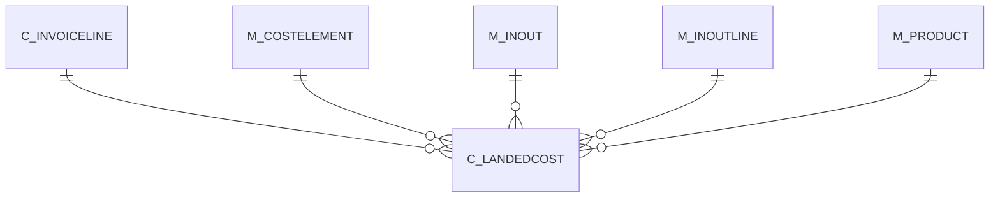

# C_LANDEDCOST

Area [C](../../data-model/c/index.md) · class **business** (proposed) · read from database `idempiere-db` (owner `ADEMPIERE`) · 0 row(s) when profiled

Application model: `org.compiere.model.X_C_LandedCost`, access level 1 - Org.

## Columns

| column | type | key | not null | business name | references (code) | nulls | distinct |
|---|---|---|---|---|---|---|---|
| `C_LANDEDCOST_ID` | NUMBER(10,0) | PK | yes | Landed Cost |  | 0 | 0 |
| `AD_CLIENT_ID` | NUMBER(10,0) |  | yes | Tenant |  | 0 | 0 |
| `AD_ORG_ID` | NUMBER(10,0) |  | yes | Organization |  | 0 | 0 |
| `CREATED` | DATE |  | yes | Created |  | 0 | 0 |
| `CREATEDBY` | NUMBER(10,0) |  | yes | Created By |  | 0 | 0 |
| `UPDATED` | DATE |  | yes | Updated |  | 0 | 0 |
| `UPDATEDBY` | NUMBER(10,0) |  | yes | Updated By |  | 0 | 0 |
| `DESCRIPTION` | VARCHAR2(255 CHAR) |  |  | Description |  | 0 | 0 |
| `C_INVOICELINE_ID` | NUMBER(10,0) |  | yes | Invoice Line | [C_INVOICELINE](../../data-model/c/c_invoiceline.md) | 0 | 0 |
| `M_COSTELEMENT_ID` | NUMBER(10,0) |  | yes | Cost Element | [M_COSTELEMENT](../../data-model/m/m_costelement.md) | 0 | 0 |
| `M_INOUTLINE_ID` | NUMBER(10,0) |  |  | Shipment/Receipt Line | [M_INOUTLINE](../../data-model/m/m_inoutline.md) | 0 | 0 |
| `M_INOUT_ID` | NUMBER(10,0) |  |  | Shipment/Receipt | [M_INOUT](../../data-model/m/m_inout.md) | 0 | 0 |
| `M_PRODUCT_ID` | NUMBER(10,0) |  |  | Product | [M_PRODUCT](../../data-model/m/m_product.md) | 0 | 0 |
| `LANDEDCOSTDISTRIBUTION` | CHAR(1) |  | yes | Cost Distribution |  | 0 | 0 |
| `PROCESSING` | CHAR(1) |  |  | Process Now |  | 0 | 0 |
| `C_LANDEDCOST_UU` | VARCHAR2(36 CHAR) |  |  | C_LandedCost_UU |  | 0 | 0 |

*references (code)* is the table the application model's code says a column points to; *Foreign keys* below are the constraints the database declares. Counts come from the profile; no value is ever shown.

## Foreign keys

**References**

| table | columns | on delete |
|---|---|---|
| [C_INVOICELINE](../../data-model/c/c_invoiceline.md) | C_LANDEDCOST.C_INVOICELINE_ID → C_INVOICELINE.C_INVOICELINE_ID | CASCADE |
| [M_COSTELEMENT](../../data-model/m/m_costelement.md) | C_LANDEDCOST.M_COSTELEMENT_ID → M_COSTELEMENT.M_COSTELEMENT_ID | NO ACTION |
| [M_INOUT](../../data-model/m/m_inout.md) | C_LANDEDCOST.M_INOUT_ID → M_INOUT.M_INOUT_ID | NO ACTION |
| [M_INOUTLINE](../../data-model/m/m_inoutline.md) | C_LANDEDCOST.M_INOUTLINE_ID → M_INOUTLINE.M_INOUTLINE_ID | NO ACTION |
| [M_PRODUCT](../../data-model/m/m_product.md) | C_LANDEDCOST.M_PRODUCT_ID → M_PRODUCT.M_PRODUCT_ID | NO ACTION |

**Referenced by**

_None._

## Write behaviour

- updates: **po_only**
- deletes: **deleted_by_users, deleted_by_cascade**
- change log: **recorded**
- evidence: 2 citation(s)

## Schema history

20 change(s); the latest:

| applied | release | operation | column | tickets |
|---|---|---|---|---|
| 2025-08-22T11:29 | iD12 | `add_column` | Qty | IDEMPIERE-6124 |
| 2025-08-22T11:29 | iD12 | `add_column` | Qty | IDEMPIERE-6124 |
| 2023-04-09T15:47 | iD11 | `add_constraint` |  | IDEMPIERE-5567 |
| 2023-04-09T15:47 | iD11 | `add_constraint` |  | IDEMPIERE-5567 |
| 2021-12-05T16:45 | i8.2z | `add_constraint` |  | IDEMPIERE-5075 |
| 2021-12-05T16:45 | i8.2z | `add_constraint` |  | IDEMPIERE-5075 |
| 2021-12-05T16:45 | i8.2z | `drop_constraint` |  | IDEMPIERE-5075 |
| 2021-12-05T16:45 | i8.2z | `add_constraint` |  | IDEMPIERE-5075 |
| 2021-12-05T16:45 | i8.2z | `drop_constraint` |  | IDEMPIERE-5075 |
| 2021-12-05T16:45 | i8.2z | `add_constraint` |  | IDEMPIERE-5075 |
| 2021-12-05T16:45 | i8.2z | `drop_constraint` |  | IDEMPIERE-5075 |
| 2021-12-05T16:45 | i8.2z | `drop_constraint` |  | IDEMPIERE-5075 |
| 2021-12-05T16:45 | i8.2z | `add_constraint` |  | IDEMPIERE-5075 |
| 2021-12-05T16:45 | i8.2z | `drop_constraint` |  | IDEMPIERE-5075 |
| 2020-08-04T01:00 | i7.1z | `add_column` | tmp_col_1_tmp | IDEMPIERE-3862 |

## Open conflicts

| type | attribute | explanation |
|---|---|---|
| `model_column_missing` | `columns.Qty` | unexplained |

## Notes

<!-- ekos:manual id="table.c_landedcost.notes" -->
_Business notes about this table._
<!-- /ekos:manual -->
