# C_LOCATION

Area [C](../../data-model/c/index.md) · class **business** (proposed) · read from database `idempiere-db` (owner `ADEMPIERE`) · 34 row(s) when profiled

Application model: `org.compiere.model.X_C_Location`, access level 7 - System - Client - Org.

## Columns

| column | type | key | not null | business name | references (code) | nulls | distinct |
|---|---|---|---|---|---|---|---|
| `C_LOCATION_ID` | NUMBER(10,0) | PK | yes | Address |  | 0 | 34 |
| `AD_CLIENT_ID` | NUMBER(10,0) |  | yes | Tenant |  | 0 | 2 |
| `AD_ORG_ID` | NUMBER(10,0) |  | yes | Organization |  | 0 | 3 |
| `ISACTIVE` | CHAR(1) |  | yes | Active |  | 0 | 1 |
| `CREATED` | DATE |  | yes | Created |  | 0 | 32 |
| `CREATEDBY` | NUMBER(10,0) |  | yes | Created By |  | 0 | 2 |
| `UPDATED` | DATE |  | yes | Updated |  | 0 | 32 |
| `UPDATEDBY` | NUMBER(10,0) |  | yes | Updated By |  | 0 | 2 |
| `ADDRESS1` | VARCHAR2(60 CHAR) |  |  | Address 1 |  | 1 | 23 |
| `ADDRESS2` | VARCHAR2(60 CHAR) |  |  | Address 2 |  | 32 | 1 |
| `CITY` | VARCHAR2(60 CHAR) |  |  | City |  | 13 | 16 |
| `POSTAL` | VARCHAR2(10 CHAR) |  |  | ZIP |  | 15 | 16 |
| `POSTAL_ADD` | VARCHAR2(10 CHAR) |  |  | Additional Zip |  | 34 | 0 |
| `C_COUNTRY_ID` | NUMBER(10,0) |  | yes | Country | [C_COUNTRY](../../data-model/c/c_country.md) | 0 | 3 |
| `C_REGION_ID` | NUMBER(10,0) |  |  | Region | [C_REGION](../../data-model/c/c_region.md) | 7 | 5 |
| `C_CITY_ID` | NUMBER(10,0) |  |  | City | [C_CITY](../../data-model/c/c_city.md) | 33 | 1 |
| `REGIONNAME` | VARCHAR2(40 CHAR) |  |  | Region |  | 34 | 0 |
| `ADDRESS3` | VARCHAR2(60 CHAR) |  |  | Address 3 |  | 34 | 0 |
| `ADDRESS4` | VARCHAR2(60 CHAR) |  |  | Address 4 |  | 34 | 0 |
| `C_LOCATION_UU` | VARCHAR2(36 CHAR) |  |  | C_Location_UU |  | 0 | 34 |
| `VALIDATEADDRESS` | CHAR(1) |  |  | Validate Address |  | 34 | 0 |
| `RESULT` | VARCHAR2(2000 CHAR) |  |  | Result |  | 34 | 0 |
| `ISVALID` | CHAR(1) |  |  | Valid |  | 0 | 1 |
| `C_ADDRESSVALIDATION_ID` | NUMBER(10,0) |  |  | Address Validation | [C_ADDRESSVALIDATION](../../data-model/c/c_addressvalidation.md) | 34 | 0 |
| `ADDRESS5` | VARCHAR2(60 CHAR) |  |  | Address 5 |  | 34 | 0 |
| `COMMENTS` | VARCHAR2(2000 CHAR) |  |  | Comments |  | 34 | 0 |

*references (code)* is the table the application model's code says a column points to; *Foreign keys* below are the constraints the database declares. Counts come from the profile; no value is ever shown.

## Check constraints

| name | expression |
|---|---|
| `SYS_C0019527` | `IsActive in ('Y','N')` |
| `SYS_C0019530` | `IsValid IN ('Y','N')` |

## Foreign keys

**References**

| table | columns | on delete |
|---|---|---|
| [AD_CLIENT](../../data-model/ad/ad_client.md) | C_LOCATION.AD_CLIENT_ID → AD_CLIENT.AD_CLIENT_ID | NO ACTION |
| [AD_ORG](../../data-model/ad/ad_org.md) | C_LOCATION.AD_ORG_ID → AD_ORG.AD_ORG_ID | NO ACTION |
| [C_ADDRESSVALIDATION](../../data-model/c/c_addressvalidation.md) | C_LOCATION.C_ADDRESSVALIDATION_ID → C_ADDRESSVALIDATION.C_ADDRESSVALIDATION_ID | NO ACTION |
| [C_CITY](../../data-model/c/c_city.md) | C_LOCATION.C_CITY_ID → C_CITY.C_CITY_ID | NO ACTION |
| [C_COUNTRY](../../data-model/c/c_country.md) | C_LOCATION.C_COUNTRY_ID → C_COUNTRY.C_COUNTRY_ID | NO ACTION |
| [C_REGION](../../data-model/c/c_region.md) | C_LOCATION.C_REGION_ID → C_REGION.C_REGION_ID | NO ACTION |

**Referenced by**

| table | columns | on delete |
|---|---|---|
| [AD_ORGINFO](../../data-model/ad/ad_orginfo.md) | AD_ORGINFO.C_LOCATION_ID → C_LOCATION.C_LOCATION_ID | NO ACTION |
| [AD_REGISTRATION](../../data-model/ad/ad_registration.md) | AD_REGISTRATION.C_LOCATION_ID → C_LOCATION.C_LOCATION_ID | NO ACTION |
| [AD_USER](../../data-model/ad/ad_user.md) | AD_USER.BP_LOCATION_ID → C_LOCATION.C_LOCATION_ID | NO ACTION |
| [A_ASSET](../../data-model/a/a_asset.md) | A_ASSET.C_LOCATION_ID → C_LOCATION.C_LOCATION_ID | NO ACTION |
| [A_ASSET_CHANGE](../../data-model/a/a_asset_change.md) | A_ASSET_CHANGE.C_LOCATION_ID → C_LOCATION.C_LOCATION_ID | NO ACTION |
| [C_ACCTSCHEMA_ELEMENT](../../data-model/c/c_acctschema_element.md) | C_ACCTSCHEMA_ELEMENT.C_LOCATION_ID → C_LOCATION.C_LOCATION_ID | NO ACTION |
| [C_ADDRESSTRANSACTION](../../data-model/c/c_addresstransaction.md) | C_ADDRESSTRANSACTION.C_LOCATION_ID → C_LOCATION.C_LOCATION_ID | NO ACTION |
| [C_BANK](../../data-model/c/c_bank.md) | C_BANK.C_LOCATION_ID → C_LOCATION.C_LOCATION_ID | NO ACTION |
| [C_BPARTNER_LOCATION](../../data-model/c/c_bpartner_location.md) | C_BPARTNER_LOCATION.C_LOCATION_ID → C_LOCATION.C_LOCATION_ID | NO ACTION |
| [C_VALIDCOMBINATION](../../data-model/c/c_validcombination.md) | C_VALIDCOMBINATION.C_LOCFROM_ID → C_LOCATION.C_LOCATION_ID | NO ACTION |
| [FACT_ACCT](../../data-model/fact/fact_acct.md) | FACT_ACCT.C_LOCFROM_ID → C_LOCATION.C_LOCATION_ID | NO ACTION |
| [FACT_ACCT_SUMMARY](../../data-model/fact/fact_acct_summary.md) | FACT_ACCT_SUMMARY.C_LOCFROM_ID → C_LOCATION.C_LOCATION_ID | NO ACTION |
| [GL_DISTRIBUTION](../../data-model/gl/gl_distribution.md) | GL_DISTRIBUTION.C_LOCFROM_ID → C_LOCATION.C_LOCATION_ID | NO ACTION |
| [GL_DISTRIBUTIONLINE](../../data-model/gl/gl_distributionline.md) | GL_DISTRIBUTIONLINE.C_LOCFROM_ID → C_LOCATION.C_LOCATION_ID | NO ACTION |
| [GL_JOURNALLINE](../../data-model/gl/gl_journalline.md) | GL_JOURNALLINE.C_LOCFROM_ID → C_LOCATION.C_LOCATION_ID | NO ACTION |
| `I_ASSET` | I_ASSET.C_LOCATION_ID → C_LOCATION.C_LOCATION_ID | NO ACTION |
| `I_FAJOURNAL` | I_FAJOURNAL.C_LOCFROM_ID → C_LOCATION.C_LOCATION_ID | NO ACTION |
| `I_GLJOURNAL` | I_GLJOURNAL.C_LOCFROM_ID → C_LOCATION.C_LOCATION_ID | SET NULL |
| `I_INVOICE` | I_INVOICE.C_LOCATION_ID → C_LOCATION.C_LOCATION_ID | SET NULL |
| `I_ORDER` | I_ORDER.C_LOCATION_ID → C_LOCATION.C_LOCATION_ID | SET NULL |
| [M_WAREHOUSE](../../data-model/m/m_warehouse.md) | M_WAREHOUSE.C_LOCATION_ID → C_LOCATION.C_LOCATION_ID | NO ACTION |
| [PA_REPORTCOLUMN](../../data-model/pa/pa_reportcolumn.md) | PA_REPORTCOLUMN.C_LOCATION_ID → C_LOCATION.C_LOCATION_ID | NO ACTION |
| [PA_REPORTSOURCE](../../data-model/pa/pa_reportsource.md) | PA_REPORTSOURCE.C_LOCATION_ID → C_LOCATION.C_LOCATION_ID | NO ACTION |

```mermaid
erDiagram
  AD_CLIENT ||--o{ C_LOCATION : ""
  AD_ORG ||--o{ C_LOCATION : ""
  C_ADDRESSVALIDATION ||--o{ C_LOCATION : ""
  C_CITY ||--o{ C_LOCATION : ""
  C_COUNTRY ||--o{ C_LOCATION : ""
  C_LOCATION ||--o{ AD_ORGINFO : ""
  C_LOCATION ||--o{ AD_REGISTRATION : ""
  C_LOCATION ||--o{ AD_USER : ""
  C_LOCATION ||--o{ A_ASSET : ""
  C_LOCATION ||--o{ A_ASSET_CHANGE : ""
  C_LOCATION ||--o{ C_ACCTSCHEMA_ELEMENT : ""
  C_LOCATION ||--o{ C_ADDRESSTRANSACTION : ""
  C_LOCATION ||--o{ C_BANK : ""
  C_LOCATION ||--o{ C_BPARTNER_LOCATION : ""
  C_LOCATION ||--o{ C_VALIDCOMBINATION : ""
  C_LOCATION ||--o{ FACT_ACCT : ""
  C_LOCATION ||--o{ FACT_ACCT_SUMMARY : ""
  C_LOCATION ||--o{ GL_DISTRIBUTION : ""
  C_LOCATION ||--o{ GL_DISTRIBUTIONLINE : ""
  C_LOCATION ||--o{ GL_JOURNALLINE : ""
  C_LOCATION ||--o{ I_ASSET : ""
  C_LOCATION ||--o{ I_FAJOURNAL : ""
  C_LOCATION ||--o{ I_GLJOURNAL : ""
  C_LOCATION ||--o{ I_INVOICE : ""
  C_LOCATION ||--o{ I_ORDER : ""
  C_LOCATION ||--o{ M_WAREHOUSE : ""
  C_LOCATION ||--o{ PA_REPORTCOLUMN : ""
  C_LOCATION ||--o{ PA_REPORTSOURCE : ""
  C_REGION ||--o{ C_LOCATION : ""
```

## Write behaviour

- updates: **po_only**
- deletes: **deleted_by_users**
- change log: **recorded**
- evidence: 1 citation(s)

## Read by

| kind | name |
|---|---|
| View | `C_DUNNING_HEADER_V` |
| View | `C_DUNNING_HEADER_VT` |
| View | `C_INVOICE_HEADER_V` |
| View | `C_INVOICE_HEADER_VT` |
| View | `C_ORDER_HEADER_V` |
| View | `C_ORDER_HEADER_VT` |
| View | `DD_ORDER_HEADER_V` |
| View | `DD_ORDER_HEADER_VT` |
| View | `M_INOUT_HEADER_V` |
| View | `M_INOUT_HEADER_VT` |
| View | `RV_BPARTNER` |
| View | `RV_C_INVOICE` |
| View | `RV_T_1099EXTRACT` |
| View | `c_dunning_header_v` |
| View | `c_dunning_header_vt` |
| View | `c_invoice_header_v` |
| View | `c_invoice_header_vt` |
| View | `c_order_header_v` |
| View | `c_order_header_vt` |
| View | `dd_order_header_v` |
| View | `dd_order_header_vt` |
| View | `m_inout_header_v` |
| View | `m_inout_header_vt` |
| View | `rv_bpartner` |
| View | `rv_c_invoice` |
| View | `rv_t_1099extract` |

## Schema history

58 change(s); the latest:

| applied | release | operation | column | tickets |
|---|---|---|---|---|
| 2023-04-09T15:47 | iD11 | `add_constraint` |  | IDEMPIERE-5567 |
| 2023-04-09T15:47 | iD11 | `add_constraint` |  | IDEMPIERE-5567 |
| 2021-12-05T16:45 | i8.2z | `add_constraint` |  | IDEMPIERE-5075 |
| 2021-12-05T16:45 | i8.2z | `add_constraint` |  | IDEMPIERE-5075 |
| 2021-12-05T16:45 | i8.2z | `drop_constraint` |  | IDEMPIERE-5075 |
| 2021-12-05T16:45 | i8.2z | `drop_constraint` |  | IDEMPIERE-5075 |
| 2021-12-05T16:45 | i8.2z | `drop_constraint` |  | IDEMPIERE-5075 |
| 2021-12-05T16:45 | i8.2z | `add_constraint` |  | IDEMPIERE-5075 |
| 2021-12-05T16:45 | i8.2z | `drop_constraint` |  | IDEMPIERE-5075 |
| 2021-12-05T16:45 | i8.2z | `drop_constraint` |  | IDEMPIERE-5075 |
| 2021-12-05T16:45 | i8.2z | `add_constraint` |  | IDEMPIERE-5075 |
| 2021-12-05T16:45 | i8.2z | `add_constraint` |  | IDEMPIERE-5075 |
| 2020-08-04T01:00 | i7.1z | `modify_column` | CITY | IDEMPIERE-3862 |
| 2020-08-04T01:00 | i7.1z | `modify_column` | ADDRESS3 | IDEMPIERE-3862 |
| 2020-08-04T01:00 | i7.1z | `modify_column` | ADDRESS4 | IDEMPIERE-3862 |

## Notes

<!-- ekos:manual id="table.c_location.notes" -->
_Business notes about this table._
<!-- /ekos:manual -->
