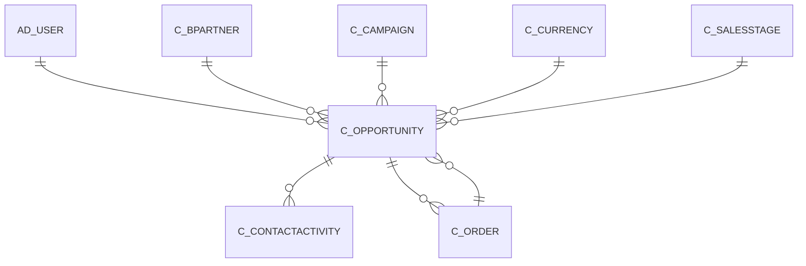

# C_OPPORTUNITY

Area [C](../../data-model/c/index.md) · class **business** (proposed) · read from database `idempiere-db` (owner `ADEMPIERE`) · 0 row(s) when profiled

Application model: `org.compiere.model.X_C_Opportunity`, access level 3 - Client - Org.

## Columns

| column | type | key | not null | business name | references (code) | nulls | distinct |
|---|---|---|---|---|---|---|---|
| `C_OPPORTUNITY_ID` | NUMBER(10,0) | PK | yes | Sales Opportunity |  | 0 | 0 |
| `AD_CLIENT_ID` | NUMBER(10,0) |  | yes | Tenant |  | 0 | 0 |
| `AD_ORG_ID` | NUMBER(10,0) |  | yes | Organization |  | 0 | 0 |
| `CREATED` | DATE |  | yes | Created |  | 0 | 0 |
| `CREATEDBY` | NUMBER(10,0) |  | yes | Created By |  | 0 | 0 |
| `DESCRIPTION` | VARCHAR2(255 CHAR) |  |  | Description |  | 0 | 0 |
| `ISACTIVE` | CHAR(1) |  | yes | Active |  | 0 | 0 |
| `UPDATED` | DATE |  | yes | Updated |  | 0 | 0 |
| `UPDATEDBY` | NUMBER(10,0) |  | yes | Updated By |  | 0 | 0 |
| `DOCUMENTNO` | VARCHAR2(60 CHAR) |  | yes | Document No |  | 0 | 0 |
| `C_BPARTNER_ID` | NUMBER(10,0) |  | yes | Business Partner | [C_BPARTNER](../../data-model/c/c_bpartner.md) | 0 | 0 |
| `AD_USER_ID` | NUMBER(10,0) |  |  | User/Contact | [AD_USER](../../data-model/ad/ad_user.md) | 0 | 0 |
| `C_CAMPAIGN_ID` | NUMBER(10,0) |  |  | Campaign | [C_CAMPAIGN](../../data-model/c/c_campaign.md) | 0 | 0 |
| `CLOSEDATE` | DATE |  |  | Close Date |  | 0 | 0 |
| `EXPECTEDCLOSEDATE` | DATE |  | yes | Expected Close Date |  | 0 | 0 |
| `SALESREP_ID` | NUMBER(10,0) |  |  | Sales Representative | [AD_USER](../../data-model/ad/ad_user.md) | 0 | 0 |
| `OPPORTUNITYAMT` | NUMBER |  | yes | Opportunity Amount |  | 0 | 0 |
| `COMMENTS` | CLOB |  |  | Comments |  | 0 |  |
| `C_CURRENCY_ID` | NUMBER(10,0) |  | yes | Currency | [C_CURRENCY](../../data-model/c/c_currency.md) | 0 | 0 |
| `COST` | NUMBER |  |  | Cost |  | 0 | 0 |
| `C_SALESSTAGE_ID` | NUMBER(10,0) |  | yes | Sales Stage | [C_SALESSTAGE](../../data-model/c/c_salesstage.md) | 0 | 0 |
| `PROBABILITY` | NUMBER |  | yes | Probability |  | 0 | 0 |
| `C_ORDER_ID` | NUMBER(10,0) |  |  | Order | [C_ORDER](../../data-model/c/c_order.md) | 0 | 0 |
| `C_OPPORTUNITY_UU` | VARCHAR2(36 CHAR) |  |  | C_Opportunity_UU |  | 0 | 0 |

*references (code)* is the table the application model's code says a column points to; *Foreign keys* below are the constraints the database declares. Counts come from the profile; no value is ever shown.

## Check constraints

| name | expression |
|---|---|
| `SYS_C0021384` | `IsActive IN ('Y','N')` |

## Foreign keys

**References**

| table | columns | on delete |
|---|---|---|
| [AD_USER](../../data-model/ad/ad_user.md) | C_OPPORTUNITY.AD_USER_ID → AD_USER.AD_USER_ID | NO ACTION |
| [C_BPARTNER](../../data-model/c/c_bpartner.md) | C_OPPORTUNITY.C_BPARTNER_ID → C_BPARTNER.C_BPARTNER_ID | NO ACTION |
| [C_CAMPAIGN](../../data-model/c/c_campaign.md) | C_OPPORTUNITY.C_CAMPAIGN_ID → C_CAMPAIGN.C_CAMPAIGN_ID | NO ACTION |
| [C_CURRENCY](../../data-model/c/c_currency.md) | C_OPPORTUNITY.C_CURRENCY_ID → C_CURRENCY.C_CURRENCY_ID | NO ACTION |
| [C_ORDER](../../data-model/c/c_order.md) | C_OPPORTUNITY.C_ORDER_ID → C_ORDER.C_ORDER_ID | NO ACTION |
| [C_SALESSTAGE](../../data-model/c/c_salesstage.md) | C_OPPORTUNITY.C_SALESSTAGE_ID → C_SALESSTAGE.C_SALESSTAGE_ID | NO ACTION |

**Referenced by**

| table | columns | on delete |
|---|---|---|
| [C_CONTACTACTIVITY](../../data-model/c/c_contactactivity.md) | C_CONTACTACTIVITY.C_OPPORTUNITY_ID → C_OPPORTUNITY.C_OPPORTUNITY_ID | NO ACTION |
| [C_ORDER](../../data-model/c/c_order.md) | C_ORDER.C_OPPORTUNITY_ID → C_OPPORTUNITY.C_OPPORTUNITY_ID | NO ACTION |

## Write behaviour

- updates: **po_only**
- deletes: **deleted_by_users**
- change log: **recorded**
- evidence: 1 citation(s)

## Schema history

83 change(s); the latest:

| applied | release | operation | column | tickets |
|---|---|---|---|---|
| 2020-08-04T01:00 | i7.1z | `modify_column` | DOCUMENTNO | IDEMPIERE-3862 |
| 2020-08-04T01:00 | i7.1z | `modify_column` | DOCUMENTNO | IDEMPIERE-3862 |
| 2020-08-04T01:00 | i7.1z | `drop_column` | tmp_col_1_tmp | IDEMPIERE-3862 |
| 2020-08-04T01:00 | i7.1z | `drop_column` | tmp_col_3_tmp | IDEMPIERE-3862 |
| 2020-08-04T01:00 | i7.1z | `add_column` | tmp_col_1_tmp | IDEMPIERE-3862 |
| 2020-08-04T01:00 | i7.1z | `modify_column` | DESCRIPTION | IDEMPIERE-3862 |
| 2020-08-04T01:00 | i7.1z | `drop_column` | tmp_col_2_tmp | IDEMPIERE-3862 |
| 2020-08-04T01:00 | i7.1z | `modify_column` | DOCUMENTNO | IDEMPIERE-3862 |
| 2020-08-04T01:00 | i7.1z | `add_column` | tmp_col_2_tmp | IDEMPIERE-3862 |
| 2020-08-04T01:00 | i7.1z | `modify_column` | C_OPPORTUNITY_UU | IDEMPIERE-3862 |
| 2020-08-04T01:00 | i7.1z | `add_column` | tmp_col_3_tmp | IDEMPIERE-3862 |
| 2014-05-02T10:09 | i2.0 | `modify_column` | created | IDEMPIERE-709 |
| 2014-05-02T10:09 | i2.0 | `modify_column` | updated | IDEMPIERE-709 |
| 2014-04-17T15:00 | i2.0 | `modify_column` | created | IDEMPIERE-709 |
| 2014-04-17T15:00 | i2.0 | `modify_column` | updated | IDEMPIERE-709 |

## Notes

<!-- ekos:manual id="table.c_opportunity.notes" -->
_Business notes about this table._
<!-- /ekos:manual -->
