# C_ORDER

Sales & Purchase Order

Area [C](../../data-model/c/index.md) · class **business** (proposed) · read from database `idempiere-db` (owner `ADEMPIERE`) · 8 row(s) when profiled

Application model: `org.compiere.model.X_C_Order`, access level 1 - Org.

## Columns

| column | type | key | not null | business name | references (code) | nulls | distinct |
|---|---|---|---|---|---|---|---|
| `C_ORDER_ID` | NUMBER(10,0) | PK | yes | Order |  | 0 | 8 |
| `AD_CLIENT_ID` | NUMBER(10,0) |  | yes | Tenant |  | 0 | 1 |
| `AD_ORG_ID` | NUMBER(10,0) |  | yes | Organization |  | 0 | 1 |
| `ISACTIVE` | CHAR(1) |  | yes | Active |  | 0 | 1 |
| `CREATED` | DATE |  | yes | Created |  | 0 | 8 |
| `CREATEDBY` | NUMBER(10,0) |  | yes | Created By |  | 0 | 1 |
| `UPDATED` | DATE |  | yes | Updated |  | 0 | 8 |
| `UPDATEDBY` | NUMBER(10,0) |  | yes | Updated By |  | 0 | 2 |
| `ISSOTRX` | CHAR(1) |  | yes | Sales Transaction |  | 0 | 2 |
| `DOCUMENTNO` | VARCHAR2(30 CHAR) |  | yes | Document No |  | 0 | 8 |
| `DOCSTATUS` | CHAR(2) |  | yes | Document Status |  | 0 | 2 |
| `DOCACTION` | CHAR(2) |  | yes | Document Action |  | 0 | 2 |
| `PROCESSING` | CHAR(1) |  |  | Process Now |  | 0 | 1 |
| `PROCESSED` | CHAR(1) |  | yes | Processed |  | 0 | 1 |
| `C_DOCTYPE_ID` | NUMBER(10,0) |  | yes | Document Type | [C_DOCTYPE](../../data-model/c/c_doctype.md) | 0 | 3 |
| `C_DOCTYPETARGET_ID` | NUMBER(10,0) |  | yes | Target Document Type | [C_DOCTYPE](../../data-model/c/c_doctype.md) | 0 | 3 |
| `DESCRIPTION` | VARCHAR2(255 CHAR) |  |  | Description |  | 1 | 5 |
| `ISAPPROVED` | CHAR(1) |  | yes | Approved |  | 0 | 1 |
| `ISCREDITAPPROVED` | CHAR(1) |  | yes | Credit Approved |  | 0 | 1 |
| `ISDELIVERED` | CHAR(1) |  | yes | Delivered |  | 0 | 2 |
| `ISINVOICED` | CHAR(1) |  | yes | Invoiced |  | 0 | 2 |
| `ISPRINTED` | CHAR(1) |  | yes | Printed |  | 0 | 1 |
| `ISTRANSFERRED` | CHAR(1) |  | yes | Transferred |  | 0 | 1 |
| `ISSELECTED` | CHAR(1) |  | yes | Selected |  | 0 | 1 |
| `SALESREP_ID` | NUMBER(10,0) |  |  | Sales Representative | [AD_USER](../../data-model/ad/ad_user.md) | 0 | 2 |
| `DATEORDERED` | DATE |  | yes | Date Ordered |  | 0 | 4 |
| `DATEPROMISED` | DATE |  |  | Date Promised |  | 0 | 4 |
| `DATEPRINTED` | DATE |  |  | Date Printed |  | 8 | 0 |
| `DATEACCT` | DATE |  | yes | Account Date |  | 0 | 4 |
| `C_BPARTNER_ID` | NUMBER(10,0) |  | yes | Business Partner | [C_BPARTNER](../../data-model/c/c_bpartner.md) | 0 | 6 |
| `C_BPARTNER_LOCATION_ID` | NUMBER(10,0) |  | yes | Partner Location | [C_BPARTNER_LOCATION](../../data-model/c/c_bpartner_location.md) | 0 | 6 |
| `POREFERENCE` | VARCHAR2(20 CHAR) |  |  | Order Reference |  | 7 | 1 |
| `ISDISCOUNTPRINTED` | CHAR(1) |  | yes | Discount Printed |  | 0 | 1 |
| `C_CURRENCY_ID` | NUMBER(10,0) |  | yes | Currency | [C_CURRENCY](../../data-model/c/c_currency.md) | 0 | 2 |
| `PAYMENTRULE` | CHAR(1) |  | yes | Payment Rule |  | 0 | 2 |
| `C_PAYMENTTERM_ID` | NUMBER(10,0) |  | yes | Payment Term | [C_PAYMENTTERM](../../data-model/c/c_paymentterm.md) | 0 | 4 |
| `INVOICERULE` | CHAR(1) |  | yes | Invoice Rule |  | 0 | 2 |
| `DELIVERYRULE` | CHAR(1) |  | yes | Delivery Rule |  | 0 | 1 |
| `FREIGHTCOSTRULE` | CHAR(1) |  | yes | Freight Cost Rule |  | 0 | 1 |
| `FREIGHTAMT` | NUMBER |  |  | Freight Amount |  | 0 | 1 |
| `DELIVERYVIARULE` | CHAR(1) |  | yes | Delivery Via |  | 0 | 1 |
| `M_SHIPPER_ID` | NUMBER(10,0) |  |  | Shipper | [M_SHIPPER](../../data-model/m/m_shipper.md) | 8 | 0 |
| `C_CHARGE_ID` | NUMBER(10,0) |  |  | Charge | [C_CHARGE](../../data-model/c/c_charge.md) | 8 | 0 |
| `CHARGEAMT` | NUMBER |  |  | Charge amount |  | 0 | 1 |
| `PRIORITYRULE` | CHAR(1) |  | yes | Priority |  | 0 | 2 |
| `TOTALLINES` | NUMBER |  | yes | Total Lines |  | 0 | 8 |
| `GRANDTOTAL` | NUMBER |  | yes | Grand Total |  | 0 | 8 |
| `M_WAREHOUSE_ID` | NUMBER(10,0) |  | yes | Warehouse | [M_WAREHOUSE](../../data-model/m/m_warehouse.md) | 0 | 1 |
| `M_PRICELIST_ID` | NUMBER(10,0) |  | yes | Price List | [M_PRICELIST](../../data-model/m/m_pricelist.md) | 0 | 3 |
| `ISTAXINCLUDED` | CHAR(1) |  | yes | Price includes Tax |  | 0 | 1 |
| `C_CAMPAIGN_ID` | NUMBER(10,0) |  |  | Campaign | [C_CAMPAIGN](../../data-model/c/c_campaign.md) | 8 | 0 |
| `C_PROJECT_ID` | NUMBER(10,0) |  |  | Project | [C_PROJECT](../../data-model/c/c_project.md) | 8 | 0 |
| `C_ACTIVITY_ID` | NUMBER(10,0) |  |  | Activity | [C_ACTIVITY](../../data-model/c/c_activity.md) | 8 | 0 |
| `POSTED` | CHAR(1) |  | yes | Posted |  | 0 | 1 |
| `C_PAYMENT_ID` | NUMBER(10,0) |  |  | Payment | [C_PAYMENT](../../data-model/c/c_payment.md) | 7 | 1 |
| `C_CASHLINE_ID` | NUMBER(10,0) |  |  | Cash Journal Line | [C_CASHLINE](../../data-model/c/c_cashline.md) | 6 | 2 |
| `SENDEMAIL` | CHAR(1) |  | yes | Send EMail |  | 0 | 1 |
| `AD_USER_ID` | NUMBER(10,0) |  |  | User/Contact | [AD_USER](../../data-model/ad/ad_user.md) | 6 | 1 |
| `COPYFROM` | CHAR(1) |  |  | Copy From |  | 6 | 1 |
| `ISSELFSERVICE` | CHAR(1) |  | yes | Self-Service |  | 0 | 1 |
| `AD_ORGTRX_ID` | NUMBER(10,0) |  |  | Trx Organization |  | 8 | 0 |
| `USER1_ID` | NUMBER(10,0) |  |  | User Element List 1 | [C_ELEMENTVALUE](../../data-model/c/c_elementvalue.md) | 8 | 0 |
| `USER2_ID` | NUMBER(10,0) |  |  | User Element List 2 | [C_ELEMENTVALUE](../../data-model/c/c_elementvalue.md) | 8 | 0 |
| `C_CONVERSIONTYPE_ID` | NUMBER(10,0) |  |  | Currency Type | [C_CONVERSIONTYPE](../../data-model/c/c_conversiontype.md) | 6 | 1 |
| `BILL_BPARTNER_ID` | NUMBER(10,0) |  |  | Invoice Partner | [C_BPARTNER](../../data-model/c/c_bpartner.md) | 0 | 6 |
| `BILL_LOCATION_ID` | NUMBER(10,0) |  |  | Invoice Location | [C_BPARTNER_LOCATION](../../data-model/c/c_bpartner_location.md) | 0 | 6 |
| `BILL_USER_ID` | NUMBER(10,0) |  |  | Invoice Contact | [AD_USER](../../data-model/ad/ad_user.md) | 7 | 1 |
| `PAY_BPARTNER_ID` | NUMBER(10,0) |  |  | Payment BPartner |  | 8 | 0 |
| `PAY_LOCATION_ID` | NUMBER(10,0) |  |  | Payment Location |  | 8 | 0 |
| `REF_ORDER_ID` | NUMBER(10,0) |  |  | Referenced Order | [C_ORDER](../../data-model/c/c_order.md) | 8 | 0 |
| `ISDROPSHIP` | CHAR(1) |  | yes | Drop Shipment |  | 0 | 1 |
| `VOLUME` | NUMBER |  |  | Volume |  | 7 | 1 |
| `WEIGHT` | NUMBER |  |  | Weight |  | 7 | 1 |
| `ORDERTYPE` | VARCHAR2(510 CHAR) |  |  |  |  | 8 | 0 |
| `C_POS_ID` | NUMBER(10,0) |  |  | POS Terminal | [C_POS](../../data-model/c/c_pos.md) | 8 | 0 |
| `AMOUNTTENDERED` | NUMBER(22,2) |  |  | Amount Tendered |  | 8 | 0 |
| `AMOUNTREFUNDED` | NUMBER(22,2) |  |  | Amount Refunded |  | 8 | 0 |
| `LINK_ORDER_ID` | NUMBER(10,0) |  |  | Linked Order | [C_ORDER](../../data-model/c/c_order.md) | 8 | 0 |
| `M_FREIGHTCATEGORY_ID` | NUMBER(10,0) |  |  | Freight Category | [M_FREIGHTCATEGORY](../../data-model/m/m_freightcategory.md) | 8 | 0 |
| `DROPSHIP_BPARTNER_ID` | NUMBER(10,0) |  |  | Drop Ship Business Partner | [C_BPARTNER](../../data-model/c/c_bpartner.md) | 8 | 0 |
| `DROPSHIP_LOCATION_ID` | NUMBER(10,0) |  |  | Drop Shipment Location | [C_BPARTNER_LOCATION](../../data-model/c/c_bpartner_location.md) | 8 | 0 |
| `DROPSHIP_USER_ID` | NUMBER(10,0) |  |  | Drop Shipment Contact | [AD_USER](../../data-model/ad/ad_user.md) | 8 | 0 |
| `PROMOTIONCODE` | VARCHAR2(30 CHAR) |  |  | Promotion Code |  | 8 | 0 |
| `C_ORDERSOURCE_ID` | NUMBER(10,0) |  |  | Order Source | [C_ORDERSOURCE](../../data-model/c/c_ordersource.md) | 8 | 0 |
| `PROCESSEDON` | NUMBER |  |  | Processed On |  | 0 | 8 |
| `ISPAYSCHEDULEVALID` | CHAR(1) |  | yes | Pay Schedule valid |  | 0 | 1 |
| `C_CASHPLANLINE_ID` | NUMBER(10,0) |  |  | Cash Plan Line | [C_CASHPLANLINE](../../data-model/c/c_cashplanline.md) | 8 | 0 |
| `C_ORDER_UU` | VARCHAR2(36 CHAR) |  |  | C_Order_UU |  | 0 | 8 |
| `SHIPPINGRATEINQUIRY` | CHAR(1) |  |  | Rate Inquiry |  | 8 | 0 |
| `ISPRIVILEDGEDRATE` | CHAR(1) |  | yes | Privileged Rate |  | 0 | 1 |
| `C_OPPORTUNITY_ID` | NUMBER(10,0) |  |  | Sales Opportunity | [C_OPPORTUNITY](../../data-model/c/c_opportunity.md) | 8 | 0 |
| `QUOTATIONORDER_ID` | NUMBER(10,0) |  |  | Quotation | [C_ORDER](../../data-model/c/c_order.md) | 8 | 0 |

*references (code)* is the table the application model's code says a column points to; *Foreign keys* below are the constraints the database declares. Counts come from the profile; no value is ever shown.

## Check constraints

| name | expression |
|---|---|
| `SYS_C0022935` | `IsInvoiced in ('Y','N')` |
| `SYS_C0022937` | `IsPayScheduleValid IN ('Y','N')` |
| `SYS_C0022938` | `IsApproved in ('Y','N')` |
| `SYS_C0022939` | `IsCreditApproved in ('Y','N')` |
| `SYS_C0022940` | `IsPriviledgedRate IN ('Y','N')` |
| `SYS_C0022941` | `IsSelected in ('Y','N')` |
| `SYS_C0022942` | `IsDiscountPrinted in ('Y','N')` |
| `SYS_C0022943` | `IsTaxIncluded in ('Y','N')` |
| `SYS_C0022944` | `IsSOTrx in ('Y','N')` |
| `SYS_C0022945` | `IsActive in ('Y','N')` |
| `SYS_C0022946` | `IsTransferred in ('Y','N')` |
| `SYS_C0022947` | `IsPrinted in ('Y','N')` |
| `SYS_C0022949` | `Processed in ('Y','N')` |
| `SYS_C0022950` | `IsDelivered in ('Y','N')` |

## Foreign keys

**References**

| table | columns | on delete |
|---|---|---|
| [AD_ORG](../../data-model/ad/ad_org.md) | C_ORDER.AD_ORGTRX_ID → AD_ORG.AD_ORG_ID | NO ACTION |
| [AD_USER](../../data-model/ad/ad_user.md) | C_ORDER.BILL_USER_ID → AD_USER.AD_USER_ID | NO ACTION |
| [C_ACTIVITY](../../data-model/c/c_activity.md) | C_ORDER.C_ACTIVITY_ID → C_ACTIVITY.C_ACTIVITY_ID | NO ACTION |
| [C_BPARTNER](../../data-model/c/c_bpartner.md) | C_ORDER.BILL_BPARTNER_ID → C_BPARTNER.C_BPARTNER_ID | NO ACTION |
| [C_BPARTNER_LOCATION](../../data-model/c/c_bpartner_location.md) | C_ORDER.C_BPARTNER_LOCATION_ID → C_BPARTNER_LOCATION.C_BPARTNER_LOCATION_ID | NO ACTION |
| [C_CAMPAIGN](../../data-model/c/c_campaign.md) | C_ORDER.C_CAMPAIGN_ID → C_CAMPAIGN.C_CAMPAIGN_ID | NO ACTION |
| [C_CASHLINE](../../data-model/c/c_cashline.md) | C_ORDER.C_CASHLINE_ID → C_CASHLINE.C_CASHLINE_ID | NO ACTION |
| [C_CASHPLANLINE](../../data-model/c/c_cashplanline.md) | C_ORDER.C_CASHPLANLINE_ID → C_CASHPLANLINE.C_CASHPLANLINE_ID | NO ACTION |
| [C_CHARGE](../../data-model/c/c_charge.md) | C_ORDER.C_CHARGE_ID → C_CHARGE.C_CHARGE_ID | NO ACTION |
| [C_CONVERSIONTYPE](../../data-model/c/c_conversiontype.md) | C_ORDER.C_CONVERSIONTYPE_ID → C_CONVERSIONTYPE.C_CONVERSIONTYPE_ID | NO ACTION |
| [C_CURRENCY](../../data-model/c/c_currency.md) | C_ORDER.C_CURRENCY_ID → C_CURRENCY.C_CURRENCY_ID | NO ACTION |
| [C_DOCTYPE](../../data-model/c/c_doctype.md) | C_ORDER.C_DOCTYPETARGET_ID → C_DOCTYPE.C_DOCTYPE_ID | NO ACTION |
| [C_ELEMENTVALUE](../../data-model/c/c_elementvalue.md) | C_ORDER.USER2_ID → C_ELEMENTVALUE.C_ELEMENTVALUE_ID | NO ACTION |
| [C_OPPORTUNITY](../../data-model/c/c_opportunity.md) | C_ORDER.C_OPPORTUNITY_ID → C_OPPORTUNITY.C_OPPORTUNITY_ID | NO ACTION |
| [C_ORDER](../../data-model/c/c_order.md) | C_ORDER.REF_ORDER_ID → C_ORDER.C_ORDER_ID | NO ACTION |
| [C_ORDERSOURCE](../../data-model/c/c_ordersource.md) | C_ORDER.C_ORDERSOURCE_ID → C_ORDERSOURCE.C_ORDERSOURCE_ID | NO ACTION |
| [C_PAYMENT](../../data-model/c/c_payment.md) | C_ORDER.C_PAYMENT_ID → C_PAYMENT.C_PAYMENT_ID | NO ACTION |
| [C_PAYMENTTERM](../../data-model/c/c_paymentterm.md) | C_ORDER.C_PAYMENTTERM_ID → C_PAYMENTTERM.C_PAYMENTTERM_ID | NO ACTION |
| [C_POS](../../data-model/c/c_pos.md) | C_ORDER.C_POS_ID → C_POS.C_POS_ID | NO ACTION |
| [C_PROJECT](../../data-model/c/c_project.md) | C_ORDER.C_PROJECT_ID → C_PROJECT.C_PROJECT_ID | NO ACTION |
| [M_FREIGHTCATEGORY](../../data-model/m/m_freightcategory.md) | C_ORDER.M_FREIGHTCATEGORY_ID → M_FREIGHTCATEGORY.M_FREIGHTCATEGORY_ID | NO ACTION |
| [M_PRICELIST](../../data-model/m/m_pricelist.md) | C_ORDER.M_PRICELIST_ID → M_PRICELIST.M_PRICELIST_ID | NO ACTION |
| [M_SHIPPER](../../data-model/m/m_shipper.md) | C_ORDER.M_SHIPPER_ID → M_SHIPPER.M_SHIPPER_ID | NO ACTION |
| [M_WAREHOUSE](../../data-model/m/m_warehouse.md) | C_ORDER.M_WAREHOUSE_ID → M_WAREHOUSE.M_WAREHOUSE_ID | NO ACTION |

**Referenced by**

| table | columns | on delete |
|---|---|---|
| [B_BUYERFUNDS](../../data-model/b/b_buyerfunds.md) | B_BUYERFUNDS.C_ORDER_ID → C_ORDER.C_ORDER_ID | NO ACTION |
| [B_SELLERFUNDS](../../data-model/b/b_sellerfunds.md) | B_SELLERFUNDS.C_ORDER_ID → C_ORDER.C_ORDER_ID | NO ACTION |
| [C_ALLOCATIONLINE](../../data-model/c/c_allocationline.md) | C_ALLOCATIONLINE.C_ORDER_ID → C_ORDER.C_ORDER_ID | NO ACTION |
| [C_INVOICE](../../data-model/c/c_invoice.md) | C_INVOICE.C_ORDER_ID → C_ORDER.C_ORDER_ID | NO ACTION |
| [C_OPPORTUNITY](../../data-model/c/c_opportunity.md) | C_OPPORTUNITY.C_ORDER_ID → C_ORDER.C_ORDER_ID | NO ACTION |
| [C_ORDER](../../data-model/c/c_order.md) | C_ORDER.REF_ORDER_ID → C_ORDER.C_ORDER_ID | NO ACTION |
| [C_ORDERLANDEDCOST](../../data-model/c/c_orderlandedcost.md) | C_ORDERLANDEDCOST.C_ORDER_ID → C_ORDER.C_ORDER_ID | NO ACTION |
| [C_ORDERLINE](../../data-model/c/c_orderline.md) | C_ORDERLINE.C_ORDER_ID → C_ORDER.C_ORDER_ID | NO ACTION |
| [C_ORDERPAYSCHEDULE](../../data-model/c/c_orderpayschedule.md) | C_ORDERPAYSCHEDULE.C_ORDER_ID → C_ORDER.C_ORDER_ID | NO ACTION |
| [C_ORDERTAX](../../data-model/c/c_ordertax.md) | C_ORDERTAX.C_ORDER_ID → C_ORDER.C_ORDER_ID | CASCADE |
| [C_PAYMENT](../../data-model/c/c_payment.md) | C_PAYMENT.C_ORDER_ID → C_ORDER.C_ORDER_ID | NO ACTION |
| [C_PAYMENTTRANSACTION](../../data-model/c/c_paymenttransaction.md) | C_PAYMENTTRANSACTION.C_ORDER_ID → C_ORDER.C_ORDER_ID | NO ACTION |
| [C_POSPAYMENT](../../data-model/c/c_pospayment.md) | C_POSPAYMENT.C_ORDER_ID → C_ORDER.C_ORDER_ID | NO ACTION |
| [C_PROJECTLINE](../../data-model/c/c_projectline.md) | C_PROJECTLINE.C_ORDERPO_ID → C_ORDER.C_ORDER_ID | NO ACTION |
| [C_PROJECTPHASE](../../data-model/c/c_projectphase.md) | C_PROJECTPHASE.C_ORDER_ID → C_ORDER.C_ORDER_ID | NO ACTION |
| [C_RECURRING](../../data-model/c/c_recurring.md) | C_RECURRING.C_ORDER_ID → C_ORDER.C_ORDER_ID | NO ACTION |
| [C_RECURRING_RUN](../../data-model/c/c_recurring_run.md) | C_RECURRING_RUN.C_ORDER_ID → C_ORDER.C_ORDER_ID | NO ACTION |
| [C_RFQ](../../data-model/c/c_rfq.md) | C_RFQ.C_ORDER_ID → C_ORDER.C_ORDER_ID | NO ACTION |
| [C_RFQRESPONSE](../../data-model/c/c_rfqresponse.md) | C_RFQRESPONSE.C_ORDER_ID → C_ORDER.C_ORDER_ID | NO ACTION |
| [DD_ORDER](../../data-model/dd/dd_order.md) | DD_ORDER.C_ORDER_ID → C_ORDER.C_ORDER_ID | NO ACTION |
| `I_ORDER` | I_ORDER.C_ORDER_ID → C_ORDER.C_ORDER_ID | SET NULL |
| [M_INOUT](../../data-model/m/m_inout.md) | M_INOUT.C_ORDER_ID → C_ORDER.C_ORDER_ID | NO ACTION |
| [M_RMA](../../data-model/m/m_rma.md) | M_RMA.C_ORDER_ID → C_ORDER.C_ORDER_ID | NO ACTION |
| [M_SHIPPINGTRANSACTION](../../data-model/m/m_shippingtransaction.md) | M_SHIPPINGTRANSACTION.C_ORDER_ID → C_ORDER.C_ORDER_ID | NO ACTION |
| [PP_MRP](../../data-model/pp/pp_mrp.md) | PP_MRP.C_ORDER_ID → C_ORDER.C_ORDER_ID | NO ACTION |
| [R_REQUEST](../../data-model/r/r_request.md) | R_REQUEST.C_ORDER_ID → C_ORDER.C_ORDER_ID | NO ACTION |
| [R_REQUESTACTION](../../data-model/r/r_requestaction.md) | R_REQUESTACTION.C_ORDER_ID → C_ORDER.C_ORDER_ID | NO ACTION |

```mermaid
erDiagram
  AD_ORG ||--o{ C_ORDER : ""
  AD_USER ||--o{ C_ORDER : ""
  C_ACTIVITY ||--o{ C_ORDER : ""
  C_BPARTNER ||--o{ C_ORDER : ""
  C_BPARTNER_LOCATION ||--o{ C_ORDER : ""
  C_CAMPAIGN ||--o{ C_ORDER : ""
  C_CASHLINE ||--o{ C_ORDER : ""
  C_CASHPLANLINE ||--o{ C_ORDER : ""
  C_CHARGE ||--o{ C_ORDER : ""
  C_CONVERSIONTYPE ||--o{ C_ORDER : ""
  C_CURRENCY ||--o{ C_ORDER : ""
  C_DOCTYPE ||--o{ C_ORDER : ""
  C_ELEMENTVALUE ||--o{ C_ORDER : ""
  C_OPPORTUNITY ||--o{ C_ORDER : ""
  C_ORDER ||--o{ B_BUYERFUNDS : ""
  C_ORDER ||--o{ B_SELLERFUNDS : ""
  C_ORDER ||--o{ C_ALLOCATIONLINE : ""
  C_ORDER ||--o{ C_INVOICE : ""
  C_ORDER ||--o{ C_OPPORTUNITY : ""
  C_ORDER ||--o{ C_ORDER : ""
  C_ORDER ||--o{ C_ORDERLANDEDCOST : ""
  C_ORDER ||--o{ C_ORDERLINE : ""
  C_ORDER ||--o{ C_ORDERPAYSCHEDULE : ""
  C_ORDER ||--o{ C_ORDERTAX : ""
  C_ORDER ||--o{ C_PAYMENT : ""
  C_ORDER ||--o{ C_PAYMENTTRANSACTION : ""
  C_ORDER ||--o{ C_POSPAYMENT : ""
  C_ORDERSOURCE ||--o{ C_ORDER : ""
  C_PAYMENT ||--o{ C_ORDER : ""
  C_PAYMENTTERM ||--o{ C_ORDER : ""
  C_POS ||--o{ C_ORDER : ""
  C_PROJECT ||--o{ C_ORDER : ""
```

18 more neighbour(s) not drawn.

## Write behaviour

- updates: **raw_sql_skips_updated**
- deletes: **deleted_by_app, deleted_by_users**
- change log: **recorded**
- evidence: 6 citation(s)

## Read by

| kind | name |
|---|---|
| Procedure | [documentNo](../../logic/documentno.md) |
| View | `C_INVOICE_CANDIDATE_V` |
| View | `C_INVOICE_CREATEFROM_V` |
| View | `C_ORDER_HEADER_V` |
| View | `C_ORDER_HEADER_VT` |
| View | `C_ORDER_LINETAX_V` |
| View | `C_ORDER_LINETAX_VT` |
| View | `M_INOUT_CANDIDATE_V` |
| View | `M_INOUT_CREATEFROM_V` |
| View | `RV_COMMISSIONRUNDETAIL` |
| View | `RV_ORDERDETAIL` |
| View | `RV_UNPOSTED` |
| View | `RV_UNPROCESSED` |
| View | `c_invoice_candidate_v` |
| View | `c_invoice_createfrom_v` |
| View | `c_order_header_v` |
| View | `c_order_header_vt` |
| View | `c_order_linetax_v` |
| View | `c_order_linetax_vt` |
| View | `m_inout_candidate_v` |
| View | `m_inout_createfrom_v` |
| View | `rv_commissionrundetail` |
| View | `rv_orderdetail` |
| View | `rv_unposted` |
| View | `rv_unprocessed` |

## Schema history

129 change(s); the latest:

| applied | release | operation | column | tickets |
|---|---|---|---|---|
| 2024-05-14T13:59 | iD13 | `add_constraint` |  | IDEMPIERE-5598 |
| 2024-05-14T13:59 | iD13 | `add_constraint` |  | IDEMPIERE-5598 |
| 2024-05-14T13:59 | iD13 | `add_column` | C_Department_ID | IDEMPIERE-5598 |
| 2024-05-14T13:59 | iD13 | `add_constraint` |  | IDEMPIERE-5598 |
| 2024-05-14T13:59 | iD13 | `add_column` | C_Department_ID | IDEMPIERE-5598 |
| 2024-05-14T13:59 | iD13 | `add_constraint` |  | IDEMPIERE-5598 |
| 2024-05-14T13:59 | iD13 | `add_column` | C_CostCenter_ID | IDEMPIERE-5598 |
| 2024-05-14T13:59 | iD13 | `add_column` | C_CostCenter_ID | IDEMPIERE-5598 |
| 2023-06-21T18:41 | iD10 | `add_constraint` |  | IDEMPIERE-5747 |
| 2023-06-21T18:41 | iD10 | `drop_constraint` |  | IDEMPIERE-5747 |
| 2023-06-21T18:41 | iD10 | `add_constraint` |  | IDEMPIERE-5747 |
| 2023-06-21T18:41 | iD10 | `drop_constraint` |  | IDEMPIERE-5747 |
| 2023-04-09T15:47 | iD11 | `add_constraint` |  | IDEMPIERE-5567 |
| 2023-04-09T15:47 | iD11 | `add_constraint` |  | IDEMPIERE-5567 |
| 2022-08-11T15:53 | i9 | `modify_column` | IsApproved | IDEMPIERE-5372 |

## Open conflicts

| type | attribute | explanation |
|---|---|---|
| `model_column_missing` | `columns.C_CostCenter_ID` | unexplained |
| `model_column_missing` | `columns.C_Department_ID` | unexplained |
| `mandatory_but_nullable` | `columns.DatePromised.nullable` | unexplained |
| `mandatory_but_nullable` | `columns.FreightAmt.nullable` | unexplained |
| `mandatory_but_nullable` | `columns.SalesRep_ID.nullable` | unexplained |

## Notes

<!-- ekos:manual id="table.c_order.notes" -->
_Business notes about this table._
<!-- /ekos:manual -->
