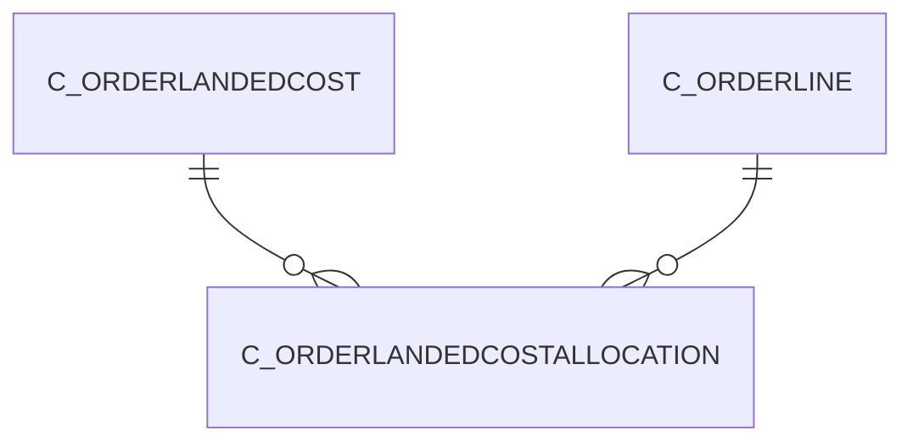

# C_ORDERLANDEDCOSTALLOCATION

Area [C](../../data-model/c/index.md) · class **business** (proposed) · read from database `idempiere-db` (owner `ADEMPIERE`) · 0 row(s) when profiled

Application model: `org.compiere.model.X_C_OrderLandedCostAllocation`, access level 1 - Org.

## Columns

| column | type | key | not null | business name | references (code) | nulls | distinct |
|---|---|---|---|---|---|---|---|
| `C_ORDERLANDEDCOSTALLOCATION_ID` | NUMBER(10,0) | PK | yes | Estimated Landed Cost Allocation |  | 0 | 0 |
| `AD_CLIENT_ID` | NUMBER(10,0) |  | yes | Tenant |  | 0 | 0 |
| `AD_ORG_ID` | NUMBER(10,0) |  | yes | Organization |  | 0 | 0 |
| `AMT` | NUMBER |  | yes | Amount |  | 0 | 0 |
| `BASE` | NUMBER |  | yes | Base |  | 0 | 0 |
| `C_ORDERLANDEDCOSTALLOCATION_UU` | VARCHAR2(36 CHAR) |  |  | C_OrderLandedCostAllocation_UU |  | 0 | 0 |
| `CREATED` | DATE |  | yes | Created |  | 0 | 0 |
| `CREATEDBY` | NUMBER(10,0) |  | yes | Created By |  | 0 | 0 |
| `QTY` | NUMBER |  | yes | Quantity |  | 0 | 0 |
| `UPDATED` | DATE |  | yes | Updated |  | 0 | 0 |
| `UPDATEDBY` | NUMBER(10,0) |  | yes | Updated By |  | 0 | 0 |
| `C_ORDERLANDEDCOST_ID` | NUMBER(10,0) |  | yes | Estimated Landed Cost | [C_ORDERLANDEDCOST](../../data-model/c/c_orderlandedcost.md) | 0 | 0 |
| `C_ORDERLINE_ID` | NUMBER(10,0) |  | yes | Sales Order Line | [C_ORDERLINE](../../data-model/c/c_orderline.md) | 0 | 0 |
| `ISACTIVE` | CHAR(1) |  | yes | Active |  | 0 | 0 |
| `PROCESSED` | CHAR(1) |  | yes | Processed |  | 0 | 0 |

*references (code)* is the table the application model's code says a column points to; *Foreign keys* below are the constraints the database declares. Counts come from the profile; no value is ever shown.

## Check constraints

| name | expression |
|---|---|
| `SYS_C0022852` | `IsActive IN ('Y','N')` |
| `SYS_C0022855` | `Processed IN ('Y','N')` |

## Foreign keys

**References**

| table | columns | on delete |
|---|---|---|
| [C_ORDERLANDEDCOST](../../data-model/c/c_orderlandedcost.md) | C_ORDERLANDEDCOSTALLOCATION.C_ORDERLANDEDCOST_ID → C_ORDERLANDEDCOST.C_ORDERLANDEDCOST_ID | NO ACTION |
| [C_ORDERLINE](../../data-model/c/c_orderline.md) | C_ORDERLANDEDCOSTALLOCATION.C_ORDERLINE_ID → C_ORDERLINE.C_ORDERLINE_ID | NO ACTION |

**Referenced by**

_None._

## Write behaviour

- updates: **po_only**
- deletes: **deleted_by_users**
- change log: **recorded**
- evidence: 1 citation(s)

## Schema history

47 change(s); the latest:

| applied | release | operation | column | tickets |
|---|---|---|---|---|
| 2020-08-04T01:00 | i7.1z | `drop_column` | tmp_col_1_tmp | IDEMPIERE-3862 |
| 2020-08-04T01:00 | i7.1z | `add_column` | tmp_col_1_tmp | IDEMPIERE-3862 |
| 2020-08-04T01:00 | i7.1z | `modify_column` | C_ORDERLANDEDCOSTALLOCATION_UU | IDEMPIERE-3862 |
| 2014-05-02T10:09 | i2.0 | `modify_column` | updated | IDEMPIERE-709 |
| 2014-05-02T10:09 | i2.0 | `modify_column` | created | IDEMPIERE-709 |
| 2014-04-17T15:00 | i2.0 | `modify_column` | updated | IDEMPIERE-709 |
| 2014-04-17T15:00 | i2.0 | `modify_column` | created | IDEMPIERE-709 |
| 2014-04-17T15:00 | i2.0 | `modify_column` | updated | IDEMPIERE-709 |
| 2014-04-17T15:00 | i2.0 | `modify_column` | created | IDEMPIERE-709 |
| 2014-04-17T15:00 | i2.0 | `modify_column` | updated | IDEMPIERE-709 |
| 2014-04-17T15:00 | i2.0 | `modify_column` | created | IDEMPIERE-709 |
| 2013-10-31T19:19 | i1.0z | `add_constraint` |  |  |
| 2013-10-31T19:19 | i1.0z | `add_constraint` |  |  |
| 2013-10-31T19:19 | i1.0z | `add_constraint` |  |  |
| 2013-10-31T19:19 | i1.0z | `add_constraint` |  |  |

## Notes

<!-- ekos:manual id="table.c_orderlandedcostallocation.notes" -->
_Business notes about this table._
<!-- /ekos:manual -->
